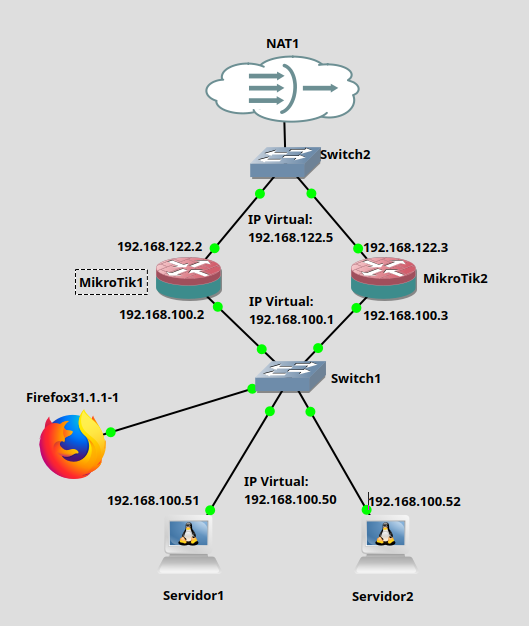
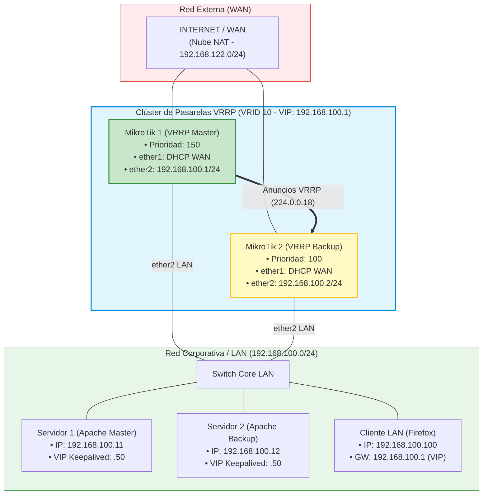
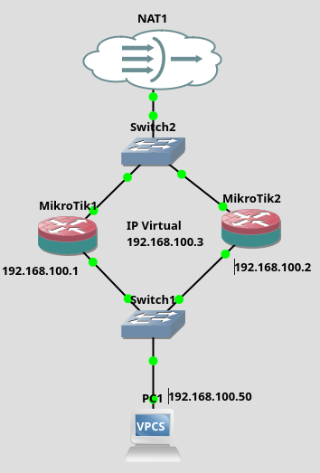
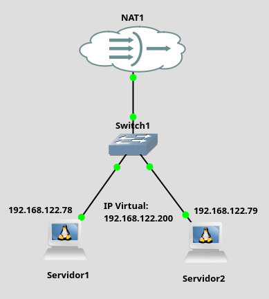

# Práctica 10.1: Redundancia y Tolerancia a Fallos de Pasarelas y Servicios Web con VRRP en MikroTik y Linux

!!! note "Datos de la Práctica"
    * **Módulo:** Seguridad y Alta Disponibilidad (SAD - 0378)
    * **Unidad Didáctica:** UD10 - Soluciones de Alta Disponibilidad
    * **Entorno de trabajo:** Emulador de red **GNS3** con las siguientes máquinas y appliances:
        1. **Dos Routers MikroTik RouterOS CHR (`MikroTik 1` y `MikroTik 2`):** Agrupados en clúster VRRP para garantizar la redundancia de la puerta de enlace corporativa.
        2. **Dos Servidores Linux Debian (`Servidor 1` y `Servidor 2`):** Servidores web Apache con **Keepalived** configurados en alta disponibilidad mediante VRRP e IP Virtual compartida (`192.168.100.50`).
        3. **Cliente gráfico (`Firefox` / Webterm):** Equipo de pruebas en la red interna para auditar la continuidad del servicio web y de la navegación perimetral ante caídas simuladas.
        4. **Nube NAT (Internet) y Switches Ethernet** de GNS3.
    * **Archivo descargable del laboratorio:** Puedes utilizar el proyecto base preconfigurado de GNS3: [HA_original.gns3project](recursos/HA_original.gns3project).

---

## 1. Objetivos

* Diseñar e implementar una arquitectura de **Alta Disponibilidad (*High Availability - HA*)** completa en GNS3 que elimine los puntos únicos de fallo (**SPOF**) tanto en el plano de enrutamiento perimetral como en el plano de servicios de aplicación.
* Configurar el protocolo **VRRP (Virtual Router Redundancy Protocol - RFC 5798)** en routers **MikroTik RouterOS** para proporcionar una puerta de enlace por defecto tolerante a fallos.
* Desplegar **Keepalived** en servidores **Debian GNU/Linux** para gestionar una **Dirección IP Virtual (VIP)** compartida entre servidores web Apache.
* Implementar scripts de monitorización de salud (**`vrrp_script`**) que detecten no solo la caída física del servidor, sino también la detención imprevista del demonio web Apache.
* Ejecutar una batería exhaustiva de pruebas de resiliencia (corte de enlaces, detención de servicios y apagado de nodos) verificando la conmutación transparente sin cortes mediante ping continuo y navegación web.
* Extraer y documentar los archivos de configuración de ambos entornos (`keepalived.conf` y copias de seguridad de RouterOS).

---

## 2. Escenario y Topología en GNS3

El laboratorio modela una infraestructura corporativa resiliente donde ningún fallo individual de hardware o software interrumpe el acceso a los servicios:





### Tabla de Direccionamiento IP del Laboratorio

| Nodo / Dispositivo | Interfaz | Dirección IP Física | Dirección IP Virtual (VIP) | Rol y Prioridad |
| :--- | :--- | :--- | :--- | :--- |
| **MikroTik 1 (RouterOS)** | `ether1` (WAN)<br>`ether2` (LAN) | DHCP / `192.168.122.X`<br>`192.168.100.1/24` | --<br>**`192.168.100.1`** (VRID 10) | **VRRP MASTER** (Prioridad 150). Puerta de enlace activa de la LAN. |
| **MikroTik 2 (RouterOS)** | `ether1` (WAN)<br>`ether2` (LAN) | DHCP / `192.168.122.Y`<br>`192.168.100.2/24` | --<br>**`192.168.100.1`** (VRID 10) | **VRRP BACKUP** (Prioridad 100). En espera pasiva ante caída de MT1. |
| **Servidor 1 (Debian)** | `eth0` | `192.168.100.11/24` | **`192.168.100.50`** (VRID 51) | **APACHE MASTER** (Keepalived Prioridad 101). |
| **Servidor 2 (Debian)** | `eth0` | `192.168.100.12/24` | **`192.168.100.50`** (VRID 51) | **APACHE BACKUP** (Keepalived Prioridad 100). |
| **Cliente LAN (Firefox)** | `eth0` | `192.168.100.100/24` | Gateway: `192.168.100.1` | Puesto cliente de usuario para auditoría de servicios. |

---

## 3. Desarrollo Paso a Paso de la Práctica

---

### Fase 1: Despliegue del Escenario Base en GNS3

1. Inicia GNS3 y abre el proyecto base: [HA_original.gns3project](recursos/HA_original.gns3project) (o móntalo manualmente arrastrando dos MikroTik CHR, dos Debian y un appliance Firefox).
2. Arranca todos los nodos.
3. Comprueba que las interfaces de ambos routers MikroTik obtienen dirección IP dinámica en `ether1` desde la nube NAT y que sus interfaces internas `ether2` tienen asignadas las IPs estáticas `192.168.100.1/24` y `192.168.100.2/24` respectivamente.
4. Asegúrate de habilitar la regla de enmascaramiento NAT (*Masquerade*) en la interfaz `ether1` de ambos routers:
    ```routeros
    /ip firewall nat add chain=srcnat out-interface=ether1 action=masquerade comment="NAT Internet WAN"
    ```

---

### Fase 2: Redundancia de Pasarela con VRRP en MikroTik RouterOS

!!! tip "Vídeo de Apoyo: VRRP en MikroTik"
    Puedes revisar la configuración de VRRP en RouterOS en el siguiente vídeo:
    
    * [Vídeo: MikroTik - Redundancia con VRRP (Román Carceller)](https://youtu.be/n0MlkTEG6bI){:target="_blank"}



#### 1. Configuración de MikroTik 1 (Router MASTER)
1. Accede a la consola o a WebFig de `MikroTik 1`.
2. Crea la interfaz virtual VRRP sobre la interfaz LAN física (`ether2`):
    ```routeros
    /interface vrrp add interface=ether2 name=vrrp1 vrid=10 priority=150 comment="VRRP Master LAN"
    ```
3. Asigna la **Dirección IP Virtual (VIP)** a la interfaz `vrrp1`:
    ```routeros
    /ip address add address=192.168.100.1/24 interface=vrrp1 comment="VIP Pasarela por defecto"
    ```
4. Comprueba el estado de la interfaz ejecutando `/interface vrrp print`. Observarás los indicadores **`RM` (*Running, Master*)**, confirmando que MikroTik 1 ha asumido el rol activo.

#### 2. Configuración de MikroTik 2 (Router BACKUP)
1. Accede a la consola o a WebFig de `MikroTik 2`.
2. Crea la interfaz virtual VRRP con la **misma VRID (10)** pero con **menor prioridad (100)**:
    ```routeros
    /interface vrrp add interface=ether2 name=vrrp1 vrid=10 priority=100 comment="VRRP Backup LAN"
    ```
3. Asigna exactamente la **misma Dirección IP Virtual (VIP)** a la interfaz `vrrp1`:
    ```routeros
    /ip address add address=192.168.100.1/24 interface=vrrp1 comment="VIP Pasarela por defecto"
    ```
4. Comprueba el estado con `/interface vrrp print`. Observarás el indicador **`B` (*Backup*)**, indicando que se encuentra a la escucha pasiva de los anuncios procedentes de MikroTik 1.

---

### Fase 3: Alta Disponibilidad Web con Keepalived y Apache en Linux

!!! tip "Vídeo de Apoyo: Alta Disponibilidad con Keepalived y Apache"
    Sigue las instrucciones del siguiente vídeo para la configuración del clúster web:
    
    * [Vídeo: Ubuntu Server - Alta disponibilidad de servicios con VRRP (Román Carceller)](https://youtu.be/jxoqAdHAW48){:target="_blank"}



#### 1. Instalación y Personalización del Servicio Web en Ambos Servidores
En **Servidor 1** y en **Servidor 2**, abre una terminal y ejecuta:

```bash
sudo apt update
sudo apt install -y apache2 keepalived psmisc curl
```

Personaliza la página de inicio de cada servidor para identificar visualmente qué nodo atiende las peticiones:

* **En Servidor 1:**
    ```bash
    echo "<h1>Servidor 1 (MASTER) - [Tu Nombre y Apellidos]</h1>" | sudo tee /var/www/html/index.html
    ```
* **En Servidor 2:**
    ```bash
    echo "<h1>Servidor 2 (BACKUP) - [Tu Nombre y Apellidos]</h1>" | sudo tee /var/www/html/index.html
    ```

#### 2. Configuración de Keepalived en Servidor 1 (Nodo MASTER)
Crea el archivo `/etc/keepalived/keepalived.conf`:

```nginx
# Script para monitorizar la salud del proceso Apache
vrrp_script chk_apache {
    script "killall -0 apache2"    # Devuelve 0 si apache2 está en ejecución
    interval 2                     # Se ejecuta cada 2 segundos
    weight -20                     # Si falla, reduce la prioridad en 20 puntos
    fall 2                         # Requiere 2 fallos consecutivos para pasar a fallo
    rise 2                         # Requiere 2 éxitos consecutivos para recuperarse
}

vrrp_instance VI_WEB {
    state MASTER
    interface eth0
    virtual_router_id 51
    priority 101                   # Mayor prioridad que el backup (101 > 100)
    advert_int 1

    authentication {
        auth_type PASS
        auth_pass ClaveVRRP51
    }

    virtual_ipaddress {
        192.168.100.50/24          # VIP compartida del servicio web
    }

    track_script {
        chk_apache                 # Monitoriza el script definido arriba
    }
}
```

#### 3. Configuración de Keepalived en Servidor 2 (Nodo BACKUP)
Crea el archivo `/etc/keepalived/keepalived.conf`:

```nginx
vrrp_script chk_apache {
    script "killall -0 apache2"
    interval 2
    weight -20
    fall 2
    rise 2
}

vrrp_instance VI_WEB {
    state BACKUP
    interface eth0
    virtual_router_id 51
    priority 100                   # Prioridad menor que el master
    advert_int 1

    authentication {
        auth_type PASS
        auth_pass ClaveVRRP51
    }

    virtual_ipaddress {
        192.168.100.50/24
    }

    track_script {
        chk_apache
    }
}
```

#### 4. Arranque del Servicio y Verificación
En ambos servidores:

```bash
sudo systemctl enable keepalived.service
sudo systemctl restart keepalived.service
```

!!! important "Aviso sobre visualización de registros en Debian moderno"
    En versiones recientes de Debian, el demonio tradicional `rsyslog` no viene instalado por defecto. En lugar de consultar `/var/log/syslog`, la auditoría en tiempo real de los eventos de VRRP se realiza mediante:
    ```bash
    sudo journalctl -u keepalived.service -f
    ```

Comprueba en **Servidor 1** que la VIP ha sido levantada con éxito en la interfaz física:
```bash
ip addr show eth0
```
*(Deberás observar tanto la IP física `192.168.100.11` como la dirección secundaria `192.168.100.50/24`).*

En **Servidor 2**, la VIP no debe figurar en `ip addr show eth0` mientras Servidor 1 permanezca operativo.

---

## 4. Batería de Pruebas de Resiliencia y Conmutación por Fallo

Desde el equipo cliente **Firefox**, ejecuta las siguientes tres pruebas críticas de tolerancia a fallos:

---

### Prueba 1: Conmutación de Pasarela ante Fallo de Enlace en MikroTik
1. En la consola del cliente Firefox, lanza un ping continuo hacia la red exterior:
    ```bash
    ping 192.168.122.1
    ```
2. En GNS3, **elimina el cable o desactiva la interfaz `ether2` de MikroTik 1** (o en su consola ejecuta `/interface vrrp disable vrrp1`).
3. **Observación esperada:** 
    * MikroTik 2 detecta la ausencia de anuncios multicast en `224.0.0.18`.
    * En cuestión de **1 a 2 segundos**, MikroTik 2 pasa de estado `Backup` a `Master`.
    * El ping en Firefox continúa respondiendo con éxito (con una pérdida máxima de 1 o 2 paquetes).
4. Vuelve a conectar el cable o activa la interfaz en MikroTik 1:
    * Gracias a la preempción (*preemption*) y a su prioridad 150, MikroTik 1 recupera automáticamente el rol de Master de forma transparente.

---

### Prueba 2: Conmutación Web ante Caída de Servicio Apache (`vrrp_script`)
1. En el navegador Firefox, accede a la dirección IP Virtual del clúster web:
    ```text
    http://192.168.100.50
    ```
    * Comprobarás que se muestra la página: **Servidor 1 (MASTER)**.
2. Abre una terminal en **Servidor 1** y detén intencionadamente el servicio web:
    ```bash
    sudo systemctl stop apache2
    ```
3. Observa los registros en Servidor 1 (`sudo journalctl -u keepalived -f`):
    * El script `chk_apache` falla.
    * Keepalived reduce la prioridad de Servidor 1 en 20 puntos (pasa de 101 a 81).
    * Al tener menor prioridad que Servidor 2 (que tiene 100), Servidor 1 libera la VIP `192.168.100.50`.
    * Servidor 2 asume la VIP de inmediato.
4. Vuelve a Firefox y **recarga la página (F5)**:
    * La página web responde de inmediato mostrando: **Servidor 2 (BACKUP)**.
5. Reactiva el servicio en Servidor 1:
    ```bash
    sudo systemctl start apache2
    ```
    * Servidor 1 recupera su prioridad de 101 y reasume el rol de Master. Al recargar Firefox vuelve a responder Servidor 1.

---

### Prueba 3: Conmutación Web ante Apagado Total de Máquina
1. Apaga totalmente la máquina virtual **Servidor 1** (`sudo shutdown -h now` o botón Stop en GNS3).
2. Recarga Firefox en `http://192.168.100.50`.
3. Comprueba que la página web continúa respondiendo desde **Servidor 2** sin interrupción perceptible.

---

## 5. Matriz de Auditoría y Verificación

Completa la siguiente tabla con los resultados empíricos obtenidos en tu laboratorio:

| Evento de Fallo Provocado | Dispositivo / Servicio Afectado | Comportamiento Esperado | ¿Superada? (Sí/No) | Tiempo de Conmutación (segundos / paquetes perdidos) |
| :--- | :--- | :--- | :---: | :--- |
| **Caída de enlace LAN** | Interfaz `ether2` de MikroTik 1 | MikroTik 2 asume rol Master de pasarela; el ping no se corta. | | |
| **Recuperación de enlace** | Interfaz `ether2` de MikroTik 1 | MikroTik 1 recupera rol Master por preempción. | | |
| **Parada de Apache** | `systemctl stop apache2` en Servidor 1 | `chk_apache` falla, VIP pasa a Servidor 2; web sigue activa. | | |
| **Reinicio de Apache** | `systemctl start apache2` en Servidor 1 | Servidor 1 recupera VIP; web conmuta a Servidor 1. | | |
| **Apagado del nodo** | `shutdown` en Servidor 1 | Servidor 2 atiende permanentemente la VIP 192.168.100.50. | | |

---

## 6. Cuestiones Técnicas y Análisis

Responde con rigor técnico a las siguientes cuestiones:

1. **La Importancia de la MAC Virtual en VRRP:**
    * Si el router MikroTik 2 asumiera la VIP `192.168.100.1` utilizando su propia dirección MAC física en lugar de la VMAC estandarizada (`00:00:5E:00:01:0A`), ¿qué problema experimentarían los clientes de la red LAN y qué comando tendrían que ejecutar manualmente para recuperar la conexión?
2. **Ventajas del Monitoreo por `vrrp_script` frente a Caída Física:**
    * Si en Servidor 1 se detiene el proceso de Apache pero la máquina continúa encendida y conectada a la red, ¿qué sucedería con las peticiones de los usuarios si Keepalived no estuviera configurado con el bloque `vrrp_script`?
3. **El Riesgo de *Split-Brain* en Clústeres de Alta Disponibilidad:**
    * Imagina que se corta el switch interno que comunica a Servidor 1 con Servidor 2, pero ambos servidores permanecen encendidos. ¿Qué intentarán hacer ambos nodos con la IP Virtual `192.168.100.50`? ¿Qué consecuencias tendría para la red y cómo previenen los clústeres avanzados este problema mediante quórum?
4. **Análisis de la Preempción (*Preempt*):**
    * Si un servidor web sufre un fallo intermitente de software que hace que Apache se caiga y se reinicie cada 10 segundos, ¿qué efecto tendría la directiva de preempción activa en el clúster (*Flapping*) y cómo se mitigaría en producción?

---

## 7. Entregables

Presenta un documento en formato **PDF** junto con los archivos de configuración del laboratorio:

1. **Archivos de Configuración:**
    * Copia de seguridad sin cifrar de RouterOS: `MikroTik1-tunombre.backup` y `MikroTik2-tunombre.backup`.
    * Archivos de configuración de Keepalived: `keepalived1-tunombre.conf` y `keepalived2-tunombre.conf`.
2. **Memoria Técnica en PDF conteniendo:**
    * **Portada y datos del alumno:** Nombre, módulo SAD y fecha.
    * **Captura de la Topología en GNS3:** Todas las máquinas encendidas y enlaces etiquetados.
    * **Evidencias de MikroTik:**
        * Captura de `/interface vrrp print` en MikroTik 1 mostrando el estado `RM`.
        * Captura de `/interface vrrp print` en MikroTik 2 mostrando el estado `B`.
        * Captura del ping continuo en Firefox demostrando la ausencia de corte durante la desconexión de MikroTik 1.
    * **Evidencias de Servidores Linux:**
        * Captura de `ip addr show eth0` en Servidor 1 con la VIP `.50` activa.
        * Captura de la pantalla del navegador Firefox mostrando la web de Servidor 1.
        * Captura de la pantalla del navegador Firefox mostrando la conmutación automática a Servidor 2 tras detener Apache en Servidor 1.
        * Captura de los registros del sistema con `journalctl -u keepalived -f`.
    * **Matriz de Auditoría:** Tabla del apartado 5 completada con los resultados empíricos.
    * **Cuestiones Técnicas:** Respuestas completas y argumentadas a las cuatro cuestiones del apartado 6.
