# UD10. Soluciones de Alta Disponibilidad

!!! note "Datos de la Unidad Didáctica"
    * **Módulo:** Seguridad y Alta Disponibilidad (SAD - 0378)
    * **Ciclo Formativo:** Administración de Sistemas Informáticos en Red (ASIR) - 2º Curso
    * **Duración estimada:** 8 horas
    * **Resultados de aprendizaje:** Diseñar, implementar y verificar arquitecturas de alta disponibilidad y tolerancia a fallos tanto en el plano de enrutamiento perimetral como en servicios de red, eliminando puntos únicos de fallo (SPOF) mediante protocolos de redundancia (VRRP) y balanceadores de carga.

---

## 1. Introducción y Fundamentos de la Alta Disponibilidad

En el ámbito de la seguridad de la información (gobernado por la tríada clásica **CIA**: Confidencialidad, Integridad y Disponibilidad), la **Disponibilidad** garantiza que los servicios informáticos, aplicaciones y datos permanezcan accesibles y operativos para los usuarios autorizados en el momento exacto en que los requieran.

A diferencia de las medidas de seguridad activa (que buscan evitar intrusiones mediante cortafuegos, autenticación o parches), las soluciones de **Alta Disponibilidad (*High Availability - HA*)** forman parte de la **seguridad pasiva y de las medidas correctoras**: asumen con realismo que los componentes de hardware fallarán tarde o temprano (discos duros rotos, cortes de suministro eléctrico, caídas de enlace de red, bloqueos del kernel o saturación de servidores) y estructuran la infraestructura para **tolerar dichos fallos sin que se produzca una interrupción del servicio** perceptible por el usuario final.

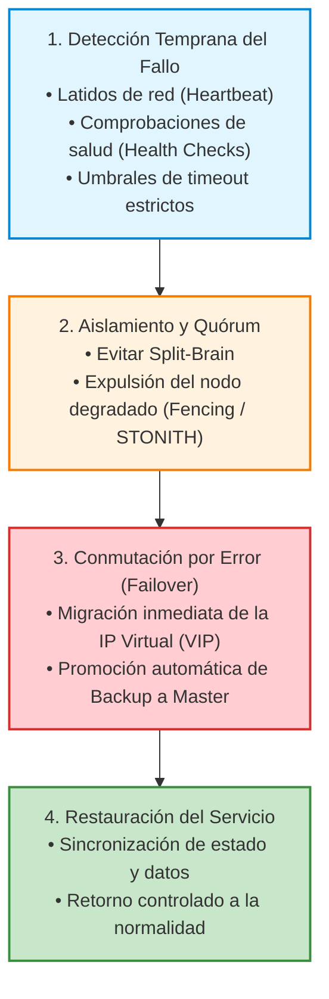

---

### Métricas de Disponibilidad: MTBF, MTTR y MTTF

Para cuantificar y evaluar formalmente la resiliencia de un sistema tecnológico se emplean tres métricas estándar de ingeniería:

```text
                       CICLO DE VIDA ANTE FALLOS
  ├──────────────────────────── MTBF ────────────────────────────┤
  ┌───────────────────────────┐           ┌──────────────────────┐
  │   SISTEMA OPERATIVO       │   FALLO   │ REPARACIÓN Y ALTA    │
  │   (Tiempo en Servicio)    │           │ (Tiempo de Parada)   │
  └───────────────────────────┘           └──────────────────────┘
  ├─────────── MTTF ──────────┤           ├──────── MTTR ────────┤
```

1. **MTTF (*Mean Time To Failure* - Tiempo Medio Hasta el Fallo):**
    * Es el tiempo medio que un dispositivo no reparable o un sistema funciona de manera continuada antes de sufrir su primera avería.
2. **MTTR (*Mean Time To Repair* - Tiempo Medio De Reparación):**
    * Es el tiempo medio necesario para detectar un incidente, intervenir el sistema, sustituir el componente averiado y devolver el servicio a su estado plenamente operativo. El objetivo primordial de la alta disponibilidad es **reducir el MTTR al mínimo posible (idealmente a segundos o milisegundos mediante conmutación automática)**.
3. **MTBF (*Mean Time Between Failures* - Tiempo Medio Entre Fallos):**
    * Es el tiempo transcurrido entre dos averías consecutivas en un sistema reparable:
    * `MTBF = MTTF + MTTR`

#### Cálculo de la Disponibilidad
La disponibilidad matemática de un sistema se define como el porcentaje de tiempo durante el cual el sistema está operativo respecto al tiempo total:

```text
                             MTBF
Disponibilidad (%) = ───────────────────── × 100
                         MTBF + MTTR
```

En entornos donde KaTeX no esté disponible, la relación se expresa como:
`Disponibilidad (%) = [MTBF / (MTBF + MTTR)] * 100`

---

### La Escala de los «Nueves» de Disponibilidad

En los Acuerdos de Nivel de Servicio (**SLA - Service Level Agreement**) entre proveedores de infraestructura y clientes, la disponibilidad se pacta mediante la conocida escala de los «nueves»:

| Nivel de Disponibilidad | Denominación Común | Tiempo Máximo de Parada Inesperada al Año | Tiempo Máximo de Parada al Mes | Tolerancia del Negocio |
| :---: | :---: | :---: | :---: | :--- |
| **99%** | Dos nueves | **3,65 días** (87,6 horas) | 7,2 horas | Aceptable para servicios no críticos o entornos de prueba. |
| **99,9%** | Tres nueves | **8,76 horas** | 43,8 minutos | Estándar habitual en servicios de hosting y PYMEs. |
| **99,99%** | Cuatro nueves | **52,6 minutos** | 4,38 minutos | Requerido en comercio electrónico y servicios empresariales. |
| **99,999%** | **Cinco nueves (*Carrier Grade*)** | **5,26 minutos** | **26 segundos** | Estándar de oro: telecomunicaciones, banca y hospitales. |
| **99,9999%** | Seis nueves | **31,5 segundos** | 2,6 segundos | Sistemas aeroespaciales, defensa y control de reactores nucleares. |

---

## 2. Puntos Únicos de Fallo (SPOF) y Redundancia Física

Un **Punto Único de Fallo (*Single Point of Failure - SPOF*)** es cualquier elemento, componente o enlace de una arquitectura cuya avería individual provoca la interrupción completa de todo el sistema.

El principio fundacional de la alta disponibilidad consiste en **identificar todos los SPOFs de la infraestructura y eliminarlos mediante redundancia**, duplicando o triplicando los elementos críticos en cada capa:

```text
                  ELIMINACIÓN DE SPOF EN CADA CAPA
  ┌──────────────────────────────────────────────────────────────┐
  │ 1. Suministro Eléctrico  → SAIs dobles + Generadores diésel  │
  ├──────────────────────────────────────────────────────────────┤
  │ 2. Almacenamiento        → Matrices RAID + Réplicas SAN/NAS  │
  ├──────────────────────────────────────────────────────────────┤
  │ 3. Conectividad de Red   → LACP / NIC Teaming + Doble ISP    │
  ├──────────────────────────────────────────────────────────────┤
  │ 4. Pasarela Perimetral   → VRRP (Routers Master / Backup)    │
  ├──────────────────────────────────────────────────────────────┤
  │ 5. Servicios Web         → Granjas de Servidores + Balanceo  │
  └──────────────────────────────────────────────────────────────┘
```

---

### A. Redundancia en el Suministro Eléctrico

La energía es el recurso más sensible de un centro de datos. Una simple caída de tensión o un microcorte puede corromper bases de datos y provocar horas de indisponibilidad:

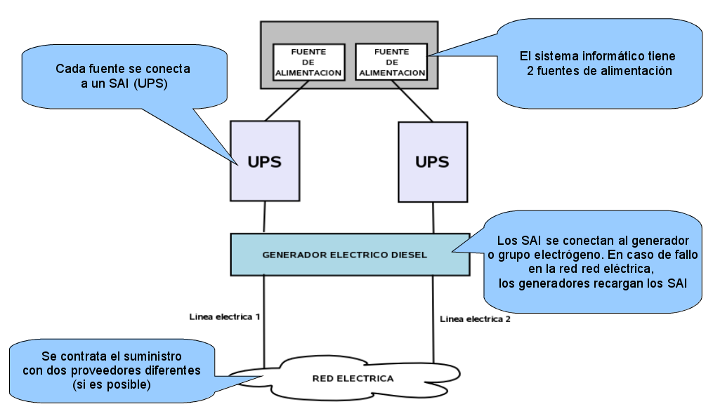

* **Fuentes de Alimentación Redundantes (*Hot-Plug Power Supplies*):** Los servidores profesionales cuentan con dos (o cuatro) fuentes de alimentación conmutadas. Si una fuente falla internamente, la otra asume el 100% de la carga de forma instantánea sin reiniciar el equipo.
* **Líneas Eléctricas Independientes (A+B):** Cada fuente de alimentación del servidor se conecta a una regleta de distribución PDU diferente alimentada por cuadros eléctricos y fases distintas.
* **Sistemas de Alimentación Ininterrumpida (SAI / UPS):** Baterías industriales que filtran armónicos y suministran energía limpia inmediata ante apagones.
* **Grupos Electrógenos (Generadores Diésel):** Motores de combustión con arranque automático que se activan si el corte eléctrico general se prolonga más de unos segundos, garantizando autonomía de días o semanas.

---

### B. Redundancia en el Almacenamiento

Los discos duros mecánicos (HDD) y de estado sólido (SSD) poseen tasas de fallo inevitables debido al desgaste físico:

* **Matrices RAID Tolerantes a Fallos:**
    * **RAID 1 (Mirroring / Espejo):** Duplica la información en dos discos. Tolera la pérdida de 1 disco.
    * **RAID 5:** Distribuye datos y bloques de paridad en un mínimo de 3 discos. Tolera la rotura de 1 disco.
    * **RAID 6:** Utiliza doble bloque de paridad en un mínimo de 4 discos. Tolera la rotura simultánea de 2 discos.
    * **RAID 10 (1+0):** Combina espejado y división (*striping*). Ofrece altísimo rendimiento y tolerancia a fallos múltiples.
    * **Discos Hot-Spare:** Discos de reserva conectados en caliente que entran en funcionamiento y reconstruyen la matriz de forma automática en cuanto un disco titular falla.
* **Redundancia a Nivel de Cabina y Red:**
    * Redes de almacenamiento dedicadas (**SAN - Storage Area Network**) mediante Fibre Channel o iSCSI con doble controladora activa-activa.
    * Replicación de bloques por red a nivel de kernel mediante **DRBD (*Distributed Replicated Block Device*)** o sistemas de archivos distribuidos como **Ceph** y GlusterFS.

---

### C. Redundancia en Conectividad y Redes

Una caída en una tarjeta de red, un cable cortado o un switch estropeado pueden aislar servidores en perfecto estado:

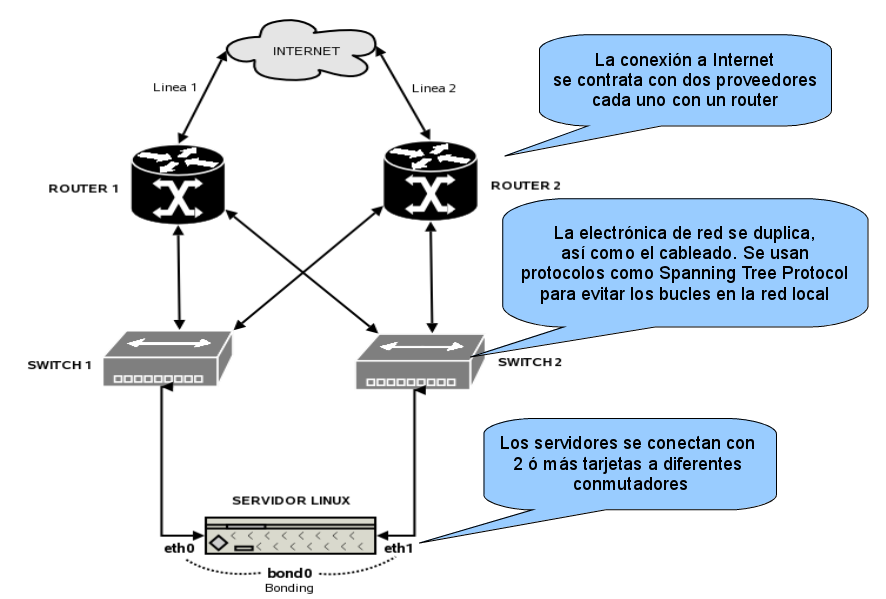

* **Agregación de Enlaces (LACP / NIC Teaming / Bonding):**
    * Se conectan dos o más interfaces de red físicas de un servidor a switches diferentes configuradas bajo el estándar IEEE 802.3ad (LACP).
    * Si una tarjeta o cable falla, el tráfico conmuta a las interfaces supervivientes sin pérdida de paquetes (*Fault Tolerance*), aportando además agregación de ancho de banda.
* **Protocolos de Nivel de Enlace (STP / RSTP):**
    * *Rapid Spanning Tree Protocol (IEEE 802.1w)* permite interconectar switches con topologías en bucle redundantes, bloqueando enlaces secundarios y activándolos en menos de un segundo si el enlace principal cae.
* **Multihoming con Varios Operadores (ISP):**
    * La organización contrata salida a Internet con dos proveedores de telecomunicaciones independientes mediante líneas que entran por acometidas físicas distintas.
    * Mediante el protocolo **BGP (*Border Gateway Protocol*)** y un Sistema Autónomo propio (ASN), si uno de los ISPs sufre una avería general, todo el tráfico de la empresa conmuta automáticamente hacia el segundo operador.

---

### D. Redundancia en Servidores y Virtualización

Tener un único servidor ejecutando aplicaciones críticas es un riesgo inaceptable. Se despliegan arquitecturas en racimo o granja:

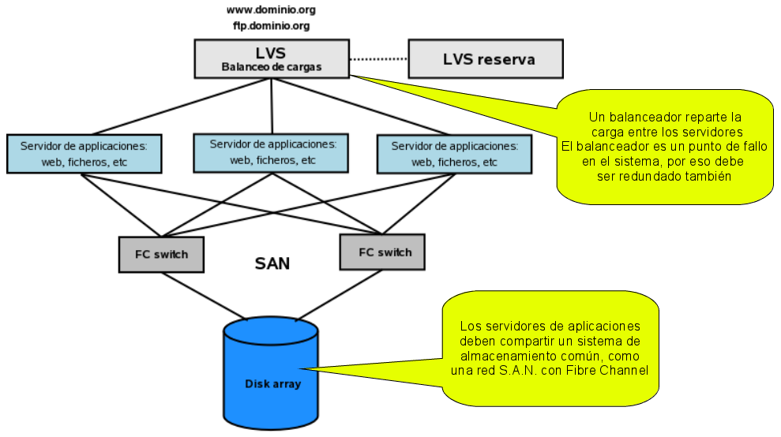

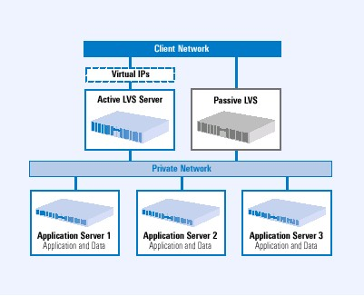

* **Clustering de Hipervisores (Proxmox VE, VMware ESXi, KVM):**
    * Si un nodo físico sufre una avería de placa base o CPU, el clúster detecta el fallo (*Heartbeat*) y reinicia automáticamente las máquinas virtuales afectadas en los nodos supervivientes (*HA VM Restart*).
    * **Migración en Vivo (*Live Migration*):** Permite mover máquinas virtuales de un servidor físico a otro en caliente (en milisegundos y sin interrumpir servicios) para realizar labores de mantenimiento y actualización de hardware.

---

## 3. Protocolos de Redundancia de Pasarela por Defecto (FHRP)

En cualquier red de área local corporativa, todos los equipos cliente (ordenadores, terminales, impresoras) están configurados con una única dirección IP como **Puerta de Enlace por Defecto (*Default Gateway*)**.

Si la red dispone de un único router y este se avería, todos los clientes pierden instantáneamente la conectividad con Internet y con el resto de subredes, convirtiendo al router en el **SPOF más peligroso de la red de acceso**:

```text
                  EL PROBLEMA DEL ROUTER COMO PUNTO ÚNICO DE FALLO
  [ PC CLIENTE ] ── (GW: 192.168.100.1) ──> [ ROUTER 1 ] ──X [ ¡AVERÍA! ]
  (Incomunicado, aunque exista un Router 2 en la misma red)
```

Para solucionar este problema se crearon los protocolos **FHRP (*First Hop Redundancy Protocols*)**, de los cuales el estándar abierto indiscutible de la industria es **VRRP**.

---

### El Estándar VRRP (Virtual Router Redundancy Protocol - RFC 5798)

**VRRP** permite agrupar dos o más routers físicos situados en el mismo segmento de red para que funcionen como un **único Enrutador Virtual (*Virtual Router*)** de alta disponibilidad:

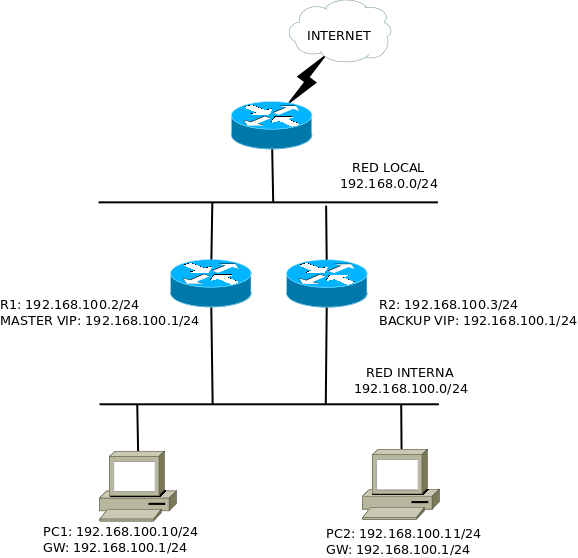

#### Componentes Fundamentales de VRRP
1. **Identificador de Enrutador Virtual (VRID):** Un número entre 1 y 255 que identifica de forma unívoca al grupo de routers que colaboran en el clúster.
2. **Dirección IP Virtual (VIP - Virtual IP):** Una dirección IP compartida (por ejemplo, `192.168.100.1`) que se asigna al Enrutador Virtual. **Esta VIP es la dirección que los clientes configuran como su puerta de enlace por defecto**.
3. **Dirección MAC Virtual (VMAC):** Para que los equipos cliente no tengan que purgar su tabla ARP tras una conmutación por fallo, el estándar VRRP genera una dirección MAC virtual estandarizada:
    * Formato para IPv4: `00:00:5E:00:01:{VRID en hexadecimal}`
    * Por ejemplo, si el VRID es 10 (en hex `0A`), la MAC virtual es: `00:00:5E:00:01:0A`.
4. **Rol MASTER (Maestro):**
    * Es el router físico que atiende activamente el tráfico enviado a la VIP y responde a las peticiones ARP con la VMAC.
    * Envía periódicamente paquetes de latido (*Advertisement packets*) cada 1 segundo por multidifusión (**Multicast a `224.0.0.18`**, protocolo IP 112).
5. **Rol BACKUP (Esclavo o Reserva):**
    * Permanecen a la escucha pasiva de los anuncios de latido del Master.
    * Si dejan de recibir paquetes del Master durante un tiempo determinado (*Master Down Interval*, aproximadamente 3,6 segundos), asumen que el Master ha caído y el Backup de mayor prioridad se autoproclama nuevo Master, emitiendo un anuncio **Gratuitous ARP (GARP)** para que los switches actualicen sus tablas MAC.

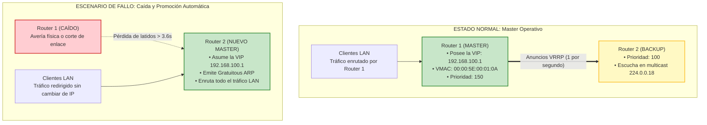

#### Parámetros de Elección y Preempción
* **Prioridad:** Un valor entre 1 y 254 (el valor 255 se reserva para el router dueño de la IP real). El router con mayor prioridad se convierte en Master (por ejemplo, Prioridad 150 para Master y Prioridad 100 para Backup).
* **Preempción (*Preemption*):** Directiva que determina si un router que tiene mayor prioridad recupera automáticamente el rol de Master cuando vuelve a encenderse tras una avería.

---

### Otros Protocolos de Redundancia de Pasarela

* **HSRP (*Hot Standby Router Protocol*):** Protocolo propietario desarrollado por Cisco en 1998 (predecesor de VRRP). Utiliza el grupo multicast `224.0.0.2` (v1) o `224.0.0.102` (v2) y MAC virtual `00:00:0C:07:AC:XX`.
* **CARP (*Common Address Redundancy Protocol*):** Alternativa libre desarrollada por el proyecto OpenBSD debido a problemas de patentes de Cisco sobre HSRP y VRRP. Muy extendido en cortafuegos pfSense y OPNsense.
* **GLBP (*Gateway Load Balancing Protocol*):** Protocolo de Cisco que, a diferencia de VRRP/HSRP (activo-pasivo donde el backup no enruta nada), permite **balancear el tráfico de forma activa entre hasta 4 routers simultáneamente** asignando dinámicamente diferentes MACs virtuales a los clientes:

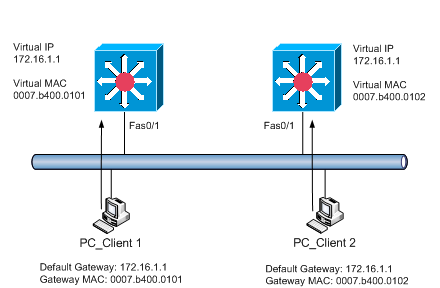

---

## 4. Balanceo de Carga y Granjas Web (*Server Load Balancing - SLB*)

Cuando un servicio web o de base de datos recibe más peticiones de las que un único servidor puede procesar, o cuando se desea garantizar que la caída de un servidor no afecte a la disponibilidad de la aplicación, se despliega una **Granja de Servidores (*Server Farm*)** gobernada por un **Balanceador de Carga (*Load Balancer*)**:

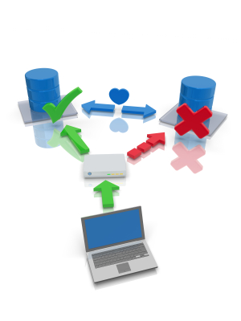

### Modos de Operación y Topologías de Balanceo

Existen diferentes formas de integrar el balanceador en la topología de red:

#### 1. Modo Router / NAT (LVS/NAT)
El balanceador actúa como router y puerta de enlace de los servidores reales (*Real Servers*). Aplica Destination NAT a las peticiones entrantes de Internet y Source NAT al tráfico de retorno:

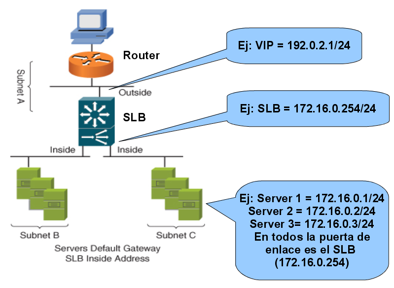

* **Ventaja:** Los servidores reales pueden utilizar direccionamiento privado aislado de Internet.
* **Inconveniente:** El balanceador debe procesar tanto el tráfico de entrada como el de salida, convirtiéndose en un cuello de botella si las respuestas contienen archivos de gran tamaño.

#### 2. Modo Direct Server Return (DSR / LVS/DR / One-Armed)
En este modo avanzado, el balanceador recibe la petición del cliente y la entrega al servidor real alterando únicamente la dirección MAC de destino (Capa 2), sin modificar las IPs:

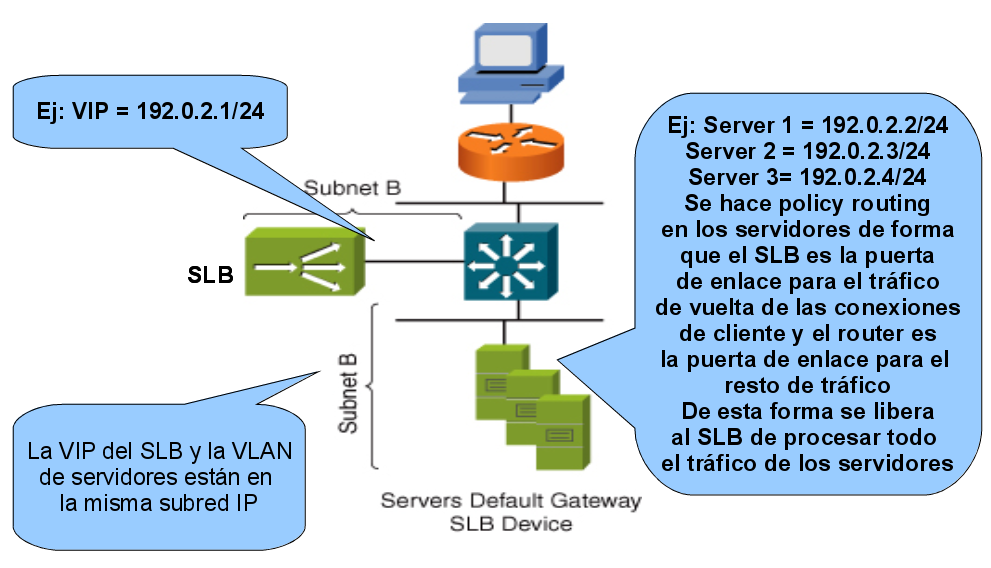

* **Ventaja espectacular:** Los servidores reales **responden directamente al cliente de Internet** sin que los datos de retorno vuelvan a pasar por el balanceador. Dado que en la web el tráfico de respuesta (descarga de imágenes, vídeos, HTML) es de 10 a 100 veces superior al de petición (pequeñas solicitudes `GET`), el modo DSR permite balancear terabits de tráfico con un balanceador muy modesto.

---

### Algoritmos de Distribución de Carga

El balanceador decide qué servidor atiende cada nueva conexión aplicando uno de los siguientes criterios:

* **Round Robin (Turno Rotatorio):** Asigna las peticiones de forma secuencial y cíclica: Servidor 1 → Servidor 2 → Servidor 3 → Servidor 1. Idóneo si todos los servidores tienen especificaciones de hardware idénticas.
* **Weighted Round Robin (Ponderado):** Asigna un peso numérico a cada servidor según su potencia de CPU y RAM. Un servidor con peso 3 recibirá tres veces más peticiones que uno con peso 1.
* **Least Connections (Menor Número de Conexiones):** Envía la petición al servidor que en ese instante tiene el menor número de conexiones TCP activas. Es el más eficiente cuando las peticiones tienen tiempos de procesamiento muy dispares (ej. transacciones complejas vs páginas estáticas).
* **Source IP Hash (Persistencia de Sesión / Sticky Sessions):** Aplica una función hash a la dirección IP del cliente para garantizar que todas las peticiones procedentes del mismo usuario vayan siempre al mismo servidor físico, preservando carritos de compra o sesiones en memoria sin almacenamiento compartido.

---

### Monitorización de Salud (*Health Checks*)

Un balanceador no puede limitarse a enviar peticiones a ciegas; debe supervisar de forma continua el estado de salud de cada servidor de backend:

1. **Chequeo ICMP (Ping):** Comprueba si el servidor físico responde a nivel de red. Es insuficiente: el servidor puede responder al ping pero tener el proceso de Apache o Nginx colgado.
2. **Chequeo TCP (SYN/ACK):** Intenta abrir una conexión al puerto de servicio (ej. puerto 80 u 8080).
3. **Chequeo HTTP de Capa 7 (Recomendado):** El balanceador solicita periódicamente una ruta específica (ej. `GET /health.php HTTP/1.1`) y verifica que el servidor devuelva un código **HTTP 200 OK** y un contenido esperado. Si la base de datos local del servidor falla, el script devuelve un error 500 y el balanceador retira automáticamente a ese servidor de la granja en cuestión de segundos, redirigiendo el tráfico a los nodos sanos.

---

## 5. Herramientas Software de Alta Disponibilidad en Linux

En el ecosistema GNU/Linux profesional destacan tres grandes herramientas:

```text
┌───────────────────────────┬───────────────────────────┬───────────────────────────┐
│        KEEPALIVED         │          HAPROXY          │    PACEMAKER / COROSYNC   │
├───────────────────────────┼───────────────────────────┼───────────────────────────┤
│ • Protocolo VRRP (VIPs).  │ • Balanceador L4 (TCP)    │ • Clúster de conmutación  │
│ • Integración con IPVS    │   y L7 (HTTP avanzado).   │   de recursos complejos.  │
│   (Linux Virtual Server). │ • Terminación SSL/TLS.    │ • Quórum y protección     │
│ • Sencillo, ligero y      │ • Comprobación de salud   │   contra Split-Brain      │
│   extremadamente robusto. │   y estadísticas web.     │   mediante STONITH/Fencing│
└───────────────────────────┴───────────────────────────┴───────────────────────────┘
```

1. **Keepalived:** Es la herramienta de referencia para implementar VRRP en Linux. Permite configurar una o varias direcciones IP virtuales (VIPs) compartidas entre dos o más máquinas, monitorizando scripts personalizados mediante bloques `vrrp_script` para conmutar la VIP si un servicio (como Apache, Nginx o MySQL) deja de ejecutarse.
2. **HAProxy:** Es el estándar de la industria en balanceo de carga web de alto rendimiento. Capaz de gestionar millones de conexiones concurrentes con una latencia despreciable, filtrado de cabeceras, soporte HTTP/2 y HTTP/3, y terminación SSL avanzada.
3. **Pacemaker y Corosync:** Solución completa de clustering para servicios con estado (*Stateful Services* como servidores de archivos NFS o bases de datos PostgreSQL/MariaDB). Implementa mecanismos de quórum estricto y **fencing (STONITH - Shoot The Other Node In The Head)**: si un nodo deja de responder pero no se sabe si está vivo o muerto, el clúster le corta la alimentación eléctrica a través de la regleta PDU o IPMI para evitar que ambos nodos escriban simultáneamente en el almacenamiento compartido y corrompan los datos (*Split-Brain*).

---

## 6. Cuestionario de Autoevaluación

Comprueba tu dominio de los conceptos de alta disponibilidad respondiendo a las siguientes cuestiones:

??? question "1. ¿Qué diferencia fundamental existe entre una medida de seguridad activa y una solución de alta disponibilidad?"
    **Respuesta:** La seguridad activa busca prevenir y evitar que ocurran incidentes o ataques (como un cortafuegos o un antivirus). La alta disponibilidad pertenece a la **seguridad pasiva y a las medidas correctoras**: asume que los fallos físicos o lógicos son inevitables y se diseña para que el sistema tolere dichos fallos y se recupere automáticamente sin interrupción de los servicios.

??? question "2. En las métricas de fiabilidad, ¿qué representan las siglas MTBF y MTTR, y cuál de ellas busca minimizar la alta disponibilidad?"
    **Respuesta:** **MTBF** (*Mean Time Between Failures*) es el tiempo medio entre averías consecutivas, mientras que **MTTR** (*Mean Time To Repair*) es el tiempo medio necesario para reparar el fallo y restablecer el servicio. La alta disponibilidad busca **minimizar al máximo el MTTR**, reduciéndolo a segundos o milisegundos mediante mecanismos de conmutación por error automática (*failover*).

??? question "3. ¿Cuántas horas de parada inesperada al año tolera un servicio contratado con un nivel de disponibilidad del 99,9% ('tres nueves')?"
    **Respuesta:** Tolera como máximo **8,76 horas al año** (o unos 43,8 minutos al mes). Para alcanzar menos de 5 minutos al año se requiere el nivel del 99,999% («cinco nueves»).

??? question "4. ¿Qué es un Punto Único de Fallo (SPOF) y qué principio arquitectónico se utiliza para eliminarlo?"
    **Respuesta:** Un SPOF (*Single Point of Failure*) es cualquier componente de hardware, software o enlace cuya rotura individual paraliza por completo todo el sistema. Se elimina mediante el principio de **redundancia**, duplicando los componentes críticos (fuentes eléctricas, discos RAID, tarjetas LACP, routers VRRP y servidores en clúster).

??? question "5. ¿Qué dirección IP configuran los equipos clientes de una red local cuando se implementa redundancia de pasarelas con VRRP?"
    **Respuesta:** Configuran la **Dirección IP Virtual (VIP)** del grupo VRRP (por ejemplo, `192.168.100.1`). Esta IP no pertenece rígidamente a ninguna tarjeta física, sino que es asumida de forma transparente por el router que en cada momento ostente el rol de Master.

??? question "6. ¿Qué función cumple la dirección MAC Virtual (VMAC) en el protocolo VRRP?"
    **Respuesta:** Permite que ante una caída del router Master, el router Backup asuma el control utilizando exactamente la misma dirección MAC virtual. De este modo, los ordenadores clientes no sufren cortes de red esperando a que expire su caché ARP local, ya que la dirección de Capa 2 de la puerta de enlace permanece idéntica.

??? question "7. ¿Por qué el protocolo VRRP envía paquetes de anuncio periódicos cada 1 segundo a la dirección de multidifusión 224.0.0.18?"
    **Respuesta:** Para actuar como señal de latido (*Heartbeat*). Mientras los routers Backup sigan recibiendo estos anuncios del Master, permanecen a la escucha pasiva. Si dejan de recibirlos durante el intervalo de caída (*Master Down Interval* ~3,6 segundos), deducen que el Master ha fallado y uno de los Backups se autoproclama nuevo Master.

??? question "8. ¿Qué ventaja de rendimiento ofrece el modo de balanceo Direct Server Return (DSR) frente al modo Router/NAT?"
    **Respuesta:** En el modo DSR, el balanceador sólo procesa las peticiones entrantes de los clientes y los servidores reales **responden directamente a los clientes de Internet** sin pasar por el balanceador. Esto elimina el cuello de botella en el balanceador, permitiéndole gestionar granjas masivas de tráfico web y multimedia.

??? question "9. En un balanceador de carga, ¿cuál es la diferencia entre el algoritmo Round Robin y el algoritmo Least Connections?"
    **Respuesta:** Round Robin reparte las conexiones en estricto turno rotatorio secuencial sin considerar la carga real. Least Connections entrega la nueva petición al servidor que en ese momento tiene el menor número de sesiones TCP activas, siendo mucho más eficiente ante peticiones con duraciones de procesamiento desiguales.

??? question "10. ¿Para qué se utiliza la directiva 'vrrp_script' en la configuración de Keepalived?"
    **Respuesta:** Permite definir un script o comando de comprobación (por ejemplo, `killall -0 apache2` o `systemctl is-active apache2`) que se ejecuta periódicamente para monitorizar la salud de un servicio de aplicación. Si el script falla, Keepalived reduce automáticamente la prioridad del nodo o lo fuerza a pasar a estado FAULT, conmutando la IP virtual al otro servidor sin esperar a que la máquina se apague.

---

## 7. Práctica de la Unidad

Aplica los conocimientos teóricos adquiridos en el laboratorio práctico oficial de la unidad:

* **[Práctica 10.1: Redundancia y Tolerancia a Fallos de Pasarelas y Servicios Web con VRRP en MikroTik y Linux](P10_1_alta_disponibilidad_vrrp.md)**: Despliegue en GNS3 de routers MikroTik redundantes con VRRP, servidores web Apache en alta disponibilidad con Keepalived y simulación empírica de fallos y conmutación.
