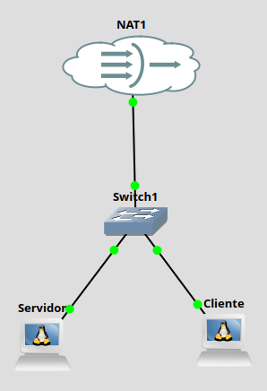

# Práctica 5.1: Diagnóstico Local de Sockets y Conexiones de Red con `ss` y `netstat`

!!! note "Datos de la Práctica"
    * **Módulo:** Seguridad y Alta Disponibilidad (SAD - 0378)
    * **Unidad Didáctica:** UD5 - Seguridad Activa y Auditorías en Redes Corporativas
    * **Requisitos:** Dos máquinas virtuales Linux (Debian o Ubuntu) interconectadas en red (vía GNS3, VirtualBox, KVM o AWS) con acceso a terminal y privilegios `sudo`.

---

## 1. Objetivos de la Práctica

* Comprender la función del diagnóstico de sockets como técnica fundamental de auditoría local y detección de servicios no autorizados.
* Diferenciar la herramienta clásica `netstat` (paquete `net-tools`) de la utilidad moderna `ss` (*Socket Statistics*, paquete `iproute2`).
* Identificar y clasificar los estados principales de los sockets de red (`LISTEN`, `ESTABLISHED`, `TIME_WAIT`).
* Asociar puertos abiertos y conexiones activas con sus respectivos procesos propietarios y PIDs (`-p`).
* Auditar el impacto de la instalación de nuevos servicios de red (servidor SSH y servidor web Apache).
* Correlacionar de forma cruzada una sesión de comunicación cliente-servidor verificando la tupla de red en ambos extremos.

---

## 2. Introducción Teórica: Auditoría de Sockets y Puertos

En la administración de sistemas informáticos, un **socket** es el punto final de una comunicación bidireccional entre dos aplicaciones a través de la red. Viene definido por la tupla:

Socket = Dirección IP, Puerto transportador, Protocolo TCP/UDP

Cuando un servidor ofrece un servicio (por ejemplo, un servidor web o SSH), abre un socket en estado **`LISTEN`** (escucha) a la espera de peticiones entrantes. Cuando un cliente se conecta, el sistema operativo establece una conexión en estado **`ESTABLISHED`**, asignando en el cliente un puerto efímero de origen (puerto alto aleatorio, ej. 54321) y conectándolo al puerto bien conocido del servidor (ej. 80 o 22).

```
  [ CLIENTE (192.168.1.50) ]                           [ SERVIDOR (192.168.1.100) ]
  Socket Origen: 192.168.1.50:54321 ── ESTABLISHED ──> Socket Destino: 192.168.1.100:22
  (Puerto Efímero)                                     (Puerto de Servicio SSH)
```

### ¿Por qué auditar los sockets del sistema?
Un administrador o auditor de seguridad utiliza estas herramientas para:

1. **Inventariar servicios expuestos:** Verificar qué puertos están abiertos y si corresponden a servicios autorizados.
2. **Detectar conexiones no autorizadas:** Identificar sesiones iniciadas hacia direcciones IP externas desconocidas o puertos inusuales.
3. **Analizar fallos de conectividad:** Confirmar si un servicio se ha colgado o si está escuchando únicamente en la interfaz local (`127.0.0.1`) en lugar de en la interfaz de red pública (`0.0.0.0`).

### Comparativa: `netstat` vs `ss`
* **`netstat` (*Network Statistics*):** Herramienta tradicional del paquete `net-tools`. Lee la información analizando el sistema de archivos `/proc/net/`. En sistemas con miles de conexiones abiertas, resulta lenta y obsoleta.
* **`ss` (*Socket Statistics*):** Herramienta moderna del paquete `iproute2`. Consulta directamente al kernel de Linux mediante el subsistema de sockets `netlink`, siendo exponencialmente más rápida y precisa.

---

## 3. Desarrollo Paso a Paso de la Práctica

### Escenario de Trabajo Requerido:
Para completar la práctica se requieren **dos máquinas Linux** (Debian o Ubuntu) conectadas a la misma red virtual. Nosotros usaremos el siguiente escenario en GNS3.



* **Servidor:** IP asignada por tu entorno GNS3.
* **Cliente:** IP asignada por tu entorno GNS3.

Recuerda que en GNS3 las máquinas Debian no tienen habilitada la interfaz de red. Habilítala en ambos equipos y cambia el Hostname de cada uno de ellos a *Servidor* y *Cliente*.

---

### Tarea 1: Preparación del Entorno e Instalación de Utilidades

1. Inicia sesión en la máquina que actuará como **Servidor**.
2. Actualiza los repositorios e instala los paquetes necesarios (`net-tools`, `iproute2` y `openssh-server`):
   ```bash
   sudo apt update
   sudo apt install net-tools iproute2 openssh-server -y
   ```
3. Verifica que el servicio SSH está activo en el servidor:
   ```bash
   sudo systemctl status ssh
   ```

---

### Tarea 2: Inspección Inicial de Sockets en Escucha (`LISTEN`)

1. Ejecuta el comando `ss` para listar únicamente los sockets de transporte (TCP/UDP) que están en **escucha**, mostrando direcciones numéricas y los procesos propietarios:
   ```bash
   sudo ss -tulpn
   ```
   * **Desglose de opciones:**
     * `-t`: Muestra sockets **TCP**.
     * `-u`: Muestra sockets **UDP**.
     * `-l`: Muestra únicamente sockets en estado **`LISTEN`** (escucha).
     * `-p`: Muestra el **proceso** (nombre y PID) propietario del socket.
     * `-n`: Muestra direcciones y **puertos numéricos** (ej. `22` en lugar de `ssh`).

2. Ejecuta la inspección equivalente utilizando el comando tradicional `netstat`:
   ```bash
   sudo netstat -tulpn
   ```

3. **Análisis Guiado:**

    * Localiza en la salida la línea correspondiente al servicio `sshd`.
    * Anota la dirección IP de escucha asignada a SSH:
      * Si aparece `0.0.0.0:22` o `:::22`, significa que el servicio escucha en **todas las interfaces de red del equipo**.
      * Si apareciera `127.0.0.1:22`, el servicio solo aceptaría conexiones locales desde la propia máquina.
    * Anota el **PID** (identificador de proceso) asociado a `sshd`.

---

### Tarea 3: Instalación y Detección de un Nuevo Servicio (Apache Web Server)

1. En la máquina **Servidor**, instala el servidor web Apache:
   ```bash
   sudo apt install apache2 -y
   ```

2. Una vez finalizada la instalación, vuelve a inspeccionar los sockets en escucha filtrando por el nombre del servicio:
   ```bash
   sudo ss -tulpn | grep apache2
   ```

3. **Análisis Guiado:**

    * Comprueba que ha aparecido un nuevo socket TCP en escucha.
    * Anota el número de puerto asociado a Apache (puerto **80** / HTTP).
    * Observa cómo el sistema operativo ha asignado el puerto 80 al proceso `apache2` automáticamente.

---

### Tarea 4: Generación de Tráfico Web y Consulta de Conexiones Activas (`ESTABLISHED`)

1. Desde la máquina **Cliente**, realiza una petición HTTP al servidor web mediante `curl` o abriendo el navegador hacia la IP del servidor desde la máquina HOST:
   ```bash
   curl IP_SERVIDOR
   ```

2. De forma simultánea, en la máquina **Servidor**, consulta las conexiones que se encuentran en estado **establecido** (`ESTABLISHED`):
   ```bash
   sudo ss -tan state established
   ```
   *(O bien mediante `netstat`: `sudo netstat -tan | grep ESTABLISHED`)*

   En este caso hemos usado -t (protocolos TCP), -a (Muestra todos los sockets TCP, combinando tanto los que están en estado de escucha (LISTEN) como aquellos en estados establecidos o de cierre (ESTABLISHED, TIME-WAIT, CLOSE-WAIT, SYN-SENT, etc.). Por defecto, si se omite -a, ss ignora los sockets en escucha y solo lista las conexiones activas) y -n (numeric, muestra direcciones IP)

3. **Análisis Guiado:**
    * Comprueba que la conexión HTTP es muy breve y pasa rápidamente a estado `TIME_WAIT` o se cierra, debido a la naturaleza sin  conexión persistente del protocolo HTTP/1.1 por defecto. Probablemente pase tan rápido que no te de tiempo ni a capturarlo con el comando.
    * Vamos a lanzar el comando con `watch`que nos permite lanzar el comando a intervalos regulares y capturar esos cambios
    ```bash
    watch -n 0.25 -d "ss -tan"
    ```
    El comando `watch` lanzará cada 0.25 seg el comando que le sigue. Además, con -d nos mostrará en video inverso los camibios frente al comando anterior.
    * Lanza ahora conexiones desde el Cliente y el navegador del Host y comprueba el cambio en las conexiones.


---

### Tarea 5: Correlación Cruzada de una Sesión SSH Cliente-Servidor (Doble Terminal)

En esta tarea vas a verificar cómo se visualiza una **misma conexión de red** desde los dos extremos de la comunicación (Cliente y Servidor).

1. Vas a necesitar **2 ventanas de terminal simultáneas**:

    * **Ventana 1 (Cliente):** Consola abierta en la máquina cliente desde GNS3.
    * **Ventana 2 (Servidor):** Consola abierta en la máquina cliente desde GNS3.

2. **Ejecución en el CLIENTE (Ventana 1):**

    Lanza una conexión SSH desde el Cliente al Servidor. Conéctate y deja esa ventana abierta. Estarás trabajando en el servidor.


2. **Ejecución en el SERVIDOR (Ventana 2):**

    Lanza una conexión SSH desde el Servidor al Cliente. Conéctate y deja esa ventana abierta. Estarás trabajando en el cliente.

    * Dentro de la sesión SSH en el Cliente ejecuta el comando ss necesario para ver las conexiones e identifica las 2 conexiones ssh establecidas. Mira en cuál es cliente es el servidor `sshd` y en cual el cliente `ssh`

3. **Ejecución en el CLIENTE (Ventana 1):**

    Realiza en la otra ventana las mismas operaciones. Identifica las 2 conexiones establecidas y comprueba cómo el que era servidor en la otra ventana es cliente en esta y viceversa.


4. **Captura de Pantalla Obligatoria:**

    * Realiza una captura de pantalla donde se vean **las dos terminales abiertas en paralelo en el mismo escritorio**.
    * Abre la imagen con un editor gráfico (Pinta, GIMP o la herramienta de recortes de tu SO) y **resalta/marca con un recuadro de color distinto** las dos líneas correspondientes a cada conexión SSH (demostrando que el puerto efímero del cliente coincide exactamente en ambas ejecuciones).

---

### Tarea 6: Ampliación Opcional en Entornos Windows (`netstat` en CMD)

Si dispones de un equipo o máquina virtual con Windows:
1. Abre una consola de comandos (`cmd.exe`) o PowerShell como Administrador.
2. Consulta la ayuda de la herramienta `netstat` en Windows:
   ```cmd
   netstat /?
   ```
3. Muestra todas las conexiones activas y puertos en escucha junto con el **PID** del proceso propietario:
   ```cmd
   netstat -ano
   ```
4. Asocia el PID de un puerto en escucha (ej. puerto 135 o 445) con el nombre del ejecutable en el Administrador de Tareas o mediante PowerShell:
   ```powershell
   Get-Process -Id <PID>
   ```

---

## 4. Cheatsheet Comparativo: `ss` vs `netstat`

Utiliza esta tabla de referencia rápida para tus tareas de administración de sistemas:

| Acción / Objetivo | Comando con `ss` (Moderno) | Comando con `netstat` (Legacy) |
| :--- | :--- | :--- |
| **Listar todos los puertos TCP/UDP en escucha con PID** | `ss -tulpn` | `netstat -tulpn` |
| **Mostrar solo conexiones TCP establecidas** | `ss -tan state established` | `netstat -tan \| grep ESTABLISHED` |
| **Filtrar por puerto de destino específico** | `ss -tan dport = :22` | `netstat -tan \| grep :22` |
| **Mostrar estadísticas numéricas sin resolver nombres** | `ss -n` | `netstat -n` |
| **Mostrar sockets en escucha del proceso Apache** | `ss -tulpn \| grep apache2` | `netstat -tulpn \| grep apache2` |

---

## 5. Entregable y Cuestiones de Autoevaluación

### Requisitos de Entrega:
Elabora un informe en formato **PDF** que incluya:

1. La **captura de pantalla editada de la Tarea 5** (donde se aprecie claramente el escritorio con las dos terminales paralelas y las líneas SSH marcadas).


---

### Cuestiones de Autoevaluación:

1. **Interpretación de Direcciones de Escucha:**

    Si al ejecutar `ss -tulpn` en un servidor observas que el servicio de base de datos MySQL/MariaDB escucha en `127.0.0.1:3306`, ¿podrá un cliente conectado desde otra máquina de la red de área local realizar consultas a la base de datos? ¿Qué dirección debería figurar en la escucha para permitir el acceso remoto?

2. **Puertos Efímeros:**

    ¿Qué es un puerto efímero (*ephemeral port*)? ¿Quién lo asigna, en qué rango de puertos se suele situar y cuál es su función en una comunicación cliente-servidor?

3. **Detección de Conexiones Anómalas:**

    Si sospechas que un servidor Linux ha sido comprometido por un proceso no autorizado que envía datos a un servidor remoto en Internet, ¿por qué el parámetro `-p` en `ss -tulpn` o `netstat -tulpn` es crucial para la investigación del incidente?

4. **Rendimiento de Diagnóstico:**

    ¿Por qué en servidores con un volumen de tráfico muy elevado (decenas de miles de sockets abiertos) se desaconseja el uso de `netstat` y se exige utilizar `ss`? Explica la diferencia en la fuente de datos que consulta cada comando dentro del sistema Linux.
