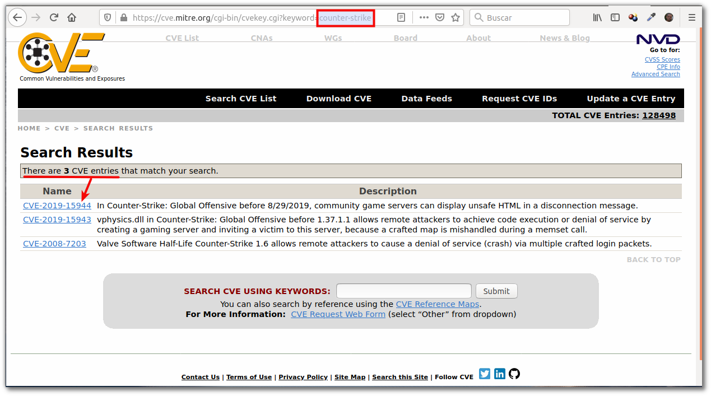

# Práctica 5.2: Auditoría e Inventariado de Redes con Nmap

!!! note "Datos de la Práctica"
    * **Módulo:** Seguridad y Alta Disponibilidad (SAD - 0378)
    * **Unidad Didáctica:** UD5 - Seguridad Activa y Auditorías en Redes Corporativas
    * **Requisitos:** Sistema operativo Linux (Debian o Ubuntu) en entorno físico o máquina virtual (GNS3, VirtualBox, KVM o AWS Educate) con conexión a Internet, privilegios `sudo` y navegador web para consulta de bases de datos de vulnerabilidades (NVD/CVE).

---

## 1. Objetivos de la Práctica

* Comprender la función del escaneo activo de puertos en las fases de reconocimiento, inventariado de activos y auditoría de seguridad.
* Instalar y utilizar la herramienta estándar **Nmap** (*Network Mapper*) en entornos GNU/Linux.
* Analizar de forma guiada el significado técnico de los parámetros de tipo de escaneo, temporizado, detección de versiones y fingerprinting de sistema operativo.
* Interpretar los estados de los puertos (`open`, `closed`, `filtered`) devueltos por el motor de escaneo.
* Realizar pruebas de auditoría autorizadas contra servidores de prueba en Internet (`scanme.nmap.org`) y máquinas de laboratorio local.
* Correlacionar los servicios y versiones detectados con las bases de datos públicas de vulnerabilidades conocidas (**CVE** / **NVD**).

---

## 2. Introducción Teórica: El Escaneo Activo de Redes

En la gestión de la seguridad informática, mientras que utilidades como `ss` o `netstat` ofrecen una visión **local** de los sockets abiertos desde el propio sistema operativo, las herramientas de escaneo activo de red como **Nmap** permiten auditar un sistema o red completa desde una posición **remota**.

```
  [ EQUIPO AUDITOR / NMAP ]  ─── Sondaje de Paquetes TCP/UDP ───>  [ SERVIDOR OBJETIVO ]
  (Analiza respuestas)                                             (Puertos Open / Filtered)
```

El escaneo de puertos cumple un doble propósito en el ciclo de vida de la seguridad:
1. **Perspectiva del Administrador / Auditor (Defensivo):** Permite inventariar los equipos activos en la red, identificar qué servicios están escuchando realmente, verificar que no existan puertos no autorizados o servicios obsoletos y validar el correcto funcionamiento de los cortafuegos perimetrales.
2. **Perspectiva del Atacante (Ofensivo):** Constituye la primera fase de una intrusión (*Footprinting* / Reconocimiento). Un atacante busca puertos abiertos para identificar versiones de software específicas y buscar fallos conocidos capaces de comprometer el servicio.

### Legalidad y Ética en el Escaneo de Puertos
!!! warning "Regla Fundamental de Seguridad"
    El escaneo de puertos sin autorización explícita sobre sistemas o redes de terceros **puede ser considerado un ataque de reconocimiento o intento de intrusión**, activando alertas en los sistemas IDS/IPS e incluso dando lugar a la suspensión de cuentas o acciones legales.

Para la realización de pruebas de aprendizaje fuera del laboratorio local, el proyecto Nmap mantiene oficialmente el servidor **`scanme.nmap.org`**, un equipo configurado de forma expresa y autorizada para recibir escaneos con fines educativos.

---

## 3. Desarrollo Paso a Paso de la Práctica

### Tarea 1: Instalación de Nmap y Verificación del Entorno

1. Abre una terminal en tu sistema Linux (Debian o Ubuntu).
2. Actualiza los repositorios de paquetes e instala la herramienta `nmap`:
   ```bash
   sudo apt update && sudo apt install -y nmap
   ```
3. Verifica la correcta instalación consultando la versión del programa:
   ```bash
   nmap --version
   ```
   *Comprueba que se muestra la versión instalada (ej. Nmap 7.9x) y los motores de captura soportados.*

---

### Tarea 2: Escaneo de Prueba sobre `scanme.nmap.org`

Ejecutaremos un escaneo compuesto sobre el servidor oficial de pruebas para auditar los servicios expuestos, detectar sus versiones y deducir el sistema operativo subyacente.

1. Abre la consola y ejecuta el siguiente comando con privilegios de superusuario (`sudo`):
   ```bash
   sudo nmap -sV -T4 -O -F --version-light scanme.nmap.org
   ```

2. Observa la salida generada por Nmap en la terminal.
3. **Captura de Pantalla N.º 1:** Realiza una captura de la terminal donde se aprecie claramente el comando ejecutado y la salida devuelta.
4. **Análisis Inicial:**
   * ¿Cuántos puertos se han encontrado en estado `open`?
   * ¿Qué servicios de red corresponden a esos puertos (ejemplo: SSH, HTTP)?
   * ¿Qué versión concreta del servidor SSH y del servidor Web Apache están escuchando en la máquina remota?
   * ¿Qué sistema operativo deduce Nmap que ejecuta el servidor?

---

### Tarea 3: Análisis Detallado y Desglose de Parámetros de Nmap

Analiza la función técnica de cada uno de los modificadores utilizados en el comando de la Tarea 2 para comprender su impacto en el rendimiento y la precisión del escaneo:

#### 1. Uso de `sudo` (Privilegios de Root)
* **Función:** Permite a Nmap acceder a sockets crudos (*raw sockets*) del kernel de Linux.
* **Impacto:** Sin `sudo`, Nmap utiliza el escaneo estándar `TCP Connect()`. Con `sudo`, Nmap construye paquetes TCP/IP personalizados a bajo nivel, habilitando el escaneo **TCP SYN** (`-sS`), el reconocimiento de sistema operativo (`-O`) y la estimación de latencia precisa.

#### 2. Parámetro `-sV` (*Service / Version Detection*)
* **Función:** Activa la sonda de detección de servicios y versiones en los puertos abiertos.
* **Mecánica:** Una vez que Nmap descubre que un puerto está abierto, le envía una serie de consultas (*probes*) específicas (peticiones HTTP, saludos SSH, banners SMTP) y compara los textos de respuesta (*banners*) contra una base de datos de patrones conocidos para determinar el nombre exacto del programa y su número de versión.

#### 3. Parámetro `-T4` (*Timing Template - Aggressive*)
* **Función:** Establece la plantilla de velocidad y temporización del escaneo en nivel 4 (*Aggressive*).
* **Escala de Plantillas de Temporización:**
  * `-T0` (*Paranoid*) y `-T1` (*Sneaky*): Escaneos lentos para evadir sistemas de detección.
  * `-T2` (*Polite*): Reduce la velocidad para consumir menos ancho de banda.
  * `-T3` (*Normal*): Modo por defecto.
  * **`-T4` (*Aggressive*):** Optimizado para redes modernas de alta velocidad y conexiones estables.
  * `-T5` (*Insane*): Velocidad máxima sacrificando precisión si la red se satura.

#### 4. Parámetro `-O` (*Operating System Detection*)
* **Función:** Habilita el reconocimiento del sistema operativo (*OS Fingerprinting*).
* **Mecánica:** Envía una serie de paquetes TCP y UDP especialmente modificados (variando campos como el tamaño de ventana TCP, opciones TCP, valor inicial de número de secuencia ISN) y analiza las diferencias de respuesta de la pila de red del kernel objetivo.

#### 5. Parámetro `-F` (*Fast Scan*)
* **Función:** Modo de escaneo rápido.
* **Impacto:** Por defecto, Nmap escanea los 1.000 puertos TCP más habituales. Al añadir `-F`, Nmap reduce la lista a los **100 puertos TCP más frecuentes**, recortando drásticamente el tiempo total del escaneo.

#### 6. Parámetro `--version-light` (*Light Version Probes*)
* **Función:** Limita la intensidad del sondeo de versiones.
* **Mecánica:** Reduce las pruebas de versión a nivel de intensidad 2 (en una escala de 0 a 9). Nmap probará únicamente las sondas que tienen una probabilidad casi segura de identificar el servicio, acelerando el proceso.

---

### Tarea 4: Experimentación Comparativa de Tipos de Escaneo

Para comprender las diferencias operativas entre los distintos métodos de transporte, realiza las siguientes pruebas contra tus máquinas virtuales de laboratorio local o contra `scanme.nmap.org`:

1. **Escaneo TCP SYN (*Stealth Scan*) con `sudo`:**
   ```bash
   sudo nmap -sS -p 22,80,443 scanme.nmap.org
   ```
   *Este método envía paquetes SYN y espera la respuesta SYN/ACK, pero responde inmediatamente con un RST en lugar de completar el saludo en tres vías (3-way handshake).*

2. **Escaneo TCP Connect sin privilegios:**
   ```bash
   nmap -sT -p 22,80,443 scanme.nmap.org
   ```
   *Este método utiliza la llamada al sistema `connect()`, completando la conexión TCP completa.*

3. **Escaneo UDP:**
   ```bash
   sudo nmap -sU -F scanme.nmap.org
   ```
   *El protocolo UDP no es orientado a conexión, por lo que los escaneos UDP son significativamente más lentos.*

---

### Tarea 5: Auditoría de Vulnerabilidades y Búsqueda en Bases de Datos CVE / NVD

Una de las fases más críticas de la auditoría de seguridad consiste en transformar los datos puros obtenidos en el escaneo (versión de software) en información de riesgo accionable.

1. Toma una de las versiones concretas de software obtenidas en la Tarea 2 (por ejemplo, la versión del servidor web Apache o del servidor SSH).

2. Accede a las bases de datos públicas de vulnerabilidades conocidas:

   * **[NIST National Vulnerability Database (NVD)](https://nvd.nist.gov/vuln/search)**
   * **[CVE Program (Common Vulnerabilities and Exposures)](https://cve.mitre.org/)**

3. **Búsqueda en NVD:**

   * Introduce en el cuadro de búsqueda el nombre del producto y la versión identificada.
   * Examina el listado de vulnerabilidades CVE asociadas.

4. **Selección y Análisis de un CVE Específico:**

   * Elige una vulnerabilidad de la lista (identificador con formato `CVE-YYYY-NNNN`).
   * Abre los detalles del CVE e identifica los siguientes parámetros de auditoría:
     * **Identificador CVE:** Código único del fallo.
     * **Puntuación CVSS (*Common Vulnerability Scoring System*):** Valor numérico de gravedad (de 0.0 a 10.0) y nivel (*Medium, High, Critical*).
     * **Descripción del Fallo:** En qué consiste la vulnerabilidad.
     * **Vector de Ataque:** Si es explotable de forma remota a través de la red (*Network*).

5. **Captura de Pantalla N.º 2:** Toma una captura del navegador donde se muestre la ficha detallada del CVE seleccionado en la web de la NVD.

   

6. **Redacción de Conclusiones de Auditoría:**

   * ¿Crees que la versión de software analizada es segura para mantenerse en un entorno corporativo de producción expuesto a Internet?
   * ¿Qué medidas correctoras urgentes debe aplicar el equipo de administración de sistemas para mitigar el riesgo descubierto?

---

## 4. Cheatsheet de Parámetros Principales de Nmap

Utiliza la siguiente tabla como hoja de referencia rápida para seleccionar los modificadores adecuados según el objetivo del escaneo:

| Categoría | Parámetro / Modificador | Descripción / Función Técnica |
| :--- | :--- | :--- |
| **Selección de Objetivos** | `192.168.1.1` | Escanea un host individual por IP o nombre FQDN. |
| | `192.168.1.0/24` | Escanea un rango o subred CIDR completa (254 hosts). |
| **Tipos de Escaneo** | `-sS` | Escaneo **TCP SYN** (por defecto con `sudo`). Rápido y sigiloso. |
| | `-sT` | Escaneo **TCP Connect**. Completa la conexión (usado sin `sudo`). |
| | `-sU` | Escaneo **UDP**. Sonda puertos de protocolos sin conexión. |
| | `-sn` | Escaneo de descubrimiento de hosts (*Ping Sweep*). No escanea puertos. |
| **Selección de Puertos** | `-F` | Modo rápido (*Fast*). Escanea únicamente los 100 puertos TCP más comunes. |
| | `-p 80,443,22` | Escanea puertos específicos separados por comas. |
| | `-p 1-1024` | Escanea un rango numérico delimitado de puertos. |
| | `-p-` | Escanea la totalidad de los **65.535 puertos TCP**. |
| **Detección y Reconocimiento** | `-sV` | Habilita la **detección de versiones** de servicios. |
| | `-O` | Habilita la **detección del Sistema Operativo** (*OS Fingerprinting*). |
| | `-A` | Modo agresivo. Combina `-sV`, `-O`, escaneo de scripts y `traceroute`. |
| | `--version-light` | Reduce la intensidad de sondas de versión para ganar velocidad. |
| **Temporización y Rendimiento** | `-T0` a `-T5` | Plantillas de velocidad (de `-T0` Paranoico a `-T5` Insano). `-T4` es el recomendado. |
| **Scripts de Auditoría (NSE)** | `--script vuln` | Ejecuta el conjunto de scripts del *Nmap Scripting Engine* para detectar vulnerabilidades conocidas. |

---

## 5. Cuestiones de Autoevaluación

1. **Tipos de Escaneo y Privilegios:** ¿Por qué el escaneo `-sS` (TCP SYN) requiere ejecutarse con privilegios `sudo` mientras que `-sT` (TCP Connect) puede ejecutarse con un usuario estándar sin privilegios? ¿Qué ventaja técnica aporta `-sS` frente a `-sT`?
2. **Interpretación de Estados de Puerto:** Si al ejecutar Nmap sobre un servidor remoto un puerto devuelve el estado **`filtered`** (filtrado), ¿qué significa técnicamente respecto al estado del servicio y la infraestructura intermedia de red?
3. **Diferenciación de Conceptos:** Explica la diferencia entre la detección de versiones de servicios (`-sV`) y la detección de sistema operativo (`-O`). ¿Qué información utiliza Nmap en cada caso?
4. **Respuesta ante Incidentes de Auditoría:** Durante un escaneo de seguridad en tu empresa descubres que un servidor expuesto a Internet ejecuta un servicio web desactualizado afectado por una vulnerabilidad **CVE** con puntuación **CVSS 9.8 (Crítica)** que permite la Ejecución Remota de Código (RCE). ¿Cuáles son las tres medidas inmediatas que debe tomar el equipo de administración de sistemas?

---

## 6. Recursos y Enlaces de Referencia

* **[StationX Nmap Cheat Sheet Oficial](https://www.stationx.net/nmap-cheat-sheet/):** Guía rápida completa con todas las banderas y combinaciones de comandos Nmap.
* **[Nmap Tutorial: Descubriendo el terreno de juego (Parte 1)](https://hacking-etico.com/2013/02/24/nmap-tutorial-descubriendo-el-terreno-de-juego-parte-1/):** Fundamentos de sondas y descubrimiento de puertos.
* **[Nmap Tutorial: Descubriendo el terreno de juego (Parte 2)](https://hacking-etico.com/2013/03/23/nmap-tutorial-descubriendo-el-terreno-de-juego-parte-2/):** Técnicas avanzadas de fingerprinting y evasión.
* **[NIST National Vulnerability Database (NVD)](https://nvd.nist.gov/vuln/search):** Motor oficial de búsqueda de vulnerabilidades y puntuaciones CVSS.
* **[MITRE CVE Program](https://cve.mitre.org/):** Diccionario estandarizado internacional de fallos de seguridad.
