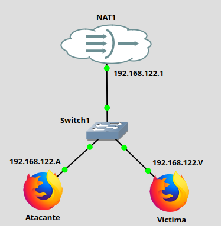
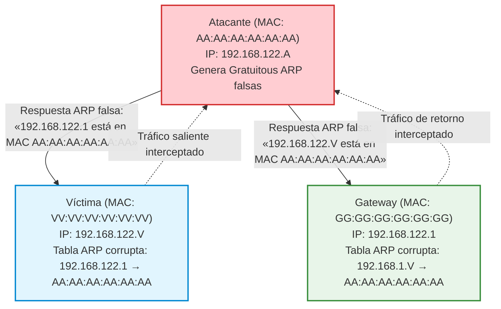

# Práctica 5.4: Intercepción Man-In-The-Middle (MITM) y ARP Spoofing con Ettercap y Wireshark

!!! note "Datos de la Práctica"
    * **Módulo:** Seguridad y Alta Disponibilidad (SAD - 0378)
    * **Unidad Didáctica:** UD5 - Seguridad Activa y Auditorías en Redes Corporativas
    * **Requisitos:** Escenario de red virtualizada en GNS3, VirtualBox o KVM con 3 máquinas en el mismo segmento de red LAN:
        1. **Atacante:** Kali Linux o Debian/Ubuntu con `ettercap-text-only`, `ettercap-graphical`.
        2. **Víctima (Cliente):** Linux o Windows (cliente web/FTP).
        3. **Servidor / Pasarela (Gateway):** Router o Servidor Web/FTP de pruebas (ej. Debian con Apache o vsftpd).
    * **Privilegios:** Acceso de superusuario (`sudo`) en la máquina atacante.

---

## 1. Objetivos de la Práctica

* Comprender la ausencia de mecanismos nativos de autenticación en el protocolo **ARP** (*Address Resolution Protocol*) en redes de área local Ethernet.
* Analizar la mecánica del ataque de **envenenamiento de caché ARP** (*ARP Spoofing / ARP Poisoning*) para situarse en la trayectoria del tráfico (**Man-In-The-Middle - MITM**).
* Habilitar y comprobar el reenvío de paquetes IP (*IP Forwarding*) en el kernel del atacante para evitar la denegación de servicio (DoS) involuntaria.
* Utilizar la herramienta **Ettercap** en modo consola y modo gráfico para ejecutar el ataque de envenenamiento bidireccional entre la víctima y la pasarela.
* Capturar e inspeccionar tráfico de red en tiempo real mediante **Wireshark**, filtrando flujos de autenticación para extraer credenciales transmitidas en texto claro (HTTP y FTP).
* Analizar e implementar contramedidas defensivas tanto a nivel de host (entradas ARP estáticas) como a nivel de infraestructura de conmutación (Inspección Dinámica de ARP - *DAI* y *DHCP Snooping*).

---

## Topología de Referencia del Laboratorio

Para esta práctica utilizaremos GNS3 con 2 appliances Webterm que nos ofrecen un entorno gráfico con un consumo reducido de recursos.

| Rol del Nodo | Dirección IP | Dirección MAC Ejemplo | Sistema Operativo |
| :--- | :--- | :--- | :--- |
| **Gateway / Pasarela** | `192.168.122.1` | `gg:gg:gg:gg:gg:gg` | GNS3 Host |
| **Víctima (Cliente)** | `192.168.122.V` | `vv:vv:vv:vv:vv:vv` | GNS Webterm  |
| **Atacante (Auditor)** | `192.168.122.A` | `aa:aa:aa:aa:aa:aa` | GNS Webterm |





## 2. Introducción Teórica: La Vulnerabilidad Inherente de ARP

En una red de área local Ethernet (Capa 2), los dispositivos comunican mediante tramas direccionadas por **direcciones físicas MAC**. Cuando un equipo necesita enviar un paquete a una dirección IP dentro de la misma subred, consulta su **tabla de caché ARP local**. Si la entrada no existe, emite una petición ARP (*ARP Request*) en difusión (*broadcast*): *"¿Quién tiene la IP X.X.X.X? Díganselo a mi MAC"*.

El estándar ARP (RFC 826) fue diseñado sin funciones criptográficas ni comprobación de identidad:

* **Confianza Ciega:** Cualquier host puede responder a peticiones ARP, incluso si no iban dirigidas a él.
* **Respuestas No Solicitadas (*Gratuitous ARP*):** Los sistemas operativos actualizan su caché ARP al recibir un paquete de respuesta ARP aunque no hayan emitido ninguna consulta previa.

### Mecánica del Ataque MITM por ARP Spoofing

Un atacante en el mismo dominio de colisión/difusión puede enviar periódicamente paquetes ARP falsificados (*ARP Poisoning*):



1. La víctima cree que la pasarela es el atacante y le envía a él todo el tráfico con destino exterior.
2. La pasarela cree que la víctima es el atacante y le entrega a él todo el tráfico de retorno.
3. Si el atacante tiene habilitado el **reenvío IP (`ip_forward`)**, pasa los paquetes al destinatario legítimo sin que la víctima perciba corte de conexión mientras audita o manipula todo el tráfico transmitido.

---

## 3. Desarrollo Paso a Paso de la Práctica

!!! warning "Aviso Legal y de Ética"
    Esta práctica debe realizarse estrictamente en un entorno virtualizado y controlado de laboratorio. La realización de ataques de intercepción de tráfico o envenenamiento ARP en redes corporativas, educativas o públicas sin autorización expresa es una infracción grave y puede constituir delito según la legislación vigente.

---

### Tarea 1: Inspección de la Tabla ARP en Estado Normal (Pre-Ataque)

1. En la máquina **Víctima**, abre una terminal y consulta la tabla de caché ARP para identificar el estado inicial legítimo:
    * En Linux:
      ```bash
      ip neighbour show
      ```
      *(o alternativamente: `arp -n`)*
    * En Windows:
      ```cmd
      arp -a
      ```
2. Identifica la entrada de la pasarela (`192.168.122.1`) y anota su dirección MAC física legítima.
3. En la máquina **Atacante**, comprueba la conectividad hacia la víctima y hacia la pasarela mediante `ping`:
    ```bash
    ping -c 2 192.168.122.V
    ping -c 2 192.168.122.1
    ```

---

### Tarea 2: Habilitación del Reenvío de Paquetes IP en el Atacante

Si el atacante envenena las tablas ARP pero el kernel de su sistema no tiene activo el enrutamiento de paquetes (*IP Forwarding*), todos los paquetes que reciba de la víctima serán descartados, provocando una **Denegación de Servicio (DoS)** en lugar de una intercepción transparente Man-In-The-Middle.

1. En la máquina **Atacante**, comprueba el estado del parámetro de reenvío en el kernel:
    ```bash
    cat /proc/sys/net/ipv4/ip_forward
    ```
2. Si el valor es `0`, actívalo de forma inmediata con privilegios `sudo`:
    ```bash
    sudo sysctl -w net.ipv4.ip_forward=1
    ```
3. Verifica que la salida devuelve `net.ipv4.ip_forward = 1`.

---

### Tarea 3: Ejecución del Envenenamiento ARP con Ettercap

Ettercap es una herramienta integral para ataques MITM en redes locales que automatiza el envío continuo de paquetes ARP falsificados hacia ambos extremos. Haremos la práctica primero en modo texto y luego con la interfaz gráfica.

#### Método A: Modo Texto por Línea de Comandos (CLI)

1. Instala el comando de ettercap en modo texto
    ```
    sudo apt install ettercap-text-only 
    ```

2. En la terminal del **Atacante**, lanza Ettercap indicando los dos objetivos (Target 1: Víctima, Target 2: Pasarela):
    ```bash
    sudo ettercap -T -q -M arp:remote /192.168.122.V// /192.168.122.1//
    ```
    *Explicación de parámetros:*
    * `-T`: Modo interfaz de texto.
    * `-q`: Modo silencioso (*quiet*), evita imprimir paquetes redundantes.
    * `-M arp:remote`: Módulo MITM de envenenamiento ARP bidireccional remoto.
    * `/192.168.122.V// /192.168.122.1//`: Sintaxis interna de objetivos `[IPs]/[Puertos]/[MACs]/[VLANs]`.

3. Continúa en la tarea 4.

#### Método B: Modo Gráfico (GUI)

1. En la máquina atacante, abre la interfaz gráfica de Ettercap:
    ```bash
    sudo ettercap -G
    ```
2. Selecciona la interfaz de red conectada a la LAN (ej. `eth0`) y pulsa sobre el icono de validación azul (**Sniffing at startup**). Presiona el botón de aceptación en la parte superior.
3. Escanea los hosts activos en la red: Menú hamburguesa **Hosts → Scan for hosts**.
4. Visualiza la lista de equipos detectados: Menú hamburguesa **Hosts → Host List**. Observa sus IP's y direcciónes MAC.
5. Selecciona la IP de la víctima (`192.168.122.V`) y pulsa el botón derecho del ratón: **Add to Target 1**.
6. Selecciona la IP de la pasarela (`192.168.122.1`) y pulsa el botón derecho del ratón:  **Add to Target 2**.
7. Inicia el envenenamiento: Menú superior **MITM menu → ARP poisoning**, marca la casilla **Sniff remote connections** y pulsa **OK**.
8. Continúa en la tarea 4.
---

### Tarea 4: Verificación del Envenenamiento en la Víctima

1. Regresa a la consola de la máquina **Víctima**.
2. Vuelve a consultar la tabla de resolución ARP:
    * En Linux:
      ```bash
      ip neighbour show
      ```
    * En Windows:
      ```cmd
      arp -a
      ```
3. **Comprobación Crítica:** Observa la dirección MAC asociada a la IP de la pasarela (`192.168.122.1`).
    * **Resultado del Ataque:** La dirección MAC del gateway ha sido reemplazada por la dirección MAC de la tarjeta de red del atacante.
    * En la víctima, tanto la pasarela como el atacante figuran ahora con la **misma dirección física MAC**.

---

### Tarea 5: Intercepción de Tráfico y Extracción de Credenciales en Wireshark

Con el ataque activo, todo el tráfico generado por la víctima fluye a través de la interfaz de red del atacante antes de salir al exterior.

1. En la máquina **Atacante** no hace falta que hagas nada especial. Simplemente observa la ventana de comandos donde lanzaste ettercap (modo texto) o mantén abierta la interfaz gráfica de ettercap.

3. En la máquina **Víctima**, abre un navegador web o cliente FTP y realiza una autenticación sobre un servicio web sin cifrar (HTTP) o un servidor FTP de pruebas. Puedes usar la siguiente página web [http://httpbin.org/basic-auth/usuario/secreto](http://httpbin.org/basic-auth/usuario/secreto) que se usa para este tipo de pruebas
    * Usuario de prueba: `usuario`
    * Contraseña de prueba: `secreto`
6. **Inspección de Evidencias:** Observa la salida de ettercap. Al no existir cifrado en la capa de aplicación, el usuario y la contraseña viajan completamente legibles en texto plano.

---

### Tarea 6: Detención del Ataque y Aplicación de Contramedidas

#### 1. Cierre Limpio del Ataque en Ettercap
1. En la ventana de Ettercap, pulsa la tecla `q` (modo CLI) o ve a **MITM → Stop MITM attack** (modo GUI).
2. Ettercap emitirá automáticamente una ráfaga de paquetes ARP legítimos de restauración (*un-poisoning*) para devolver a la víctima y al gateway las direcciones MAC reales.
3. Compruébalo en la víctima.

#### 2. Contramedida en el Host: Entradas ARP Estáticas
Para evitar que un atacante sobrescriba la tabla ARP en un equipo crítico (como un servidor de bases de datos o pasarela de pagos), se puede fijar de forma permanente la entrada MAC de la pasarela:

* En Linux:
  ```bash
  sudo ip neighbour replace 192.168.122.1 lladdr 00:11:22:33:44:55 nud permanent dev eth0
  ```
* En Windows (CMD como Administrador):
  ```cmd
  netsh interface ipv4 add neighbors "Ethernet" "192.168.122.1" "00-11-22-33-44-55"
  ```
*Comprobación:* Una entrada configurada como estática / permanente no se actualizará aunque el atacante inyecte paquetes ARP fraudulentos.

Obtén la dirección MAC de la pasarela 192.168.122.1 y en la víctima incluye la entrada estática según se explica antes. 

Vuelve a lanzar en ARP Poisoning y comprueba si ahora tiene efecto.


#### 3. Contramedidas en Conmutadores Corporativos (Capa 2)
En entornos empresariales no es viable configurar manualmente entradas estáticas en cientos de puestos. Se configuran defensas activas en los switches:

* **DHCP Snooping:** El switch monitoriza los mensajes DHCP y crea una base de datos segura relacionando cada dirección IP asignada con su dirección MAC y el puerto físico del conmutador.
* **Inspección Dinámica de ARP (DAI - *Dynamic ARP Inspection*):** El switch intercepta todas las peticiones y respuestas ARP en los puertos no confiables (*untrusted*) y comprueba que la correspondencia IP/MAC coincida con la tabla de DHCP Snooping. Si la correspondencia no es válida, la trama ARP es descartada inmediatamente.
* **Seguridad de Puertos (*Port Security*):** Limita el número de direcciones MAC permitidas por puerto para evitar desbordamientos de tabla MAC (*CAM Table Flooding*).

---

## 4. Cheatsheet de Diagnóstico y Comandos MITM / ARP

| Acción / Objetivo | Herramienta / Entorno | Sintaxis o Comando Exacto |
| :--- | :--- | :--- |
| **Consultar caché ARP en Linux** | Consola Linux | `ip neighbour show` o `arp -n` |
| **Consultar caché ARP en Windows** | CMD Windows | `arp -a` |
| **Activar reenvío IP en Linux** | Kernel Linux | `sudo sysctl -w net.ipv4.ip_forward=1` |
| **Comprobar reenvío IP** | Consola Linux | `cat /proc/sys/net/ipv4/ip_forward` |
| **Ataque ARP Spoofing CLI** | Ettercap | `sudo ettercap -T -q -M arp:remote /<IP_Víctima>// /<IP_Gateway>//` |
| **Fijar entrada ARP estática (Linux)** | Consola Linux | `sudo ip neighbour replace <IP> lladdr <MAC> nud permanent dev <IF>` |
| **Fijar entrada ARP estática (Win)** | CMD Windows (Admin) | `netsh interface ipv4 add neighbors "<IF>" "<IP>" "<MAC>"` |

---

## 5. Cuestiones de Autoevaluación

1. **Vulnerabilidad de Protocolo:** ¿Por qué el diseño original del protocolo ARP (RFC 826) permite que un equipo malicioso falsifique la identidad de la pasarela de enlace sin ser rechazado por los equipos de la red?
2. **Función del Reenvío IP (*IP Forwarding*):** ¿Qué ocurre técnicamente con la conexión a Internet de la víctima si el atacante ejecuta el envenenamiento ARP pero mantiene desactivado el parámetro `net.ipv4.ip_forward`? ¿Qué diferencia hay entre un ataque MITM y un ataque DoS en este contexto?
3. **Efectividad del Cifrado (HTTPS / TLS):** Si la víctima accede a un sitio web seguro bajo protocolo HTTPS (con certificado digital válido y HSTS activo) mientras sufre un ataque de ARP Spoofing, ¿podrá el atacante leer las contraseñas en texto claro? Justifica qué datos podrá ver el atacante y cuáles quedarán protegidos.
4. **Protección en Infraestructura de Conmutación:** Explica la relación operativa entre **DHCP Snooping** y **Dynamic ARP Inspection (DAI)** en un conmutador de red corporativo. ¿Por qué DAI no puede funcionar de manera autónoma sin una base de datos previa de asignación de direcciones?

---

## 6. Recursos y Enlaces de Referencia

* **[RFC 826 - An Ethernet Address Resolution Protocol](https://datatracker.ietf.org/doc/html/rfc826):** Especificación técnica formal del protocolo ARP.
* **[Ettercap Official Project Documentation](https://www.ettercap-project.org/):** Guía de uso y módulos de auditoría de red de Ettercap.
* **[Cisco Guide: Dynamic ARP Inspection Configuration](https://www.cisco.com/c/en/us/td/docs/switches/lan/catalyst3750/software/release/12-2_55_se/configuration/guide/scg3750/swdynarp.html):** Configuración de contramedidas DAI y DHCP Snooping en conmutadores.
