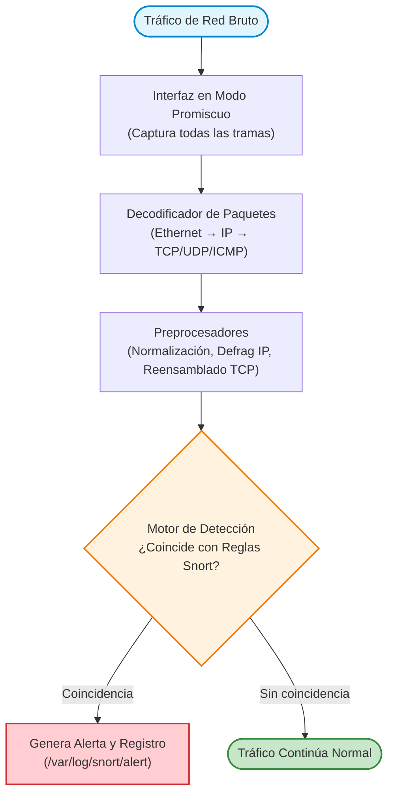

# Práctica 5.5: Despliegue y Análisis de Reglas en IDS/IPS Snort

!!! note "Datos de la Práctica"
    * **Módulo:** Seguridad y Alta Disponibilidad (SAD - 0378)
    * **Unidad Didáctica:** UD5 - Seguridad Activa y Auditorías en Redes Corporativas
    * **Requisitos:** Dos máquinas virtuales Linux (Debian o Ubuntu) conectadas a la misma red virtual (en GNS3, VirtualBox o KVM): una máquina actuará como **Sensor NIDS / Servidor** y la otra como **Equipo Atacante / Auditor**. Acceso a terminal y privilegios `sudo`.

---

## 1. Objetivos de la Práctica

* Comprender la función de los **Sistemas de Detección de Intrusiones de Red (NIDS)** en la arquitectura de seguridad activa.
* Instalar y verificar el funcionamiento del motor de inspección **Snort** en un entorno GNU/Linux.
* Configurar las variables de red del sensor (`HOME_NET` y `EXTERNAL_NET`) para delimitar el perímetro vigilado.
* Dominar la sintaxis formal de las **reglas de detección** (cabecera y opciones).
* Diseñar reglas personalizadas en `local.rules` para detectar tráfico ICMP anómalo, escaneos de puertos y peticiones web sospechosas.
* Ejecutar Snort en modo escucha y analizar las trazas de alerta generadas en tiempo real.
* Evaluar la diferencia conceptual y operativa entre el modo detección (**IDS**) y el modo prevención activa (**IPS**).

---

## 2. Introducción Teórica: Arquitectura NIDS y Sintaxis de Reglas

Un **NIDS** (*Network-based Intrusion Detection System*) analiza los paquetes que atraviesan una interfaz de red, comparando las cabeceras y la carga útil (*payload*) contra un conjunto de firmas o reglas de comportamiento.



### Anatomía de una Regla Snort

Una regla se divide en dos bloques obligatorios:

```text
[ Acción ] [ Protocolo ] [ IP Origen ] [ Puerto Origen ] -> [ IP Destino ] [ Puerto Destino ] ( Opciones )
\______________________________________________________/ \________________________________/
               Cabecera de la Regla (Header)                    Opciones de la Regla
```

1. **Cabecera (*Header*):**
   * **Acción:** Determina qué hacer si el paquete coincide (`alert` genera alerta y anota el evento; `log` solo registra el paquete; `pass` ignora el paquete; `drop` descarta el paquete en modo IPS).
   * **Protocolo:** `ip`, `icmp`, `tcp` o `udp`.
   * **Direcciones y Puertos:** Flujo del tráfico (ej. `$EXTERNAL_NET any -> $HOME_NET 80`). El operador `->` indica dirección unívoca y `<>` bidireccional.

2. **Opciones (*Options*):**
   * `msg`: Texto descriptivo que se mostrará en el log de alertas.
   * `content`: Cadena de texto o secuencia hexadecimal a buscar en el cuerpo del paquete.
   * `nocase`: Modificador para ignorar mayúsculas y minúsculas en la búsqueda.
   * `sid` (*Signature ID*): Identificador numérico único de la regla (las reglas personalizadas deben usar números a partir de `1000001`).
   * `rev`: Número de revisión de la regla.
   * `classtype`: Categoría del ataque para clasificar la severidad.

---

## 3. Desarrollo Paso a Paso de la Práctica

### Escenario de Trabajo Requerido:
* **Máquina 1 - Servidor NIDS (Snort):** Debian/Ubuntu (ej. IP `192.168.1.10`).
* **Máquina 2 - Atacante / Auditor:** Kali Linux o Debian/Ubuntu (ej. IP `192.168.1.20`).

Ambas máquinas deben pertenecer a la misma red y tener conectividad directa.

---

### Tarea 1: Instalación de Snort y Verificación de la Interfaz

1. En la máquina **Servidor NIDS**, actualiza los repositorios e instala el paquete `snort`:
   ```bash
   sudo apt update
   sudo apt install -y snort
   ```

2. Durante la instalación, el asistente solicitará la interfaz de red a monitorizar (ej. `eth0`, `ens33` o `enp0s3`) y el rango de la red local (ej. `192.168.1.0/24`). Si no aparece el menú, se configurará manualmente a continuación.

3. Identifica el nombre exacto de tu interfaz de red:
   ```bash
   ip -brief address
   ```

4. Detén temporalmente el demonio de fondo para trabajar en modo interactivo:
   ```bash
   sudo systemctl stop snort
   ```

---

### Tarea 2: Configuración de Variables de Perímetro en `snort.conf`

1. Abre el archivo principal de configuración de Snort:
   ```bash
   sudo nano /etc/snort/snort.conf
   ```

2. Localiza la sección **Step #1: Set the network variables** y define tu red protegida y la red externa:
   ```text
   ipvar HOME_NET 192.168.1.0/24
   ipvar EXTERNAL_NET !$HOME_NET
   ```
   *(Sustituye `192.168.1.0/24` por el rango real de tu subred de pruebas).*

3. Desplázate hacia el final del archivo hasta la sección de inclusión de reglas (Step #7). Asegúrate de que la línea `include $RULE_PATH/local.rules` no esté comentada:
   ```text
   include $RULE_PATH/local.rules
   ```

4. Guarda los cambios (`Ctrl + O`, `Enter`, `Ctrl + X`).

5. Valida que no existen errores de sintaxis en el archivo de configuración:
   ```bash
   sudo snort -T -c /etc/snort/snort.conf
   ```
   *Comprueba que al final del test aparece el mensaje: `Snort successfully validated the configuration!`.*

---

### Tarea 3: Creación de Reglas de Detección Personalizadas

Editaremos el archivo de reglas locales `/etc/snort/rules/local.rules` para incorporar nuestras propias firmas de seguridad.

1. Abre el archivo de reglas:
   ```bash
   sudo nano /etc/snort/rules/local.rules
   ```

2. Borra o comenta las líneas existentes y añade las siguientes cuatro reglas:

   ```text
   # Regla 1: Detección de paquetes ICMP Echo Request (Ping)
   alert icmp any any -> $HOME_NET any (msg:"[ALERTA-SAD] Sondeo ICMP Ping detectado"; itype:8; sid:1000001; rev:1;)

   # Regla 2: Detección de intentos de conexión al puerto SSH (Puerto 22)
   alert tcp any any -> $HOME_NET 22 (msg:"[ALERTA-SAD] Intento de conexion SSH"; flags:S; sid:1000002; rev:1;)

   # Regla 3: Detección de accesos a panel de administracion web (/admin)
   alert tcp any any -> $HOME_NET 80 (msg:"[ALERTA-SAD] Peticion sospechosa a /admin"; content:"/admin"; nocase; sid:1000003; rev:1;)

   # Regla 4: Detección de patrón básico de inyección SQL en tráfico HTTP
   alert tcp any any -> $HOME_NET 80 (msg:"[ALERTA-SAD] Posible Inyeccion SQL detectada (OR 1=1)"; content:"%27%20OR%20"; nocase; sid:1000004; rev:1;)
   ```

3. Guarda los cambios.

4. Vuelve a comprobar la configuración para asegurar que Snort carga las nuevas reglas sin fallos:
   ```bash
   sudo snort -T -c /etc/snort/snort.conf
   ```

---

### Tarea 4: Ejecución de Snort en Modo Escucha y Registro

Iniciaremos Snort en primer plano, indicándole que muestre las alertas de forma rápida por consola y escuche en la interfaz activa:

```bash
sudo snort -A console -q -u snort -c /etc/snort/snort.conf -i eth0
```
*(Sustituye `eth0` por el nombre de tu tarjeta de red).*

*Parámetros del comando:*
* `-A console`: Imprime las alertas directamente en la pantalla de la terminal.
* `-q`: Modo silencioso (*quiet*), omite banners y estadísticas iniciales.
* `-u snort`: Ejecuta el proceso con el usuario de sistema sin privilegios `snort`.
* `-c`: Ruta al archivo de configuración.
* `-i`: Interfaz de red a monitorizar.

---

### Tarea 5: Generación de Tráfico y Validación de Alertas

Desde la máquina **Atacante / Auditor**, abre una terminal y lanza las siguientes pruebas dirigidas contra la IP del Servidor NIDS (ej. `192.168.1.10`):

#### Prueba 1: Sondeo ICMP
1. En el atacante ejecuta:
   ```bash
   ping -c 3 192.168.1.10
   ```
2. **Observación en el NIDS:** Verifica que aparecen en pantalla las alertas correspondientes:
   `[**] [1:1000001:1] [ALERTA-SAD] Sondeo ICMP Ping detectado [**] ...`

#### Prueba 2: Escaneo TCP SYN al puerto SSH
1. En el atacante ejecuta:
   ```bash
   sudo nmap -sS -p 22 192.168.1.10
   ```
2. **Observación en el NIDS:** Verifica la captura del paquete SYN con la regla `sid:1000002`.

#### Prueba 3: Petición HTTP sospechosa
1. En el servidor NIDS, asegúrate de tener un servidor web activo escuchando en el puerto 80 (puedes instalar `nginx` o `apache2`, o lanzar un servidor Python provisional: `sudo python3 -m http.server 80`).
2. En la máquina atacante lanza una petición con `curl`:
   ```bash
   curl http://192.168.1.10/admin
   ```
3. **Observación en el NIDS:** Comprueba que salta la alerta `sid:1000003` por coincidencia de contenido (*content*).

#### Prueba 4: Simulación de payload SQLi
1. En la máquina atacante simula un ataque de inyección:
   ```bash
   curl "http://192.168.1.10/login?user=%27%20OR%201=1"
   ```
2. **Observación en el NIDS:** Verifica que Snort identifica la firma codificada con `sid:1000004`.

---

### Tarea 6: Auditoría de Registros en Ficheros de Log

Por defecto, además de emitir alertas por consola, Snort almacena las trazas en el directorio `/var/log/snort/`:

1. Detén la ejecución en consola de Snort pulsando `Ctrl + C`.
2. Inspecciona el contenido del fichero de alertas rápidas:
   ```bash
   sudo cat /var/log/snort/snort.alert.fast
   ```
   *(O `sudo cat /var/log/snort/alert` según la versión instalada).*
3. Comprueba que quedan registradas las marcas temporales, IPs de origen y destino, puertos y mensajes descriptivos de cada incidente.

---

## 4. Cheatsheet de Sintaxis y Comandos de Snort

| Elemento / Parámetro | Sintaxis de Ejemplo | Descripción |
| :--- | :--- | :--- |
| **Validar configuración** | `snort -T -c /etc/snort/snort.conf` | Comprueba sintaxis y reglas sin capturar tráfico. |
| **Ejecutar con alertas en pantalla** | `snort -A console -q -c snort.conf -i eth0` | Modo interactivo para depuración y laboratorio. |
| **Acciones en cabecera** | `alert`, `log`, `pass`, `drop` | Tipo de respuesta que ejecuta el motor. |
| **Coincidencia de texto** | `content:"/wp-admin"; nocase;` | Busca una subcadena en la carga útil del paquete. |
| **Banderas TCP** | `flags:S;` o `flags:FSR;` | Filtra por banderas TCP (`S` = SYN, `F` = FIN, `R` = RST). |
| **Filtro de tipo ICMP** | `itype:8;` (Echo Request) | Especifica el código de control del protocolo ICMP. |
| **Identificadores locales** | `sid:1000001; rev:1;` | Obligatorio `sid > 1000000` para reglas de usuario. |

---

## 5. Cuestiones de Autoevaluación

1. **Modo Promiscuo:** ¿Por qué la tarjeta de red del sensor NIDS debe configurarse en modo promiscuo cuando se monitoriza un segmento mediante un puerto espejo (*SPAN*) de un conmutador?
2. **Falsos Positivos vs. Falsos Negativos:** Si configuramos una regla que alerte ante cualquier paquete HTTP que contenga la palabra `SELECT`, ¿qué tipo de error cometerá el IDS con frecuencia y por qué?
3. **IDS vs. IPS:** En esta práctica hemos utilizado la acción `alert`. Si cambiásemos la acción a `drop`, ¿qué requisitos arquitectónicos adicionales debe cumplir el servidor para que el tráfico malicioso sea realmente bloqueado en la red?
4. **Cifrado HTTPS:** Si la víctima y el atacante se comunican mediante HTTPS (puerto 443 con TLS 1.3), ¿por qué las reglas basadas en `content` (como la de `/admin` o SQLi) dejan de ser efectivas en un NIDS tradicional? ¿Qué solución técnica se requeriría?
