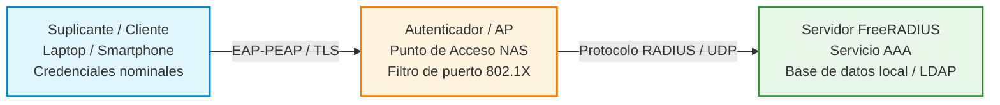

# Práctica 5.5: Despliegue de un Servidor de Autenticación RADIUS con FreeRADIUS

!!! note "Datos de la Práctica"
    * **Módulo:** Seguridad y Alta Disponibilidad (SAD - 0378)
    * **Unidad Didáctica:** UD5 - Seguridad Activa y Auditorías en Redes Corporativas
    * **Requisitos:** Un servidor Linux (Debian o Ubuntu) para albergar FreeRADIUS 3.0, un punto de acceso/router inalámbrico o simulador en GNS3/VirtualBox (con soporte WPA2/WPA3 Enterprise / IEEE 802.1X), y un equipo cliente/móvil suplicante. Privilegios `sudo`.

---

## 1. Objetivos de la Práctica

* Comprender el funcionamiento del protocolo de autenticación centralizada **RADIUS** (*Remote Authentication Dial-In User Service*) y la arquitectura **AAA** (*Authentication, Authorization, Accounting*).
* Desplegar y configurar el servicio **FreeRADIUS 3.0** en una distribución Linux.
* Configurar usuarios, contraseñas y parámetros de red en el archivo `/etc/freeradius/3.0/users`.
* Registrar equipos de red (Puntos de Acceso / Routers NAS - *Network Access Server*) como clientes autorizados en `/etc/freeradius/3.0/clients.conf` mediante clave compartida (*secret*).
* Habilitar la auditoría de accesos y registro de trazas de autenticación (*Accounting*) en FreeRADIUS.
* Configurar un punto de acceso inalámbrico en modo **WPA2-Enterprise / WPA3-Enterprise (IEEE 802.1X)** vinculado al servidor RADIUS.
* Realizar pruebas de autenticación desde un dispositivo cliente (suplicante) y auditar los accesos registrados en `/var/log/freeradius/radius.log`.

---

## 2. Introducción Teórica: La Arquitectura AAA e IEEE 802.1X

En redes corporativas, el uso de claves compartidas (WPA2-Personal / PSK) presenta graves inconvenientes: todos los empleados usan la misma contraseña, no se puede identificar individualmente quién accede y cambiar la clave exige reconfigurar todos los dispositivos.

Para resolver esto se emplea el estándar **IEEE 802.1X** con un servidor **RADIUS** (Modelo AAA):



### Componentes de la Arquitectura:

1. **Suplicante (Cliente):** El dispositivo (PC, smartphone) que solicita acceso a la red proporcionando credenciales individuales.
2. **Autenticador (NAS - *Network Access Server*):** El switch o punto de acceso Wi-Fi. Bloquea todo el tráfico salvo las tramas de autenticación EAP hacia el servidor RADIUS.
3. **Servidor de Autenticación (FreeRADIUS):** Valida las credenciales recibidas, consulta las políticas de acceso y responde con un mensaje `Access-Accept` o `Access-Reject`.

### Posibles Escenarios de Montaje de la Práctica

Para la realización del laboratorio puedes optar por uno de los dos escenarios siguientes en función del equipamiento disponible:

#### Opción A: Escenario con Punto de Acceso dedicado (AP)
En este montaje el Punto de Acceso actúa como autenticador conectado directamente a la misma red local que el servidor FreeRADIUS:


#### Opción B: Escenario con Router Inalámbrico
En este montaje se emplea un router Wi-Fi doméstico o de laboratorio configurado para delegar la autenticación de su red inalámbrica en el servidor FreeRADIUS:


!!! tip "Emulación sin dispositivo físico"
    Si no dispones de un punto de acceso físico en casa o en el aula, puedes realizar pruebas de configuración y explorar las opciones de seguridad WPA-Enterprise mediante el [Emulador Web de Punto de Acceso D-Link](https://anweb.dlink.ru/).

---

## 3. Desarrollo Paso a Paso de la Práctica

### Tarea 1: Instalación de FreeRADIUS y Utilidades

1. En el servidor Linux destinado a RADIUS, actualiza los repositorios e instala FreeRADIUS y sus herramientas de prueba (`freeradius-utils`):
   ```bash
   sudo apt update
   sudo apt install freeradius freeradius-utils -y
   ```
2. Comprueba que el servicio se encuentra activo y escuchando en los puertos UDP **1812** (Autenticación) y **1813** (Anotación/Accounting):
   ```bash
   sudo systemctl status freeradius
   sudo ss -tulpn | grep freeradius
   ```

---

### Tarea 2: Configuración de Usuarios y Credenciales en `users`

1. Abre el archivo de usuarios de FreeRADIUS:
   ```bash
   sudo nano /etc/freeradius/3.0/users
   ```
2. Añade al principio del archivo la definición de dos usuarios de prueba con contraseñas en claro (`Cleartext-Password`):
   ```text
   # Usuario de prueba 1
   testing Cleartext-Password := "1234"

   # Usuario de prueba nominal (SAD)
   roman Cleartext-Password := "ClaveSegura2026!"
   ```
3. Guarda los cambios (`Ctrl + O`) y sal (`Ctrl + X`).
4. Reinicia el servicio FreeRADIUS:
   ```bash
   sudo systemctl restart freeradius
   ```

---

### Tarea 3: Verificación Local del Servidor con `radtest`

Antes de conectar el punto de acceso inalámbrico, probaremos localmente que la base de datos de usuarios responde correctamente:

1. Ejecuta el comando de diagnóstico `radtest` simulando una petición de autenticación:
   ```bash
   radtest roman ClaveSegura2026! 127.0.0.1 1812 testing123
   ```
   Los parámetros del comando son:

    * Usuario que has dado de alta en users: roman
    * Su contraseña: ClaveSegura2026!
    * Nombre del cliente, en este caso, localhost o 127.0.0.1
    * Un número de puerto. Vale cualquiera.
    * Contraseña que usa localhost para validase frente al servidor freeradius ( directiva secret de clients.conf).

2. **Resultado esperado:**
   ```text
   Sent Access-Request Id 78 from 0.0.0.0:54321 to 127.0.0.1:1812
   Received Access-Accept Id 78 from 127.0.0.1:1812 length 20
   ```
   Si la clave es errónea, devolverá `Received Access-Reject`.

---

### Tarea 4: Configuración de Clientes NAS en `clients.conf`

Para que el punto de acceso Wi-Fi o router pueda enviar peticiones al servidor RADIUS, debemos registrar su dirección IP y una clave compartida (*Secret*):

1. Abre el archivo de clientes:
   ```bash
   sudo nano /etc/freeradius/3.0/clients.conf
   ```
2. Añade un nuevo bloque para registrar tu Punto de Acceso / Router Wi-Fi (ejemplo con IP `192.168.1.254`):
   ```text
   client router_wifi_ap {
       ipaddr = 192.168.122.99
       secret = ElCaminas             
       shortname = MikroTik 
   }
   ```
   *(Si trabajas con un rango entero de red local, puedes usar la máscara CIDR: `ipaddr = 192.168.1.0/24`).*

3. Guarda y reinicia FreeRADIUS:
   ```bash
   sudo systemctl restart freeradius
   ```

---

### Tarea 5: Activación de Logs de Auditoría (*Accounting*)

1. Abre el fichero principal de configuración `/etc/freeradius/3.0/radiusd.conf`:
   ```bash
   sudo nano /etc/freeradius/3.0/radiusd.conf
   ```
2. Localiza la sección `log { ... }` y asegúrate de habilitar el registro de intentos de acceso exitosos y fallidos:
   ```text
   log {
       destination = files
       file = ${logdir}/radius.log
       auth = yes
       auth_badpass = yes
       auth_goodpass = yes
   }
   ```
3. Reinicia el servicio: `sudo systemctl restart freeradius`.

---

### Tarea 6: Configuración del Punto de Acceso Inalámbrico (WPA2/WPA3 Enterprise)

1. Accede a la interfaz web de administración de tu router/AP Wi-Fi.
2. En la sección de configuración de la red inalámbrica, selecciona el modo de seguridad:

    * **Modo de Seguridad:** WPA2-Enterprise / WPA3-Enterprise (IEEE 802.1X).
    * **Dirección IP del Servidor RADIUS:** La IP de tu servidor Linux FreeRADIUS (ej. `192.168.1.100`).
    * **Puerto RADIUS:** `1812` UDP.
    * **Clave compartida (Secret):** `ClaveSecretaRADIUS2026` (debe coincidir exactamente con la configurada en `clients.conf`).


---

### Tarea 7: Validación de Conexión desde el Suplicante y Auditoría de Logs

1. Desde un smartphone o PC cliente, busca la red Wi-Fi corporativa emitida por el AP.
2. Al conectar, el sistema operativo solicitará los parámetros de autenticación Enterprise (EAP-PEAP):

    * **Método EAP:** PEAP (o TTLS).
    * **Autenticación de Fase 2 (Inner):** MSCHAPv2 (o GTC).
    * **Certificado CA:** *"No validar"* (o seleccionar certificado de pruebas).
    * **Identidad / Usuario:** `roman`
    * **Contraseña:** `ClaveSegura2026!`

| Conexión en Smartphone Android | Parámetros de Seguridad Avanzados |
| :---: | :---: |
|  |  |

3. Conéctate a la red y comprueba que se valida la identidad y se obtiene dirección IP para navegar.
4. En el servidor FreeRADIUS, audita el registro de accesos en tiempo real:
    ```bash
    sudo tail -f /var/log/freeradius/radius.log
    ```
5. Realiza una prueba introduciendo una contraseña incorrecta y verifica que queda registrado el intento fallido (`Auth: Login incorrect...`).

---

## 4. Cheatsheet de Administración de FreeRADIUS

| Acción / Objetivo | Fichero o Comando | Sintaxis / Detalle |
| :--- | :--- | :--- |
| **Instalar FreeRADIUS** | Comando `apt` | `sudo apt install freeradius freeradius-utils` |
| **Añadir usuario y clave** | `/etc/freeradius/3.0/users` | `usuario Cleartext-Password := "contraseña"` |
| **Registrar cliente NAS / AP** | `/etc/freeradius/3.0/clients.conf` | `client AP { ipaddr = 192.168.1.X; secret = clave }` |
| **Prueba local de credenciales** | Comando `radtest` | `radtest <user> <pass> <host> <port> <secret>` |
| **Modo Depuración (Debug Manual)** | Comando `freeradius -X` | Ejecuta el servidor en primer plano mostrando trazas detalladas. |
| **Inspección de Logs de Acceso** | `/var/log/freeradius/radius.log` | `sudo tail -f /var/log/freeradius/radius.log` |

---

## 5. Cuestiones de Autoevaluación

1. **Ventaja organizativa:** ¿Por qué la arquitectura WPA2/WPA3 Enterprise basada en RADIUS es infinitamente más segura en una empresa que el uso de una clave Wi-Fi compartida (PSK)?
2. **Función del Secret:** ¿Qué función cumple la clave secreta compartida (*secret*) configurada en `clients.conf` entre el servidor RADIUS y el Punto de Acceso AP?
3. **Uso del modo depuración (`freeradius -X`):** Si un cliente no puede autenticarse a través del AP, ¿por qué se recomienda detener el servicio `systemctl` y ejecutar `sudo freeradius -X` para diagnosticar el problema?
4. **Auditoría e Incidentes:** ¿Qué información valiosa queda registrada en `/var/log/freeradius/radius.log` cuando un usuario descontento intenta acceder a la red fuera de su horario laboral?

---

## 6. Recursos y Enlaces de Referencia

* **[FreeRADIUS Documentation & WPA-HOWTO](https://wiki.freeradius.org/guide/WPA-HOWTO):** Guía técnica oficial para configuración de WPA-Enterprise y certificados TLS.
* **[Tabla de Compatibilidad de Protocolos EAP y FreeRADIUS](http://deployingradius.com/documents/protocols/compatibility.html):** Resumen de compatibilidad entre clientes, métodos EAP (PEAP, TLS, TTLS) y almacenes de contraseñas.
* **[Emulador Web de Punto de Acceso D-Link](https://anweb.dlink.ru/):** Entorno interactivo para simular la interfaz web de routers y puntos de acceso Wi-Fi.
