# Práctica 5.5: Despliegue de un Servidor de Autenticación RADIUS con FreeRADIUS

!!! note "Datos de la Práctica"
    * **Módulo:** Seguridad y Alta Disponibilidad (SAD - 0378)
    * **Unidad Didáctica:** UD5 - Seguridad Activa y Auditorías en Redes Corporativas
    * **Requisitos:** Un servidor Linux (Debian o Ubuntu) para albergar FreeRADIUS 3.0, un punto de acceso/router inalámbrico o router MikroTik en GNS3/VirtualBox (con soporte WPA2/WPA3 Enterprise o Dot1X / IEEE 802.1X), y un equipo cliente (móvil suplicante o máquina Linux con `wpa_supplicant`). Privilegios `sudo`.

---

## 1. Objetivos de la Práctica

* Comprender el funcionamiento del protocolo de autenticación centralizada **RADIUS** (*Remote Authentication Dial-In User Service*) y la arquitectura **AAA** (*Authentication, Authorization, Accounting*).
* Desplegar y configurar el servicio **FreeRADIUS 3.0** en una distribución Linux.
* Configurar usuarios, contraseñas y parámetros de red en el archivo `/etc/freeradius/3.0/users`.
* Registrar equipos de red (Puntos de Acceso / Routers NAS - *Network Access Server*) como clientes autorizados en `/etc/freeradius/3.0/clients.conf` mediante clave compartida (*secret*).
* Habilitar la auditoría de accesos y registro de trazas de autenticación (*Accounting*) en FreeRADIUS.
* Configurar un punto de acceso inalámbrico o router MikroTik en modo **WPA2/WPA3-Enterprise / Dot1X (IEEE 802.1X)** vinculado al servidor RADIUS.
* Realizar pruebas de autenticación desde un dispositivo cliente (suplicante Wi-Fi móvil o suplicante cableado Linux mediante `wpa_supplicant`) y auditar los accesos registrados en `/var/log/freeradius/radius.log`.

---

## 2. Introducción Teórica: La Arquitectura AAA e IEEE 802.1X

En redes corporativas, el uso de claves compartidas (WPA2-Personal / PSK) presenta graves inconvenientes: todos los empleados usan la misma contraseña, no se puede identificar individualmente quién accede y cambiar la clave exige reconfigurar todos los dispositivos.

Para resolver esto se emplea el estándar **IEEE 802.1X** con un servidor **RADIUS** (Modelo AAA):

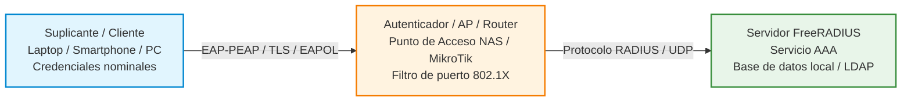

### Componentes de la Arquitectura:

1. **Suplicante (Cliente):** El dispositivo (PC, smartphone) que solicita acceso a la red proporcionando credenciales individuales.
2. **Autenticador (NAS - *Network Access Server*):** El switch, router o punto de acceso Wi-Fi. Bloquea todo el tráfico ordinario salvo las tramas de autenticación EAP hacia el servidor RADIUS.
3. **Servidor de Autenticación (FreeRADIUS):** Valida las credenciales recibidas, consulta las políticas de acceso y responde con un mensaje `Access-Accept` o `Access-Reject`.

### Posibles Escenarios de Montaje de la Práctica

Para la realización del laboratorio puedes optar por uno de los escenarios siguientes en función del equipamiento disponible:

#### Opción A: Escenario con Punto de Acceso dedicado (AP)
En este montaje el Punto de Acceso actúa como autenticador conectado directamente a la misma red local que el servidor FreeRADIUS:

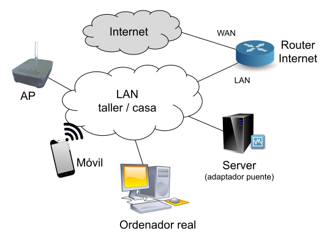

#### Opción B: Escenario con Router Inalámbrico
En este montaje se emplea un router Wi-Fi doméstico o de laboratorio configurado para delegar la autenticación de su red inalámbrica en el servidor FreeRADIUS:

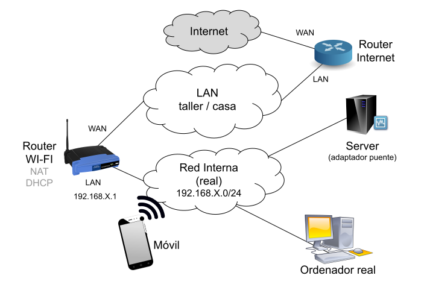

#### Opción C: Escenario Emulado con Router MikroTik (Dot1X Cableado)
Si no dispones de un punto de acceso físico en casa o en el aula, puedes realizar la práctica mediante emulación en GNS3 o máquina virtual, configurando el servicio Dot1X sobre un puerto Ethernet de MikroTik RouterOS y utilizando un cliente Linux con `wpa_supplicant`.

!!! tip "Emulador Web de Puntos de Acceso"
    Para explorar las opciones de configuración web de un punto de acceso WPA-Enterprise sin hardware físico, también puedes consultar el [Emulador Web de Punto de Acceso D-Link](https://anweb.dlink.ru/){target="_blank"}.

---

## 3. Desarrollo Paso a Paso de la Práctica

### Tarea 1: Instalación de FreeRADIUS y Utilidades

1. En el servidor Linux destinado a RADIUS, actualiza los repositorios e instala FreeRADIUS y sus herramientas de prueba (`freeradius-utils`):
   ```bash
   sudo apt update
   sudo apt install -y freeradius freeradius-utils
   ```
2. Comprueba que el servicio se encuentra activo y escuchando en los puertos UDP **1812** (Autenticación) y **1813** (Anotación / Accounting):
   ```bash
   sudo systemctl status freeradius
   sudo ss -tulpn | grep freeradius
   ```

---

### Tarea 2: Configuración de Usuarios y Credenciales en `users`

1. Abre el archivo de usuarios de FreeRADIUS:
   ```bash
   sudo nano /etc/freeradius/3.0/users
   ```
2. Añade al principio del archivo la definición de dos usuarios de prueba con contraseñas en claro (`Cleartext-Password`):
   ```text
   # Usuario de prueba 1
   testing Cleartext-Password := "1234"

   # Usuario de prueba nominal (SAD)
   roman Cleartext-Password := "ClaveSegura2026!"
   ```
3. Guarda los cambios (`Ctrl + O`, Enter) y sal (`Ctrl + X`).
4. Reinicia el servicio FreeRADIUS:
   ```bash
   sudo systemctl restart freeradius
   ```

---

### Tarea 3: Verificación Local del Servidor con `radtest`

Antes de conectar el punto de acceso inalámbrico o el router, probaremos localmente que el motor de FreeRADIUS y la base de datos de usuarios responden correctamente:

1. Ejecuta el comando de diagnóstico `radtest` simulando una petición de autenticación:
   ```bash
   radtest roman ClaveSegura2026! 127.0.0.1 1812 testing123
   ```
    * **Desglose de los parámetros del comando:**
        * `roman`: Nombre de usuario dado de alta en `/etc/freeradius/3.0/users`.
        * `ClaveSegura2026!`: Contraseña del usuario.
        * `127.0.0.1`: Dirección IP del servidor RADIUS a consultar (`localhost`).
        * `1812`: Puerto estándar UDP de autenticación RADIUS.
        * `testing123`: Clave secreta que usa `localhost` para validarse frente a FreeRADIUS (definida por defecto en `/etc/freeradius/3.0/clients.conf` para el cliente local).

2. **Resultado esperado:**
   ```text
   Sent Access-Request Id 78 from 0.0.0.0:54321 to 127.0.0.1:1812
   Received Access-Accept Id 78 from 127.0.0.1:1812 length 20
   ```
   *Si la clave o el usuario son erróneos, el servidor devolverá `Received Access-Reject`.*

---

### Tarea 4: Configuración de Clientes NAS en `clients.conf`

Para que el punto de acceso Wi-Fi o router pueda enviar peticiones al servidor RADIUS, debemos registrar su dirección IP y una clave compartida (*Secret*):

1. Abre el archivo de clientes:
   ```bash
   sudo nano /etc/freeradius/3.0/clients.conf
   ```
2. Añade un nuevo bloque para registrar tu Punto de Acceso / Router Wi-Fi o MikroTik (ejemplo con la subred de red local `192.168.122.0/24`):
   ```text
   client router_wifi_ap {
       ipaddr = 192.168.122.0/24
       secret = ElCaminas             
       shortname = MikroTik 
   }
   ```

!!! tip "Direccionamiento IP del cliente NAS"
    Si conoces la IP exacta del Punto de Acceso o router MikroTik, puedes indicarla de forma individualizada (ej. `ipaddr = 192.168.122.99`). Indicar la subred completa con máscara `/24` resulta muy cómodo en laboratorio para permitir que cualquier equipo de esa red actúe como autenticador sin generar errores de rechazo.

3. Guarda los cambios (`Ctrl + O`, Enter, `Ctrl + X`) y reinicia FreeRADIUS:
   ```bash
   sudo systemctl restart freeradius
   ```

---

### Tarea 5: Activación de Logs de Auditoría (*Accounting*)

1. Abre el fichero principal de configuración `/etc/freeradius/3.0/radiusd.conf`:
   ```bash
   sudo nano /etc/freeradius/3.0/radiusd.conf
   ```
2. Localiza la sección `log { ... }` y asegúrate de habilitar el registro de intentos de acceso exitosos y fallidos:
   ```text
   log {
       destination = files
       file = ${logdir}/radius.log
       auth = yes
       auth_badpass = yes
       auth_goodpass = yes
   }
   ```
3. Reinicia el servicio para aplicar los cambios:
   ```bash
   sudo systemctl restart freeradius
   ```

---

### Tarea 6: Configuración del Punto de Acceso Inalámbrico (WPA2/WPA3 Enterprise)

Si dispones de un punto de acceso (AP) físico o emulador conectado a la misma red local que el servidor FreeRADIUS, podrás realizar una prueba de validación con un cliente móvil o PC inalámbrico.

1. Accede a la interfaz web de administración de tu router o AP Wi-Fi.
2. En la sección de configuración de la red inalámbrica, selecciona el modo de seguridad corporativo:
    * **Modo de Seguridad:** WPA2-Enterprise / WPA3-Enterprise (IEEE 802.1X).
    * **Dirección IP del Servidor RADIUS:** La IP de tu servidor Linux FreeRADIUS (ej. `192.168.122.X`).
    * **Puerto RADIUS:** `1812` UDP.
    * **Clave compartida (Secret):** `ElCaminas` (debe coincidir exactamente con la configurada en `clients.conf`).

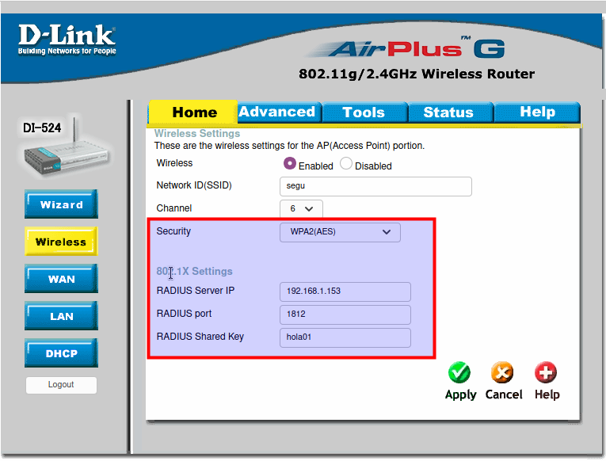

---

#### Validación de Conexión desde el Suplicante Móvil y Auditoría de Logs

1. Desde un smartphone o PC cliente, busca la red Wi-Fi corporativa emitida por el AP.
2. Al conectar, el sistema operativo solicitará los parámetros de autenticación Enterprise (EAP-PEAP):
    * **Método EAP:** PEAP (o TTLS).
    * **Autenticación de Fase 2 (Inner):** MSCHAPv2 (o GTC).
    * **Certificado CA:** *"No validar"* (o seleccionar certificado de pruebas).
    * **Identidad / Usuario:** `roman`
    * **Contraseña:** `ClaveSegura2026!`

| Conexión en Smartphone Android | Parámetros de Seguridad Avanzados |
| :---: | :---: |
| 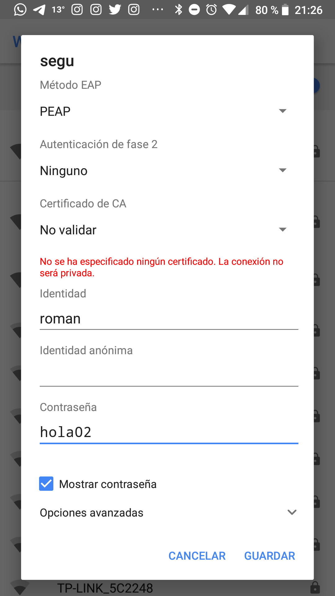 | 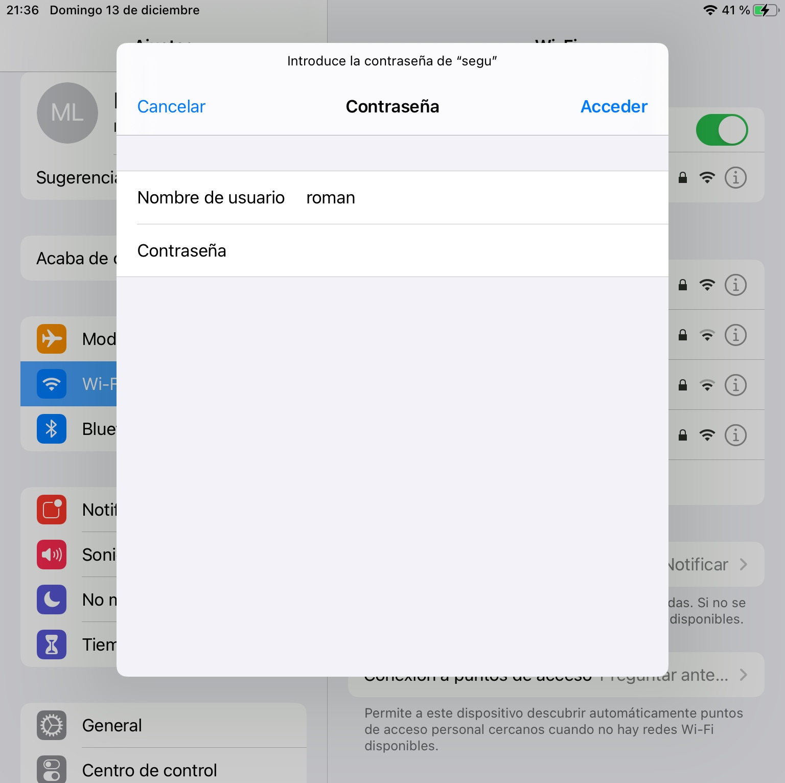 |

3. Conéctate a la red y comprueba que se valida la identidad y se obtiene dirección IP para navegar.
4. En el servidor FreeRADIUS, audita el registro de accesos en tiempo real:
   ```bash
   sudo tail -f /var/log/freeradius/radius.log
   ```
5. Realiza una prueba introduciendo una contraseña incorrecta y verifica que queda registrado el intento fallido (`Auth: Login incorrect...`).

---

### Tarea 7: Emulación de Autenticación 802.1X con Router MikroTik (Escenario Cableado Dot1X)

Si no dispones de un punto de acceso Wi-Fi físico, puedes realizar la autenticación de red con un router MikroTik RouterOS simulando la conexión mediante cable en la interfaz `ether2`.

Para recrear el escenario de autenticación WPA2/WPA3 Enterprise (802.1X/EAP) sobre un enlace Ethernet en RouterOS, no se utiliza la sección *Wireless* (ya que `ether2` es un puerto Ethernet físico), sino el servicio **Dot1X**. El router MikroTik actúa como **NAS / Autenticador 802.1X**, delegando la validación de credenciales en el servidor FreeRADIUS conectado a `ether1`, mientras que el equipo cliente conectado a `ether2` actúa como **Suplicante** (*Supplicant*).

#### Fase 1: Acceso Inicial a MikroTik y Entorno WebFig / WinBox

En primer lugar, abre la consola en MikroTik (o terminal en entorno virtualizado) para obtener su dirección IP de gestión:

1. Introduce el usuario por defecto: `admin`.
2. Contraseña (*Password*): dejar en blanco (pulsar Enter).
3. Cuando el sistema solicite asignar una nueva contraseña al usuario `admin`, introduce una clave sencilla dos veces (ej. `admin`).
4. Consulta la dirección IP asignada a la interfaz de administración:
   ```routeros
   /ip/address/print
   ```
5. Desde el navegador web de tu equipo anfitrión o máquina de gestión, accede a la IP obtenida (`http://<IP_MIKROTIK>`) para administrar el router mediante **WebFig** (o mediante la utilidad WinBox).

#### Fase 2: Configuración del Router MikroTik como Autenticador Dot1X

A continuación se detalla la configuración paso a paso a través de la interfaz gráfica (WebFig / WinBox):

1. **Configuración de la red local en `ether2` (QuickSet):**
   Accede a **QuickSet** y define el direccionamiento IP de la red local sobre la interfaz `ether2`. Asegúrate de habilitar el servidor DHCP y el enmascaramiento NAT:

   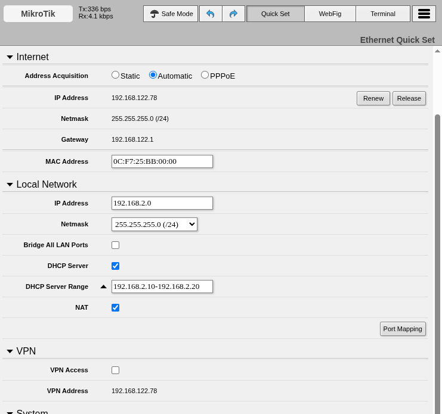

2. **Registrar el servidor RADIUS en RouterOS (`/radius`):**
   Define el servidor FreeRADIUS como backend de autenticación para los servicios Dot1X:
    1. En el menú lateral, accede a **RADIUS**.
    2. Haz clic en **+ (Add)** para añadir una nueva entrada de cliente RADIUS.
    3. Configura los parámetros de conexión tal como se ilustra en la captura:
        * **Service:** Marca la casilla **`dot1x`**.
        * **Address:** Dirección IP del servidor FreeRADIUS (ej. `192.168.122.99`).
        * **Secret:** Clave secreta compartida configurada en `clients.conf` (`ElCaminas`).
        * **Authentication Port:** `1812`.
        * **Accounting Port:** `1813`.
    4. Haz clic en **OK** para guardar.

   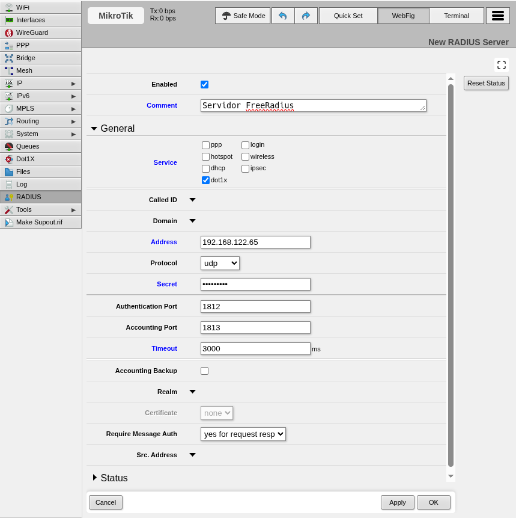

3. **Configurar el puerto `ether2` como autenticador 802.1X:**
   Activa el servidor Dot1X en la interfaz cableada `ether2` que da servicio al equipo cliente:
    1. En el menú lateral, accede a **Dot1X**.
    2. En la pestaña **Server**, haz clic en **+ (Add)**.
    3. Selecciona la interfaz `ether2` y los métodos de autenticación correspondientes.
    4. Haz clic en **OK** para activar el filtrado de puerto.

   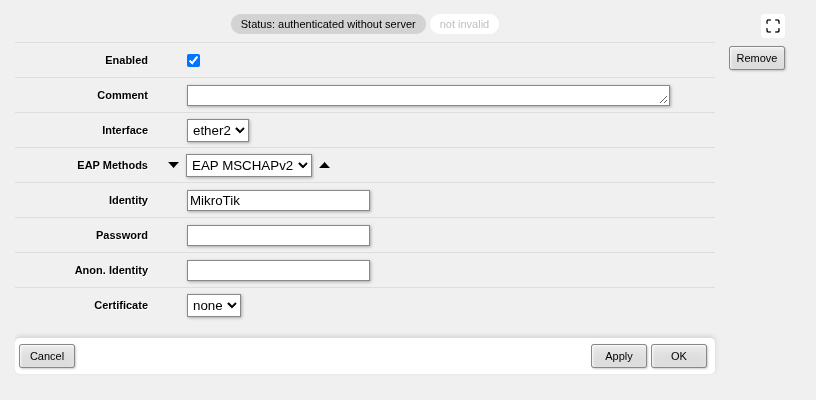

   !!! note "Comportamiento del tráfico en el puerto 802.1X"
       Mientras el puerto no esté autenticado, `ether2` permanecerá bloqueado a nivel de Capa 2 para cualquier tráfico ordinario (IP, ARP, DHCP). Únicamente se permite el paso de tramas **EAPOL** (*EAP over LAN*). En cuanto el suplicante se valida satisfactoriamente frente a FreeRADIUS, el estado del puerto cambia automáticamente a `authorized`, permitiendo el paso completo del tráfico de red.

#### Fase 3: Configuración del Suplicante en Linux (`wpa_supplicant`) y Validación

Como equipo suplicante utilizaremos una máquina Linux (Debian o Ubuntu) conectada al puerto `ether2` del router MikroTik.

Para negociar la autenticación IEEE 802.1X cableada en Linux se requiere el demonio **`wpa_supplicant`**:

1. **Instalación del software suplicante:**
   ```bash
   sudo apt update && sudo apt install -y wpasupplicant
   ```

2. **Creación del archivo de configuración 802.1X:**
   Crea el archivo `/etc/wpa_supplicant/dot1x.conf` con las credenciales del usuario:
   ```text
   ctrl_interface=/run/wpa_supplicant
   ap_scan=0
   fast_reauth=1

   network={
       key_mgmt=IEEE8021X
       eap=PEAP
       phase2="auth=MSCHAPV2"
       identity="roman"
       password="ClaveSegura2026!"
   }
   ```

   !!! tip "Directiva ap_scan=0 en redes cableadas"
       La directiva `ap_scan=0` es obligatoria para interfaces cableadas (Ethernet), ya que indica a `wpa_supplicant` que no busque balizas Wi-Fi (*beacons*) y opere directamente sobre tramas EAPOL cableadas.

3. **Lanzar la autenticación 802.1X:**
   Identifica el nombre de la interfaz de red del cliente conectada a `ether2` (por ejemplo, `ens4` o `eth0` mediante `ip link`) y ejecuta el demonio en segundo plano:
   ```bash
   sudo wpa_supplicant -D wired -i ens4 -c /etc/wpa_supplicant/dot1x.conf -dd &
   ```
    * **`-D wired`:** Especifica el controlador (*driver*) para interfaces cableadas Ethernet.
    * **`-i ens4`:** Interfaz de red del cliente conectada al puerto `ether2` de MikroTik.
    * **`-c /etc/wpa_supplicant/dot1x.conf`:** Ruta al fichero de configuración Dot1X.
    * **`-dd`:** Modo de depuración (*debug*) verbose para visualizar en consola el intercambio completo de tramas EAP (*EAP-Request/Identity*, intercambio TLS/MSCHAPv2 y *EAP-Success*).

4. **Renovación y comprobación de direccionamiento IP:**
   Una vez recibido el mensaje `EAP-Success`, solicita dirección IP al servidor DHCP de MikroTik:
   ```bash
   sudo dhclient -v ens4
   ```
   *(O bien reinicia la pila de red del cliente: `sudo systemctl restart networking`)*

#### Fase 4: Comprobación de Estado en MikroTik y Auditoría en FreeRADIUS

Una vez que el puerto pasa a estado autorizado, el conmutador de MikroTik permite el tráfico normal. Puedes verificarlo tanto en el router como en el servidor:

1. **Supervisión en MikroTik RouterOS (WebFig / WinBox):**
   En la sección **Dot1X**, comprueba las pestañas **State** y **Active**:
    * En la pestaña **State**, verifica que el puerto `ether2` figura como `authorized`.
    * En la pestaña **Active**, comprueba que aparece la sesión autenticada con la MAC del cliente y el usuario `roman`.

   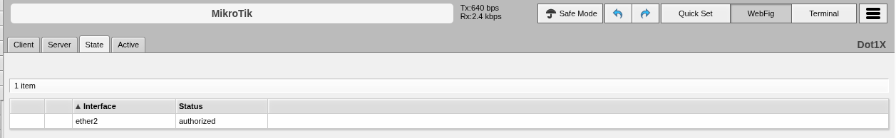

   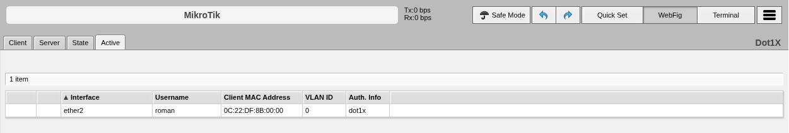

2. **Auditoría de logs en el servidor FreeRADIUS:**
   En el servidor Linux FreeRADIUS, consulta el archivo de registro para verificar la traza de acceso:
   ```bash
   sudo tail -n 25 /var/log/freeradius/radius.log
   ```
   *Comprueba que aparece el evento `Login OK: [roman] (from client MikroTik port ...)` certificando la concesión de acceso nominal.*

---

## 4. Cheatsheet de Administración de FreeRADIUS

| Acción / Objetivo | Fichero o Comando | Sintaxis / Detalle |
| :--- | :--- | :--- |
| **Instalar FreeRADIUS** | Comando `apt` | `sudo apt install freeradius freeradius-utils` |
| **Añadir usuario y clave** | `/etc/freeradius/3.0/users` | `usuario Cleartext-Password := "contraseña"` |
| **Registrar cliente NAS / AP** | `/etc/freeradius/3.0/clients.conf` | `client AP { ipaddr = 192.168.1.X; secret = clave }` |
| **Auditoría de accesos** | `/etc/freeradius/3.0/radiusd.conf` | `auth = yes; auth_badpass = yes; auth_goodpass = yes` |
| **Prueba local de credenciales** | Comando `radtest` | `radtest <user> <pass> <host> 1812 <secret>` |
| **Modo Depuración (Debug Manual)** | Comando `freeradius -X` | Ejecuta el servidor en primer plano mostrando trazas detalladas. |
| **Suplicante 802.1X Cableado** | Comando `wpa_supplicant` | `sudo wpa_supplicant -D wired -i <iface> -c dot1x.conf -dd &` |
| **Inspección de Logs de Acceso** | `/var/log/freeradius/radius.log` | `sudo tail -f /var/log/freeradius/radius.log` |

---

## 5. Cuestiones de Autoevaluación

1. **Ventaja organizativa:** ¿Por qué la arquitectura WPA2/WPA3 Enterprise basada en RADIUS es infinitamente más segura en una empresa que el uso de una clave Wi-Fi compartida (PSK)?
2. **Función del Secret:** ¿Qué función cumple la clave secreta compartida (*secret*) configurada en `clients.conf` entre el servidor RADIUS y el Punto de Acceso AP o router MikroTik?
3. **Uso del modo depuración (`freeradius -X`):** Si un cliente no puede autenticarse a través del AP o MikroTik, ¿por qué se recomienda detener el servicio `systemctl` y ejecutar `sudo freeradius -X` para diagnosticar el problema?
4. **Auditoría e Incidentes:** ¿Qué información valiosa queda registrada en `/var/log/freeradius/radius.log` cuando un usuario descontento intenta acceder a la red fuera de su horario laboral o con credenciales erróneas?
5. **Autenticación en Redes Cableadas:** En entornos de alta seguridad (banca, CPDs, oficinas corporativas), ¿qué ventaja aporta habilitar la autenticación IEEE 802.1X en las rosetas de red física (puertos de switch) frente a una red cableada tradicional abierta?

---

## 6. Recursos y Enlaces de Referencia

* **[FreeRADIUS Documentation & WPA-HOWTO](https://wiki.freeradius.org/guide/WPA-HOWTO){target="_blank"}:** Guía técnica oficial para configuración de WPA-Enterprise y certificados TLS.
* **[Tabla de Compatibilidad de Protocolos EAP y FreeRADIUS](http://deployingradius.com/documents/protocols/compatibility.html){target="_blank"}:** Resumen de compatibilidad entre clientes, métodos EAP (PEAP, TLS, TTLS) y almacenes de contraseñas.
* **[MikroTik RouterOS Documentation: Dot1X (IEEE 802.1X)](https://help.mikrotik.com/docs/display/ROS/Dot1X){target="_blank"}:** Manual oficial de RouterOS para la configuración de servidores y clientes Dot1X en puertos cableados.
* **[Emulador Web de Punto de Acceso D-Link](https://anweb.dlink.ru/){target="_blank"}:** Entorno interactivo para simular la interfaz web de routers y puntos de acceso Wi-Fi.
