# Práctica 5.6: Configuración de un Hotspot con Portal Cautivo en MikroTik RouterOS mediante WebFig

!!! note "Datos de la Práctica"
    * **Módulo:** Seguridad y Alta Disponibilidad (SAD - 0378)
    * **Unidad Didáctica:** UD5 - Seguridad Activa y Auditorías en Redes Corporativas
    * **Entorno de Trabajo:** Router MikroTik físico (RouterBOARD) o máquina virtual **MikroTik CHR** (*Cloud Hosted Router*) en GNS3 / VirtualBox / KVM. Interfaz de administración web (**WebFig**), red WAN con salida a Internet (NAT), red de gestión LAN y red de invitados (Hotspot) con máquina cliente (Ubuntu con Firefox).

---

## 1. Objetivos de la Práctica

* Comprender la arquitectura de un **Hotspot / Portal Cautivo** para el control de acceso e interceptación de tráfico en redes de invitados corporativas.
* Configurar de forma íntegramente gráfica mediante **WebFig** los servicios de red base: direccionamiento IP, pool y servidor DHCP.
* Generar una **Autoridad de Certificación interna (`LocalCA`)** y emitir certificados SSL/TLS para el acceso administrativo seguro (**HTTPS**) y el portal cautivo.
* Desplegar el servicio de Hotspot en MikroTik RouterOS: creación de perfiles de servidor con cifrado HTTPS, instancia del portal y gestión de usuarios locales.
* Auditar el comportamiento del portal desde el cliente: verificar el bloqueo previo de tráfico, la redirección HTTP/HTTPS automática, la autenticación y la salida efectiva a Internet.
* Analizar la persistencia de sesión mediante **Cookies** y monitorizar el estado de los clientes a través de la página web de estado (`/status`).

---

## 2. Introducción Teórica: Arquitectura de un Portal Cautivo

Un **Hotspot o Portal Cautivo** es una solución de seguridad perimetral de Capa 3 y Capa 7 que intercepta todo el tráfico no autenticado procedente de una interfaz o VLAN de invitados. Antes de conceder acceso a la red externa o a Internet, redirige las solicitudes de navegación del cliente a una página web de bienvenida o login donde debe identificarse o aceptar los términos del servicio.

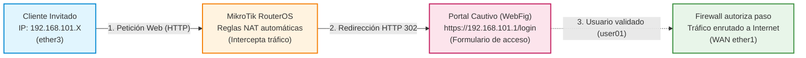

### Ciclo de Vida de la Conexión de un Cliente al Hotspot:

1. **Obtención de Parámetros de Red:** El dispositivo se conecta a la red de invitados (`ether3`) y recibe automáticamente IP, máscara, pasarela y servidores DNS mediante el servidor DHCP configurado en el router.
2. **Interceptación y Aislamiento:** Mientras no esté autenticado, las reglas internas de firewall del Hotspot bloquean el tráfico directo hacia Internet (ICMP, SSH, etc.) e interceptan las peticiones de navegación web (puertos 80 y 443).
3. **Redirección al Portal Seguro (HTTPS):** El router responde al navegador con una redirección hacia la pasarela interna (`https://192.168.101.1/login`), solicitando las credenciales de usuario mediante un canal cifrado SSL/TLS.
4. **Validación y Apertura de Tráfico:** Si el usuario y contraseña son válidos, RouterOS registra la dirección IP y la dirección MAC en su tabla de sesiones activas (`Active Users`) y activa las reglas de enrutamiento y NAT Masquerade para conceder salida a Internet.
5. **Control de Sesión:** El cliente puede comprobar su consumo de datos y tiempo de conexión en `https://192.168.101.1/status`, o cerrar voluntariamente la sesión mediante el botón *Log Off*.

!!! info "Vídeos Didácticos de Referencia"
    Para el seguimiento de esta práctica se utilizan las directrices audiovisuales elaboradas por Román Carceller:
    
    * **[Vídeo 1: MikroTik - Acceso HTTPS (Gestión Segura)](https://www.youtube.com/watch?v=2SK0OiN07Lk):** Creación de la CA interna, firma de certificados digitales y aseguramiento del entorno WebFig por HTTPS.
    * **[Vídeo 2: MikroTik - Instalación y Configuración de un HotSpot](https://youtu.be/LRO8aKzhJS8):** Despliegue gráfico completo del Hotspot, certificados SSL para el portal, pruebas con cliente Ubuntu/Firefox y gestión de cookies.

---

## 3. Escenario de Red y Montaje en GNS3

### Topología Lógica del Escenario

En esta práctica configuraremos un router MikroTik para actuar como HotSpot, aislando el tráfico de los visitantes no autorizados en tres zonas de red:


* **`ether1` (Zona WAN / Internet):** Conectada a la red externa o nube NAT (obtiene IP dinámica por DHCP, p. ej. `192.168.122.X/24`). Dispone de enmascaramiento NAT (*Masquerade*).
* **`ether2` (Zona LAN de Gestión):** Red de administración interna (`192.168.100.0/24`). IP del router: `192.168.100.1`. Desde aquí administraremos el router mediante la interfaz gráfica **WebFig**.
* **`ether3` (Zona Hotspot / Invitados):** Red restringida de visitantes (`192.168.101.0/24`). IP del router: `192.168.101.1`. Alberga a los clientes no autenticados que accederán al portal cautivo.

---

### Montaje del Escenario en GNS3

Para desplegar y realizar este laboratorio en el simulador de redes **GNS3**, conectaremos los dispositivos según el siguiente esquema de red:


#### Appliances de GNS3 requeridos:
* **[MikroTik Cloud Hosted Router (CHR)](https://www.gns3.com/marketplace/appliances/mikrotik-cloud-hosted-router):** Router virtual con RouterOS donde configuraremos los certificados, servicios y el HotSpot.
* **[Firefox Guest Appliance](https://www.gns3.com/marketplace/appliances/firefox-guest):** Cliente gráfico ligero sobre Linux conectado a `ether3` para verificar la redirección del navegador y el acceso al portal cautivo.
* **Dispositivos auxiliares PC100 y PC101 (VPCS o Linux):** Conectados a las redes de gestión y de invitados para comprobación de conectividad e inspección del tráfico antes y después de autenticarse.

---

## 4. Parte 1: Aseguramiento del Acceso a WebFig mediante HTTPS (Vídeo 1)

Antes de desplegar el portal cautivo, debemos asegurar la propia administración del router MikroTik. Por defecto, WebFig utiliza HTTP sin cifrar sobre el puerto 80, lo que expone las credenciales del administrador a ataques de sniffing en la red de gestión.

### Fase 1: Acceso Inicial a MikroTik y Entorno WebFig / WinBox

En primer lugar, abre la consola en MikroTik (o terminal en entorno virtualizado) para obtener su dirección IP de gestión:

1. Introduce el usuario por defecto: `admin`.
2. Contraseña (*Password*): dejar en blanco (pulsar Enter).
3. Cuando el sistema solicite asignar una nueva contraseña al usuario `admin`, introduce una clave sencilla dos veces (ej. `admin`).
4. Consulta la dirección IP asignada a la interfaz de administración:
   ```routeros
   /ip/address/print
   ```
5. Desde el navegador web de tu equipo anfitrión o máquina de gestión, accede a la IP obtenida (`http://<IP_MIKROTIK>`) para administrar el router mediante **WebFig** (o mediante la utilidad WinBox).
6. **Configuración de la red local en `ether2` (QuickSet):**
   Accede a **QuickSet** y define el direccionamiento IP de la red local sobre la interfaz `ether2`. Asegúrate de habilitar el servidor DHCP y el enmascaramiento NAT:

   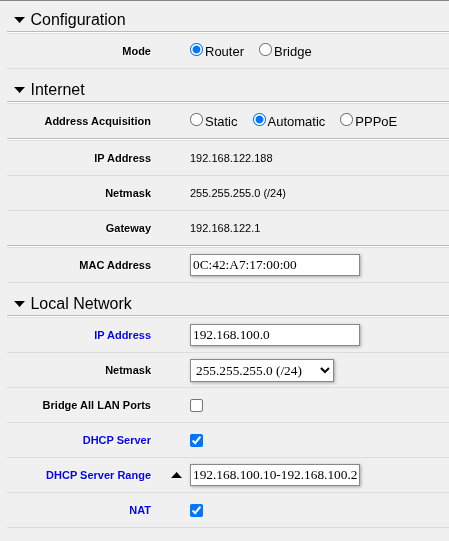

### Tarea 1.1: Creación de la Autoridad de Certificación Raíz (`LocalCA`)

2. En WebFig el menú lateral izquierdo, navega a **System > Certificates**.
3. Pulsa el botón **Add New** (`+`) para definir el certificado raíz de la CA:
    * **Name:** `LocalCA`
    * **Common Name:** `LocalCA`
    * **Key Size:** `2048`
    * **Days Valid:** `365`
    * En el apartado **Key Usage**, marca exclusivamente las casillas:
        * `crl sign`
        * `key cert sign`
4. Pulsa el botón **Apply**.
5. Con la ficha guardada, pulsa el botón **Sign** situado en la barra superior.
    * En el desplegable **Certificate*, selecciona `LocalCA` (autofirma).
    * Pulsa **Start** y espera a que la barra de progreso complete el proceso.
    * Pulsa **Close**.
    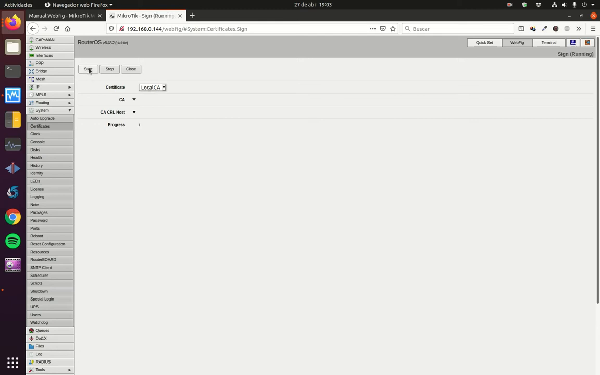
6. En la lista de certificados comprobarás que `LocalCA` muestra los flags **`K`** (*Private Key*), **`A`** (*Authority*) y **`T`** (*Trusted*).


---

### Tarea 1.2: Generación y Firma del Certificado del Servidor Web (`webfig`)

A continuación crearemos el certificado digital que utilizará el servidor web interno de RouterOS para cifrar el tráfico del panel de control.

1. En **System > Certificates**, pulsa nuevamente **Add New** (`+`):
    * **Name:** `webfig`
    * **Common Name:** `192.168.122.x` *(la dirección IP de la interfaz de gestión)*
    * **Key Size:** `2048`
    * **Days Valid:** `365`
    * En **Key Usage** no hace falta que marques nada. Al hacer Apply se marcarán las opciones por defecto.
2. Pulsa el botón **Apply**.
3. Pulsa el botón superior **Sign**:
    * En el desplegable **CA**, selecciona nuestra entidad emisora: `LocalCA`.
    * Pulsa **Start** para firmar la petición con la clave privada de la CA.
    * Cuando finalice, pulsa **Close**.
4. Marca la casilla **Trusted: yes** y pulsa **OK**.
5. El certificado `webfig` quedará validado con los flags **`K`** (*Private Key*) y **`T`** (*Trusted*).

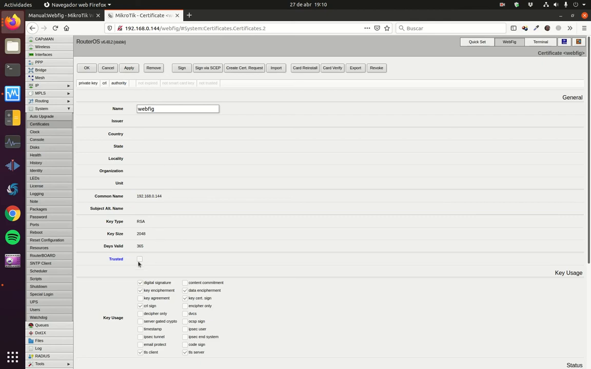

---

### Tarea 1.3: Habilitación de `www-ssl` y Desactivación de Servicios Inseguros

1. En el menú lateral, dirígete a **IP > Services**.
2. Desactiva los protocolos en texto plano seleccionándolos y pulsando el botón **Disable** (icono `X` o `D`):
    * Desactiva **`telnet`** (puerto 23).
    * NO LO HAGAS TODAVÍA. Una vez compruebes que el acceso por https funciona, podrás desactivar también **`www`** (puerto 80 HTTP).
3. Haz clic sobre el servicio **`www-ssl`** para editar sus propiedades:
    * **Port:** `443`
    * **Certificate:** En el menú desplegable, selecciona el certificado **`webfig`** creado en el paso anterior.
4. Pulsa **Apply** y **OK**, y asegúrate de que el servicio `www-ssl` queda habilitado (icono verde).


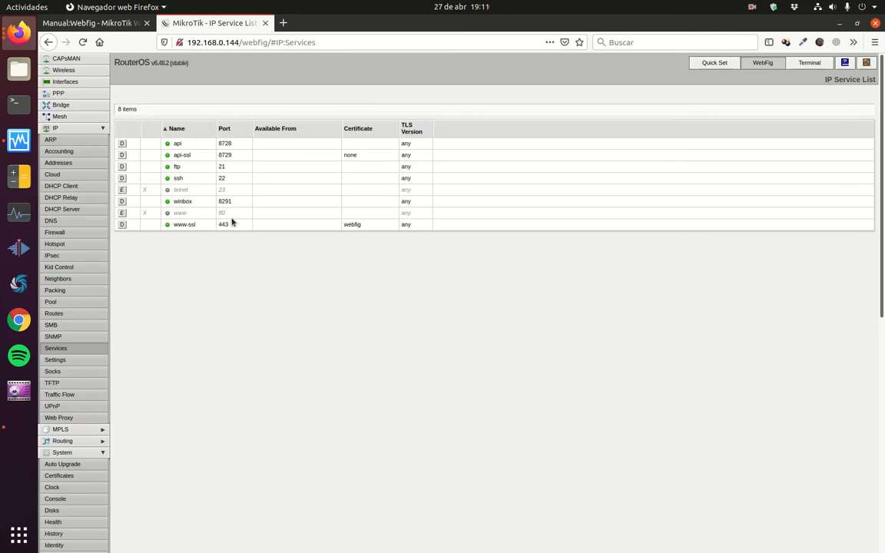

---

### Tarea 1.4: Validación del Acceso Cifrado HTTPS

1. No cierres todavíala pestaña actual del navegador. Abre una nueva pestaña e ingresa utilizando el protocolo seguro: `https://192.168.122.X`.
2. El navegador mostrará una advertencia de seguridad debido a que el certificado ha sido emitido por una entidad interna (`LocalCA`) no incluida en el almacén público del sistema operativo.
3. Haz clic en **Avanzado** y acepta el riesgo seleccionando **Aceptar el riesgo y continuar**.
4. Comprueba que accedes satisfactoriamente al panel WebFig visualizando el icono del **candado HTTPS** en la barra de direcciones.
5. Ahora ya puedes cerrar la pestaña del navegador donde estabas conectado al router por http y volver al paso anterior para deshabilitar el acceso por www.

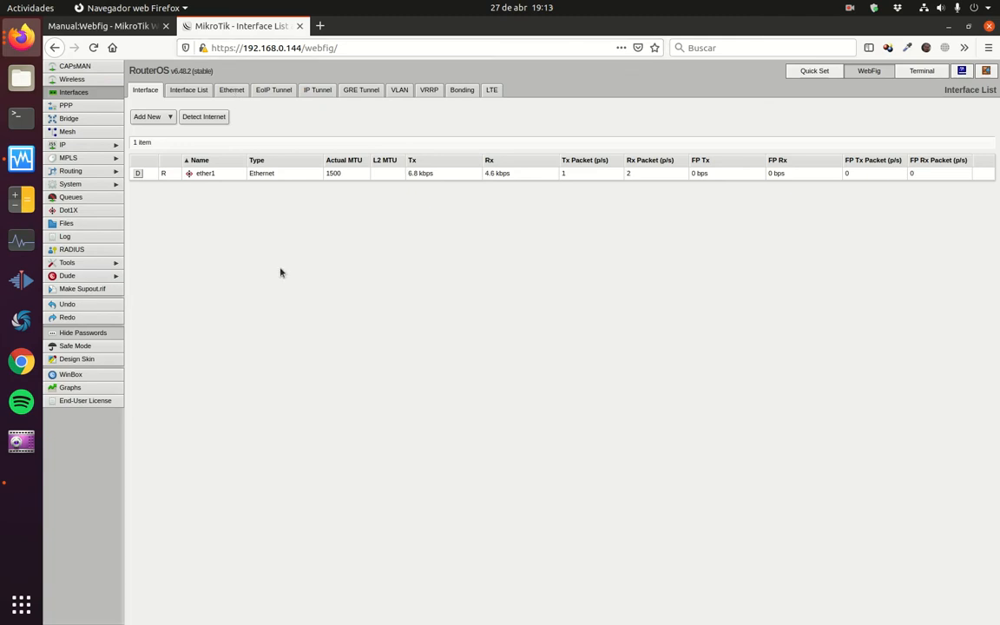

---

## 5. Parte 2: Configuración del Hotspot mediante WebFig (Vídeo 2)

Una vez asegurado el router, procederemos a desplegar el servicio de portal cautivo sobre la interfaz `ether3`, configurando de manera manual y gráfica cada uno de sus componentes de red.

### Tarea 2.1: Configuración de Red para la Interfaz de Invitados (`ether3`)

Para que los clientes invitados puedan comunicarse con el router y recibir parámetros de red, configuraremos su IP, el rango de direcciones dinámicas y el servidor DHCP.

#### 1. Asignar la Dirección IP a `ether3`:
* Dirígete a **IP > Addresses** y pulsa **Add New** (`+`).
* **Address:** `192.168.101.1/24`
* **Network:** `192.168.101.0`
* **Interface:** `ether3`
* Pulsa **OK**.

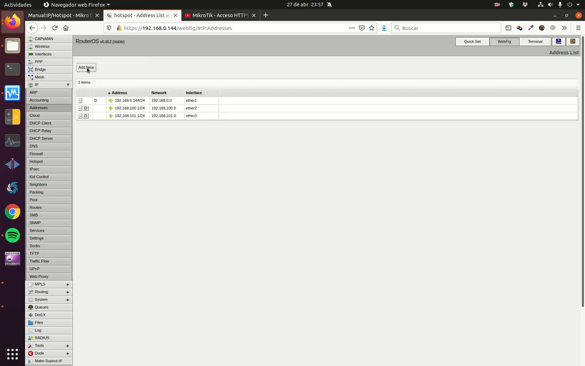

#### 2. Definir el Pool de Direcciones DHCP:
* Dirígete a **IP > Pool** y pulsa **Add New** (`+`).
* **Name:** `pool101`
* **Addresses:** `192.168.101.100-192.168.101.199`
* Pulsa **OK**.

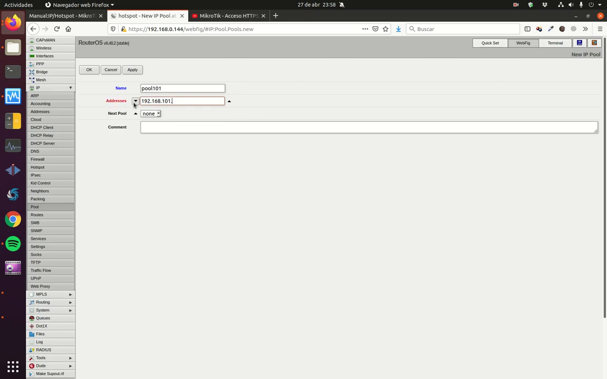

#### 3. Configurar la Instancia del Servidor DHCP:
* Dirígete a **IP > DHCP Server** y, en la pestaña **DHCP**, pulsa **Add New** (`+`).
* **Name:** `dhcp101`
* **Interface:** `ether3`
* **Address Pool:** `pool101`
* **Lease Time:** `00:10:00` *(10 minutos)*
* Pulsa **OK**.

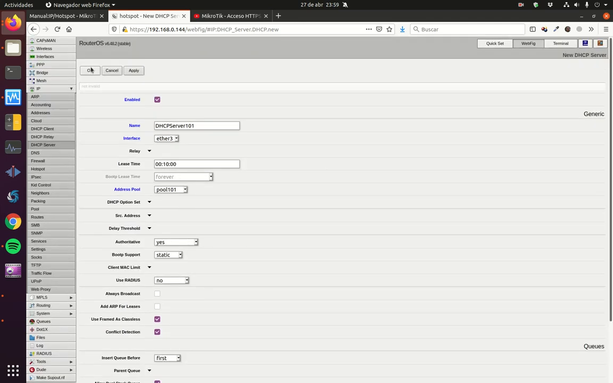

#### 4. Definir los Parámetros de Red Entregados por DHCP:
* En la misma sección **IP > DHCP Server**, cambia a la pestaña superior **Networks** y pulsa **Add New** (`+`).
* **Address:** `192.168.101.0/24`
* **Gateway:** `192.168.101.1`
* **Netmask:** `24`
* Pulsa **OK**.

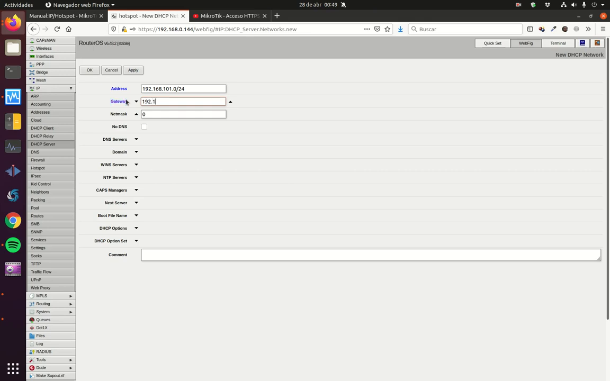

!!! tip "Verificación de la Salida a Internet (NAT Masquerade)"
    Para que los usuarios autenticados puedan salir a Internet a través de `ether1`, comprueba en **IP > Firewall > NAT** que existe una regla activa con los siguientes parámetros:
    
    * **Chain:** `srcnat`
    * **Out. Interface:** `WAN`
    * **Action:** `masquerade`

---

### Tarea 2.2: Generación del Certificado SSL/TLS para el Hotspot (`hotspot`)

Para que la página de login del portal cautivo se entregue por un canal seguro cifrado (HTTPS) y no viaje el usuario y la contraseña en texto claro:

1. Dirígete a **System > Certificates** y pulsa **Add New** (`+`):
    * **Name:** `hotspot`
    * **Common Name:** `192.168.101.1` *(dirección IP de la pasarela del HotSpot)*
    * Resto de opciones por defecto
2. Pulsa **Apply**.
3. Pulsa el botón **Sign**:
    * En **CA**, selecciona `LocalCA`.
    * Pulsa **Start**, espera a que finalice y pulsa **Close**.
4. Marca la casilla **Trusted: yes** y pulsa **OK**.

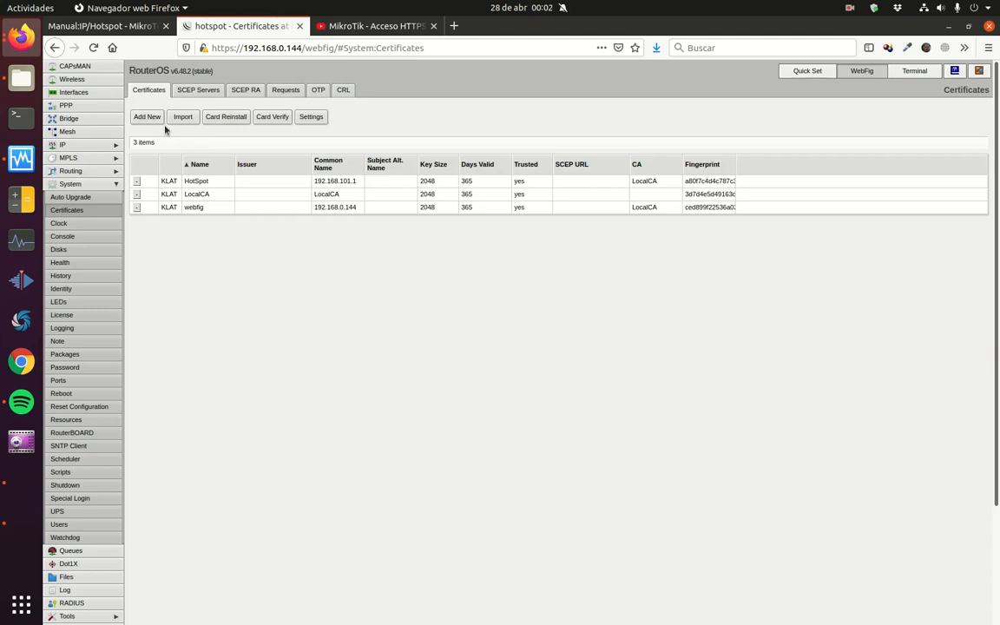

---

### Tarea 2.3: Configuración del Servicio HotSpot en WebFig

En lugar de utilizar asistentes por consola, crearemos la estructura del Hotspot modularmente a través del menú **IP > Hotspot**.

#### 1. Crear el Perfil de Servidor (`Server Profiles`):
* En **IP > Hotspot**, haz clic en la pestaña superior **Server Profiles** y pulsa **Add New** (`+`).
* **Name:** `perfil_server_101`
* **Hotspot Address:** `192.168.101.1`
* En la sección **Login By**, configura los métodos de autenticación:
    * Desmarca **`HTTP PAP`**
    * Marca **`HTTPS`**
    * Marca **`Cookie`**
* En el campo **SSL Certificate**, selecciona en el menú desplegable el certificado **`hotspot`**.
* Pulsa **OK**.

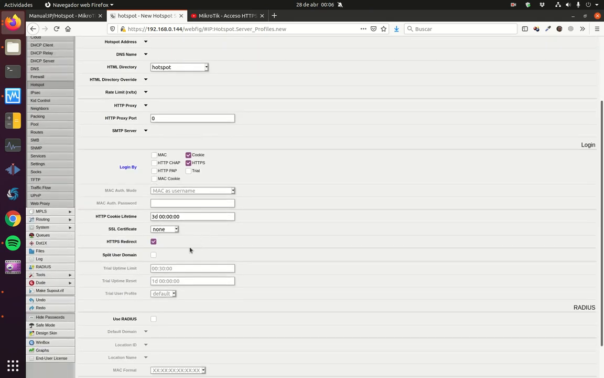

#### 2. Crear la Instancia del Servidor Hotspot (`Servers`):
* Cambia a la pestaña **Servers** y pulsa **Add New** (`+`).
* **Name:** `server101`
* **Interface:** `ether3`
* **Profile:** `perfil_server_101`
* Pulsa **OK**.

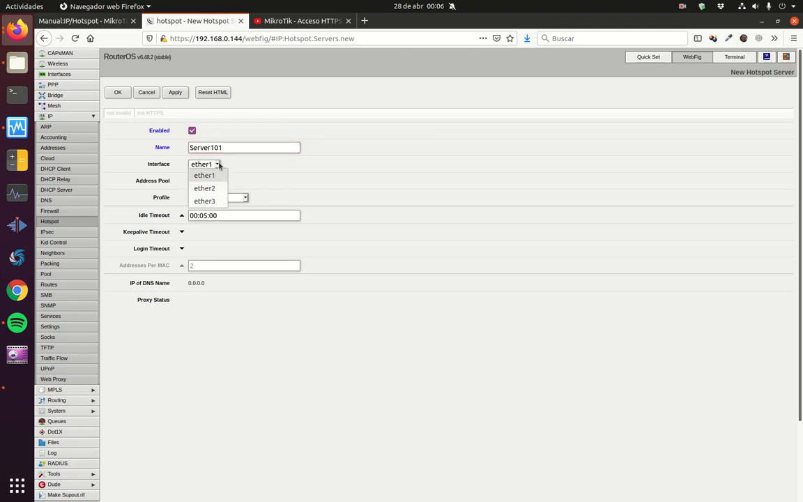

---

### Tarea 2.4: Creación de Usuarios Locales del Hotspot

1. En la misma ventana de **IP > Hotspot**, haz clic en la pestaña **Users** y pulsa **Add New** (`+`).
2. Rellena los datos de la cuenta de usuario:
    * **Server:** `server101`
    * **Name:** `user01`
    * **Password:** `hola01`
    * **Profile:** `default`
3. Pulsa **OK**.

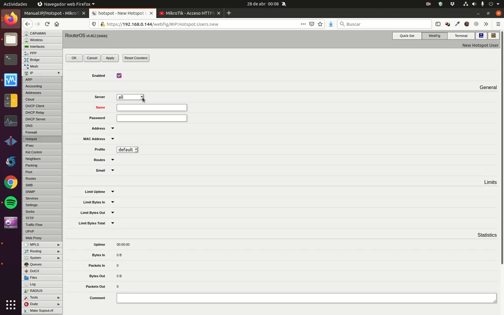


!!! tip "Activación del servidor HotSpot"
    Una vez finalices toda la configuración comprueba si el servidor HotSpot está activado. De no ser así, actívalo.

---

### Tarea 2.5: Verificación de Bloqueo, Redirección y Conexión desde el Cliente

Para verificar el correcto funcionamiento del portal cautivo, utilizaremos la máquina virtual cliente (Webterm o Firefox) conectada a la interfaz `ether3`.

#### 1. Comprobación del Estado Inicial y Bloqueo de Conexión:
* Si usas webterm, antes de arrancar la appliance, haz clic con el botón derecho, selecciona "Edit config" y descomenta las líneas de la configuración DHCP
* Enciende la máquina cliente y comprueba en la terminal de Linux que ha obtenido una IP por DHCP dentro del rango del pool:
    ```bash
    ip addr show
    ```
    *(Ejemplo: el cliente recibe la IP `192.168.101.199/24` con pasarela `192.168.101.1`)*.
* Verifica que el router bloquea el tráfico saliente antes de iniciar sesión. Ejecuta en la terminal:
    ```bash
    traceroute 8.8.8.8
    ```
    Comprobarás que las trazas no superan el router o que la salida a Internet se encuentra completamente denegada.

#### 2. Interceptación del Navegador Web y Login en el Portal:
* Abre el navegador web **Firefox** en el cliente e intenta navegar a cualquier sitio web.
* **Resultado de la interceptación:** El router captura la petición y redirige automáticamente al cliente hacia la URL segura del portal:
    ```
    https://192.168.101.1/login
    ```
* Acepta la advertencia de seguridad del certificado digital autofirmado.
* Aparecerá la pantalla oficial de inicio de sesión de **MikroTik RouterOS > log in**.
* Introduce primero unas credenciales no existentes y comprueba cómo te deniega el acceso. Después introduce las credenciales configuradas:
    * **Username:** `user01`
    * **Password:** `hola01`
* Pulsa el botón **OK**.

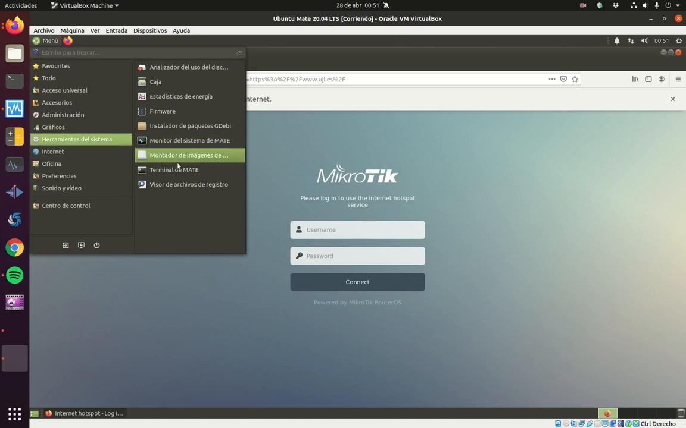

#### 3. Verificación de Navegación Abierta tras la Autenticación:
* Tras pulsar OK, el router validará las credenciales y autorizará el tráfico hacia Internet.
* Abre una nueva pestaña en el navegador y comprueba que puedes navegar fluidamente a sitios externos (p. ej. `www.uji.es`, Wikipedia, etc.).
* Vuelve a la terminal del cliente y ejecuta nuevamente una comprobación de ruta externa:
    ```bash
    traceroute 8.8.8.8
    ```
* Comprobarás que los paquetes superan el primer salto (`192.168.101.1`) y alcanzan su destino a través de la interfaz WAN `ether1`.

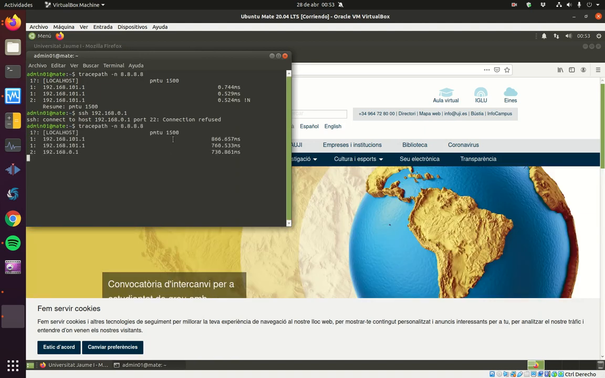

---

### Tarea 2.6: Monitorización de Sesión, Página de Estado y Control de Cookies

#### 1. Consulta de la Página de Estado del Hotspot:
* En el navegador del cliente, accede a la URL:
    ```
    https://192.168.101.1/status
    ```
* En esta página interactiva se muestran las métricas en tiempo real de la sesión:
    * Nombre de usuario conectado (`user01`).
    * Dirección IP asignada.
    * Volumen de datos transmitidos y recibidos (*bytes up / down*).
    * Tiempo total de conexión activa (*connected / status refresh*).
    * Botón para finalizar sesión (**log off**).

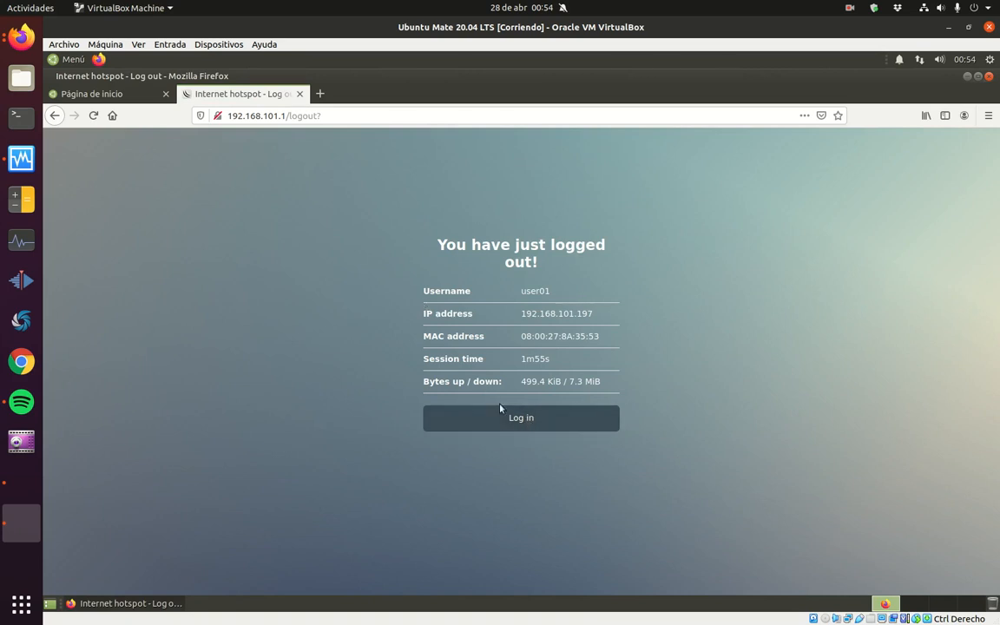

#### 2. Análisis del Mecanismo de Reconexión Automática por Cookie:
* En la página de estado, pulsa el botón **log off** para cerrar la sesión.
* A continuación, haz click sobre **Log in**.
* **Comportamiento observado:** El cliente vuelve a tener conexión de inmediato sin solicitar usuario ni contraseña.
* **Explicación técnica:** Al haber mantenido marcada la casilla **`Cookie`** en el perfil de servidor (`perfil_server_101`), RouterOS envió una cookie de sesión cifrada al navegador. Mientras dicha cookie no expire, el cliente se autentica de forma transparente.

#### 3. Desactivación de Cookies para Forzar Login Manual Continuo:
* Regresa al equipo de administración y accede a WebFig (`https://192.168.122.X`).
* Ve a **IP > Hotspot > Server Profiles** y abre la ficha de **`perfil_server_101`**.
* En el apartado **Login By**, **desmarca la casilla `Cookie`**.
* Pulsa **Apply** y **OK**.
* Vuelve al cliente, pulsa de nuevo **log off** en `https://192.168.101.1/status` e intenta hacer **Log in** de nuevo.
* Comprobarás que, al no haber autenticación por cookie, el router intercepta de nuevo la conexión y obliga obligatoriamente a teclear las credenciales en la pantalla de login.

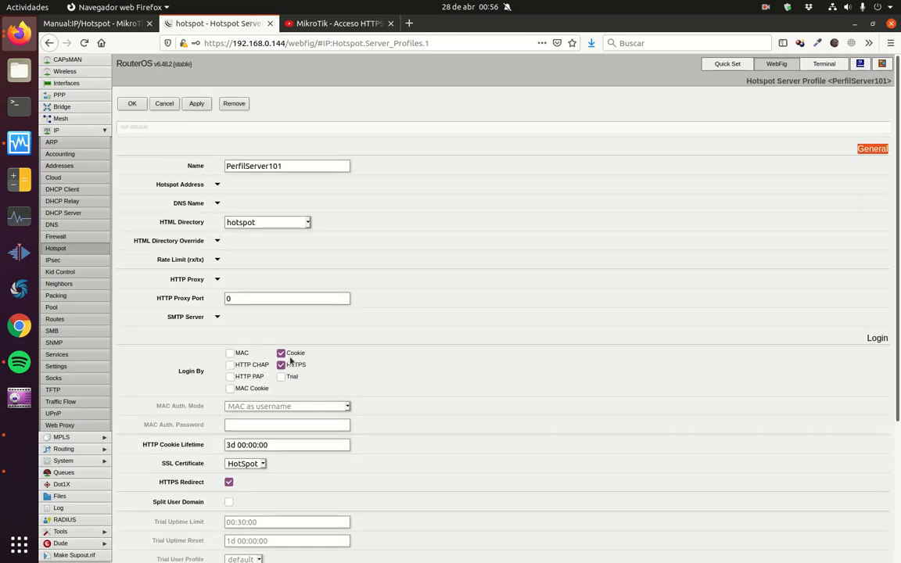

---

## 6. Cheatsheet: Correspondencia entre WebFig y Comandos RouterOS CLI

Aunque la práctica se realiza íntegramente de manera visual mediante WebFig, la siguiente tabla muestra la correspondencia directa de cada acción gráfica con su comando equivalente en la consola de comandos de RouterOS:

| Acción en WebFig | Menú Gráfico WebFig | Comando RouterOS CLI | Parámetros Clave |
| :--- | :--- | :--- | :--- |
| **Crear CA Raíz** | `System > Certificates` (`+`) | `/certificate add name=LocalCA common-name=LocalCA key-usage=crl-sign,key-cert-sign` | Autofirmar con `/certificate sign LocalCA` |
| **Crear Certificado Web** | `System > Certificates` (`+`) | `/certificate add name=webfig common-name=192.168.100.1 key-usage=digital-signature,key-encipherment,tls-server` | Firmar con CA `/certificate sign webfig ca=LocalCA` |
| **Activar HTTPS WebFig** | `IP > Services` | `/ip service set www-ssl certificate=webfig disabled=no` | Desactivar telnet y www con `set [find name=telnet] disabled=yes` |
| **Asignar IP ether3** | `IP > Addresses` (`+`) | `/ip address add address=192.168.101.1/24 interface=ether3 network=192.168.101.0` | Dirección de pasarela de la red de invitados |
| **Crear Pool DHCP** | `IP > Pool` (`+`) | `/ip pool add name=pool101 ranges=192.168.101.100-192.168.101.199` | Rango de concesión dinámica para clientes |
| **Servidor DHCP** | `IP > DHCP Server` (`+`) | `/ip dhcp-server add name=dhcp101 interface=ether3 address-pool=pool101` | Asignación de red con `/ip dhcp-server network add` |
| **Perfil de Hotspot** | `IP > Hotspot > Server Profiles` | `/ip hotspot profile add name=perfil_server_101 hotspot-address=192.168.101.1 login-by=http-pap,https,cookie ssl-certificate=hotspot` | Define métodos de autenticación y certificado SSL |
| **Instancia Hotspot** | `IP > Hotspot > Servers` | `/ip hotspot add name=server101 interface=ether3 profile=perfil_server_101` | Vincula el servicio del portal a la interfaz física |
| **Crear Usuario** | `IP > Hotspot > Users` | `/ip hotspot user add name=user01 password=hola01 profile=default` | Credenciales de acceso de los clientes invitados |
| **Ver Usuarios Activos** | `IP > Hotspot > Active` | `/ip hotspot active print` | Muestra IP, MAC, usuario y tiempo de conexión |

---

## 7. Cuestiones de Autoevaluación

1. **Gestión Segura WebFig:** ¿Por qué es crítico deshabilitar el servicio HTTP estándar (puerto 80) una vez que se activa el servicio `www-ssl` (puerto 443)? ¿Qué riesgo persistiría si se dejaran ambos activos simultáneamente?
2. **Jerarquía de Certificados:** En el laboratorio se crea un certificado raíz (`LocalCA`) y a partir de él se firman los certificados de `webfig` y `hotspot`. ¿Qué ventaja tiene este modelo frente a crear múltiples certificados autofirmados independientes?
3. **Mecanismo de Interceptación:** ¿Cómo consigue el router MikroTik redirigir a un usuario que intenta navegar a `http://www.google.es` hacia la dirección interna `https://192.168.101.1/login` sin necesidad de configurar un proxy en el navegador del cliente?
4. **Seguridad en la Autenticación del Portal:** En el perfil de servidor se activa la opción `HTTPS` junto con un certificado digital. ¿Qué vulnerabilidad crítica se evita al transmitir el formulario de login mediante HTTPS en lugar de HTTP convencional en una red Wi-Fi compartida?
5. **Persistencia mediante Cookies:** ¿Qué ventaja de usabilidad ofrece el método de autenticación por `Cookie` en un Hotspot comercial (p. ej. un hotel o cafetería) y qué inconveniente de seguridad podría plantear en equipos públicos compartidos?

---

## 9. Recursos y Enlaces de Referencia

* **[Canal de Román Carceller: MikroTik Acceso HTTPS](https://www.youtube.com/watch?v=2SK0OiN07Lk):** Tutorial en vídeo para la creación de certificados y habilitación de gestión segura.
* **[Canal de Román Carceller: MikroTik Configuración de un Hotspot](https://youtu.be/LRO8aKzhJS8):** Tutorial en vídeo paso a paso para la configuración del Hotspot y pruebas con clientes.
* **[MikroTik RouterOS Documentation: Hotspot Gateway](https://help.mikrotik.com/docs/display/ROS/Hotspot):** Documentación oficial sobre la arquitectura y opciones avanzadas del servicio Hotspot.
* **[MikroTik RouterOS Documentation: Certificates](https://help.mikrotik.com/docs/display/ROS/Certificates):** Guía de administración y gestión de certificados digitales en RouterOS.
* **[GNS3 Marketplace: MikroTik CHR](https://www.gns3.com/marketplace/appliances/mikrotik-cloud-hosted-router):** Plantilla oficial de la máquina virtual MikroTik Cloud Hosted Router para GNS3.
