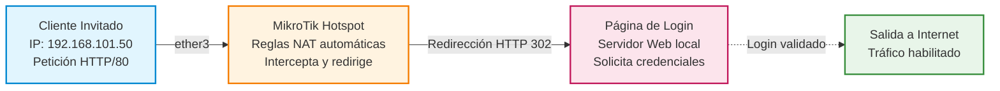
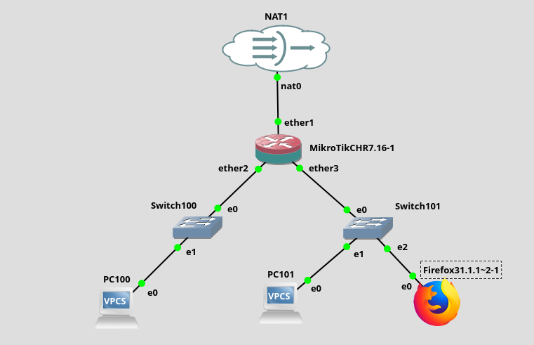

# Práctica 5.7: Configuración de un Hotspot con Portal Cautivo en MikroTik RouterOS

!!! note "Datos de la Práctica"
    * **Módulo:** Seguridad y Alta Disponibilidad (SAD - 0378)
    * **Unidad Didáctica:** UD5 - Seguridad Activa y Auditorías en Redes Corporativas
    * **Requisitos:** Router MikroTik físico (ej. RouterBOARD) o máquina virtual **MikroTik CHR** (*Cloud Hosted Router*) en GNS3, VirtualBox o KVM, interconectado con un puerto WAN (Internet NAT) y una red LAN de usuarios invitados. Cliente con navegador web (Firefox/Chrome).

---

## 1. Objetivos de la Práctica

* Comprender la arquitectura de un **Hotspot / Portal Cautivo** para el control de acceso en redes de invitados y entornos corporativos.
* Configurar el servicio de Hotspot en un router **MikroTik RouterOS** mediante comandos de consola y asistentes web.
* Diseñar la separación de tráfico entre la red interna corporativa y la red de usuarios visitantes.
* Administrar perfiles de acceso, limitaciones de ancho de banda y cuentas de usuario en el servidor Hotspot local.
* Generar e instalar certificados SSL/TLS para asegurar la página de inicio de sesión del portal cautivo mediante HTTPS.
* Auditar el estado de los usuarios activos y verificar el bloqueo de navegación antes de la autenticación.

---

## 2. Introducción Teórica: Arquitectura de un Portal Cautivo

Un **Hotspot o Portal Cautivo** es un mecanismo de seguridad de Capa 3/7 que intercepta todo el tráfico de red no autenticado procedentes de una interfaz o VLAN específica, redirigiendo las peticiones HTTP/HTTPS del usuario hacia una página web de inicio de sesión.



### Flujo de Funcionamiento del Hotspot:

1. **Asignación IP y Bypassing DNS:** El cliente se conecta a la red de invitados y obtiene IP por DHCP. Se le permite resolver nombres DNS.
2. **Interceptación HTTP:** Cuando el cliente abre un navegador e intenta navegar a cualquier sitio web, las reglas internas de firewall del router redirigen la petición al servidor web local del Hotspot.
3. **Autenticación y Apertura de Paso:** El usuario introduce sus credenciales o acepta los términos de uso. Una vez autenticado, el router añade su dirección IP y MAC a la lista de usuarios activos (`active list`) y habilita su enrutamiento hacia la interfaz WAN de Internet.

!!! info "Vídeos Conceptuales de Introducción"
    * **[¿Qué es un HotSpot y cómo funciona? (Waii Empresarial)](https://youtu.be/FApYtWA9akQ):** Introducción general al concepto y funcionamiento de los portales cautivos.
    * **[3 Mejores Estrategias con HotSpot y Marketing en Empresas](https://youtu.be/AYPQDu602m8):** Ventajas añadidas de los sistemas HotSpot en entornos corporativos y comerciales.

---

## 3. Desarrollo Paso a Paso de la Práctica

### Escenario de Red y Topología

En esta práctica configuraremos un router MikroTik para actuar como HotSpot, aislando el tráfico de los visitantes no autorizados:


### Montaje del Escenario en GNS3

Para realizar el laboratorio en el simulador GNS3, desplegaremos la topología con los siguientes elementos:



#### Appliances de GNS3 requeridos:
* **[MikroTik Cloud Hosted Router (CHR)](https://www.gns3.com/marketplace/appliances/mikrotik-cloud-hosted-router):** Router virtual con RouterOS.
* **[Firefox Guest Appliance](https://www.gns3.com/marketplace/appliances/firefox-guest):** Cliente gráfico ligero para probar la redirección del navegador web y la autenticación del portal.
* Dispositivos auxiliares PC100 y PC101 para comprobación de conectividad ICMP.

#### Vídeos Guía de Configuración:
Para realizar la práctica se recomienda visualizar estos dos vídeos paso a paso en este orden:
1. **[Vídeo 1: MikroTik - Acceso HTTPS](https://www.youtube.com/watch?v=2SK0OiN07Lk):** Generación de certificados y habilitación de conexión web cifrada.
2. **[Vídeo 2: MikroTik - Instalación y configuración de un HotSpot](https://youtu.be/LRO8aKzhJS8):** Creación del servicio HotSpot, asignación de interfaces y pruebas con clientes.
3. *(Opcional)* **[Vídeo: MikroTik - Escenario de trabajo en el laboratorio](https://youtu.be/QM8gHCq9gK0)**

* **`ether1` (WAN):** Conectado a la nube NAT de Internet (obtiene IP por DHCP, ej. `192.168.122.X`).
* **`ether2` (LAN Taller / Interna):** Red de administración (`192.168.100.0/24`).
* **`ether3` (Red Hotspot Invitados):** Red de clientes restringidos (`192.168.101.0/24`).

---

### Tarea 1: Ejecución del Asistente de Hotspot (`ip hotspot setup`)

1. Accede a la consola de comandos de MikroTik (vía SSH, puerto serie o WinBox/WebFig).
2. Lanza el asistente automático de configuración de Hotspot sobre la interfaz destinada a la red de invitados (`ether3`):
   ```routeros
   /ip hotspot setup
   ```
3. Responde interactivamente a las preguntas del asistente:
   * **Hotspot Interface:** `ether3`
   * **Local Address of Network:** `192.168.101.1/24`
   * **Masquerade Network:** `yes`
   * **Address Pool of Network:** `192.168.101.2-192.168.101.254`
   * **Select Certificate:** `none` *(lo configuraremos más adelante)*
   * **IP Address of SMTP Server:** `0.0.0.0`
   * **DNS Servers:** `8.8.8.8, 1.1.1.1`
   * **DNS Name:** `hotspot.ieselcaminas.local`
   * **Name of Local Hotspot User:** `admin_guest`
   * **Password for the User:** `ClaveInvitado2026!`

---

### Tarea 2: Creación de Perfiles de Usuario y Creación de Cuentas

Podemos definir distintos límites de velocidad y restricciones según el tipo de visitante:

1. Crea un perfil de usuario restringido con límite de ancho de banda (ej. 2 Mbps bajada / 1 Mbps subida):
   ```routeros
   /ip hotspot user profile add name=invitados_limitado rate-limit="1M/2M" shared-users=1
   ```
2. Crea usuarios específicos asociados a ese perfil:
   ```routeros
   /ip hotspot user add name="visitante1" password="User123!" profile=invitados_limitado
   /ip hotspot user add name="alumno_sad" password="SAD2026!" profile=default
   ```

---

### Tarea 3: Verificación de Bloqueo y Autenticación desde el Cliente

1. Arranca la máquina cliente (ej. `PC101` o máquina virtual con navegador Firefox) conectada a la interfaz `ether3`.
2. Verifica que el equipo obtiene IP en el rango `192.168.101.X`.
3. Intenta hacer ping a una IP externa de Internet (ej. `ping 8.8.8.8`).
   * **Observación:** El tráfico será bloqueado antes de autenticarse.
4. Abre el navegador web Firefox e intenta acceder a cualquier página HTTP.
5. **Resultado esperado:** El router interceptará la petición y mostrará la página del portal cautivo de MikroTik solicitando usuario y contraseña.
6. Introduce el usuario `visitante1` y su clave. Tras aceptar, verifica que el cliente obtiene acceso completo a Internet.

---

### Tarea 4: Inspección de Sesiones Activas en Consola MikroTik

1. Regresa a la consola de MikroTik y ejecuta los siguientes comandos de auditoría para verificar los usuarios conectados:
   ```routeros
   /ip hotspot active print
   /ip hotspot user print detail
   /ip hotspot profile print
   ```
2. Muestra los detalles de la sesión activa identificando la IP del cliente, su dirección MAC, el tiempo de conexión (*uptime*) y el volumen de bytes transmitidos/recibidos.

---

### Tarea 5: Aseguramiento del Portal mediante Certificado SSL/TLS (Opcional Avanzado)

Para evitar que las credenciales del portal se transmitan en texto claro sobre HTTP:

1. Genera o importa un certificado en RouterOS:
   ```routeros
   /certificate print detail
   ```
2. En el perfil de la página del Hotspot, habilita el protocolo HTTPS y asigna el certificado generado:
   ```routeros
   /ip hotspot profile set default ssl-certificate=cert1 html-directory=hotspot
   ```

---

## 4. Cheatsheet de Comandos MikroTik RouterOS Hotspot

| Acción / Objetivo | Comando RouterOS | Sintaxis exacta |
| :--- | :--- | :--- |
| **Asistente de configuración Hotspot** | `/ip hotspot setup` | Lanza el menú paso a paso en la interfaz elegida. |
| **Listar usuarios activos conectados** | `/ip hotspot active print` | Muestra IP, MAC, usuario y uptime de los clientes. |
| **Crear perfil con límite de velocidad** | `/ip hotspot user profile add` | `add name=limite rate-limit="1M/2M"` |
| **Añadir nuevo usuario al Hotspot** | `/ip hotspot user add` | `add name="user" password="pass" profile=limite` |
| **Consultar detalle de usuarios** | `/ip hotspot user print detail` | Muestra cuentas creadas y sus estadísticas. |
| **Desconectar usuario por la fuerza** | `/ip hotspot active remove` | `remove [find user="visitante1"]` |

---

## 5. Cuestiones de Autoevaluación

1. **Redirección HTTP:** ¿Qué mecanismo técnico utiliza el router MikroTik para interceptar la primera petición del cliente y redirigirla a la página de login sin que el usuario configure ningún proxy?
2. **Seguridad del Portal:** Si la página de login del Hotspot funciona sobre HTTP sin cifrar, ¿a qué tipo de riesgo están expuestas las contraseñas de los usuarios en la red Wi-Fi de invitados?
3. **Uso de Nombres DNS:** ¿Por qué se configura un nombre DNS local (ej. `hotspot.ieselcaminas.local`) en el asistente del Hotspot en lugar de usar directamente una IP numérica?
4. **Limitación de recursos:** ¿Qué ventaja operativa aporta la directiva `rate-limit` en los perfiles de usuario de un Hotspot de empresa o de hotel?

---

## 6. Criterios de Entrega del Laboratorio

Para la evaluación de esta práctica, deberás elaborar un documento PDF que incluya las siguientes evidencias técnicas:

1. **Captura del Navegador Web del Cliente:**
   * Ventana del navegador Firefox mostrando la página de estado del Hotspot que certifica que el cliente se encuentra autenticado, junto con los datos de tiempo de conexión y consumo.

2. **Evidencias en la Consola de MikroTik RouterOS:**
   * Captura del comando `/certificate print detail` remarcando los usos del certificado raíz generado.
   * Captura del comando `/ip hotspot profile print` remarcando el certificado SSL/TLS asignado al perfil.
   * Captura del comando `/ip hotspot print detail` remarcando el perfil y la interfaz asociada al servidor Hotspot.
   * Captura del comando `/ip hotspot user print detail` remarcando un usuario que lleve tu propio nombre y apellidos validado correctamente.

---

## 7. Recursos y Enlaces de Referencia

* **[MikroTik RouterOS Documentation: Hotspot Gateway](https://help.mikrotik.com/docs/display/ROS/Hotspot):** Manual oficial completo de administración del servicio Hotspot en RouterOS.
* **[GNS3 Marketplace: MikroTik CHR](https://www.gns3.com/marketplace/appliances/mikrotik-cloud-hosted-router):** Ficha y plantilla de despliegue para emulación en GNS3.
* **[GNS3 Marketplace: Firefox Guest](https://www.gns3.com/marketplace/appliances/firefox-guest):** Appliance cliente web ligero para topologías de red.
