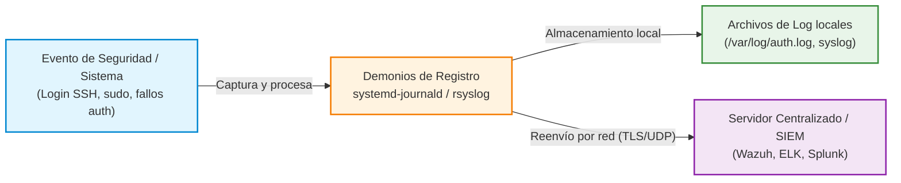

# Práctica 5.7: Monitorización Activa y Análisis de Registros de Auditoría en Linux y Windows

!!! note "Datos de la Práctica"
    * **Módulo:** Seguridad y Alta Disponibilidad (SAD - 0378)
    * **Unidad Didáctica:** UD5 - Seguridad Activa y Auditorías en Redes Corporativas
    * **Requisitos:** Una máquina virtual Linux (Debian o Ubuntu) con `systemd-journald` y `rsyslog`, y una máquina Windows (Windows 10/11 o Windows Server) con acceso al Visor de Eventos (*Event Viewer*). Privilegios de administración (`sudo` / Administrador).

---

## 1. Objetivos de la Práctica

* Comprender la importancia de la auditoría de registros (*logs*) en el marco de la seguridad activa y el análisis forense tras un incidente.
* Consultar y filtrar registros estructurados en Linux mediante `journalctl` y auditar los archivos de eventos en `/var/log/`.
* Configurar la rotación automática de logs mediante `logrotate` para evitar la saturación de disco.
* Simular intentos fallidos de autenticación e identificar los eventos de seguridad generados en Linux (`/var/log/auth.log`).
* Analizar el **Visor de Eventos de Windows** (*Event Viewer*) e identificar los identificadores de eventos (*Event IDs*) críticos de seguridad (inicios de sesión fallidos 4625, correctos 4624 y elevación de privilegios 4672).

---

## 2. Introducción Teórica: La Trazabilidad mediante Logs

Los ficheros de log son la memoria histórica del sistema operativo. Registrar qué usuario ejecutó un comando, qué proceso falló o desde qué IP se intentó ingresar una contraseña resulta vital para mantener la trazabilidad y responder ante incidentes de ciberseguridad.



### La Arquitectura de Logs en Linux:
* **`systemd-journald`:** Recopila eventos en formato binario estructurado nada más arrancar el sistema.
* **`rsyslog`:** Recoge eventos del sistema y los escribe en texto claro en `/var/log/` (`auth.log`, `syslog`, `kern.log`) o los reenvía por red a un servidor SIEM centralizado.

---

## 3. Desarrollo Paso a Paso de la Práctica

---

### MÓDULO A: AUDITORÍA DE LOGS EN GNU/LINUX

#### Tarea 1: Consulta y Filtrado Avanzado con `journalctl`

1. Para hacer esta práctica optaremos por una máquina Debian conectada a una nube NAT en GNS3. También podría hacerse sobre una máquina física con permisos de administrador o una MV VirtualBox.
1. Abre una terminal en tu sistema Linux y vamos a ejecutar los siguientes comandos. Consulta en `man jornalctl` el significado exacto y forma de usar cada opción.
2. Consulta todos los registros del arranque actual:
   ```bash
   sudo journalctl -b
   ```
3. Filtra únicamente los eventos generados por un servicio específico (ejemplo con SSH o Apache):
   ```bash
   sudo journalctl -u ssh
   ```
4. Filtra por nivel de criticidad o prioridad (mostrar solo errores y emergencias: `-p err`):
   ```bash
   sudo journalctl -p err..emerg
   ```
5. Muestra los eventos en tiempo real con seguimiento continuo (modo `tail -f`):
   ```bash
   sudo journalctl -f -u ssh
   ```
   Lanza una conexión ssh desde el host y comprueba cómo se detecta la conexión.

---

#### Tarea 2: Inspección de Autenticación Fallida en `/var/log/auth.log`

1. En una segunda terminal o desde otra máquina, intenta conectar por SSH a tu equipo escribiendo una contraseña errónea dos o tres veces:
   ```bash
   ssh usuario_falso@IP_DEL_SERVIDOR
   ```
2. En el servidor, abre el fichero de auditoría de autenticación `/var/log/auth.log` (en RedHat/CentOS `/var/log/secure`):
   ```bash
   sudo tail -n 20 /var/log/auth.log
   ```
3. Localiza las líneas conteniendo el mensaje `Failed password for ...` e identifica la marca de tiempo, la dirección IP de origen y el puerto empleado.

---

#### Tarea 3: Verificación del Servicio de Rotación `logrotate`

1. Examina la configuración del servicio encargado de comprimir y rotar archivos de log para evitar el llenado del disco:
   ```bash
   cat /etc/logrotate.conf
   ```
2. Consulta las reglas específicas para los registros del sistema en `/etc/logrotate.d/rsyslog`.

---

### MÓDULO B: AUDITORÍA DE LOGS EN MICROSOFT WINDOWS

#### Tarea 4: Análisis del Visor de Eventos (*Event Viewer*)

1. En tu máquina Windows, pulsa `Win + R`, escribe `eventvwr.msc` y pulsa Enter.
2. En el panel izquierdo, despliega **Registros de Windows** (*Windows Logs*) y selecciona **Seguridad** (*Security*).
3. En el panel derecho, haz clic en **Filtrar registro actual...** (*Filter Current Log...*).

---

#### Tarea 5: Identificación de Event IDs Críticos de Seguridad

1. En la casilla de filtro por identificador de evento (*Event IDs*), introduce los siguientes valores clave:

    * **Event ID `4625`:** Inicio de sesión fallido (*An account failed to log on*).
    * **Event ID `4624`:** Inicio de sesión correcto (*An account was successfully logged on*).
    * **Event ID `4672`:** Asignación de privilegios especiales / Administrador (*Special privileges assigned to new logon*).

2. Simula un fallo de inicio de sesión en Windows (bloquea la sesión con `Win + L` e introduce una clave errónea).
3. Regresa al Visor de Eventos, actualiza la vista (`F5`) y filtra por Event ID `4625`.
4. Abre el evento registrado e identifica: el nombre de la cuenta intentada, el tipo de inicio de sesión (*Logon Type*) y la dirección IP o nombre del equipo de origen.

---

## 4. Cheatsheet de Auditoría de Logs (Linux vs Windows)

| Sistema | Herramienta / Ubicación | Comando / Event ID | Propósito / Descripción |
| :--- | :--- | :--- | :--- |
| **Linux** | `journalctl` | `journalctl -u ssh -b` | Muestra logs del servicio SSH del arranque actual. |
| **Linux** | `journalctl` | `journalctl -p err -f` | Muestra errores en tiempo real. |
| **Linux** | Fichero `/var/log/auth.log` | `grep "Failed" /var/log/auth.log` | Muestra intentos de inicio de sesión fallidos. |
| **Linux** | Configuración `logrotate` | `/etc/logrotate.d/` | Define periodicidad y compresión de logs. |
| **Windows** | Visor de Eventos (`eventvwr`) | **Event ID 4625** | Registro de intento de inicio de sesión fallido. |
| **Windows** | Visor de Eventos (`eventvwr`) | **Event ID 4624** | Registro de inicio de sesión exitoso. |
| **Windows** | Visor de Eventos (`eventvwr`) | **Event ID 4672** | Registro de inicio de sesión con privilegios elevador/root. |

---

## 5. Cuestiones de Autoevaluación

1. **Formato estructurado:** ¿Qué ventaja operativa aporta consultar logs con `journalctl` frente a hacer un simple `cat` de un archivo en texto plano dentro de `/var/log/`?
2. **Event ID 4625:** En una auditoría forense de Windows, si observas cientos de Event IDs `4625` seguidos en un intervalo de pocos segundos, ¿qué fenómeno está sufriendo el equipo?
3. **Riesgo de llenado de disco:** ¿Qué ocurriría en un servidor de producción si el servicio `logrotate` dejase de funcionar y un servicio comenzara a generar gigabytes de logs de error?
4. **Centralización (SIEM):** ¿Por qué en un entorno corporativo es crítico reenviar los logs a un servidor remoto (ej. `rsyslog` central o un SIEM) en lugar de almacenarlos únicamente en el disco local del equipo auditado?
