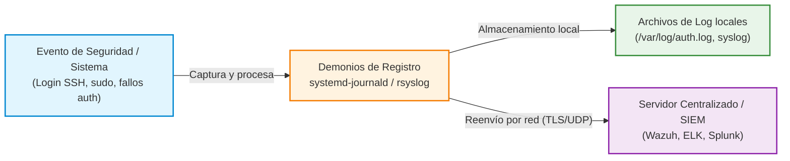

# Práctica 5.7: Monitorización Activa y Análisis de Registros de Auditoría

!!! note "Datos de la Práctica"
    * **Módulo:** Seguridad y Alta Disponibilidad (SAD - 0378)
    * **Unidad Didáctica:** UD5 - Seguridad Activa y Auditorías en Redes Corporativas
    * **Requisitos:** Una máquina virtual Linux (Debian o Ubuntu) con `systemd-journald` y `rsyslog`. Privilegios de administración (`sudo` / Administrador).

---

## 1. Objetivos de la Práctica

* Comprender la importancia de la auditoría de registros (*logs*) en el marco de la seguridad activa y el análisis forense tras un incidente.
* Consultar y filtrar registros estructurados en Linux mediante `journalctl` y auditar los archivos de eventos en `/var/log/`.
* Configurar la rotación automática de logs mediante `logrotate` para evitar la saturación de disco.
* Simular intentos fallidos de autenticación e identificar los eventos de seguridad generados en Linux (`/var/log/auth.log`).
* Analizar el **Visor de Eventos de Windows** (*Event Viewer*) e identificar los identificadores de eventos (*Event IDs*) críticos de seguridad (inicios de sesión fallidos 4625, correctos 4624 y elevación de privilegios 4672).

---

## 2. Introducción Teórica: La Trazabilidad mediante Logs

Los ficheros de log son la memoria histórica del sistema operativo. Registrar qué usuario ejecutó un comando, qué proceso falló o desde qué IP se intentó ingresar una contraseña resulta vital para mantener la trazabilidad y responder ante incidentes de ciberseguridad.



### La Arquitectura de Logs en Linux:
* **`systemd-journald`:** Recopila eventos en formato binario estructurado nada más arrancar el sistema.
* **`rsyslog`:** Recoge eventos del sistema y los escribe en texto claro en `/var/log/` (`auth.log`, `syslog`, `kern.log`) o los reenvía por red a un servidor SIEM centralizado.

---

## 3. Desarrollo Paso a Paso de la Práctica

---

### MÓDULO A: AUDITORÍA DE LOGS EN GNU/LINUX

#### Tarea 1: Consulta y Filtrado Avanzado con `journalctl`

1. Para hacer esta práctica optaremos por una máquina Debian conectada a una nube NAT en GNS3. También podría hacerse sobre una máquina física con permisos de administrador o una MV VirtualBox.
1. Abre una terminal en tu sistema Linux y vamos a ejecutar los siguientes comandos. Consulta en `man jornalctl` el significado exacto y forma de usar cada opción.
2. Consulta todos los registros del arranque actual:
   ```bash
   sudo journalctl -b
   ```
3. Filtra únicamente los eventos generados por un servicio específico (ejemplo con SSH o Apache):
   ```bash
   sudo journalctl -u ssh
   ```
4. Filtra por nivel de criticidad o prioridad (mostrar solo errores y emergencias: `-p err`):
   ```bash
   sudo journalctl -p err..emerg
   ```
5. Muestra los eventos en tiempo real con seguimiento continuo (modo `tail -f`):
   ```bash
   sudo journalctl -f -u ssh
   ```
   Lanza una conexión ssh desde el host y comprueba cómo se detecta la conexión.

---

#### Tarea 2: Inspección de Autenticación Fallida en `/var/log/auth.log`

En las versiones recientes de Debian (a partir de Debian 12 "Bookworm"), el paquete rsyslog ya no viene instalado por defecto. Como consecuencia, el demonio tradicional de syslog no está corriendo y los registros estándar en texto plano como /var/log/auth.log o /var/log/syslog no se generan.

Debian delega ahora la gestión de registros íntegramente en el journal binario de systemd-journald.

Si necesitas que /var/log/auth.log exista físicamente (por ejemplo, para herramientas legacy, parsers o integraciones específicas de monitorización como ciertos agentes SIEM o Fail2ban configurados para leer ficheros planos), basta con instalar rsyslog:

```Bash
sudo apt update && sudo apt install rsyslog
sudo systemctl enable --now rsyslog
```

Una vez iniciado el servicio, rsyslog leerá del socket de systemd-journald y volverá a poblar /var/log/auth.log en tiempo real.

1. En una segunda terminal o desde otra máquina, intenta conectar por SSH a tu equipo escribiendo una contraseña errónea dos o tres veces:
   ```bash
   ssh usuario_falso@IP_DEL_SERVIDOR
   ```
2. En el servidor, abre el fichero de auditoría de autenticación `/var/log/auth.log` (en RedHat/CentOS `/var/log/secure`):
   ```bash
   sudo tail -n 20 /var/log/auth.log
   ```
3. Localiza las líneas conteniendo el mensaje `Failed password for ...` e identifica la marca de tiempo, la dirección IP de origen y el puerto empleado.

---

#### Tarea 3: Verificación del Servicio de Rotación `logrotate`

1. Examina la configuración del servicio encargado de comprimir y rotar archivos de log para evitar el llenado del disco:
   ```bash
   cat /etc/logrotate.conf
   ```
2. Consulta las reglas específicas para los registros del sistema en `/etc/logrotate.d/rsyslog`.

Directivas de configuración

* **rotate 4**: Número de versiones archivadas que se conservan antes de eliminarlas. Al rotar por quinta vez, el archivo más antiguo (.4.gz) se descarta.
* **weekly**: Frecuencia de corte. La rotación se ejecuta una vez por semana (habitualmente activada por el temporizador o cron diario de logrotate).
* **missingok**: Evita que logrotate devuelva un error si alguno de los archivos especificados en la cabecera no existe en el sistema de ficheros; simplemente lo ignora y continúa con el resto.
* **notifempty**: Condición de rotación: si el log tiene tamaño 0 bytes, no se rota ni cuenta para el ciclo semanal.
* **compress**: Comprime con gzip los archivos ya rotados para optimizar el almacenamiento (generando sufijos .gz).
* **delaycompress**: Pospone la compresión del log rotado al ciclo siguiente. El archivo recién rotado pasa a llamarse *.1 (en texto plano), mientras que *.2, *.3, etc., sí estarán comprimidos. Resulta útil para evitar conflictos con procesos que aún mantienen abierto el descriptor de archivo antiguo tras la rotación.
* **sharedscripts**: Fuerza a que las órdenes del bloque postrotate se ejecuten una sola vez en total, tras procesar todos los ficheros que cumplieron el criterio de rotación, en lugar de invocar el script individualmente por cada archivo rotado.
* **postrotate / endscript**: Delimita el script que se ejecuta inmediatamente después de rotar los archivos:
    * /usr/lib/rsyslog/rsyslog-rotate: Script auxiliar de Debian que envía una señal SIGHUP (o ejecuta systemctl kill -s HUP rsyslog) a rsyslogd. Esto obliga al demonio a cerrar los descriptores de archivo antiguos y abrir los nuevos ficheros vacíos.

Ejemplo práctico del ciclo de vida
En un fichero como /var/log/auth.log, la evolución semanal del directorio /var/log/ sigue este esquema:

| Semana	| Estado de archivos |
| --- | --- | 
| Actual	| auth.log (escritura activa) |
| Semana 1	| auth.log (nuevo), auth.log.1 (plano, por delaycompress) |
| Semana 2	| auth.log, auth.log.1, auth.log.2.gz (comprimido) |
| Semana 4	| auth.log, auth.log.1, auth.log.2.gz, auth.log.3.gz, auth.log.4.gz |
| Semana 5	| Se genera auth.log.1, los demás se desplazan y el antiguo auth.log.4.gz se borra. |
---

---

## 4. Cheatsheet de Auditoría de Logs

| Sistema | Herramienta / Ubicación | Comando / Event ID | Propósito / Descripción |
| :--- | :--- | :--- | :--- |
| **Linux** | `journalctl` | `journalctl -u ssh -b` | Muestra logs del servicio SSH del arranque actual. |
| **Linux** | `journalctl` | `journalctl -p err -f` | Muestra errores en tiempo real. |
| **Linux** | Fichero `/var/log/auth.log` | `grep "Failed" /var/log/auth.log` | Muestra intentos de inicio de sesión fallidos. |
| **Linux** | Configuración `logrotate` | `/etc/logrotate.d/` | Define periodicidad y compresión de logs. |

---

## 5. Cuestiones de Autoevaluación

1. **Formato estructurado:** ¿Qué ventaja operativa aporta consultar logs con `journalctl` frente a hacer un simple `cat` de un archivo en texto plano dentro de `/var/log/`?
3. **Riesgo de llenado de disco:** ¿Qué ocurriría en un servidor de producción si el servicio `logrotate` dejase de funcionar y un servicio comenzara a generar gigabytes de logs de error?
4. **Centralización (SIEM):** ¿Por qué en un entorno corporativo es crítico reenviar los logs a un servidor remoto (ej. `rsyslog` central o un SIEM) en lugar de almacenarlos únicamente en el disco local del equipo auditado?
