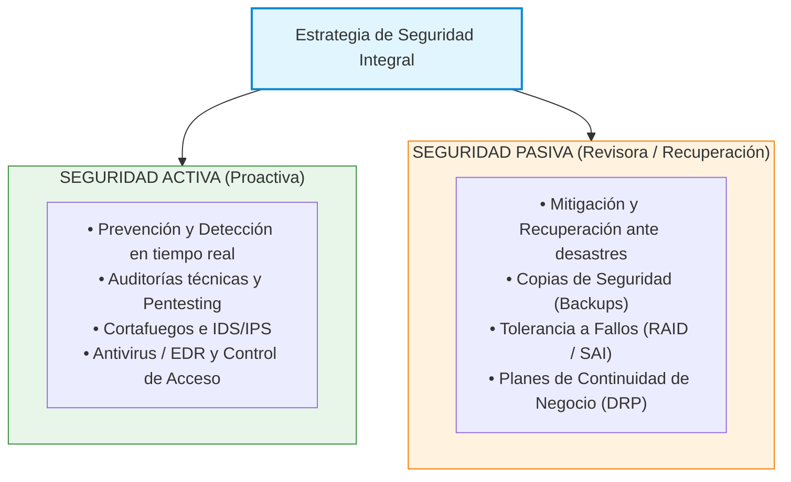
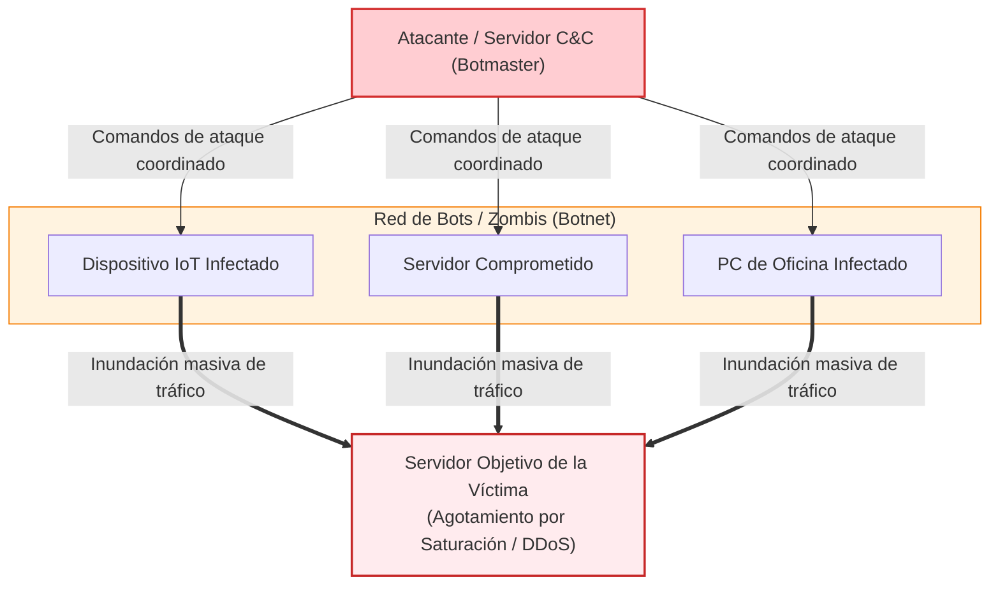
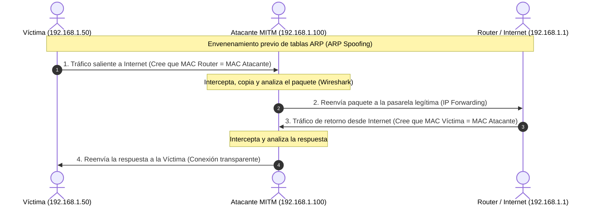
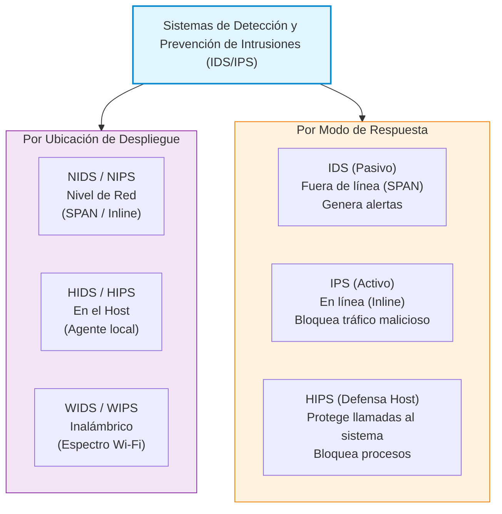
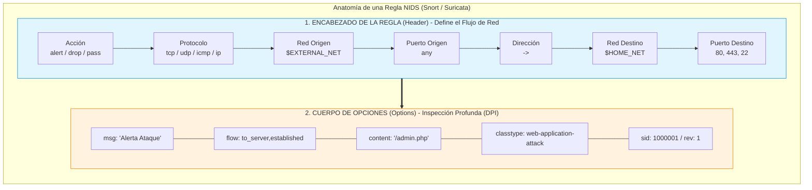
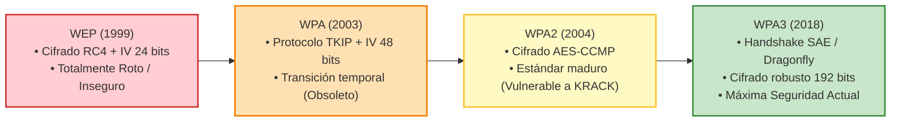
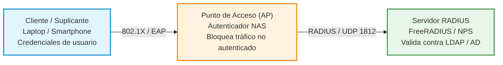
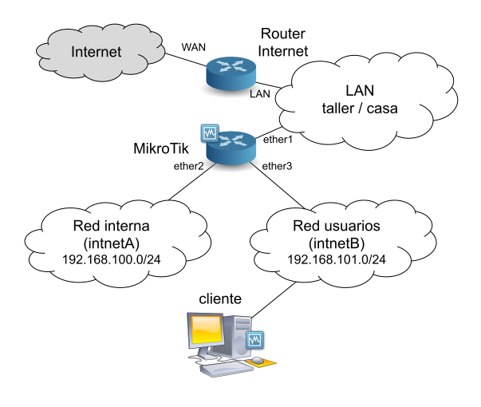
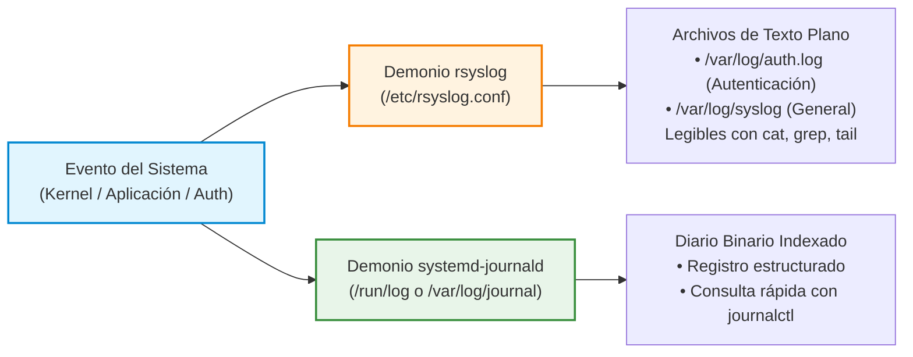

# UD5: Seguridad Activa y Auditorías en Redes Corporativas

El despliegue de infraestructuras informáticas en las organizaciones actuales exige superar el enfoque defensivo estático tradicional para adoptar una estrategia de **seguridad activa**. Frente a un escenario de amenazas dinámico y sofisticado, la seguridad activa combina contramedidas en tiempo real, auditorías técnicas de vulnerabilidades, monitorización continua de eventos y contención proactiva de ataques para garantizar la resiliencia operativa del sistema.

---

## 1. Introducción a la Seguridad Activa, Auditorías y Seguridad Heredada

### 1.1. Seguridad Activa vs. Pasiva y la Amenaza Interna

En el diseño de una arquitectura de seguridad informática se distinguen dos enfoques complementarios:

* **Seguridad Pasiva:** Conjunto de medidas orientadas a **minimizar los daños y facilitar la recuperación** una vez que se ha producido un incidente de seguridad o desastre. Incluye:
    * la programación de copias de seguridad (*backups*), 
    * el uso de sistemas de alimentación ininterrumpida (SAI),
    * el despliegue de almacenamiento redundante (RAID) y 
    * los planes de continuidad de negocio y recuperación ante desastres (DRP).
* **Seguridad Activa:** Conjunto de mecanismos, herramientas y protocolos diseñados para **prevenir, detectar, neutralizar y bloquear** de forma proactiva y en tiempo real las amenazas o intentos de acceso no autorizado antes de que comprometan el sistema. Incluye:
    * el uso de cortafuegos, 
    * sistemas de detección y prevención de intrusiones (IDS/IPS), 
    * antivirus/EDR, 
    * autenticación multifactor, 
    * cifrado de datos y 
    * la ejecución periódica de auditorías de seguridad.

#### El Mito del Perímetro Seguro: La Realidad de la Amenaza Interna
Existe la falsa creencia de que las mayores amenazas informáticas provienen exclusivamente de ciberdelincuentes externos que atacan a través de Internet. Sin embargo, los estudios del sector (como los análisis de Cisco Systems e INCIBE) revelan de forma constante que entre el **70% y el 80% de los incidentes de seguridad en las empresas tienen su origen en la red interna**.

Las principales causas de este elevado porcentaje de riesgo interno son:

1. **Factor Humano e Ingeniería Social:** Empleados que caen de forma involuntaria en campañas de *phishing* o descargan software malicioso desde el correo o la web.
2. **Uso de Dispositivos No Gestionados (BYOD):** Equipos personales, smartphones o almacenamiento USB que se conectan a la LAN corporativa sin pasar por los controles de seguridad del equipo de IT.
3. **Amenazas Insercionadas o Intencionadas:** Personal descontento, exempleados cuyos accesos no fueron revocados a tiempo o usuarios que buscan privilegios no autorizados.
4. **Falta de Aislamiento de Red:** Diseños de red planos donde, si un equipo de aula o departamento es comprometido, el atacante tiene visibilidad directa sobre la totalidad de los servidores corporativos.

---

### 1.2. La "Seguridad Heredada" en la Arquitectura de Red (TCP/IP)

Para comprender por qué las redes locales son vulnerables, es necesario analizar el concepto de **seguridad heredada** (*legacy security*).

Cuando en la década de 1970 se diseñaron las tecnologías fundamentales que hoy sostienen las comunicaciones digitales —como la familia de protocolos **TCP/IP** y el estándar de enlace **Ethernet (IEEE 802.3)**—, su objetivo prioritario era garantizar la **interconexión, la tolerancia a fallos y la eficiencia** en la transmisión de datos dentro de entornos académicos y militares de absoluta confianza implícita.

#### Carencias Nativas de la Pila TCP/IP:
* **Ausencia de Autenticación de Origen:** Protocolos básicos como ARP, IP, ICMP, DHCP o DNS no incorporan ningún mecanismo nativo para verificar la identidad real del emisor del paquete.
* **Ausencia de Cifrado en Transmisión:** Por defecto, los datos transmitidos en capas superiores (HTTP, FTP, TELNET, SMTP) viajan en **texto claro**, permitiendo la captura de credenciales y contenido confidencial mediante técnicas de escucha (*sniffing*).
* **Confianza Ciega en las Respuestas:** Los clientes de red aceptan y procesan de forma inmediata cualquier respuesta recibida (por ejemplo, una respuesta ARP o una concesión DHCP) sin comprobar si proviene de un servidor autorizado.

Esta falta de seguridad desde el diseño (*security by design*) en los protocolos base es aprovechada de forma sistemática por los atacantes en las redes locales.

---

### 1.3. Marco Metodológico de las Auditorías de Seguridad

Una **auditoría de seguridad informática** es un proceso sistemático, independiente y documentado para evaluar la eficacia de los controles de seguridad lógicos, físicos y organizativos de un sistema de información.

#### Clasificación según el Grado de Conocimiento Inicial:
* **Auditoría de Caja Negra (*Black Box*):** El auditor no dispone de ninguna información previa sobre la infraestructura interna (no conoce direcciones IP internas, esquemas de red ni código fuente). Simula el ataque de un ciberdelincuente externo desde Internet.
* **Auditoría de Caja Gris (*Grey Box*):** El auditor dispone de información parcial (por ejemplo, acceso como usuario estándar sin privilegios o un esquema general de la red). Simula la amenaza de un usuario interno o un atacante que ha comprometido credenciales básicas.
* **Auditoría de Caja Blanca (*White Box*):** El auditor cuenta con acceso completo a la documentación técnica, esquemas de red, códigos fuente, configuraciones de cortafuegos y credenciales de administración. Permite una revisión exhaustiva y profunda de todas las capas del sistema.

#### Fases de una Auditoría Técnica de Red (*Pentesting*):

1. **Planificación y Definición del Alcance:** Firma de acuerdos legales (NDA), límites de actuación, ventanas horarias autorizadas y objetivos fijados por el cliente.
2. **Reconocimiento y Huella (*Footprinting / Reconnaissance*):** Recolección pasiva y activa de información técnica sobre la organización objetivo.
3. **Análisis de Vulnerabilidades (*Vulnerability Assessment*):** Identificación de servicios expuestos, versiones de software desactualizadas y fallos de configuración.
4. **Explotación y Post-Explotación (Prueba de Concepto):** Validación de los hallazgos intentando verificar el impacto real de las vulnerabilidades sin alterar la disponibilidad del servicio.
5. **Elaboración de Informes y Remedación:** Generación del **Informe Ejecutivo** (destinado a la dirección) e **Informe Técnico** (con evidencias y recomendaciones de remediación detalladas para el equipo de administración).

#### Metodologías Internacionales de Referencia:
* **PTES** (*Penetration Testing Execution Standard*): Marco estandarizado que define las 7 fases principales de una prueba de penetración.
* **OSSTMM** (*Open Source Security Testing Methodology Manual*): Metodología cuantitativa para medir el nivel de seguridad operativa en redes y sistemas.
* **OWASP** (*Open Web Application Security Project*): Estándar de referencia centrado en la auditoría y seguridad de aplicaciones web.

---

## 2. Descubrimiento, Inventariado y Diagnóstico de Red

### 2.1. Recolección Pasiva y Activa de Información (*Footprinting*)

Antes de cualquier evaluación de seguridad, es necesario conocer la superficie de exposición del objetivo:

* **Reconocimiento Pasivo:** Obtención de información sin interactuar directamente con la infraestructura de la víctima, evitando generar registros en sus sistemas de seguridad (OSINT, registros WHOIS, consultas BGP, motores de búsqueda especializados).
* **Reconocimiento Activo:** Interacción directa mediante el envío de paquetes de red hacia los sistemas objetivo para mapear la topología, identificar hosts activos y listar servicios expuestos.

---

### 2.2. Diagnóstico Nativo de Sockets y Servicios en Host

A nivel local en cualquier sistema operativo, un administrador debe ser capaz de determinar en todo momento qué puertos de red se encuentran en estado de escucha (*LISTEN*) y qué procesos del sistema están asociados a ellos.

Un **socket** de red queda definido por la quíntupla:
Socket = Protocolo, IP Origen, Puerto Origen, IP Destino, Puerto Destino

La inspección periódica de sockets permite identificar servicios innecesarios activos, detectar puertas traseras (*backdoors*) y verificar el cumplimiento de la política de mínimo servicio.

!!! note "Práctica de Laboratorio"
    **[Práctica 5.1: Diagnóstico Local de Servicios y Sockets](P5_1_diagnostico_sockets.md)**
    
    *En esta práctica aprenderás a inspeccionar y auditar los puertos y servicios activos localmente en un sistema Linux y Windows utilizando comandos nativos (`ss`, `netstat`, `lsof`), identificando procesos asociados, sockets a la escucha y conexiones sospechosas sin necesidad de herramientas externas.*

---

### 2.3. Escaneo Activo de Puertos y Detección de Servicios

El escaneo de puertos es la técnica que permite consultar remotamente un rango de puertos TCP/UDP en un sistema de destino para determinar su estado:

| Estado del Puerto | Significado Técnico |
| :--- | :--- |
| **Abierto (*Open*)** | Una aplicación o servicio en el host objetivo está aceptando conexiones activamente en ese puerto. |
| **Cerrado (*Closed*)** | El host recibe el paquete pero no hay ningún servicio escuchando; responde rechazando la conexión. |
| **Filtrado (*Filtered*)** | Un dispositivo intermedio (cortafuegos) o regla local bloquea el tráfico y el escáner no puede determinar si está abierto o cerrado. |

El estado de los puertos nos permitirá detectar servicios que pudieran haber sido instalados fraudulentamente y a las que un atacante puede conectarse.

En sistemas linux la identificación de puertos y versiones de servicios expuestos, la detección remota de sistemas operativos y la auditoría automatizada de vulnerabilidades conocidas podemos realizarla mediante scripts de Nmap Engine (NSE).

!!! note "Práctica de Laboratorio"
    **[Práctica 5.2: Auditoría de Red e Inventariado con Nmap](P5_2_auditoria_nmap.md)**
    
    *En esta práctica realizarás el descubrimiento de equipos activos en la red local, la identificación de puertos y versiones de servicios expuestos, la detección remota de sistemas operativos y la auditoría automatizada de vulnerabilidades conocidas mediante scripts de Nmap Engine (NSE).*

---

### 2.4. Escaneo Automatizado de Vulnerabilidades en la Red

Un **escáner de vulnerabilidades corporativo** es una solución software que automatiza la revisión de sistemas de red comparando los servicios detectados contra bases de datos de vulnerabilidades conocidas (como el registro **CVE** - *Common Vulnerabilities and Exposures* y la **NVD** - *National Vulnerability Database*).

#### Proceso de Gestión de Vulnerabilidades:
1. **Descubrimiento de Activos:** Mapeo continuo de direcciones IP y servicios en el inventario.
2. **Evaluación y Escaneo:** Ejecución de pruebas no destructivas (y opcionalmente autenticadas) sobre los servicios expuestos.
3. **Priorización por Riesgo:** Clasificación del impacto utilizando la métrica **CVSS** (*Common Vulnerability Scoring System*, de 0.0 a 10.0).
4. **Informe y Plan de Remediación:** Recomendaciones de parcheado, actualización o mitigación temporal.

!!! note "Práctica de Laboratorio Opcional"
    **[Práctica Opcional 5.1: Análisis de Vulnerabilidades con OpenVAS / Nessus](PO5_1_escaner_vulnerabilidades.md)**
    
    *En esta práctica opcional desplegarás un motor corporativo de evaluación de vulnerabilidades (OpenVAS / Greenbone), configurarás tareas de escaneo sobre una red simulada, analizarás la severidad de las vulnerabilidades detectadas (CVSS) y generarás informes de auditoría técnica y ejecutiva.*

---

## 3. Taxonomía del Malware y Vectores de Ataque en Redes Locales

### 3.1. Taxonomía del Malware Moderno y Ataques DoS/DDoS

El **malware** (*software malicioso*) abarca cualquier programa diseñado con el propósito de infiltrarse, dañar, alterar o tomar el control no autorizado de un sistema informático.

#### Clasificación Funcional del Malware:
* **Virus:** Código malicioso que requiere la intervención del usuario para ejecutarse e infecta ficheros ejecutables del sistema.
* **Gusano (*Worm*):** Malware con capacidad de **autopropagación autónoma** a través de la red explotando vulnerabilidades del sistema operativo (ej. *Blaster*, *WannaCry*).
* **Troyano:** Programa aparentemente legítimo o útil que oculta código dañino en su interior para crear una puerta trasera (*backdoor*) de acceso remoto.
* **Ransomware:** Malware que cifra los archivos de la víctima mediante algoritmos criptográficos fuertes y exige el pago de un rescate financiero para proporcionar la clave de descifrado.
* **Rootkit:** Conjunto de herramientas diseñadas para ocultar la presencia de malware y mantener acceso de superusuario modificando estructuras del kernel o del sistema operativo.
* **Botnet:** Red de equipos informáticos o dispositivos IoT infectados (*zombis*) controlados remotamente por un atacante a través de un servidor de Mando y Control (*C&C - Command & Control*).

#### Ataques de Denegación de Servicio (DoS / DDoS):
Buscan agotar los recursos de procesamiento, memoria o ancho de banda de un servicio para dejarlo inoperativo frente a usuarios legítimos:

* **SYN Flood (Agotamiento de Conexiones):** Inundación de paquetes `TCP SYN` con direcciones IP de origen falsificadas, obligando al servidor a mantener miles de conexiones semiabiertas hasta agotar la tabla de estado.
* **Ataques de Amplificación y Reflexión (UDP):** Uso de servidores públicos (DNS, NTP, Memcached) para enviar peticiones con la IP de la víctima suplantada, logrando que el servidor responda con paquetes significativamente más grandes dirigidos contra la víctima.

---

### 3.2. Intercepción de Tráfico y Ataques Man-In-The-Middle (MITM) por ARP Spoofing

Un ataque **Man-In-The-Middle (MITM)** ocurre cuando un atacante logra posicionarse en la trayectoria lógica de comunicación entre dos hosts legítimos, siendo capaz de interceptar, inspeccionar, alterar o destruir el tráfico transmitido.

#### Mecánica del Envenenamiento ARP (*ARP Spoofing / ARP Poisoning*):
El protocolo **ARP** (*Address Resolution Protocol*) vincula direcciones lógicas IP (Capa 3) con direcciones físicas MAC (Capa 2). Dado que ARP carece de autenticación, cualquier host puede enviar respuestas ARP gratuitas (*Gratuitous ARP*) no solicitadas a la red.

1. El atacante envía periódicamente paquetes ARP falsificados a la **Víctima A**, afirmando que la dirección IP del *Router/Gateway* corresponde a la dirección MAC del atacante.
2. Simultáneamente, envía paquetes ARP falsificados al **Router**, afirmando que la dirección IP de la *Víctima A* corresponde a la dirección MAC del atacante.
3. Ambos hosts actualizan su tabla de memoria caché ARP local con la asociación falsa.
4. **Resultado:** Todo el tráfico entre la Víctima A e Internet pasa obligatoriamente a través de la tarjeta de red del atacante antes de ser reenviado a su destino real.

#### Contramedidas en la Infraestructura de Red:
* **Entradas ARP Estáticas:** Fijar manualmente la relación IP-MAC en equipos críticos (eficaz pero inviable en redes grandes).
* **Inspección Dinámica de ARP (*Dynamic ARP Inspection - DAI*):** Función en conmutadores gestionables que valida las tramas ARP comparándolas contra la base de datos de enlaces autorizados.
* **Seguridad MACsec (IEEE 802.1AE):** Estándar que proporciona cifrado e integridad criptográfica directamente en las tramas Ethernet de Capa 2.

!!! note "Práctica de Laboratorio"
    **[Práctica 5.3: Intercepción MITM y Envenenamiento ARP](P5_3_mitm_arp_spoofing.md)**
    
    *En esta práctica simularás un escenario de ataque Man-In-The-Middle mediante envenenamiento de caché ARP en una red local virtualizada, analizarás la interceptación de tráfico no cifrado en Wireshark y verificarás la efectividad de las contramedidas de red.*

---

### 3.3. Ataques a Servicios Esenciales de Red (DHCP y DNS)

#### Ataques al Protocolo DHCP:
* **Agotamiento DHCP (*DHCP Starvation*):** Ataque de denegación de servicio donde un script genera miles de peticiones DHCP solicitando direcciones IP con direcciones MAC aleatorias falsificadas. El servidor DHCP agota todo el rango de direccionamiento (*pool*), impidiendo que nuevos clientes legítimos obtengan IP.
* **Servidor DHCP Falso (*Rogue DHCP*):** Tras agotar el servidor legítimo, el atacante despliega un servidor DHCP no autorizado en la red local. Cuando un cliente solicita IP, el Rogue DHCP le asigna una dirección válida pero configura como **Puerta de Enlace (Gateway)** y **Servidor DNS** la propia IP del atacante, logrando un ataque MITM absoluto.
* **Contramedida (*DHCP Snooping*):** Función en el conmutador que clasifica los puertos en *Confiables* (donde solo se permite conectar el servidor DHCP legítimo) y *No Confiables* (donde se bloquean los mensajes de respuesta DHCP Server).

#### Ataques al Protocolo DNS:
* **Suplantación DNS (*DNS Spoofing*):** Interceptación de consultas DNS mediante un ataque MITM previo para responder a la víctima con la dirección IP de un servidor falso controlado por el atacante (sitio de *phishing*).
* **Envenenamiento de Caché DNS (*DNS Cache Poisoning*):** Ataque directo contra un servidor DNS recursivo, inyectando registros falsos en su memoria caché para que todos los usuarios que consulten dicho servidor sean redirigidos a sitios maliciosos.
* **Contramedida (**DNSSEC**):** Extensiones de seguridad DNS que añaden firma digital criptográfica a los registros de zona, garantizando la autenticidad del origen y la integridad de las respuestas.

---

### 3.4. Vulnerabilidades y Ataques en Capa de Transporte / Aplicación (SSL/TLS)

Los protocolos **SSL/TLS** proporcionan cifrado y autenticación sobre las conexiones de red (ej. HTTPS). Sin embargo, han sufrido vulnerabilidades históricas que los administradores deben conocer:

* **Ataques de Degradación (*Downgrade Attacks* - ej. POODLE):** El atacante intercepta la negociación e induce fallos sintéticos para forzar al cliente y al servidor a renegociar el uso de versiones obsoletas e inseguras del protocolo (como SSL 3.0 o TLS 1.0).
* **Vulnerabilidad Heartbleed:** Fallo crítico de validación de memoria en la extensión *Heartbeat* de OpenSSL que permitía leer bloques de memoria RAM del servidor, exponiendo claves privadas maestras.
* **Secreto Perfecto hacia Adelante (*Perfect Forward Secrecy - PFS*):** Propiedad moderna en TLS 1.3 basada en el intercambio de claves Diffie-Hellman efímero (ECDHE). Garantiza que, aunque la clave privada del servidor sea robada en el futuro, no será posible descifrar las sesiones de tráfico pasadas previamente grabadas.

---

## 4. Sistemas de Detección y Prevención de Intrusiones (IDS / IPS)

### 4.1. Arquitectura y Clasificación de Sistemas IDS/IPS

Un **Sistema de Detección de Intrusiones (IDS)** es un mecanismo de seguridad que monitoriza eventos en una red o sistema informático para analizar e identificar patrones de actividad maliciosa o violaciones de las políticas de seguridad. Un **Sistema de Prevención de Intrusiones (IPS)** añade la capacidad de actuar en línea para **bloquear activamente** la amenaza detectada.

#### Clasificación según la Ubicación de Despliegue:
* **NIDS / NIPS (*Network-based*):** Inspecciona el tráfico que circula por un segmento de red (colocado en un puerto espejo *SPAN/Mirror* del switch o en la línea de paso del cortafuegos).
* **HIDS / HIPS (*Host-based*):** Se instala directamente en un servidor u ordenador cliente para monitorizar llamadas al sistema, integridad de ficheros clave, modificaciones en el registro y logs locales (ej. *OSSEC*, *Wazuh* o *Fail2ban*).
* **WIDS / WIPS (*Wireless-based*):** Diseñado específicamente para monitorizar el espectro de red inalámbrico e identificar puntos de acceso falsos (*Rogue APs*) o ataques de desautenticación.

#### Modo de Operación:
* **IDS (Modo Pasivo):** Funciona fuera de línea (*out-of-band*). Analiza una copia del tráfico y, si detecta una amenaza, genera una **alerta** para el administrador pero no bloquea el paquete original.
* **IPS (Modo Activo / En Línea):** Se sitúa físicamente en la ruta del tráfico (*inline*). Si detecta un paquete malicioso, lo **descarta de inmediato** (*DROP*), corta la sesión TCP o modifica la regla del cortafuegos para bloquear la IP atacante.

---

### 4.2. Métodos de Detección de Amenazas

Los motores de detección emplean dos métodos principales para identificar patrones sospechosos:

1. **Detección Basada en Firmas o Patrones (*Signature-based*):**
    * Compara el tráfico y los paquetes contra una base de datos actualizada de reglas o firmas de ataques conocidos (secuencias de bytes específicas, patrones de URL o hashes).
    * **Ventaja:** Muy precisa y rápida frente a ataques conocidos; genera muy pocos falsos positivos.
    * **Inconveniente:** Inoperante ante ataques de día cero (*Zero-Day*) o malware polimórfico cuya firma no ha sido publicada todavía.

2. **Detección Basada en Anomalías / Comportamiento (*Anomaly-based*):**
    * Establece un perfil de **comportamiento normal** del tráfico o del sistema (*baseline*). Cualquier desviación significativa sobre la línea base se clasifica como una potencial intrusión.
    * **Ventaja:** Capaz de identificar nuevos ataques desconocidos y desviaciones anómalas de tráfico.
    * **Inconveniente:** Tasa elevada de falsos positivos si el comportamiento legítimo de los usuarios cambia puntualmente.

---

### 4.3. Principios de Funcionamiento y Reglas en Motores de Inspección

Los motores NIDS/NIPS estándar de la industria (como **Snort** y **Suricata**) analizan el encabezado y el contenido del paquete (*Deep Packet Inspection - DPI*) mediante un lenguaje formal de reglas.

#### Estructura General de una Regla IDS/IPS:

* **Encabezado de la Regla (*Header*):** Define la acción a tomar (`alert`, `drop`, `pass`), el protocolo (`ip`, `icmp`, `tcp`, `udp`), el flujo de direcciones IP y los puertos involucrados.
* **Opciones de la Regla (*Options*):** Parámetros delimitados entre paréntesis que contienen el mensaje descriptivo (`msg`), las cadenas numéricas o de texto a buscar en el cuerpo del paquete (`content`), el identificador único de la regla (`sid` - *Signature ID*) y la revisión (`rev`).

---

## 5. Seguridad en Redes Inalámbricas Corporativas (WLAN)

### 5.1. Peculiaridades y Exposición del Medio Inalámbrico

Las redes inalámbricas (WLAN - IEEE 802.11) ofrecen movilidad y reducción de costes de cableado, pero introducen desafíos de seguridad críticos:

* **Ausencia de Perímetro Físico:** Las ondas de radiofrecuencia atraviesan paredes y fachadas. Cualquier usuario ubicado en el exterior de la instalación puede capturar o inyectar tráfico.
* **Facilidad de Interceptación Pasiva:** Todo dispositivo en cobertura configurado en **modo monitor** puede capturar y guardar las tramas de datos transmitidas por el aire.

---

### 5.2. Evolución de los Mecanismos de Cifrado Wi-Fi

A lo largo de la historia de los estándares IEEE 802.11, los mecanismos de protección han evolucionado para subsanar graves fallos criptográficos:

#### 1. WEP (*Wired Equivalent Privacy*) - OBSOLETO E INSEGURO
* Emplea el algoritmo de cifrado de flujo **RC4** con clave estática (40 o 104 bits) combinada con un **Vector de Inicialización (IV)** corto de solo 24 bits.
* Debilidad: Debido a la brevedad del IV, los vectores se repiten rápidamente en redes con tráfico. Mediante herramientas de inyección y criptoanálisis estadístico, un atacante puede romper la clave WEP en pocos minutos.

#### 2. WPA (*Wi-Fi Protected Access*) - OBSOLETO
* Diseñado como solución temporal antes de la aprobación de 802.11i. Introduce el protocolo **TKIP** (*Temporal Key Integrity Protocol*), que cambia la clave de cifrado dinámicamente paquete a paquete e incrementa el IV a 48 bits. Mantiene RC4 por compatibilidad hardware.

#### 3. WPA2 (IEEE 802.11i) - ESTÁNDAR AMPLIAMENTE EXTENDIDO
* Reemplaza RC4 por el algoritmo de cifrado por bloques **AES** (*Advanced Encryption Standard*) bajo el modo **CCMP**.
* **Vulnerabilidad KRACK (*Key Reinstallation Attacks*):** Descubierta en 2017, afecta al protocolo de asociación *4-Way Handshake* de WPA2, permitiendo a un atacante en ciertas condiciones forzar la reinstalación de claves conocidas.

#### 4. WPA3 - ESTÁNDAR DE MÁXIMA SEGURIDAD ACTUAL
* **Handshake SAE (*Simultaneous Authentication of Equals* / Protocolo Dragonfly):** Sustituye al intercambio de WPA2, ofreciendo inmunidad frente a ataques de fuerza bruta u offline por diccionario aunque la clave elegida sea sencilla.
* **Cifrado Fuerte:** Uso de suite criptográfica AES de 192 bits en entornos Enterprise.
* **Protección de Tramas de Gestión (PMF - *Protected Management Frames*):** Obligatorio en WPA3 para evitar ataques de desautenticación.
* **Cifrado en Redes Abiertas (OWE - *Opportunistic Wireless Encryption* / Enhanced Open):** Proporciona cifrado individual transparente a cada usuario en redes abiertas sin necesidad de contraseña compartida.

---

### 5.3. Wi-Fi Personal (PSK) vs. Wi-Fi Enterprise (IEEE 802.1X + RADIUS)

#### Wi-Fi Personal (WPA-PSK):
* Emplea una **Clave Precompartida única (*Pre-Shared Key*)** configurada en el punto de acceso y distribuida a todos los usuarios.
* **Inconveniente Corporativo:** Si un empleado abandona la empresa o un alumno comparte la contraseña, hay que reconfigurar manualmente la clave en todos los dispositivos de la organización. No existe trazabilidad individual.

#### Wi-Fi Enterprise (IEEE 802.1X + RADIUS):
* Arquitectura donde cada usuario se autentica de forma **nominal e individual** con su propio usuario y contraseña corporativa o mediante certificado digital.

#### Componentes de la Arquitectura 802.1X:
1. **Suplicante (*Supplicant*):** Dispositivo del usuario que solicita acceso a la red.
2. **Autenticador (*Authenticator*):** Punto de Acceso (AP) o conmutador que bloquea el tráfico de datos hasta que el servidor valida la identidad.
3. **Servidor de Autenticación (*Authentication Server* - RADIUS):** Servidor centralizado (ej. **FreeRADIUS**) que valida las credenciales contra la base de datos corporativa (LDAP / Active Directory) utilizando protocolos como **EAP-PEAP** o **EAP-TLS**.

!!! note "Práctica de Laboratorio"
    **[Práctica 5.5: Despliegue de Servidor de Autenticación RADIUS (Wi-Fi Enterprise)](P5_5_servidor_radius.md)**
    
    *En esta práctica desplegarás y configurarás un servidor de autenticación FreeRADIUS integrado con un directorio de usuarios corporativos para validar el acceso individualizado a una red Wi-Fi Enterprise mediante el protocolo IEEE 802.1X y EAP-PEAP.*

---

### 5.4. Falsas Medidas de Seguridad, Portales Cautivos y Ataques Inalámbricos

#### Falsas Medidas de Seguridad en Wi-Fi:
* **Filtrado de Direcciones MAC:** Configurar el AP para permitir solo un listado de direcciones MAC. **Inútil:** Las MAC viajan en texto claro en todas las tramas inalámbricas y cualquier atacante puede clonar una MAC autorizada en segundos (`macchanger`).
* **Ocultar el Nombre de la Red (SSID Oculto / Desactivar Beacon):** Desactivar la difusión del SSID. **Inútil:** El nombre de la red se transmite en claro en las tramas de asociación cuando un cliente legítimo se conecta.

#### Ataques Inalámbricos Específicos:
* **Ataque de Desautenticación:** El atacante envía tramas falsificadas de desasociación suplantando la MAC del AP, desconectando a los clientes legítimos para forzar la reasociación y capturar el *handshake* o interrumpir el servicio.
* **Punto de Acceso Falso (*Rogue AP* / *Evil Twin*):** Despliegue de un AP no autorizado configurado con el mismo SSID y parámetros que la red corporativa. Los dispositivos clientes se conectan automáticamente a él creyendo que es el AP legítimo, permitiendo al atacante capturar todo su tráfico (MITM).
* **Portales Cautivos (*Hotspots*):** Páginas web que interceptan el tráfico en redes abiertas solicitando un registro o aceptación de términos antes de permitir la navegación. Si no están respaldados por cifrado de red (como OWE), el tráfico posterior navega en claro y es extremadamente vulnerable a manipulaciones y *DNS Spoofing*.

!!! note "Práctica de Laboratorio"
    **[Práctica 5.6: Configuración de un Hotspot con Portal Cautivo en MikroTik RouterOS](P5_6_hotspot_mikrotik.md)**
    
    *En esta práctica analizarás el funcionamiento de un portal cautivo tipo Hotspot, identificarás sus vulnerabilidades lógicas de elusión y configurarás contramedidas de red para asegurar el acceso inalámbrico de invitados.*

---

## 6. Monitorización del Sistema Operativo y Auditoría de Registros (Logs)

### 6.1. La Auditoría de Sucesos como Pilar de la Seguridad Activa

El registro de eventos o **fichero de log** es la fuente primaria de información para la trazabilidad, la detección de intrusiones y el análisis forense tras un incidente informático.

Una política de auditoría eficaz debe registrar:
* Intentos de autenticación (correctos y fallidos).
* Cambios de privilegios y ejecución de comandos administrativos (`sudo`).
* Modificación o borrado de ficheros del sistema y políticas de seguridad.
* Creación, modificación o eliminación de cuentas de usuario.

---

### 6.2. Auditoría y Análisis de Logs en Sistemas Linux

En los sistemas GNU/Linux, la gestión de eventos combina la arquitectura tradicional de ficheros de texto con el diario binario indexado de **systemd**.

* **Arquitectura Syslog / rsyslog:** Los eventos se clasifican por **Facilidad** (*Facility*: `auth`, `cron`, `kern`, `daemon`) y **Prioridad/Severidad** (*Severity*: `emerg`, `alert`, `crit`, `err`, `warning`, `notice`, `info`, `debug`). Los ficheros habituales en `/var/log/` son `auth.log` (autenticación) y `syslog` (eventos generales).
* **Sistema `systemd-journald`:** Recolecta y almacena registros en formato binario estructurado, permitiendo búsquedas ultrarrápidas indexadas por servicio, tiempo, PID o usuario mediante la herramienta de consulta del diario.

---

### 6.3. Auditoría de Sucesos en Sistemas Windows

Los sistemas Microsoft Windows gestionan sus eventos de forma centralizada mediante el **Visor de Eventos** (*Event Viewer*), organizando los registros en tres diarios principales:

1. **Seguridad (*Security Log*):** Registra eventos de auditoría de inicio de sesión, uso de privilegios y acceso a objetos.
2. **Sistema (*System Log*):** Registra eventos generados por los controladores y servicios del propio sistema operativo.
3. **Aplicación (*Application Log*):** Registra eventos generados por programas y aplicaciones instaladas.

#### Identificadores de Eventos de Seguridad Clave (Event IDs):

| Event ID | Evento Registrado | Relevancia en Seguridad |
| :---: | :--- | :--- |
| **4624** | Inicio de sesión con éxito | Confirmación de acceso autorizado. |
| **4625** | Inicio de sesión fallido | Indicador primario de ataques de fuerza bruta o error de credencial. |
| **4672** | Asignación de privilegios especiales | Asignación de derechos administrativos al iniciar sesión. |
| **4720** | Creación de una cuenta de usuario | Auditoría de gestión de identidades. |
| **4738** | Modificación de una cuenta de usuario | Detección de cambios de clave o asignación no autorizada de grupos. |

---

### 6.4. Ciclo de Vida y Centralización de Logs (SIEM)

#### Rotación de Registros:
Para evitar que los ficheros de log agoten el espacio en disco, se aplican mecanismos de rotación periódica (como `logrotate` en Linux), comprimiendo registros antiguos y eliminando los que superan el periodo de retención legal fijado.

#### Centralización y Sistemas SIEM:
Un atacante que consigue comprometer un servidor intentará como primer paso **borrar o alterar los ficheros de log locales** para eliminar las evidencias de su intrusión.

Para evitar la manipulación de pruebas, las organizaciones despliegan un servidor **SIEM** (*Security Information and Event Management* - ej. *Wazuh*, *Elastic Stack / ELK*, *Splunk*):
* Todos los servidores y dispositivos de red envían sus registros en tiempo real hacia un **servidor de logs centralizado**.
* El SIEM correlaciona eventos de múltiples fuentes en tiempo real, identificando patrones de ataque complejos y garantizando la integridad inalterable de los registros forenses.

!!! note "Práctica de Laboratorio"
    **[Práctica 5.7: Monitorización Activa y Análisis de Logs del Sistema Operativo](P5_7_monitorizacion_logs.md)**
    
    *En esta práctica aprenderás a auditar y analizar registros de eventos de seguridad en Linux y Windows, identificarás intentos de intrusión y errores de autenticación, y configurarás reglas de rotación e inspección de logs.*
