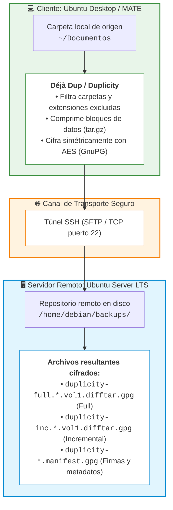
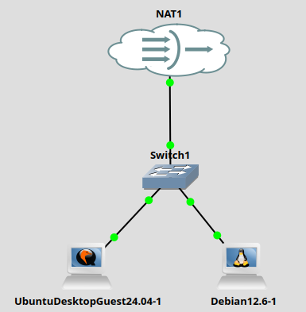

# Práctica 6.1: Copias de Seguridad en GNU/Linux con Déjà Dup

!!! note "Datos de la Práctica"
    * **Módulo:** Seguridad y Alta Disponibilidad (SAD - 0378)
    * **Unidad Didáctica:** UD6 - Copias de Seguridad y Recuperación de la Información
    * **Requisitos:** Dos máquinas virtuales Linux:
        1. **Servidor Linux:** Ubuntu Server o Debian sin entorno gráfico, con servidor SSH (`openssh-server`) activo.
        2. **Cliente Linux:** Ubuntu Desktop o Ubuntu MATE con entorno gráfico y la utilidad Déjà Dup instalada.
    * **Permisos:** Privilegios de superusuario (`sudo`) en ambas máquinas.

---

## 1. Objetivos

* Diseñar e implementar una directiva de respaldos periódicos en red sobre sistemas GNU/Linux.
* Comprender la arquitectura de **Déjà Dup** y su funcionamiento sobre el motor subyacente **Duplicity**.
* Configurar la transmisión segura de respaldos hacia un repositorio remoto empleando el protocolo **SSH/SFTP**.
* Establecer políticas de inclusión selectiva de directorios críticos y filtros de exclusión (descargas, música, papelera).
* Implementar el **cifrado simétrico en reposo** de los respaldos mediante contraseñas robustas antes de su salida por red.
* Analizar la estructura interna de los volúmenes generados (`duplicity-full` e `duplicity-inc`) para distinguir de forma justificada entre copias completas e incrementales.
* Realizar simulaciones de recuperación ante desastres tanto desde la aplicación Déjà Dup como a través del menú contextual del gestor de archivos ("Volver a la versión anterior").

---

## 2. Escenario y Fundamentos Técnicos

### El Motor Duplicity y Déjà Dup

En los entornos GNU/Linux de escritorio (GNOME, MATE), la herramienta estándar para copias de seguridad personales y departamentales es **Déjà Dup** (identificada en los menús de sistema como *"Copias de seguridad"* o *"Respaldos"*).

Déjà Dup actúa como una interfaz gráfica intuitiva construida sobre **Duplicity**:

1. **Uso del algoritmo librsync:** Duplicity genera archivos comprimidos (*tarballs*) y calcula firmas digitales de bloques para transferir únicamente los cambios producidos respecto a la copia anterior (**copias incrementales continuas**).
2. **Cifrado criptográfico con GnuPG:** Antes de abandonar la máquina cliente, todos los volúmenes de respaldo se cifran de extremo a extremo con el algoritmo AES simétrico mediante una frase de paso definida por el usuario. Aunque un atacante intercepte el canal o comprometa el servidor de destino, no podrá leer la información.
3. **Transporte seguro en red:** Admite el envío a través de protocolos seguros como SSH/SFTP, WebDAV o proveedores de almacenamiento en la nube.



### Elementos del Laboratorio

Nosotros realizaremos la práctica en GNS3 con un Ubuntu Desktop 24.04 que hará de cliente gráfico y un Debian sin entorno gráfico que hará de Servidor Backup

| Máquina Virtual | Sistema Operativo | Rol en el Laboratorio | Configuración de Red |
| :--- | :--- | :--- | :--- |
| **Servidor Backup** |  Debian | Destino remoto de almacenamiento SSH |  (IP ej. `192.168.122.S`) |
| **Cliente Desktop** | Ubuntu Desktop  | Origen de datos y ejecución de Déjà Dup | (IP ej. `192.168.122.C`) |





!!! tip "Vídeos Explicativos de Apoyo"
    Para familiarizarse con el flujo visual de la herramienta:

    * [Vídeo: Hacer copias de seguridad (backups) en Ubuntu](https://youtu.be/tgMoqx0o2xQ){:target="_blank"}
    * [Vídeo: Copias de Seguridad y Restauración en Ubuntu con Déjà Dup](https://youtu.be/KCGBSRsjKRo){:target="_blank"}

---

## 3. Desarrollo Paso a Paso de la Práctica

---

### Fase 1: Configuración del Repositorio en el Servidor Remoto

1. Inicia sesión en la máquina **Debian**.

2. Comprueba que el servicio SSH está en ejecución escuchando en el puerto TCP 22:

    ```bash
    ss -ltn | grep 22
    ```

    *Si no estuviera instalado, ejecútalo mediante `sudo apt update && sudo apt install openssh-server -y`.*

3. Identifica la dirección IP del servidor mediante `ip a` o `hostname -I`.

4. Asegúrate de disponer de un usuario estándar para gestionar los respaldos (por ejemplo, `debian`). 

5. Inicia sesión como `debian` (o mediante `su - debian`) y crea el directorio que actuará como repositorio de copias. Solo ese usuario tendrà a los backups:

    ```bash
    mkdir -p /home/debian/backups
    chmod 700 /home/debian/backups
    ```

---

### Fase 2: Preparación del Cliente y Validación de Conectividad SSH

1. Inicia sesión en la estación de trabajo **Ubuntu Desktop / MATE**.

2. Abre una terminal e instala Déjà Dup y las extensiones necesarias si no vinieran preinstaladas:

    ```bash
    sudo apt update
    sudo apt install deja-dup duplicity -y
    ```

3. Comprueba que entre las aplicaciónes ahora está "Backups"

3. **Paso crítico de verificación SSH:** Antes de configurar la herramienta gráfica, establece una conexión SSH manual por terminal hacia el servidor:

    ```bash
    ssh debian@<IP_DEL_SERVIDOR>
    ```

    * Acepta la huella digital del servidor tecleando `yes` cuando pregunte `Are you sure you want to continue connecting (yes/no/[fingerprint])?`.
    * Esto registrará el servidor en el fichero `~/.ssh/known_hosts` del cliente, evitando bloqueos silenciosos o fallos de conexión en la interfaz gráfica de Déjà Dup.
    * Cierra la sesión SSH tecleando `exit`.

4. Prepara el entorno de datos de prueba en la carpeta personal del cliente. Crea dentro de `~/Documentos` varios ficheros de texto con contenido representativo:

    ```bash
    cd ~/Documentos
    echo "Directiva de Seguridad V1 - Confidencial" > directiva_seguridad.txt
    echo "Contabilidad Ejercicio 2026 - Datos de balance" > balance_2026.txt
    echo "Matriz de Riesgos y Activos TIC" > matriz_riesgos.txt
    ```

---

### Fase 3: Configuración de la Política de Respaldo en Déjà Dup

1. Abre el menú de aplicaciones del cliente y busca **Backups** (o **"Copias de seguridad"** o **"Respaldos"** en Ubuntu).

2. En la ventana principal, accede a la sección de configuración y define las siguientes directivas:

    * **Carpetas para guardar (Inclusión):**
        * Añade la carpeta personal.
    * **Carpetas que ignorar (Exclusión):**
        * Añade a la lista de exclusión:
            * `Papelera`
            * `~/Descargas`
            * `~/Música`
    * **Ubicación del almacenamiento:**
        * Tipo de almacenamiento: **Ubicación de red / Servidor de red**.
        * Protocolo: **SSH**.
        * Servidor: Introduce el protocolo ssh y la dirección IP de tu máquina servidor (`ssh://192.168.122.S`)
        * Carpeta / Directorio: `/home/debian/backups` (o simplemente `backups` relativo a la home de `debian`).
        * Nombre de usuario: `debian`.
    * **Programación y Retención:**
        * Frecuencia: **Diaria**.
        * Conservación: **Al menos un año** (o *"Hasta que se quede sin espacio"*).

---

### Fase 4: Ejecución del Primer Respaldo y Cifrado Simétrico

1. En la pantalla principal de Déjà Dup, pulsa el botón **"Respaldar ahora"** (*Back Up Now*).

2. El asistente solicitará proteger el respaldo con contraseña:
    * Marca la opción de **proteger la copia de seguridad con contraseña**.
    * Introduce una contraseña robusta y anótala (si se pierde la clave, los datos serán irrecuperables): `ieselcaminas`.

3. El sistema solicitará la contraseña del usuario `debian` del servidor SSH para autorizar la transferencia por red.

4. Espera a que finalice la copia de seguridad hasta recibir la confirmación de *"Copia de seguridad finalizada"*.

5. **Auditoría en el Servidor:** Vuelve a la máquina **Debian** y consulta el contenido del directorio de almacenamiento:

    ```bash
    ls -lh /home/debian/backups/
    ```

    *Comprobarás la aparición de una serie de volúmenes con el prefijo `duplicity-full.*.difftar.gpg`, ficheros de firmas `.sigtar.gpg` y archivos `.manifest.gpg`.*

---

### Fase 5: Modificación de Datos y Generación de Respaldo Incremental

1. En la máquina **Cliente**, simula la jornada laboral cotidiana modificando los datos del directorio `~/Documentos`:

    ```bash
    cd ~/Documentos

    # Modificar un archivo existente
    echo "Actualización con nuevas incidencias de seguridad" >> directiva_seguridad.txt

    # Crear un nuevo archivo departamental
    echo "Nuevo procedimiento de auditoría interna" > auditoria.txt

    # Eliminar uno de los archivos originales
    rm balance_2026.txt
    ```

2. Vuelve a Déjà Dup y ejecuta manualmente una nueva copia de seguridad pulsando **"Respaldar ahora"**.

3. Introduce la contraseña de cifrado establecida cuando el asistente la requiera.

4. **Auditoría de Cambios en el Servidor:** Una vez completada, lista nuevamente el contenido de `/home/debian/backups/` en el servidor:

    ```bash
    ls -lh /home/debian/backups/
    ```

    *Observa los nuevos ficheros creados con el prefijo `duplicity-inc.*.difftar.gpg` junto a los volúmenes completos anteriores.*

---

### Fase 6: Simulación de Desastre y Restauración de Datos

Vamos a verificar los dos métodos de restauración que ofrece la plataforma:

#### Método A: Restauración Selectiva

Vamos a recuperar el archivo `balance_2026.txt` que borramos antes del 2º backup.

2. Abre la aplicación **Déjà Dup** y pulsa en la pestaña o botón **"Restaurar"** (*Restore*).
3. Sigue el asistente:
    * Selecciona la primera fecha en la que realizamos el backup.
    * Selecciona el fichero `balance_2026.txt`
    * Elige restaurar los ficheros en su **ubicación original**.
4. Verifica que el fichero `balance_2026.txt` se ha restaurado en la carpeta `~/Documentos`.


#### Método B: Restauración Completa desde la Interfaz de Déjà Dup

1. Simula una catástrofe total eliminando por completo la carpeta `Documentos`:

    ```bash
    rm -rf ~/Documentos
    ```

2. Abre la aplicación **Déjà Dup** y pulsa en la pestaña o botón **"Restaurar"** (*Restore*).
3. Sigue el asistente:
    * Selecciona la fecha más reciente disponible.
    * Elige restaurar los ficheros en su **ubicación original**.
4. Verifica que la carpeta `~/Documentos` y todos sus archivos se han recuperado con éxito.

---

## 4. Cuestiones y Análisis Técnico

Responde de forma justificada y detallada a las siguientes preguntas en tu memoria de prácticas:

1. **Análisis de Volúmenes en el Servidor:**
    * Examina la nomenclatura de los archivos almacenados en `/home/debian/backups/`.
    * ¿Qué diferencia existe entre los ficheros con prefijo `duplicity-full` y los de prefijo `duplicity-inc`?
    * ¿Por qué el tamaño de los ficheros `duplicity-inc` es notablemente inferior al de los `duplicity-full`? Justifícalo según los tipos de copia estudiados en la teoría.
2. **Seguridad y Confidencialidad en Tránsito y Reposo:**
    * El canal de red empleado utiliza SSH (cifrado en tránsito). ¿Por qué sigue siendo fundamental activar además la contraseña de cifrado propia de Déjà Dup (cifrado en reposo)?
    * Si el administrador del servidor `Ubuntu Server` intentase abrir o descomprimir con `tar` uno de los volúmenes `.gpg` ubicados en `/home/debian/backups/`, ¿podría leer su contenido? ¿Por qué?
3. **Estrategia 3-2-1:**
    * ¿En qué medida la práctica realizada cumple con la regla de oro 3-2-1 del almacenamiento de copias de seguridad? ¿Qué componente faltaría para un cumplimiento estricto?

---