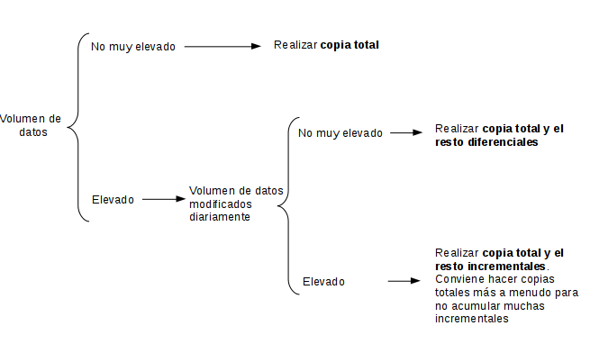
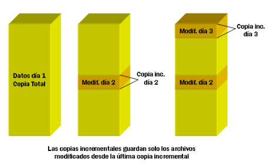
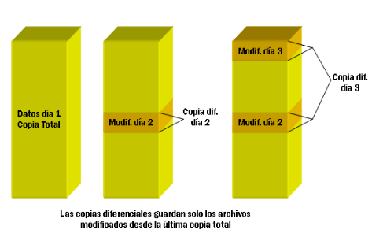

# UD6: Copias de Seguridad, Recuperación ante Desastres y Borrado Seguro

!!! note "Datos de la Unidad Didáctica"
    * **Módulo:** Seguridad y Alta Disponibilidad (SAD - 0378)
    * **Ciclo:** Técnico Superior en Administración de Sistemas Informáticos en Red (ASIR)
    * **Duración Asignada:** 8 horas lectivas (Ponderación del 10% en el módulo, aportando el 40% del Resultado de Aprendizaje RA1).

---

## 1. Introducción a la Seguridad Pasiva y Continuidad de Negocio

La información es el activo más valioso de cualquier organización o usuario particular. Mientras que la **seguridad activa** comprende todas las barreras y defensas preventivas orientadas a evitar que ocurra un incidente (cortafuegos, contraseñas robustas, detección de intrusos o parches de seguridad), la **seguridad pasiva** entra en acción cuando el incidente o desastre ya se ha producido, con el objetivo de **minimizar el impacto de los daños y restaurar la operatividad en el menor tiempo posible**.

Las pérdidas de información no solo tienen su origen en ciberataques maliciosos (como infecciones por ransomware o sabotajes internos), sino frecuentemente en:
* Averías físicas del hardware (fallos mecánicos de cabezales en discos HDD o degradación de celdas flash en SSD).
* Errores humanos involuntarios (borrado accidental de carpetas, sobreescritura de bases de datos o formateos erróneos).
* Desastres ambientales o de infraestructura (incendios, inundaciones, picos de tensión o cortes eléctricos prolongados).

```
 ┌──────────────────────────────────────┐     ┌──────────────────────────────────────┐
 │           SEGURIDAD ACTIVA           │     │          SEGURIDAD PASIVA            │
 ├──────────────────────────────────────┤     ├──────────────────────────────────────┤
 │ * Prevención y detección en vivo.    │     │ * Recuperación y respuesta al daño.  │
 │ * Control de acceso y cifrado.       │     │ * Copias de seguridad (Backups).     │
 │ * Cortafuegos, IDS/IPS y antivirus.  │     │ * Herramientas de recuperación.      │
 │ * Evita que el desastre ocurra.      │     │ * Permite volver a operar tras fallo.│
 └──────────────────────────────────────┘     └──────────────────────────────────────┘
```

---

### Métricas Críticas en la Recuperación: RPO y RTO

A la hora de diseñar un plan de continuidad de negocio (*Business Continuity Plan* - BCP) y de recuperación ante desastres (*Disaster Recovery Plan* - DRP), todo administrador de sistemas debe definir dos parámetros fundamentales acordados con la dirección:

```
  [ ÚLTIMO BACKUP ] ◄──── RPO ────► [ DESASTRE / INCIDENTE ] ◄──── RTO ────► [ SISTEMA RESTAURADO ]
   (Datos guardados)               (Pérdida de datos tolerada)                (Tiempo de inactividad)
```

1. **RPO (*Recovery Point Objective* - Objetivo de Punto de Recuperación):**
   * Representa el **volumen máximo de datos que la organización puede permitirse perder**, medido en unidades de tiempo transcurrido entre la última copia válida y el instante del desastre.
   * *Ejemplo:* Si una empresa realiza copias de seguridad una vez al día a las 23:00 y sufre un desastre a las 18:00, ha perdido 19 horas de transacciones. Si su RPO máximo exigido era de 4 horas, la política de copias ha fracasado.

2. **RTO (*Recovery Time Objective* - Objetivo de Tiempo de Recuperación):**
   * Representa el **tiempo máximo admisible que un sistema o servicio puede permanecer inactivo** antes de que la interrupción cause pérdidas inasumibles para la empresa.
   * *Ejemplo:* Si un servidor de base de datos de comercio electrónico cae a las 10:00 y no vuelve a estar operativo hasta las 18:00 (8 horas de caída), cuando el RTO fijado era de 2 horas, se ha sobrepasado el límite operativo.

3. **Ventana de Copia (*Backup Window*):**
   * Es el intervalo de tiempo disponible durante el cual se puede ejecutar el proceso de copia sin penalizar el rendimiento del sistema en horario laboral (habitualmente de madrugada).

---

## 2. Estrategias y Políticas de Copias de Seguridad (Backup)

Una copia de seguridad o *backup* es un duplicado íntegro o selectivo de la información almacenada en un sistema informático, depositado en un soporte o ubicación independiente para posibilitar su restauración si la fuente original resulta dañada, corrompida o inaccesible.

---

### La Regla Nemotécnica 3-2-1

Es el estándar de oro universalmente aceptado por los organismos de ciberseguridad (INCIBE, CISA, NIST) para el diseño de políticas de respaldo resistentes:

```
                      ┌──────────────────────────────────────┐
                      │          LA REGLA 3 - 2 - 1          │
                      └──────────────────────────────────────┘
                                          │
        ┌─────────────────────────────────┼─────────────────────────────────┐
        ▼                                 ▼                                 ▼
   [ 3 COPIAS ]                     [ 2 SOPORTES ]                    [ 1 OFFSITE ]
 1 Original + 2 Respaldos        Tecnologías distintas             Copia en ubicación externa
 (evita punto único de fallo)    (ej. Disco Local + NAS / Nube)    (protección frente a incendios)
```

* **3 Copias de los datos:** Debe existir el dato original de producción y al menos dos copias de respaldo adicionales.
* **2 Medios o soportes diferentes:** Almacenar los respaldos en dispositivos con tecnologías distintas (por ejemplo, disco magnético local y almacenamiento en red NAS, o disco y cinta magnética). Esto protege frente a fallos sistémicos de una tecnología concreta.
* **1 Copia fuera de las instalaciones (*Offsite*):** Al menos una de las copias debe guardarse en una ubicación geográfica separada (otra sede, delegación o almacenamiento en la nube). Protege los datos ante robos en la oficina, incendios, inundaciones o cortes de suministro físico.

!!! tip "La Regla Moderna 3-2-1-1-0"
    Con la proliferación del ransomware (que cifra tanto los equipos locales como los recursos compartidos en red a los que tiene acceso el administrador), la regla se ha ampliado modernamente:
    
    * **+1 Copia Inmutable o Aislada (*Air-Gapped* / WORM):** Al menos una copia no puede ser modificada, borrada ni sobrescrita durante un periodo de tiempo prefijado, incluso con credenciales de administrador (modo *Object Lock* en almacenamiento S3 o discos desconectados físicamente).
    * **+0 Errores en la Restauración:** Verificación y pruebas periódicas obligatorias de restauración para garantizar que la copia no está corrupta.

---

### Tipos de Copias de Seguridad

En función de cómo gestionan los ficheros modificados a lo largo del tiempo, se distinguen tres modalidades principales:



#### 1. Copia de Seguridad Completa (*Full Backup*)
* **Mecánica:** Respalda absolutamente todos los ficheros, carpetas y estructuras de datos seleccionados, independientemente de si han cambiado o no desde la última copia.
* **Ventajas:** Máxima sencillez y rapidez de restauración (todo lo necesario para restaurar el sistema se encuentra en un único contenedor o soporte).
* **Inconvenientes:** Es la que mayor tiempo de ejecución consume, mayor sobrecarga genera en la red y mayor espacio de almacenamiento requiere.

#### 2. Copia de Seguridad Incremental (*Incremental Backup*)
* **Mecánica:** Respalda únicamente los ficheros y datos que han sido creados o modificados **desde la última copia de seguridad efectuada (sea esta una copia completa o una copia incremental previa)**.



* **Ventajas:** Es la más rápida de realizar en el día a día y la que menor espacio de almacenamiento consume, ideal para ventanas de copia reducidas.
* **Inconvenientes:** La restauración es la más lenta y compleja: para restaurar el sistema a su estado del viernes, se debe restaurar primero la copia completa del domingo anterior y, sucesivamente, cada una de las copias incrementales del lunes, martes, miércoles, jueves y viernes en riguroso orden cronológico. Si una de las piezas intermedias se corrompe, se pierde la consistencia del resto.

#### 3. Copia de Seguridad Diferencial (*Differential Backup*)
* **Mecánica:** Respalda todos los ficheros y datos que han sido modificados **desde la última copia de seguridad completa**. Cada copia diferencial subsiguiente acumula todos los cambios producidos desde el último respaldo completo.



* **Ventajas:** Restauración muy rápida y sencilla: únicamente se requiere la última copia completa y la última copia diferencial.
* **Inconvenientes:** A medida que pasan los días tras la copia completa, el tamaño de la copia diferencial crece progresivamente, aumentando el tiempo necesario para completarla.

---

### Tabla Comparativa de Estrategias de Backup

| Característica | Copia Completa (*Full*) | Copia Incremental | Copia Diferencial |
| :--- | :--- | :--- | :--- |
| **Criterio de respaldo** | Todo lo seleccionado | Cambios desde el **último backup** (cualquiera) | Cambios desde el **último backup completo** |
| **Tiempo de realización** | Muy elevado | Mínimo | Moderado (crece día a día) |
| **Espacio requerido** | Muy grande | Mínimo | Moderado |
| **Archivos para restaurar** | Solo el último backup completo | Copia completa + **todas** las incrementales | Copia completa + **última** diferencial |
| **Velocidad de recuperación** | Muy rápida | Lenta (proceso secuencial) | Rápida |
| **Riesgo ante corrupción** | Mínimo | Alto (si falla una incremental intermedia) | Bajo |

---

### Soportes y Medios de Almacenamiento

La elección del soporte físico o lógico depende del volumen, la velocidad de transferencia requerida y el periodo de retención legal (RGPD, LOPDGDD):

1. **Almacenamiento Conectado Directamente (DAS - *Direct Attached Storage*):** Discos duros externos USB o matrices RAID conectadas al propio servidor. Rápido y económico, pero vulnerable a desastres físicos en la misma sala.
2. **Almacenamiento en Red (NAS / SAN):** Dispositivos dedicados accesibles mediante protocolos de red (NFS, SMB/CIFS, iSCSI). Permiten centralizar los respaldos de múltiples servidores y gestionar instantáneas (*snapshots*).
3. **Cintas Magnéticas (LTO - *Linear Tape-Open*):** Tecnología vigente para archivado histórico masivo a largo plazo (retención de 15 a 30 años). Coste por terabyte extremadamente bajo y capacidad nativa de desconexión física (*Air-Gap* inmune al malware).
4. **Almacenamiento en la Nube (*Cloud Storage*):** Servicios tipo Amazon S3, Google Cloud Storage, Azure Blob o proveedores de backup gestionado. Proporcionan escalabilidad inmediata, georredundancia automática y cifrado extremo a extremo.

!!! note "Práctica de Laboratorio"
    **[Práctica 6.1: Copias de Seguridad en GNU/Linux con Déjà Dup](P6_1_copias_deja_dup.md)**
    
    *En esta práctica aprenderás a planificar y ejecutar copias de seguridad locales y en red sobre entornos Linux, configurarás políticas de inclusión y exclusión de datos, habilitarás el cifrado simétrico del respaldo y realizarás simulaciones reales de restauración de archivos.*

---

## 3. Recuperación de Archivos y Funcionamiento del Almacenamiento

Cuando falla la estrategia de copias de seguridad (por ejemplo, ante archivos creados y borrados entre dos ejecuciones del backup), entran en juego las herramientas forenses y utilidades de **recuperación de datos**.

---

### Mecánica del Borrado en Sistemas de Archivos Magnéticos (HDD)

Para comprender cómo es posible recuperar un archivo borrado, es imprescindible entender cómo organizan los datos los sistemas de archivos modernos (como `ext4` en Linux o `NTFS` en Windows):

```
                        SISTEMA DE ARCHIVOS (EJEMPLO)
 ┌──────────────────────────────────────┬──────────────────────────────────────┐
 │    TABLA DE METADATOS / ÍNDICE       │          BLOQUES DE DATOS            │
 │  (Inodos en ext4 / MFT en NTFS)      │       (Contenido real del archivo)   │
 ├──────────────────────────────────────┼──────────────────────────────────────┤
 │ Archivo: balance.pdf                 │ [ Bloque 1024 ]  "Contenido binario  │
 │ Puntero -> Bloques 1024, 1025, 1026  │ [ Bloque 1025 ]   del documento PDF  │
 │ Estado: ACTIVO                       │ [ Bloque 1026 ]   sin alterar..."    │
 └──────────────────────────────────────┴──────────────────────────────────────┘
                                  │
                  EL USUARIO PULSA "ELIMINAR"
                                  ▼
 ┌──────────────────────────────────────┬──────────────────────────────────────┐
 │    TABLA DE METADATOS / ÍNDICE       │          BLOQUES DE DATOS            │
 ├──────────────────────────────────────┼──────────────────────────────────────┤
 │ Archivo: balance.pdf                 │ [ Bloque 1024 ]  "Contenido binario  │
 │ Puntero -> ELIMINADO                 │ [ Bloque 1025 ]   del documento PDF  │
 │ Estado: LIBRE / DISPONIBLE           │ [ Bloque 1026 ]   SIGUE INTACTO"     │
 └──────────────────────────────────────┴──────────────────────────────────────┘
```

1. **Estructura en dos capas:** El sistema de archivos separa los **metadatos** (nombre del archivo, permisos, fechas de modificación y punteros a los bloques físicos) de los **bloques de datos** donde residen los bytes de la información.
2. **El borrado convencional es lógico, no físico:** Cuando el usuario vacía la papelera o ejecuta `rm archivo`, el sistema operativo **no borra los datos del disco**. Únicamente marca la entrada del inodo o de la tabla MFT como "libre" y añade esos bloques a la lista de espacio disponible para futuras escrituras.
3. **Ventana de recuperación:** Mientras el sistema operativo no asigne esos bloques a un nuevo archivo y escriba encima (*sobreescritura*), **la totalidad de la información original continúa grabada en los sectores del disco**, siendo recuperable mediante software especializado.

---

### La Gran Diferencia: Discos HDD vs. Unidades SSD y el Comando TRIM

El comportamiento descrito anteriormente es válido para discos duros magnéticos tradicionales (HDD), pero cambia radicalmente con las unidades de estado sólido modernas (**SSD SATA y NVMe**):

* **La limitación física de la memoria Flash NAND:** En una memoria flash NAND, no se puede sobrescribir directamente una celda que contiene datos; es necesario **borrar previamente un bloque entero** antes de poder volver a escribir páginas en él (*Erase-Before-Write*).
* **El comando TRIM:** Para evitar que la unidad SSD se vuelva lenta con el tiempo, los sistemas operativos modernos envían el comando `TRIM` al controlador del disco en cuanto se borra un archivo.
* **Impacto en la recuperación:** El controlador del SSD utiliza procesos internos en segundo plano (*Garbage Collection* y algoritmos de nivelación de desgaste o *Wear Leveling*) para poner a cero físicamente las celdas marcadas por TRIM. Como consecuencia, **en unidades SSD con TRIM activo, los archivos borrados suelen ser irrecuperables a los pocos segundos o minutos de su eliminación**, incluso si el equipo no ha escrito nuevos datos.

---

### Técnicas de Recuperación de Datos

Existen dos aproximaciones técnicas principales a la hora de rescatar información de un soporte dañado:

#### 1. Reconstrucción de Estructuras del Sistema de Archivos (`TestDisk`)
* Actúa a nivel lógico de particiones y metadatos.
* Analiza el disco buscando copias de seguridad de las cabeceras MBR/GPT, sectores de arranque (*boot sectors*) y superbloques dañados.
* Permite **recuperar particiones borradas por error**, reparar tablas de partición dañadas y volver a montar sistemas de archivos sin perder sus nombres originales ni su jerarquía de carpetas.

#### 2. Tallado de Archivos (*File Carving* con `PhotoRec`)
* Se utiliza cuando el sistema de archivos está totalmente corrupto o formateado y no existen metadatos válidos.
* Ignora el sistema de archivos e inspecciona el disco sector por sector a bajo nivel, identificando archivos mediante sus **firmas binarias o números mágicos (*Magic Numbers*)** de inicio y fin:
  * Archivos JPEG: Comienzan con los bytes en hexadecimal `FF D8 FF`.
  * Archivos PDF: Comienzan con `%PDF` (`25 50 44 46`).
  * Archivos comprimidos ZIP: Comienzan con `PK` (`50 4B 03 04`).
* *Limitación:* Al no haber metadatos, los archivos se recuperan con nombres genéricos (ej. `f0123456.jpg`) y sin la estructura de carpetas original.

!!! note "Práctica de Laboratorio"
    **[Práctica 6.2: Recuperación de Archivos y Particiones con TestDisk y PhotoRec](P6_2_recuperacion_testdisk_photorec.md)**
    
    *En esta práctica analizarás una unidad de almacenamiento virtualizada con particiones eliminadas y datos borrados, utilizando TestDisk para reparar la tabla de particiones y PhotoRec para rescatar archivos mediante técnicas de tallado binario (file carving).*

---

## 4. Destrucción Segura de la Información (Sanitización y Borrado Permanente)

El reverso de la recuperación de datos es la necesidad de **impedir que terceros puedan recuperar información confidencial** cuando un equipo, disco duro o memoria USB va a ser reutilizado, transferido a otro departamento o retirado para reciclaje (principio de responsabilidad proactiva y cumplimiento del RGPD).

---

### Procedimientos Ineficaces de Borrado

* **Vaciar la Papelera de Reciclaje o usar `rm`:** Deja el 100% del archivo intacto en los sectores de disco.
* **Formateo Rápido (*Quick Format*):** Simplemente recrea las tablas de asignación vacías, pero no sobreescribe un solo bloque de datos.
* **Formateo Normal del Sistema Operativo:** En muchas versiones solo realiza una comprobación de sectores defectuosos sin garantizar la limpieza de los datos subyacentes.

---

### Técnicas de Sobreescritura Lógica (Sanitización)

La sanitización lógica consiste en **escribir nuevos patrones de datos (ceros, unos o secuencias pseudoaleatorias) encima de los sectores** donde se encontraban los datos originales:

1. **Llenado con Ceros (*Zero-Fill*):**
   * Se escriben ceros binarios (`0x00`) en toda la superficie o archivo.
   * En Linux se ejecuta comúnmente con la utilidad `dd`:
     ```bash
     sudo dd if=/dev/zero of=/dev/sdX bs=4M status=progress
     ```
2. **Llenado con Datos Aleatorios (*Random Fill*):**
   * Sobreescribe con patrones criptográficos aleatorios generados por el kernel:
     ```bash
     sudo dd if=/dev/urandom of=/dev/sdX bs=4M status=progress
     ```
3. **El Estándar DoD 5220.22-M (Departamento de Defensa de EE.UU.):**
   * Protocolo de 3 pasadas: Primera pasada con ceros, segunda con unos y tercera con un valor pseudoaleatorio, seguido de una verificación de lectura.
4. **El Método Gutmann:**
   * Algoritmo diseñado en 1996 por Peter Gutmann y Colin Plumb que realiza **35 pasadas de sobreescritura** con patrones diseñados específicamente para desmagnetizar discos magnéticos antiguos que empleaban codificación MFM/RLL.
   * *Realidad técnica actual:* En discos magnéticos modernos de alta densidad (PRMR/SMR), múltiples pasadas son innecesarias; organismos como el NIST (publicación especial NIST SP 800-88 Rev. 1) certifican que **una única pasada de sobreescritura con ceros o valores aleatorios hace que la recuperación sea imposible**, incluso en laboratorios forenses avanzados con microscopía magnética.

---

### Herramientas de Borrado Seguro en GNU/Linux

* **`shred` (Parte de GNU coreutils):**
  * Sobreescribe archivos o particiones completas múltiples veces con datos aleatorios y permite truncar y eliminar el fichero al finalizar:
    ```bash
    shred -u -z -n 3 archivo_confidencial.pdf
    ```
    *(Parámetros: `-n 3` realiza 3 pasadas aleatorias, `-z` añade una pasada final de ceros para ocultar el borrado, `-u` elimina el archivo tras sobreescribirlo).*
* **Paquete `secure-delete`:**
  * Colección de utilidades especializadas basadas en el estándar de sanitización:
    * `srm` (*secure remove*): Borrado seguro de ficheros y directorios individuales.
    * `sfill`: Sobreescribe todo el espacio libre de un disco para asegurar que ningún archivo borrado anteriormente pueda ser recuperado.
    * `sdmem`: Limpia los residuos de memoria RAM del equipo antes del apagado.
    * `sswap`: Sobreescribe la partición o archivo de intercambio (*swap*).

---

### Sanitización en Discos SSD: ATA Secure Erase y Criptoborrado

En discos de estado sólido (SSD / NVMe), el software de sobreescritura tradicional (`dd`, `shred`) no garantiza la destrucción total de los datos debido al controlador interno de nivelación de desgaste (*Wear Leveling*), que reasigna los bloques lógicos de forma transparente a celdas físicas de reserva fuera del alcance del sistema operativo.

Para sanitizar un SSD se emplean métodos específicos de firmware y criptografía:
* **ATA Secure Erase / NVMe Sanitize:** Comandos enviados directamente al controlador del disco para aplicar una descarga de voltaje a todas las celdas de memoria, devolviéndolas a su estado de fábrica.
* **Criptoborrado (*Crypto-Erase*):** En unidades con cifrado de hardware nativo (unidades SED - *Self-Encrypting Drives* o volúmenes LUKS/BitLocker), la destrucción instantánea de la **clave maestra de cifrado** convierte la totalidad de los datos del disco en ruido criptográfico indescifrable de forma inmediata.

---

### Destrucción Física de Soportes

Cuando los discos alcanzan el fin de su ciclo de vida y han contenido información de nivel de confidencialidad crítico, la normativa exige la destrucción material del soporte:
* **Desmagnetización (*Degaussing*):** Exposición de discos magnéticos a potentes campos electromagnéticos que destruyen los dominios magnéticos de los platos y los chips de control.
* **Triturado Mecánico (*Shredding* físico):** Máquinas trituradoras industriales que reducen los discos a fragmentos metálicos de pocos milímetros, haciendo físicamente imposible su ensamblaje.

!!! note "Práctica de Laboratorio"
    **[Práctica 6.3: Borrado Seguro de Datos y Sanitización de Soportes](P6_3_borrado_seguro.md)**
    
    *En esta práctica verificarás la eficacia de las herramientas de borrado seguro (shred, srm, sfill), comprobarás cómo el software de recuperación es incapaz de rescatar información tras una sanitización adecuada y analizarás los comandos de borrado seguro en unidades SSD.*

---

## 5. Resumen de la Unidad y Buenas Prácticas

1. **La copia de seguridad es la última línea de defensa:** Frente a un ataque de ransomware con extorsión doble, disponer de copias inmutables fuera de línea (*Air-Gapped*) es la única garantía de no pagar rescates ni perder la operatividad.
2. **Una copia de seguridad no verificada no existe:** Las empresas deben realizar simulacros periódicos de recuperación completa para validar que los medios funcionan y que el personal conoce el procedimiento.
3. **El borrado estándar no destruye la información:** Todo dispositivo de almacenamiento que vaya a cambiar de manos o ser desechado debe someterse a procesos formales de sanitización lógica o destrucción física certificada.
