# UD6: Copias de Seguridad, Recuperación ante Desastres y Borrado Seguro

!!! note "Datos de la Unidad Didáctica"
    * **Módulo:** Seguridad y Alta Disponibilidad (SAD - 0378)
    * **Ciclo:** Técnico Superior en Administración de Sistemas Informáticos en Red (ASIR)
    * **Duración Asignada:** 8 horas lectivas (Ponderación del 10% en el módulo, aportando el 40% del Resultado de Aprendizaje RA1).

---

## 1. Introducción a la Seguridad Pasiva y Continuidad de Negocio

La información es el activo más valioso de cualquier organización o usuario particular. Mientras que la **seguridad activa** comprende todas las barreras y defensas preventivas orientadas a evitar que ocurra un incidente (cortafuegos, contraseñas robustas, detección de intrusos o parches de seguridad), la **seguridad pasiva** entra en acción cuando el incidente o desastre ya se ha producido, con el objetivo de **minimizar el impacto de los daños y restaurar la operatividad en el menor tiempo posible**.

Las pérdidas de información no solo tienen su origen en ciberataques maliciosos (como infecciones por ransomware o sabotajes internos), sino frecuentemente en:

* Averías físicas del hardware (fallos mecánicos de cabezales en discos HDD o degradación de celdas flash en SSD).
* Errores humanos involuntarios (borrado accidental de carpetas, sobreescritura de bases de datos o formateos erróneos).
* Desastres ambientales o de infraestructura (incendios, inundaciones, picos de tensión o cortes eléctricos prolongados).

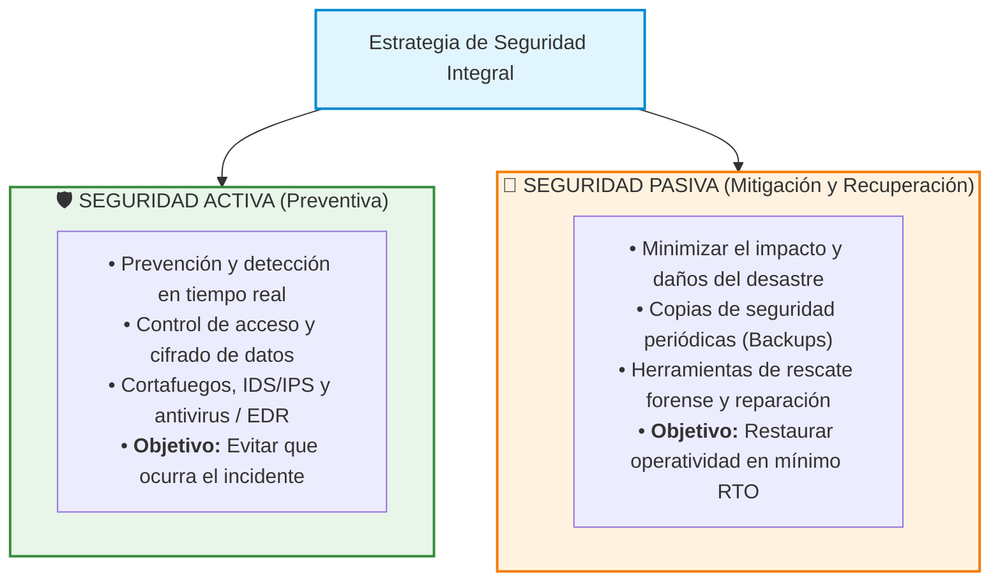

---

### Las Copias de Seguridad y la Tríada CID (Confidencialidad, Integridad y Disponibilidad)

A menudo se asume erróneamente que una copia de seguridad protege por sí misma todas las dimensiones de la seguridad de la información. Sin embargo, su impacto sobre los tres pilares clásicos (**Confidencialidad, Integridad y Disponibilidad**) es muy dispar:

* **Disponibilidad (Impacto Máximo):** Es el pilar fundamental que sostiene la seguridad pasiva. Garantiza que, ante un fallo catastrófico de hardware, desastre físico o secuestro por ransomware, la organización pueda recuperar sus activos de datos y reanudar los servicios operativos en un tiempo admisible.
* **Integridad (Impacto Correctivo):** Un respaldo no previene que un archivo sufra alteraciones o corrupción en vivo durante la producción, pero constituye la herramienta indispensable para **revertir el sistema a un estado verificado e inalterado** previo al incidente.
* **Confidencialidad (Riesgo Crítico y Superficie de Ataque):** Las copias de seguridad **no incrementan la privacidad; al contrario, amplían la superficie de exposición**. Si los servidores en producción disponen de férreos controles de acceso pero los respaldos se almacenan o transmiten sin cifrar (por ejemplo, cintas transportadas sin custodia, carpetas compartidas SMB abiertas o volcados en la nube accesibles), un atacante podrá obtener la totalidad de la información eludiendo las defensas activas. Por ello, **el cifrado robusto de extremo a extremo (como AES-256) y el control de acceso estricto al repositorio de copias son exigencias legales y técnicas inexcusables (RGPD / ENS)**.

---

### Fases del Ciclo de Respaldo y el Principio de Estados Recuperables

La implantación formal de un sistema de copias de seguridad comprende tres fases interdependientes:

1. **Definición de la Estrategia:** Planificación previa del alcance (qué información respaldar), los mecanismos técnicos de gestión, los soportes físicos/lógicos, la periodicidad de ejecución y los periodos de retención.
2. **Ejecución del Respaldo:** Proceso programado, automatizado y desatendido de duplicación de los datos en ventanas temporales que no penalicen el rendimiento de producción.
3. **Recuperación y Verificación:** Protocolos de restauración ante contingencias y simulacros periódicos de prueba para certificar que las copias son íntegras y no se encuentran corruptas.

#### El Principio de Estados Recuperables Discretos

Un sistema de copias de seguridad no funciona como una grabación continua en tiempo real: **únicamente permite regresar al instante discreto exacto en el que concluyó un respaldo válido** (t_0, t_1, t_2...).

Cualquier fichero creado y destruido en el intervalo intermedio entre dos respaldos consecutivos **no existirá en ningún soporte de copia** y, por tanto, **no podrá recuperarse mediante el sistema de backups**:

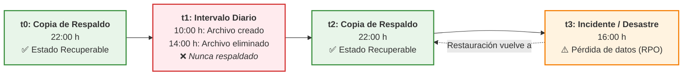

* *Consecuencia práctica:* Si un empleado crea una hoja de cálculo a las 10:00 y la elimina accidentalmente a las 14:00, y la política de copias se ejecuta cada noche a las 22:00, el sistema de copias no podrá auxiliarle. En estos casos, la única alternativa es recurrir a técnicas de recuperación forense en el almacenamiento local antes de que sus sectores sean sobrescritos.

---

### Métricas Críticas en la Recuperación: RPO y RTO

A la hora de diseñar un plan de continuidad de negocio (*Business Continuity Plan* - BCP) y de recuperación ante desastres (*Disaster Recovery Plan* - DRP), todo administrador de sistemas debe definir dos parámetros fundamentales acordados con la dirección:

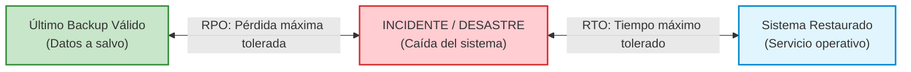

1. **RPO (*Recovery Point Objective* - Objetivo de Punto de Recuperación):**
    * Representa el **volumen máximo de datos que la organización puede permitirse perder**, medido en unidades de tiempo transcurrido entre la última copia válida y el instante del desastre.
    * *Ejemplo:* Si una empresa realiza copias de seguridad una vez al día a las 23:00 y sufre un desastre a las 18:00, ha perdido 19 horas de transacciones. Si su RPO máximo exigido era de 4 horas, la política de copias ha fracasado.

2. **RTO (*Recovery Time Objective* - Objetivo de Tiempo de Recuperación):**
    * Representa el **tiempo máximo admisible que un sistema o servicio puede permanecer inactivo** antes de que la interrupción cause pérdidas inasumibles para la empresa.
    * *Ejemplo:* Si un servidor de base de datos de comercio electrónico cae a las 10:00 y no vuelve a estar operativo hasta las 18:00 (8 horas de caída), cuando el RTO fijado era de 2 horas, se ha sobrepasado el límite operativo.

3. **Ventana de Copia (*Backup Window*):**
    * Es el intervalo de tiempo disponible durante el cual se puede ejecutar el proceso de copia sin penalizar el rendimiento del sistema en horario laboral (habitualmente de madrugada).

---

## 2. Estrategias y Políticas de Copias de Seguridad (Backup)

Una copia de seguridad o *backup* es un duplicado íntegro o selectivo de la información almacenada en un sistema informático, depositado en un soporte o ubicación independiente para posibilitar su restauración si la fuente original resulta dañada, corrompida o inaccesible.

---

### 2.1. Planificación del Alcance: ¿Qué Información Debemos Respaldar?

Una de las decisiones críticas en la estrategia es delimitar con precisión qué elementos deben formar parte del respaldo. Respaldar datos innecesarios satura el almacenamiento y penaliza el ancho de banda, mientras que omitir componentes clave impide la recuperación:

1. **El Sistema Operativo y Aplicaciones (*Bare-Metal* e Imágenes):**
    * Respaldo íntegro de la partición de arranque, sistema operativo, binarios y programas instalados.
    * *Casos de uso:* Recuperación ágil ante colapsos graves de software, sustitución urgente de hardware físico dañado (*bare-metal restore* sobre un equipo nuevo de características idénticas) o despliegue masivo mediante clonación.
    * *Inconveniente:* Consume un volumen elevado de almacenamiento y requiere una ventana de tiempo prolongada; suele ejecutarse de forma puntual (tras la puesta en marcha inicial o actualizaciones mayores).

2. **Los Datos de Producción (El Activo Esencial):**
    * Información generada dinámicamente por la organización (documentos ofimáticos, bases de datos relacionales, repositorios de código, proyectos contables). Es irremplazable, ya que no puede descargarse de ningún repositorio público.
    * **Políticas de Exclusión Inteligente:** En puestos de usuario se deben excluir carpetas temporales, descargas de Internet (`~/Descargas`), cachés de navegadores o imágenes ISO de instalación para no desperdiciar espacio ni saturar la red corporativa.
    * **Datos en Servidores:** A diferencia de los puestos personales, en los servidores los datos esenciales no residen en los directorios de usuario, sino en rutas dedicadas de servicios como `/var/www/` (servidores web), `/var/mail/` (buzones de correo) o los almacenes de bases de datos.

3. **Las Configuraciones del Sistema y Servicios:**
    * Consiste en respaldar selectivamente los ficheros de configuración del sistema operativo y de los servicios en ejecución (por ejemplo, el directorio `/etc/` en entornos GNU/Linux, directivas de cortafuegos, scripts de inicio o perfiles de usuario).
    * *Ventajas:* Su peso es insignificante (apenas unos megabytes) y permite levantar un servidor equivalente reinstalando el sistema base limpio y volcando directamente su configuración previa.

---

### 2.2. Niveles y Mecanismos de Gestión del Respaldo

Dependiendo de qué capa del sistema informático gestione el proceso de copia, se distinguen varios niveles técnicos:

1. **A Nivel de Sistema de Archivos:**
    * Ciertos sistemas de archivos modernos (como **ZFS** o **Btrfs**) y gestores de volúmenes (**LVM**) gestionan instantáneas (*snapshots*) y réplicas a nivel de bloques de disco de forma nativa.
    * Son extremadamente rápidos, no saturan la CPU y permiten revertir el estado del sistema en cuestión de segundos.

2. **A Nivel de Sistema Operativo:**
    * Utilidades integradas en el propio sistema operativo.
    * *En GNU/Linux:* La herramienta de referencia es `rsync` (sincronización incremental y diferencial eficiente por bloques), programada habitualmente mediante tareas de `cron` o temporizadores de `systemd`, o mediante entornos visuales como `Grsync`.
    * *En Windows:* Historial de archivos y utilidades de copia y restauración integradas.

3. **Mediante Aplicaciones Específicas de Copia de Seguridad:**
    * Software dedicado que unifica planificación visual, compresión, cifrado criptográfico simétrico, verificación de sumas hash y rotación de soportes:
        * **Estaciones de trabajo y puestos cliente:** Déjà Dup (interfaz para Duplicity en Linux) y Cobian Backup / Cobian Gravity (en Windows).
        * **Entornos corporativos y centros de datos:** Veeam Backup, Bacula, Amanda o Duplicati.
    * **Respaldo de Bases de Datos (SGBD):** Las bases de datos en producción nunca deben copiarse simplemente duplicando los ficheros en caliente (riesgo de inconsistencia y corrupción transaccional). Se deben emplear utilidades nativas del motor (como `mysqldump` / `mariadb-dump` en MariaDB/MySQL o `pg_dump` en PostgreSQL) para generar volcados coherentes (*dumps* atómicos).

4. **Mediante Sistemas Live y Clonación en Frío:**
    * Arranque del equipo desde un soporte externo (Live USB/PXE) sin cargar el sistema operativo principal (Clonezilla, Rescuezilla, GParted).
    * Permiten crear imágenes íntegras de discos y particiones bit a bit en frío, garantizando que ningún fichero esté bloqueado o en uso.

5. **En Plataformas de Virtualización e Hipervisores:**
    * En entornos virtualizados (Proxmox VE, VMware ESXi, Hyper-V, VirtualBox), los hipervisores permiten capturar instantáneas (*snapshots*) del estado de la memoria y disco de las máquinas virtuales en caliente.
    * !!! warning "Una instantánea (Snapshot) NO es una copia de seguridad"
        Las instantáneas dependen del disco virtual base original. Si el almacenamiento físico o la cabina SAN/NAS falla, se pierden tanto la máquina virtual como todas sus instantáneas. Las copias de seguridad deben exportarse siempre a un soporte o repositorio físicamente independiente.

---

### 2.3. Modalidades y Estrategias de Copias de Seguridad

En función de cómo gestionan los ficheros modificados a lo largo del tiempo, se distinguen tres modalidades principales:

#### 1. Copia de Seguridad Completa (*Full Backup*)
* **Mecánica:** Respalda absolutamente todos los ficheros, carpetas y estructuras de datos seleccionados, independientemente de si han cambiado o no desde la última copia.
* **Ventajas:** Máxima sencillez y rapidez de restauración (todo lo necesario para restaurar el sistema se encuentra en un único contenedor o soporte).
* **Inconvenientes:** Es la que mayor tiempo de ejecución consume, mayor sobrecarga genera en la red y mayor espacio de almacenamiento requiere.

#### 2. Copia de Seguridad Incremental (*Incremental Backup*)
* **Mecánica:** Respalda únicamente los ficheros y datos que han sido creados o modificados **desde la última copia de seguridad efectuada (sea esta una copia completa o una copia incremental previa)**.

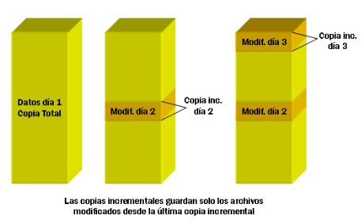

* **Ventajas:** Es la más rápida de realizar en el día a día y la que menor espacio de almacenamiento consume, ideal para ventanas de copia reducidas.
* **Inconvenientes:** La restauración es la más lenta y compleja: para restaurar el sistema a su estado del viernes, se debe restaurar primero la copia completa del domingo anterior y, sucesivamente, cada una de las copias incrementales del lunes, martes, miércoles, jueves y viernes en riguroso orden cronológico. Si una de las piezas intermedias se corrompe, se pierde la consistencia del resto.

#### 3. Copia de Seguridad Diferencial (*Differential Backup*)
* **Mecánica:** Respalda todos los ficheros y datos que han sido modificados **desde la última copia de seguridad completa**. Cada copia diferencial subsiguiente acumula todos los cambios producidos desde el último respaldo completo.

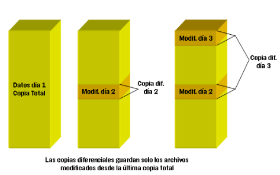

* **Ventajas:** Restauración muy rápida y sencilla: únicamente se requiere la última copia completa y la última copia diferencial.
* **Inconvenientes:** A medida que pasan los días tras la copia completa, el tamaño de la copia diferencial crece progresivamente, aumentando el tiempo necesario para completarla.

En función del volumen de datos a guardar se pueden seguir varias estrategias:

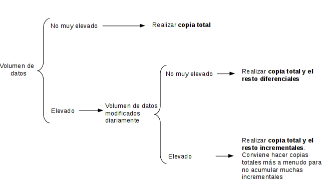

---

#### Tabla Comparativa de Estrategias de Backup

| Característica | Copia Completa (*Full*) | Copia Incremental | Copia Diferencial |
| :--- | :--- | :--- | :--- |
| **Criterio de respaldo** | Todo lo seleccionado | Cambios desde el **último backup** (cualquiera) | Cambios desde el **último backup completo** |
| **Tiempo de realización** | Muy elevado | Mínimo | Moderado (crece día a día) |
| **Espacio requerido** | Muy grande | Mínimo | Moderado |
| **Archivos para restaurar** | Solo el último backup completo | Copia completa + **todas** las incrementales | Copia completa + **última** diferencial |
| **Velocidad de recuperación** | Muy rápida | Lenta (proceso secuencial) | Rápida |
| **Riesgo ante corrupción** | Mínimo | Alto (si falla una incremental intermedia) | Bajo |

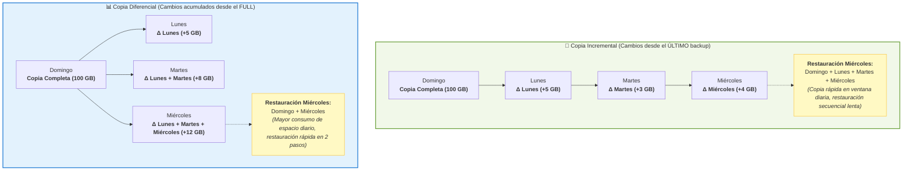

---

#### 4. Estrategia de Copias Mixta (Abuelo-Padre-Hijo / GFS)

En entornos corporativos reales, rara vez se aplica una única modalidad de forma aislada. Para conciliar la ventana de tiempo de ejecución nocturna, el volumen de almacenamiento requerido y la agilidad de restauración, se adopta un **esquema mixto jerárquico**:

| Nivel de Copia | Frecuencia Habitual | Alcance y Contenido | Objetivo Operativo |
| :--- | :--- | :--- | :--- |
| **Copia Total (Full)** | Mensual | Respalda el 100% de los datos seleccionados. | Línea base del sistema (*Abuelo*). Almacenamiento a largo plazo. |
| **Copia Diferencial** | Semanal (ej. domingos) | Cambios acumulados desde el último backup total mensual. | Reduce la cadena de restauración intermedia (*Padre*). |
| **Copia Incremental** | Diaria (lunes a sábado) | Cambios exclusivos producidos durante la jornada. | Mínimo impacto y máxima rapidez en horario nocturno (*Hijo*). |

* **Ventaja clave en caso de desastre:** Para restaurar el estado completo de un día cualquiera, el administrador únicamente debe acceder a un máximo de **tres componentes**:
    1. La última copia total mensual.
    2. La última copia diferencial semanal.
    3. Las pocas copias incrementales diarias transcurridas desde el domingo.
    *(Frente a un esquema puramente incremental, donde un desastre a final de mes obligaría a restaurar y encadenar hasta 30 copias sucesivas con altísimo riesgo de corrupción).*

---

#### Políticas de Retención y Rotación de Copias

Almacenar copias de forma indefinida satura inevitablemente la capacidad de almacenamiento y contraviene el principio de minimización de datos del RGPD. Los administradores deben configurar directivas de retención formalizadas:

1. **Rotación por Espacio de Almacenamiento (FIFO - *First In, First Out*):**
    * La aplicación de backup monitoriza el espacio libre del repositorio (disco local, NAS o bucket S3). Al superar un umbral de seguridad (por ejemplo, 85% de ocupación), purga automáticamente las copias más antiguas no bloqueadas para liberar espacio a los nuevos respaldos.
2. **Políticas Basadas en Ventanas Temporales:**
    * Se fija el tiempo de vida útil (*Time-To-Live* - TTL) de cada conjunto de copias:
        * Copias incrementales diarias: Retención de 14 a 30 días.
        * Copias diferenciales semanales: Retención de 2 a 3 meses.
        * Copias totales mensuales: Retención de 1 a 5 años (o más, en función de obligaciones tributarias, mercantiles y de auditoría).

---

### 2.4. Soportes de Almacenamiento y Reglas de Respaldo

La elección del soporte físico o lógico depende del volumen, la velocidad de transferencia requerida y el periodo de retención legal (RGPD, LOPDGDD):

1. **Almacenamiento Conectado Directamente (DAS - *Direct Attached Storage*):** Discos duros externos USB o matrices RAID conectadas al propio servidor. Rápido y económico, pero vulnerable a desastres físicos en la misma sala.
2. **Almacenamiento en Red (NAS / SAN):** Dispositivos dedicados accesibles mediante protocolos de red (NFS, SMB/CIFS, iSCSI). Permiten centralizar los respaldos de múltiples servidores y gestionar instantáneas (*snapshots*).
3. **Cintas Magnéticas (LTO - *Linear Tape-Open*):** Tecnología vigente para archivado histórico masivo a largo plazo (retención de 15 a 30 años). Coste por terabyte extremadamente bajo y capacidad nativa de desconexión física (*Air-Gap* inmune al malware).
4. **Almacenamiento en la Nube (*Cloud Storage*):** Servicios tipo Amazon S3, Google Cloud Storage, Azure Blob o proveedores de backup gestionado. Proporcionan escalabilidad inmediata, georredundancia automática y cifrado extremo a extremo.

#### La Regla Nemotécnica 3-2-1

Es el estándar de oro universalmente aceptado por los organismos de ciberseguridad (INCIBE, CISA, NIST) para el diseño de políticas de respaldo resistentes:

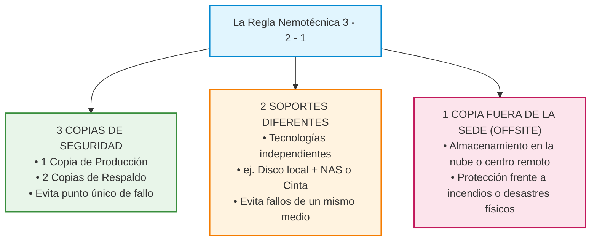

* **3 Copias de los datos:** Debe existir el dato original de producción y al menos dos copias de respaldo adicionales.
* **2 Medios o soportes diferentes:** Almacenar los respaldos en dispositivos con tecnologías distintas (por ejemplo, disco magnético local y almacenamiento en red NAS, o disco y cinta magnética). Esto protege frente a fallos sistémicos de una tecnología concreta.
* **1 Copia fuera de las instalaciones (*Offsite*):** Al menos una de las copias debe guardarse en una ubicación geográfica separada (otra sede, delegación o almacenamiento en la nube). Protege los datos ante robos en la oficina, incendios, inundaciones o cortes de suministro físico.

!!! tip "La Regla Moderna 3-2-1-1-0"
    Con la proliferación del ransomware (que cifra tanto los equipos locales como los recursos compartidos en red a los que tiene acceso el administrador), la regla se ha ampliado modernamente:
    
    * **+1 Copia Inmutable o Aislada (*Air-Gapped* / WORM):** Al menos una copia no puede ser modificada, borrada ni sobrescrita durante un periodo de tiempo prefijado, incluso con credenciales de administrador (modo *Object Lock* en almacenamiento S3 o discos desconectados físicamente).
    * **+0 Errores en la Restauración:** Verificación y pruebas periódicas obligatorias de restauración para garantizar que la copia no está corrupta.

---

### 2.5. Caso Práctico: Planificación y Restauración ante un Incidente en Fin de Año

!!! example "Caso Práctico: Planificación y Restauración ante un Incidente en Fin de Año"
    **Contexto:**
    Eres el técnico responsable de las copias de seguridad de una empresa mediana. El **31 de diciembre de 2018**, a las 19:00 h (una hora antes de concluir tu jornada laboral para celebrar la Nochevieja con tus amistades), el responsable de seguridad de la información te comunica que se ha detectado una incidencia grave de corrupción de datos en el servidor principal.

    Para evaluar el alcance del daño y auditar el histórico, te solicita con carácter de máxima urgencia:
    
    1. Restaurar en un entorno de pruebas el estado íntegro de la información del **30 de octubre de 2018**.
    2. Restaurar en un segundo entorno de pruebas el estado íntegro de la información del **22 de abril de 2018**.
    3. Recuperar un archivo crítico de facturación creado en el servidor el **17 de diciembre de 2018**, el cual fue eliminado accidentalmente por un usuario ese mismo día antes de salir a comer (a las 13:30 h).

    **Plan de Copias de Seguridad Vigente en el Servidor de la Empresa:**
         
    * **Copia Total (Completa):** El **último día de cada mes a las 22:00 h** (dos horas después del fin de la jornada laboral).
    * **Copia Diferencial:** **Cada domingo a las 22:00 h**, siempre que no coincida con el último día del mes (en cuyo caso prevalece la copia total).
    * **Copia Incremental:** **Cada día a las 22:00 h**, siempre que no se ejecute ese día un respaldo total o diferencial.

    ---

    **Cuestiones a resolver:**
    
    1. ¿Qué conjuntos de respaldo específicos deben consultarse y aplicarse para reconstruir fielmente la información del **30 de octubre de 2018**?
    2. ¿Qué conjuntos de respaldo deben consultarse y aplicarse para el **22 de abril de 2018**?
    3. ¿Qué copias de seguridad deben restaurarse para recuperar el archivo eliminado el **17 de diciembre de 2018**?
    4. Con la carga de trabajo requerida, ¿podrás llegar a tiempo a tomarte las uvas de Nochevieja con tus amigos?

    ??? success "Mostrar Solución y Análisis Detallado"
        Para resolver este supuesto práctico debemos analizar el calendario laboral de 2018 y deducir la jerarquía de copias activas en cada fecha solicitada:

        

        #### Cuestión 1: Restauración del 30 de octubre de 2018
        * **Análisis del calendario:** El 30 de octubre de 2018 cayó en **martes**.
        * **1. Copia Total de referencia:** Buscamos el último día del mes inmediatamente anterior. Septiembre tiene 30 días, por lo que el último día de septiembre fue el **domingo 30 de septiembre de 2018**. A las 22:00 h de ese día se generó la **Copia Total mensual**.
        * **2. Copia Diferencial de referencia:** Buscamos el domingo inmediatamente anterior al 30 de octubre dentro de su ciclo. Dicho domingo fue el **28 de octubre de 2018**. A las 22:00 h se generó una **Copia Diferencial** (acumula todos los cambios producidos entre el 30 de septiembre y el 28 de octubre).
        * **3. Copias Incrementales necesarias:** Entre el domingo 28 y el martes 30 transcurrieron dos jornadas laborales:
            * **Lunes 29 de octubre (22:00 h):** Copia Incremental (cambios del lunes respecto al domingo).
            * **Martes 30 de octubre (22:00 h):** Copia Incremental (cambios del martes respecto al lunes).
        * **Respaldo consolidado:** Se necesitan **4 juegos de copia** aplicados en estricto orden secuencial:
            * **Total (30 sep)** → **Diferencial (28 oct)** → **Incremental (29 oct)** → **Incremental (30 oct)**

        ---

        #### Cuestión 2: Restauración del 22 de abril de 2018
        * **Análisis del calendario:** El 22 de abril de 2018 cayó en **domingo**.
        * **1. Copia Total de referencia:** El mes anterior (marzo) finalizó el **sábado 31 de marzo de 2018**. A las 22:00 h de esa fecha se realizó la **Copia Total mensual**.
        * **2. Copia Diferencial de referencia:** Al ser el 22 de abril un domingo (y no coincidir con fin de mes, ya que abril tiene 30 días), a las 22:00 h de ese mismo día se ejecutó una **Copia Diferencial** que recopiló todos los cambios acontecidos desde el 31 de marzo.
        * **3. Copias Incrementales:** **Ninguna**. Dado que la fecha a restaurar coincide con el momento exacto de la copia diferencial dominical, esta ya consolida todas las modificaciones de las semanas previas.
        * **Respaldo consolidado:** Se necesitan únicamente **2 juegos de copia**:
            * **Total (31 mar)** → **Diferencial (22 abr)**

        ---

        #### Cuestión 3: Recuperación del archivo del 17 de diciembre de 2018
        * **Resolución técnica (Pregunta trampa):**
            * El archivo fue creado durante la mañana del 17 de diciembre y eliminado accidentalmente a las 13:30 h del mismo día.
            * Según el plan de copias de la empresa, los respaldos se ejecutan **exclusivamente a las 22:00 h**.
            * Dado el **Principio de Estados Recuperables Discretos**, el archivo **nunca llegó a existir durante una ventana de copia de seguridad**, por lo que no figura en ninguna cinta, disco o servidor de respaldo.
            * **Conclusión:** **No es posible recuperarlo mediante el sistema de copias de seguridad**. Para intentar rescatarlo, se debe paralizar inmediatamente cualquier escritura en ese disco y utilizar herramientas de recuperación forense (*File Carving* / `PhotoRec` o análisis de inodos con `TestDisk`, como se estudia en la Sección 3), confiando en que sus sectores no hayan sido sobrescritos por el sistema operativo.

        ---

        #### Cuestión 4: ¿Llegarás a tiempo para las uvas de Nochevieja?
        * Para completar las solicitudes del CISO antes de medianoche (dispones de apenas unas 4 o 5 horas), debes restaurar:
            * **6 conjuntos de copia en total:** 2 Copias Totales (30 sep y 31 mar) + 2 Copias Diferenciales (28 oct y 22 abr) + 2 Copias Incrementales (29 y 30 oct).
            * Desplegar dos entornos de pruebas independientes y volcar bases de datos de varios meses de volumen.
        * **Factores determinantes:**
            * Si las copias totales están archivadas en **cintas magnéticas LTO fuera de la sede (*Offsite*)** o en almacenamiento en la nube de acceso frío (*Archive / Glacier*), los tiempos de transporte físico o de recuperación de datos (*retrieval time*) oscilan entre 3 y 12 horas solo para disponer del medio.
            * El tiempo de descompresión, descifrado GPG y restauración secuencial de los datos de un servidor empresarial completo suele requerir varias horas de ancho de banda y procesamiento de I/O.
        * **Veredicto:** Salvo que los backups residan en un almacenamiento en red NAS/SAN de alta velocidad dentro del mismo centro de datos y el volumen de datos sea muy reducido, **el panorama es francamente adverso: las uvas tendrán que esperar en el centro de datos**.

!!! note "Práctica de Laboratorio"
    **[Práctica 6.1: Copias de Seguridad en GNU/Linux con Déjà Dup](P6_1_copias_deja_dup.md)**
    
    *En esta práctica aprenderás a planificar y ejecutar copias de seguridad locales y en red sobre entornos Linux, configurarás políticas de inclusión y exclusión de datos, habilitarás el cifrado simétrico del respaldo y realizarás simulaciones reales de restauración de archivos.*

---

## 3. Recuperación de Archivos y Funcionamiento del Almacenamiento

Cuando falla la estrategia de copias de seguridad (por ejemplo, ante archivos creados y borrados entre dos ejecuciones del backup), entran en juego las herramientas forenses y utilidades de **recuperación de datos**.

---

### Mecánica del Borrado en Sistemas de Archivos Magnéticos (HDD)

Para comprender cómo es posible recuperar un archivo borrado, es imprescindible entender cómo organizan los datos los sistemas de archivos modernos (como `ext4` en Linux o `NTFS` en Windows):

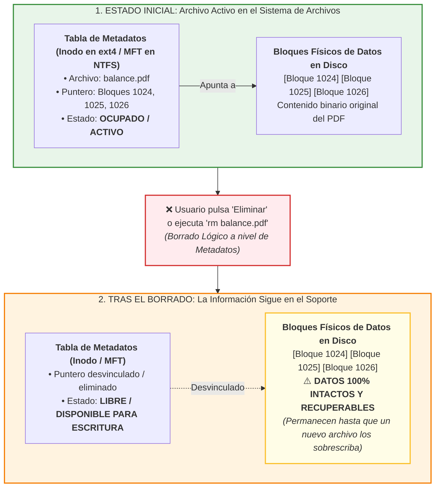

1. **Estructura en dos capas:** El sistema de archivos separa los **metadatos** (nombre del archivo, permisos, fechas de modificación y punteros a los bloques físicos) de los **bloques de datos** donde residen los bytes de la información.
2. **El borrado convencional es lógico, no físico:** Cuando el usuario vacía la papelera o ejecuta `rm archivo`, el sistema operativo **no borra los datos del disco**. Únicamente marca la entrada del inodo o de la tabla MFT como "libre" y añade esos bloques a la lista de espacio disponible para futuras escrituras.
3. **Ventana de recuperación:** Mientras el sistema operativo no asigne esos bloques a un nuevo archivo y escriba encima (*sobreescritura*), **la totalidad de la información original continúa grabada en los sectores del disco**, siendo recuperable mediante software especializado.

---

### La Gran Diferencia: Discos HDD vs. Unidades SSD y el Comando TRIM

El comportamiento descrito anteriormente es válido para discos duros magnéticos tradicionales (HDD), pero cambia radicalmente con las unidades de estado sólido modernas (**SSD SATA y NVMe**):

* **La limitación física de la memoria Flash NAND:** En una memoria flash NAND, no se puede sobrescribir directamente una celda que contiene datos; es necesario **borrar previamente un bloque entero** antes de poder volver a escribir páginas en él (*Erase-Before-Write*).
* **El comando TRIM:** Para evitar que la unidad SSD se vuelva lenta con el tiempo, los sistemas operativos modernos envían el comando `TRIM` al controlador del disco en cuanto se borra un archivo.
* **Impacto en la recuperación:** El controlador del SSD utiliza procesos internos en segundo plano (*Garbage Collection* y algoritmos de nivelación de desgaste o *Wear Leveling*) para poner a cero físicamente las celdas marcadas por TRIM. Como consecuencia, **en unidades SSD con TRIM activo, los archivos borrados suelen ser irrecuperables a los pocos segundos o minutos de su eliminación**, incluso si el equipo no ha escrito nuevos datos.

---

### Técnicas de Recuperación de Datos

Existen dos aproximaciones técnicas principales a la hora de rescatar información de un soporte dañado:

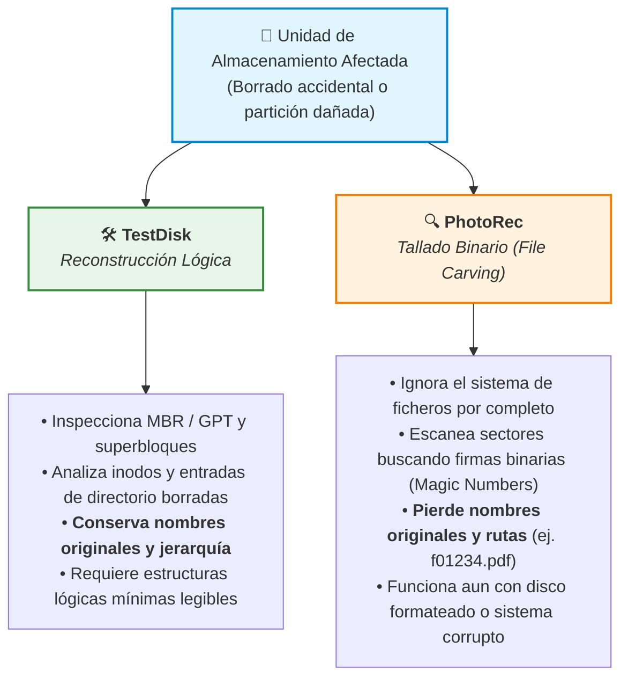

#### 1. Reconstrucción de Estructuras del Sistema de Archivos (`TestDisk`)
* Actúa a nivel lógico de particiones y metadatos.
* Analiza el disco buscando copias de seguridad de las cabeceras MBR/GPT, sectores de arranque (*boot sectors*) y superbloques dañados.
* Permite **recuperar particiones borradas por error**, reparar tablas de partición dañadas y volver a montar sistemas de archivos sin perder sus nombres originales ni su jerarquía de carpetas.

#### 2. Tallado de Archivos (*File Carving* con `PhotoRec`)
* Se utiliza cuando el sistema de archivos está totalmente corrupto o formateado y no existen metadatos válidos.
* Ignora el sistema de archivos e inspecciona el disco sector por sector a bajo nivel, identificando archivos mediante sus **firmas binarias o números mágicos (*Magic Numbers*)** de inicio y fin:
    * Archivos JPEG: Comienzan con los bytes en hexadecimal `FF D8 FF`.
    * Archivos PDF: Comienzan con `%PDF` (`25 50 44 46`).
    * Archivos comprimidos ZIP: Comienzan con `PK` (`50 4B 03 04`).
* *Limitación:* Al no haber metadatos, los archivos se recuperan con nombres genéricos (ej. `f0123456.jpg`) y sin la estructura de carpetas original.

!!! note "Práctica de Laboratorio"
    **[Práctica 6.2: Recuperación de Archivos y Particiones con TestDisk y PhotoRec](P6_2_recuperacion_testdisk_photorec.md)**
    
    *En esta práctica analizarás una unidad de almacenamiento virtualizada con particiones eliminadas y datos borrados, utilizando TestDisk para reparar la tabla de particiones y PhotoRec para rescatar archivos mediante técnicas de tallado binario (file carving).*

---

## 4. Destrucción Segura de la Información (Sanitización y Borrado Permanente)

El reverso de la recuperación de datos es la necesidad de **impedir que terceros puedan recuperar información confidencial** cuando un equipo, disco duro o memoria USB va a ser reutilizado, transferido a otro departamento o retirado para reciclaje (principio de responsabilidad proactiva y cumplimiento del RGPD).

---

### Procedimientos Ineficaces de Borrado

* **Vaciar la Papelera de Reciclaje o usar `rm`:** Deja el 100% del archivo intacto en los sectores de disco.
* **Formateo Rápido (*Quick Format*):** Simplemente recrea las tablas de asignación vacías, pero no sobreescribe un solo bloque de datos.
* **Formateo Normal del Sistema Operativo:** En muchas versiones solo realiza una comprobación de sectores defectuosos sin garantizar la limpieza de los datos subyacentes.

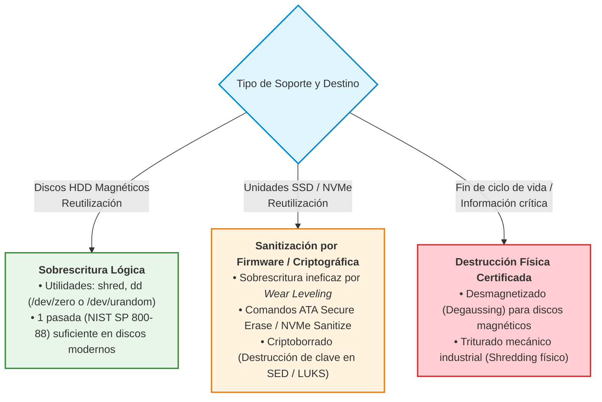

---

### Técnicas de Sobreescritura Lógica (Sanitización)

La sanitización lógica consiste en **escribir nuevos patrones de datos (ceros, unos o secuencias pseudoaleatorias) encima de los sectores** donde se encontraban los datos originales:

1. **Llenado con Ceros (*Zero-Fill*):**
    * Se escriben ceros binarios (`0x00`) en toda la superficie o archivo.
    * En Linux se ejecuta comúnmente con la utilidad `dd`:
      ```bash
      sudo dd if=/dev/zero of=/dev/sdX bs=4M status=progress
      ```
2. **Llenado con Datos Aleatorios (*Random Fill*):**
    * Sobreescribe con patrones criptográficos aleatorios generados por el kernel:
      ```bash
      sudo dd if=/dev/urandom of=/dev/sdX bs=4M status=progress
      ```
3. **El Estándar DoD 5220.22-M (Departamento de Defensa de EE.UU.):**
    * Protocolo de 3 pasadas: Primera pasada con ceros, segunda con unos y tercera con un valor pseudoaleatorio, seguido de una verificación de lectura.
4. **El Método Gutmann:**
    * Algoritmo diseñado en 1996 por Peter Gutmann y Colin Plumb que realiza **35 pasadas de sobreescritura** con patrones diseñados específicamente para desmagnetizar discos magnéticos antiguos que empleaban codificación MFM/RLL.
    * *Realidad técnica actual:* En discos magnéticos modernos de alta densidad (PRMR/SMR), múltiples pasadas son innecesarias; organismos como el NIST (publicación especial NIST SP 800-88 Rev. 1) certifican que **una única pasada de sobreescritura con ceros o valores aleatorios hace que la recuperación sea imposible**, incluso en laboratorios forenses avanzados con microscopía magnética.

---

### Herramientas de Borrado Seguro en GNU/Linux

* **`shred` (Parte de GNU coreutils):**
    * Sobreescribe archivos o particiones completas múltiples veces con datos aleatorios y permite truncar y eliminar el fichero al finalizar:
      ```bash
      shred -u -z -n 3 archivo_confidencial.pdf
      ```
      *(Parámetros: `-n 3` realiza 3 pasadas aleatorias, `-z` añade una pasada final de ceros para ocultar el borrado, `-u` elimina el archivo tras sobreescribirlo).*
* **Paquete `secure-delete`:**
    * Colección de utilidades especializadas basadas en el estándar de sanitización:
        * `srm` (*secure remove*): Borrado seguro de ficheros y directorios individuales.
        * `sfill`: Sobreescribe todo el espacio libre de un disco para asegurar que ningún archivo borrado anteriormente pueda ser recuperado.
        * `sdmem`: Limpia los residuos de memoria RAM del equipo antes del apagado.
        * `sswap`: Sobreescribe la partición o archivo de intercambio (*swap*).

---

### Sanitización en Discos SSD: ATA Secure Erase y Criptoborrado

En discos de estado sólido (SSD / NVMe), el software de sobreescritura tradicional (`dd`, `shred`) no garantiza la destrucción total de los datos debido al controlador interno de nivelación de desgaste (*Wear Leveling*), que reasigna los bloques lógicos de forma transparente a celdas físicas de reserva fuera del alcance del sistema operativo.

Para sanitizar un SSD se emplean métodos específicos de firmware y criptografía:
* **ATA Secure Erase / NVMe Sanitize:** Comandos enviados directamente al controlador del disco para aplicar una descarga de voltaje a todas las celdas de memoria, devolviéndolas a su estado de fábrica.
* **Criptoborrado (*Crypto-Erase*):** En unidades con cifrado de hardware nativo (unidades SED - *Self-Encrypting Drives* o volúmenes LUKS/BitLocker), la destrucción instantánea de la **clave maestra de cifrado** convierte la totalidad de los datos del disco en ruido criptográfico indescifrable de forma inmediata.

---

### Destrucción Física de Soportes

Cuando los discos alcanzan el fin de su ciclo de vida y han contenido información de nivel de confidencialidad crítico, la normativa exige la destrucción material del soporte:
* **Desmagnetización (*Degaussing*):** Exposición de discos magnéticos a potentes campos electromagnéticos que destruyen los dominios magnéticos de los platos y los chips de control.
* **Triturado Mecánico (*Shredding* físico):** Máquinas trituradoras industriales que reducen los discos a fragmentos metálicos de pocos milímetros, haciendo físicamente imposible su ensamblaje.

!!! note "Práctica de Laboratorio"
    **[Práctica 6.3: Borrado Seguro de Datos y Sanitización de Soportes](P6_3_borrado_seguro.md)**
    
    *En esta práctica verificarás la eficacia de las herramientas de borrado seguro (shred, srm, sfill), comprobarás cómo el software de recuperación es incapaz de rescatar información tras una sanitización adecuada y analizarás los comandos de borrado seguro en unidades SSD.*

---

## 5. Resumen de la Unidad y Buenas Prácticas

1. **La copia de seguridad es la última línea de defensa:** Frente a un ataque de ransomware con extorsión doble, disponer de copias inmutables fuera de línea (*Air-Gapped*) es la única garantía de no pagar rescates ni perder la operatividad.
2. **Una copia de seguridad no verificada no existe:** Las empresas deben realizar simulacros periódicos de recuperación completa para validar que los medios funcionan y que el personal conoce el procedimiento.
3. **El borrado estándar no destruye la información:** Todo dispositivo de almacenamiento que vaya a cambiar de manos o ser desechado debe someterse a procesos formales de sanitización lógica o destrucción física certificada.
