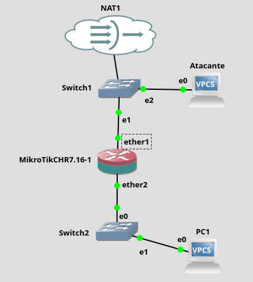
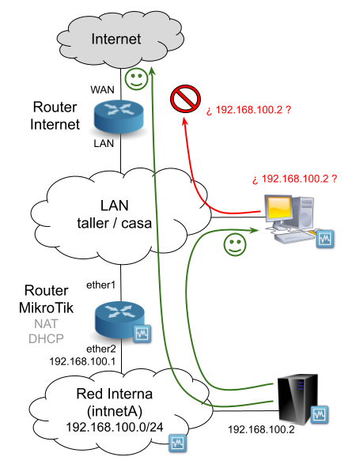
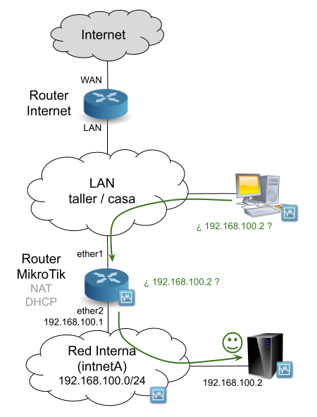
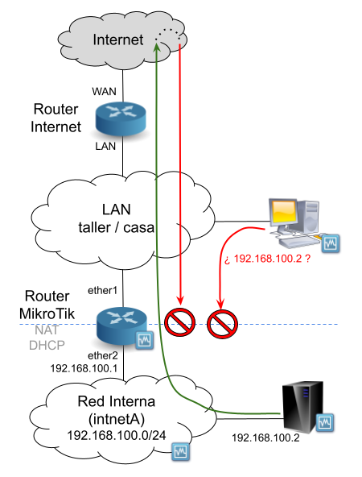
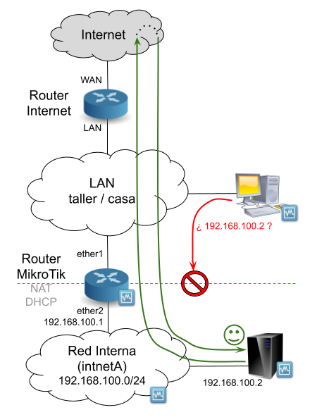
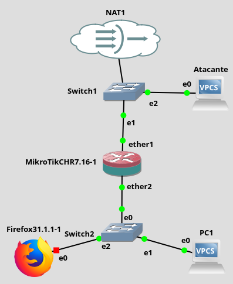
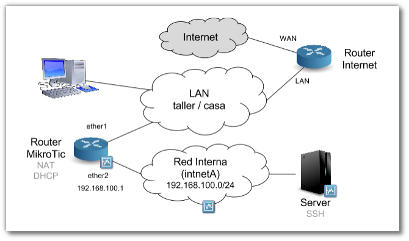
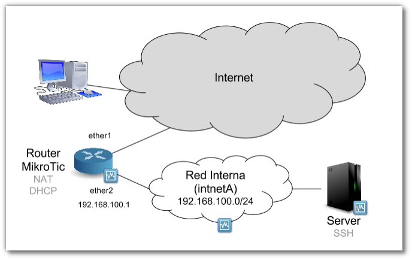
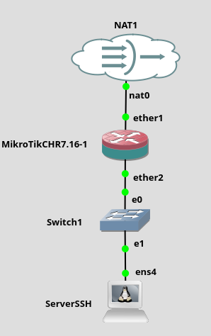

# Práctica 7.1: Configuración de Cortafuegos de Red y Filtrado con Estado en MikroTik RouterOS

!!! note "Datos de la Práctica"
    * **Módulo:** Seguridad y Alta Disponibilidad (SAD - 0378)
    * **Unidad Didáctica:** UD7 - Seguridad perimetral: cortafuegos y DMZ
    * **Entorno de trabajo:** Emulador de red **GNS3** con las siguientes máquinas y appliances:
        1. **Router MikroTik RouterOS** (Cloud Hosted Router - CHR).
        2. **Clientes ligeros VPCS** (PC1 y Atacante).
        3. **Appliance Firefox** (o Webterm) para pruebas de navegación y acceso a la interfaz web del router.
        4. **Servidor Linux Debian** para pruebas de publicación de servicios por SSH.

---

## 1. Objetivos

* Diseñar e implementar una topología de red perimetral en GNS3 estructurada en red externa (WAN) y red interna (LAN).
* Analizar los riesgos de seguridad derivados de un router que únicamente realiza funciones de enrutamiento y NAT sin filtrado perimetral activo.
* Configurar reglas de **inspección con estado (*Stateful Packet Inspection - SPI*)** en la cadena `forward` para autorizar únicamente el retorno de tráfico solicitado (`established,related`) y descartar conexiones no deseadas procedentes de Internet.
* Blindar el plano de gestión y control del router en la cadena `input`, restringiendo el acceso administrativo a **listas de direcciones autorizadas (*Address Lists*)**.
* Publicar servidores internos hacia redes públicas mediante técnicas de **redireccionamiento de puertos (Destination NAT / DNAT)** sin comprometer el direccionamiento privado.
* Gestionar la exportación, resguardo y restauración de copias de seguridad de la configuración (`.backup`) en MikroTik RouterOS.

---

## 2. Escenario y Fundamentos Técnicos

### El Entorno MikroTik RouterOS en GNS3

En esta práctica utilizaremos **MikroTik RouterOS**, uno de los sistemas operativos de enrutamiento y seguridad de red más extendidos en entornos profesionales e ISPs. 

RouterOS permite gestionar su cortafuegos mediante:

* **WebFig:** Interfaz gráfica web accesible a través de cualquier navegador web en el puerto TCP 80 (o personalizado).
* **Consola de Comandos (CLI):** Accesible por SSH, Telnet o consola serie de GNS3.
* **WinBox:** Utilidad gráfica oficial de administración remota de MikroTik.

```text
                  [ RED EXTERNA / WAN ] (Nube NAT de GNS3)
                            │
               ┌────────────┴────────────┐
               │                         │
      [ Equipo Atacante ]                ▼
         (VPCS WAN)             (ether1 - DHCP/virbr0)
                          ┌───────────────────────────┐
                          │     ROUTER MIKROTIK       │
                          │   RouterOS (Cortafuegos)  │
                          └─────────────┬─────────────┘
                                        │ (ether2 - 192.168.100.1/24)
                                        ▼
                              [ SWITCH RED INTERNA ]
                                        │
                    ┌───────────────────┼───────────────────┐
                    │                   │                   │
                    ▼                   ▼                   ▼
                 [ PC1 ]           [ Firefox ]        [ Server SSH ]
              (192.168.100.2)     (192.168.100.3)     (192.168.100.10)
```

### Tabla de Direccionamiento del Laboratorio

| Dispositivo / Nodo | Interfaz | Dirección IP | Máscara | Puerta de Enlace | Rol en la Práctica |
| :--- | :--- | :--- | :--- | :--- | :--- |
| **Router MikroTik** | `ether1` (WAN) | Dinámica (DHCP) | Según WAN | Proveedor (virbr0) | Conexión hacia la red externa / Internet. |
| **Router MikroTik** | `ether2` (LAN) | `192.168.100.1` | `255.255.255.0` (`/24`) | -- | Puerta de enlace por defecto de la LAN. |
| **PC1 (VPCS)** | `eth0` | `192.168.100.2` | `255.255.255.0` (`/24`) | `192.168.100.1` | Estación de usuario de la red interna. |
| **Atacante (VPCS)** | `eth0` | Dinámica / Estática | Según WAN | `192.168.100.1` (ficticia) | Simula un equipo hostil en la red externa. |
| **Firefox Appliance** | `eth0` | `192.168.100.3` | `255.255.255.0` (`/24`) | `192.168.100.1` | Cliente web para administrar y auditar WebFig. |
| **Servidor Debian** | `eth0` | `192.168.100.10` | `255.255.255.0` (`/24`) | `192.168.100.1` | Servidor interno para pruebas de DNAT. |

---

## 3. Desarrollo Paso a Paso de la Práctica

---

### Parte 1: Despliegue de la Topología y Verificación del Riesgo

1. Inicia **GNS3** y crea un nuevo proyecto denominado `SAD_P7_1_Cortafuegos_MikroTik`.

2. Monta el escenario inicial arrastrando los siguientes nodos al área de trabajo:

    

    * **Nube NAT (Internet):** Conéctala al puerto `ether1` del router MikroTik.
    * **Switch Ethernet externo:** Conecta también a él un nodo VPCS denominado `Atacante`.
    * **Switch Ethernet interno:** Conéctalo al puerto `ether2` del router MikroTik y añade el nodo VPCS `PC1`.

3. **Configuración básica de MikroTik:**
    * Inicia el router y accede a su consola (o mediante WebFig desde tu máquina real si utilizas la IP de la interfaz `virbr0`).
    * Configura `ether1` como cliente DHCP para recibir salida a Internet y aplica Masquerade (NAT) para la red local:

    ```routeros
    # En la consola de RouterOS:
    /ip dhcp-client add interface=ether1 disabled=no
    /ip address add address=192.168.100.1/24 interface=ether2
    /ip firewall nat add chain=srcnat out-interface=ether1 action=masquerade
    ```

4. **Configuración de los nodos VPCS:**
    * Abre la consola del nodo **PC1** y asígnale su IP fija:

    ```text
    PC1> ip 192.168.100.2 255.255.255.0 192.168.100.1
    PC1> save
    ```

    * Abre la consola del nodo **Atacante** y solicita IP por DHCP:

    ```text
    Atacante> ip dhcp
    Atacante> show ip
    ```

5. **Pruebas de conectividad iniciales:**
    * Desde **PC1**, haz ping a la IP del nodo Atacante y a Internet (`ping 8.8.8.8`). Comprobarás que hay respuesta gracias a la regla de `masquerade`.
    * Desde **Atacante**, haz ping a `192.168.100.2`. El ping fallará porque el router externo no conoce la ruta hacia la subred privada `192.168.100.0/24`:

    

6. **Simulación del Ataque (Demostración de la brecha sin cortafuegos):**
    * ¿Qué ocurre si el atacante configura una ruta estática en su máquina indicando que para llegar a `192.168.100.0/24` debe enviar los paquetes a la IP de `ether1` del MikroTik?

    

    * En el VPCS **Atacante**, modifica temporalmente su puerta de enlace asignándole como gateway la IP del puerto `ether1` del MikroTik (por ejemplo, si la IP de ether1 es `192.168.122.50`):

    ```text
    Atacante> ip 192.168.122.99 255.255.255.0 192.168.122.50
    Atacante> ping 192.168.100.2
    ```

    * **¡Comprobación crítica!:** Comprobarás que el ping **responde con éxito**. Como el router MikroTik solo enruta paquetes pero no tiene cortafuegos, permite que un atacante externo alcance los equipos de la LAN corporativa.

---

### Parte 2: Filtrado Perimetral con Estado en la Cadena `FORWARD`

Para subsanar esta vulnerabilidad, debemos implementar una directiva de filtrado que impida a cualquier host externo iniciar comunicaciones hacia la LAN, pero permitiendo a su vez que los equipos de la LAN reciban las respuestas del tráfico que ellos hayan iniciado.

#### Paso 1: El Error del Bloqueo sin Estado (*Stateless Drop*)

1. Accede a **WebFig** desde tu navegador introduciendo la dirección IP de `ether1` (o desde la consola de RouterOS).
2. Navega a **IP → Firewall → Filter Rules** y añade una nueva regla pulsando **Add New**:
    * **Enabled:** Marcado.
    * **Chain:** `forward`.
    * **In. Interface:** `ether1`.
    * **Action:** `drop`.
    * **Comment:** *Rechazar paquetes desde la red externa hacia la interna*.
    * Pulsa **OK**.

3. Comprueba el resultado:
    * Desde el nodo **Atacante**, ejecuta `ping 192.168.100.2`. El ping fallará de inmediato (el ataque ha sido neutralizado).
    * Ahora ve a **PC1** y haz ping hacia el exterior (`ping 8.8.8.8` o al Atacante). **¡El ping de PC1 también fallará!**

    

    * **Causa técnica:** La regla descarta ciegamente cualquier paquete que entre por `ether1`, incluyendo los paquetes de respuesta (echo reply) que regresan de Internet dirigidos a PC1.

---

#### Paso 2: Solución mediante Inspección de Estado (*Stateful Inspection*)

Para que la red sea segura y funcional, debemos permitir los paquetes de retorno de conexiones legítimas:

1. En WebFig, accede a **IP → Firewall → Filter Rules** y añade una nueva regla (**Add New**):
    * **Enabled:** Marcado.
    * **Chain:** `forward`.
    * **Connection State:** Marca las casillas **established** y **related**.
    * **Action:** `accept`.
    * **Comment:** *Aceptar paquetes de conexiones ya establecidas y relacionadas*.
    * Pulsa **OK**.

2. **Orden de evaluación de las reglas:**
    * En RouterOS, las reglas se evalúan estrictamente de arriba abajo. Arrastra la nueva regla con el ratón y **sitúala en la primera posición de la lista** (por encima de la regla `drop`).

    

3. **Verificación:**
    * Desde **PC1**, haz ping a Internet (`ping 8.8.8.8`) y al Atacante: **Funciona correctamente**.
    * Desde **Atacante**, haz ping a `192.168.100.2`: **Sigue bloqueado**.

4. **Copia de seguridad en RouterOS:**
    * En WebFig, accede a **Files** en el menú lateral.
    * Pulsa el botón **Backup**, asígnale el nombre `firewall_basico.backup` (sin marcar *Don't Encrypt* o sin contraseña para el aula) y descárgalo a tu ordenador.

---

### Parte 3: Protección del Router y Control Administrativo en la Cadena `INPUT`

Además de proteger la red local (cadena `forward`), es fundamental proteger al propio router frente a intentos de intrusión en su consola web o SSH (cadena `input`).

1. En GNS3, amplía la topología añadiendo un nodo **Firefox** conectado al switch interno con la dirección IP fija `192.168.100.3/24`:

    

2. **Creación de la lista de administradores autorizados (*Address Lists*):**
    * En WebFig, ve a **IP → Firewall → Address Lists** y pulsa **Add New**:
        * **Name:** `EquiposAdministradores`.
        * **Address:** Introduce la IP de tu equipo host en la red de gestión (por ejemplo, la IP de `virbr0`, ej. `192.168.122.1`).
        * **Comment:** *Administrador externo*.
        * Pulsa **OK**.
    * Añade una segunda entrada en la misma lista para el puesto de administración interno:
        * **Name:** `EquiposAdministradores`.
        * **Address:** `192.168.100.3`.
        * **Comment:** *Administrador interno Firefox*.
        * Pulsa **OK**.

3. **Reglas de filtrado para la cadena `INPUT`:**
    * En **IP → Firewall → Filter Rules**, añade las tres siguientes reglas:

    * **Regla 1 (Aceptar retornos del router):**
        * `Chain: input` | `Connection State: established,related` | `Action: accept`
        * *Comentario:* Aceptar paquetes input de conexiones establecidas y relacionadas.
    * **Regla 2 (Aceptar peticiones de administradores):**
        * `Chain: input` | `Src. Address List: EquiposAdministradores` | `Action: accept`
        * *Comentario:* Aceptar paquetes input de administradores autorizados.
    * **Regla 3 (Denegación por defecto del plano de control):**
        * `Chain: input` | `Action: drop`
        * *Comentario:* Ignorar el resto de paquetes dirigidos al router.

4. Asegúrate de ordenar las reglas de la cadena `input` de forma que la regla `drop` quede **siempre al final**:

    

5. **Auditoría del control de acceso:**
    * Desde **Firefox** (`192.168.100.3`): Accede a `http://192.168.100.1` → La interfaz WebFig responde y permite el inicio de sesión.
    * Cambia la IP del Firefox a `192.168.100.4`: Comprueba que al recargar el navegador el acceso queda completamente cortado.
    * Comprueba que los equipos no autorizados siguen pudiendo navegar hacia Internet sin problemas (el tráfico `forward` no se ve afectado por las restricciones de `input`).

6. Guarda la configuración generando un nuevo respaldo: `firewall_adminweb.backup`.

---

### Parte 4: Redireccionamiento de Puertos (DNAT / Port Forwarding)

Simularemos un escenario profesional en el que se requiere publicar un servidor SSH interno para permitir el acceso a teletrabajadores desde Internet:



```text
  [ Cliente Externo / Host ] ─── SSH a IP_MikroTik:2222 ───> [ ether1 MikroTik ]
                                                                     │
                                                              Redirecciona a:
                                                              192.168.100.10:22
                                                                     │
                                                                     ▼
                                                             [ Servidor SSH Debian ]
```



1. En GNS3, despliega el escenario incorporando un nodo servidor **Debian** conectado a la LAN interna con IP estática `192.168.100.10/24`:

    

!!! tip "Vídeo de Apoyo: Redireccionamiento de Puertos en MikroTik"
    Puedes seguir la explicación del procedimiento a partir del minuto 4:37 en el siguiente vídeo:

    * [Vídeo: MikroTik - Redireccionamiento de puertos (Román Carceller)](https://www.youtube.com/watch?v=BCxbORRfveg){:target="_blank"}

2. **Configuración de la regla de Destination NAT (DNAT):**
    * En WebFig, accede a **IP → Firewall → NAT** y pulsa **Add New**:
        * **Chain:** `dstnat`.
        * **In. Interface:** `ether1` *(¡Paso fundamental! Limita la redirección a peticiones entrantes por la WAN, evitando anomalías en el tráfico interno)*.
        * **Protocol:** `6 (tcp)`.
        * **Dst. Port:** `2222` *(Puerto público expuesto en la WAN)*.
        * **Action:** `dst-nat`.
        * **To Addresses:** `192.168.100.10`.
        * **To Ports:** `22` *(Puerto real del servicio SSH interno)*.
        * Pulsa **OK**.

3. **Verificación desde el equipo anfitrión:**
    * Desde la terminal de tu máquina real, intenta conectar por SSH al puerto redirigido utilizando la IP de `ether1` del MikroTik:

    ```bash
    ssh debian@<IP_ETHER1_MIKROTIK> -p 2222
    ```

    * Comprueba que la sesión SSH se establece correctamente con el servidor Debian interno.

---

## 4. Cuestiones y Análisis Técnico

Responde de forma justificada en tu memoria a las siguientes cuestiones:

1. **Inspección con Estado frente a Filtrado sin Estado:**
    * ¿Por qué una regla estática `drop in-interface=ether1` en la cadena `forward` interrumpe la navegación web legítima de los equipos internos?
    * ¿Qué papel desempeñan los estados `established` y `related` en la tabla de seguimiento de conexiones (*Connection Tracking*)?
2. **Cadenas de Procesamiento:**
    * Explica con tus palabras la diferencia entre el tráfico evaluado en la cadena `input` y el evaluado en la cadena `forward`.
    * Si quisiéramos bloquear el acceso a un servidor web de Internet desde la LAN corporativa, ¿en qué cadena se debe ubicar la regla? ¿Y si queremos evitar que se conecten a la consola WebFig del router?
3. **Seguridad en el Redireccionamiento de Puertos (DNAT):**
    * ¿Por qué es una mala práctica no indicar el parámetro `in-interface=ether1` al configurar una regla de `dstnat`?
    * ¿Qué ventaja de seguridad aporta publicar el servicio SSH en un puerto no estándar (ej. TCP 2222) en lugar del puerto por defecto TCP 22?

---

## 5. Entregables

Elabora un único documento en formato **PDF** que incluya:

1. **Datos de cabecera:** Nombre y apellidos del alumno, fecha y módulo (SAD).
2. **Evidencias de la Parte 1 y 2 (Cadena FORWARD):**
    * Captura de pantalla de la terminal de VPCS Atacante haciendo ping exitoso a PC1 antes de activar el cortafuegos.
    * Captura de pantalla de la tabla de **Filter Rules** en WebFig con las reglas `established,related accept` y `drop ether1` configuradas.
    * Captura de pantalla de PC1 haciendo ping exitoso a Internet mientras Atacante permanece bloqueado.
3. **Evidencias de la Parte 3 (Cadena INPUT y Address Lists):**
    * Captura de la tabla **Address Lists** con las entradas de `EquiposAdministradores`.
    * Captura del navegador Firefox accediendo a WebFig desde la IP autorizada (`192.168.100.3`) y captura del bloqueo al cambiar su IP a `192.168.100.4`.
4. **Evidencias de la Parte 4 (DNAT):**
    * Captura de la regla de NAT (`dstnat`) en WebFig.
    * Captura de la conexión SSH exitosa desde el host al puerto 2222 del router.
5. **Respuestas argumentadas:** Resolución completa de las tres cuestiones técnicas del apartado 4.
