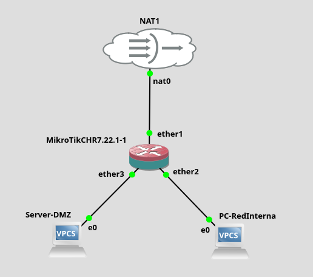
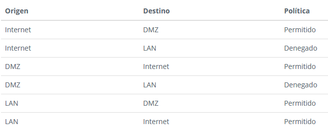
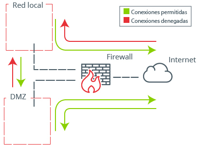
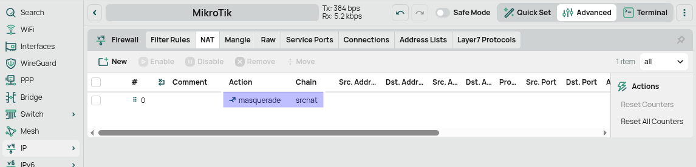
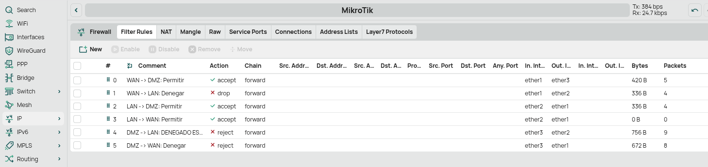

# Práctica 7.2: MikroTik - DMZ básica

!!! note "Datos de la Práctica"
    * **Módulo:** Seguridad y Alta Disponibilidad (SAD - 0378)
    * **Unidad Didáctica:** UD7 - Seguridad perimetral: cortafuegos y DMZ
    * **Entorno de trabajo:** Emulador de red **GNS3** con las siguientes máquinas y appliances:
        1. **Router MikroTik RouterOS** (Cloud Hosted Router - CHR) configurado como cortafuegos perimetral con tres interfaces de red (*Three-Legged Firewall*).
        2. **Servidor Linux Debian** en la zona DMZ (`ServerDMZ` - IP fija `192.168.101.2/24`).
        3. **Puesto ofimático interno** en la red LAN corporativa (`PC-RedInterna` - VPCS con IP `192.168.100.2/24`).
        4. **Nube NAT externa** conectada a la interfaz `ether1` (virbr0).

---

## 1. Objetivos

* Diseñar e implementar en GNS3 la topología base de una **Zona Desmilitarizada (DMZ) con un único router** de tres interfaces (*Three-Legged Firewall*).
* Comprender la segmentación física y lógica entre las tres zonas fundamentales: **WAN (Internet / No Confiable)**, **DMZ (Semiconfiable / Servicios Públicos)** y **LAN (Confiable / Red Corporativa)**.
* Configurar el direccionamiento IP estático, el enrutamiento y el enmascaramiento de salida (*Source NAT / Masquerade*).
* Comprobar el comportamiento de enrutamiento libre sin cortafuegos y constatar la brecha de seguridad que supone la ausencia de filtrado perimetral.
* Trasladar a RouterOS las **6 directivas conceptuales de filtrado del INCIBE**, analizando el flujo de paquetes y la necesidad del seguimiento de conexiones (*Connection Tracking / SPI*) para el tráfico de retorno.
* Evaluar y comparar la simplificación del juego de reglas bajo una **política por defecto permisiva** (*Default Accept / Lista Negra*) frente a una **política restrictiva** (*Default Deny / Lista Blanca*).

---

## 2. Escenario y Fundamentos Técnicos

### Concepto de DMZ con un Único Router

Cuando una organización requiere que sus servicios públicos (páginas web, servidores de correo, pasarelas de pago, etc.) sean accesibles desde Internet, colocarlos directamente en la red local interna representa un grave riesgo. Si un atacante compromete el software de dicho servidor mediante una vulnerabilidad, obtendría acceso inmediato a los equipos de los empleados y a las bases de datos corporativas.

Para mitigar este vector de ataque se despliega una **Zona Desmilitarizada (DMZ)**: una red intermedia aislada física y lógicamente de la LAN corporativa. En esta práctica abordaremos la arquitectura clásica de un **router con tres interfaces de red**:


### Modelado del Escenario en GNS3 y Appliance Webterm

En GNS3 representaremos la infraestructura conectando el router MikroTik a tres switches virtuales diferenciados:



---

### Matriz de Políticas de Seguridad del INCIBE

El Instituto Nacional de Ciberseguridad (INCIBE) establece una matriz de directivas fundamentales para gobernar las comunicaciones en una DMZ con un solo router:





| Origen | Destino | Acción | Justificación Técnica y Operativa |
| :--- | :--- | :--- | :--- |
| **Internet (WAN)** | **DMZ** | **Permitido (Condicional)** | Acceso público exclusivo a servicios publicados (Web, FTP, correo). |
| **Internet (WAN)** | **LAN** | **Denegado absoluto** | Ningún host de Internet puede comunicarse con la red interna. |
| **LAN** | **DMZ** | **Permitido** | Los empleados y administradores pueden consultar y gestionar los servidores DMZ. |
| **LAN** | **Internet (WAN)** | **Permitido** | Navegación y consumo de servicios externos mediante *Source NAT (Masquerade)*. |
| **DMZ** | **LAN** | **¡DENEGADO ESTRICTO!** | **Regla de oro de la DMZ:** Si un atacante compromete el servidor web, el cortafuegos le impide escanear o saltar a la red interna. |
| **DMZ** | **Internet (WAN)** | **Denegado por defecto** | Evita que un servidor comprometido establezca conexiones reversas (*reverse shell*) o descargue malware exterior. |

---

## 3. Direccionamiento IP y Rutas de Acceso

Configura los dispositivos del laboratorio según los siguientes parámetros:

| Dispositivo / Nodo | Interfaz | Dirección IP / Máscara | Puerta de Enlace | Rol y Función |
| :--- | :--- | :--- | :--- | :--- |
| **MikroTik RouterOS** | `ether1` | DHCP Client (`192.168.122.X`) | Proveedor NAT (virbr0) | Conexión WAN externa hacia Internet. |
| **MikroTik RouterOS** | `ether2` | `192.168.100.1/24` | -- | Puerta de enlace predeterminada de la LAN. |
| **MikroTik RouterOS** | `ether3` | `192.168.101.1/24` | -- | Puerta de enlace predeterminada de la DMZ. |
| **PC-RedInterna** | `eth0` | `192.168.100.2/24` | `192.168.100.1` | Puesto ofimático de la red interna corporativa. |
| **ServerDMZ** | `eth0` | `192.168.101.2/24` | `192.168.101.1` | Servidor público en DMZ. |

---

## 4. Desarrollo Paso a Paso de la Práctica

---

### Fase 1: Despliegue de la Topología y Configuración Inicial

1. **Creación del Proyecto:** Inicia GNS3 y crea un proyecto nuevo denominado `SAD_P7_2_DMZ_Basica`.
2. **Conexión de Nodos:**
    * Conecta `ether1` del MikroTik al switch de WAN (conectado a su vez a la Nube NAT).
    * Conecta `ether2` a PC-RedInterna.
    * Conecta `ether3` a Server-DMZ.

3. **Configuración de Interfaces y NAT en MikroTik:**
    Abre la consola de RouterOS para obtener su IP y accede a la configuración Web. 
    
    * Aplica el direccionamiento inicial según la tabla anterior.

    * Activa en IP - Firewall - NAT la opción de srcnat - masquerade para que tanto la DMZ como la LAN puedan salir a Internet.

    

    > **Nota:** No es necesario configurar servidor DHCP en `ether2` ni `ether3`; utilizaremos direccionamiento estático en los puestos y servidores.

4. **Configuración de los Equipos Finales:**
    * **PC-RedInterna (VPCS):**
        ```text
        PC-RedInterna> ip 192.168.100.2 255.255.255.0 192.168.100.1
        PC-RedInterna> save
        ```
        *(Recuerda ejecutar `save` tras cada comando en VPCS para hacer permanente la configuración).*

    * **Server-DMZ (Debian):**
        ```text
        PC-Server-DMZ> ip 192.168.101.2 255.255.255.0 192.168.101.1
        PC-Server-DMZ> save
        ```
        *(Recuerda ejecutar `save` tras cada comando en VPCS para hacer permanente la configuración).*

---

### Fase 2: Comprobación del Tráfico Inicial (Sin Cortafuegos)

Antes de aplicar directivas en el cortafuegos, comprueba el estado inicial de enrutamiento libre:

1. Desde `PC-RedInterna`, haz ping a `192.168.101.2` (DMZ) y a la pasarela NAT `192.168.122.1` (o el DNS del aula).
2. Desde `ServerDMZ`, haz ping a `192.168.100.2` (LAN) y a la pasarela NAT `192.168.122.1` (o el DNS del aula).

> **Constatación de Seguridad:** En este estado base, el enrutamiento permite que cualquier equipo de la DMZ alcance y sondee la red LAN interna sin ningún tipo de restricción. Esto evidencia la vulnerabilidad crítica que resolveremos a continuación.

---

### Fase 3: Implementación de las 6 Reglas de la Matriz INCIBE

Accede a **WebFig** (`IP → Firewall → Filter Rules`) para programar en la cadena `forward` las 6 directivas de la matriz de filtrado:



Fíjate que usamos `drop` para la interfaz WAN y `reject` para la interfaz DMZ. Comprueba la diferencia de uno y otro cuando hagas pings de prueba.

---

### Fase 4: Batería de Pruebas y Análisis de Anomalías (SPI)

Tras aplicar las 6 reglas, efectúa pruebas de comunicación:

1. **Prueba LAN → WAN:** Haz ping desde `PC-RedInterna` a Internet (puerta de enlace WAN `192.168.122.1`).
2. **Prueba LAN → DMZ:** Haz ping desde `PC-RedInterna` hacia `ServerDMZ` (`192.168.101.2`).
3. **Prueba DMZ → LAN:** Haz ping desde `ServerDMZ` hacia `PC-RedInterna` (`192.168.100.2`).
3. **Prueba DMZ → WAN:** Haz ping desde `ServerDMZ` a Internet (puerta de enlace WAN `192.168.122.1`).
3. **Prueba WAN → LAN:** Haz ping desde el host hacia `PC-RedInterna` (`192.168.100.2`).
2. **Prueba WAN → DMZ:** Haz ping desde el host hacia hacia `ServerDMZ` (`192.168.101.2`).

!!! question "Análisis Crítico: ¿Hay algún funcionamiento que no sea el esperado?"
    Observa atentamente qué sucede al hacer ping o consultar servicios desde la LAN hacia la DMZ o hacia Internet:
    
    * Aunque una **Regla** permite la ida de `LAN → DMZ` y otra permite `LAN → WAN`, ¿consiguen los paquetes de respuesta regresar al equipo de la LAN?
    * ¿Por qué la regla `DMZ → LAN REJECT` y la regla `WAN → LAN DROP` bloquean las respuestas legítimas de navegación?
    * **Solución técnica:** Recuerda de las prácticas anteriores la necesidad de autorizar las conexiones relacionadas y establecidas. Soluciona el problema y comprueba si ahora el comportamiento es el esperado.
      ```
    * Comprueba cómo el seguimiento de conexiones resuelve de inmediato el problema permitiendo únicamente los retornos autorizados.

---

### Fase 5: Eliminación y Simplificación de Reglas

Una vez comprendido el funcionamiento de todas las directivas, analiza cómo se puede optimizar el cortafuegos reduciendo la cantidad de reglas:

#### Caso A: Política por Defecto Permisiva (*Default Accept / Lista Negra*)
Si la política del router por defecto fuera aceptar todos los paquetes que no coincidan con ninguna regla anterior:

* Revisa las 6 reglas configuradas en la Fase 3.
* ¿Cuáles de las reglas con acción `accept` resultarían redundantes e innecesarias al existir un permiso implícito al final?
* ¿Qué reglas denegatorias con acción `drop` serían estrictamente imprescindibles para mantener la seguridad?

#### Caso B: Política por Defecto Restrictiva (*Default Deny / Lista Blanca*)
Si la política por defecto del MikroTik es restrictiva (denegar todo paquete al final de la cadena mediante una directiva `action=drop`):

* Revisa nuevamente las reglas de filtrado.
* ¿Qué reglas con acción `drop` intermedias dejarían de ser necesarias al quedar absorbidas por la regla final denegatoria?
* ¿Por qué la **Regla** (`DMZ → LAN DROP`) debe colocarse **antes** de cualquier permiso genérico para evitar filtraciones hacia la red corporativa?

---

## 5. Cuestiones Técnicas

Responde de forma justificada en tu informe a las siguientes cuestiones:

1. **Riesgo del Escenario Inicial:** Explica detalladamente qué peligros corría la infraestructura en la Fase 2 antes de aplicar las directivas de cortafuegos.
2. **El Papel del Seguimiento de Conexiones:** Justifica por qué la regla `connection-state=established,related` es imprescindible en cortafuegos perimetrales para permitir el tráfico de vuelta sin abrir brechas en el aislamiento de la LAN.
3. **Comparativa Permisiva vs. Restrictiva:** Resume en una tabla las ventajas e inconvenientes de diseñar la DMZ bajo una política por defecto permisiva frente a una restrictiva.

---

## 6. Entregables

Presenta un documento en formato **PDF** con la siguiente información:

1. **Datos identificativos:** Nombre completo del alumno, fecha y módulo formativo.
2. **Evidencias de Configuración:**
    * Captura de pantalla de la topología en funcionamiento en GNS3.
    * Captura de **IP → Firewall → Filter Rules** en WebFig con las 6 reglas iniciales de la matriz INCIBE.
    * Captura de la regla `established,related` incorporada en la cabecera de la cadena.
3. **Resultados de las Pruebas:**
    * Evidencias de los pings realizados en la Fase 4 antes y después de aplicar la regla de estado de conexión.
4. **Respuestas a las Cuestiones Técnicas:** Justificación razonada de los apartados de la Fase 5 y de las cuestiones de la Sección 5.
