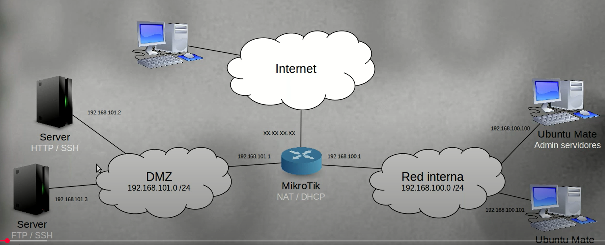
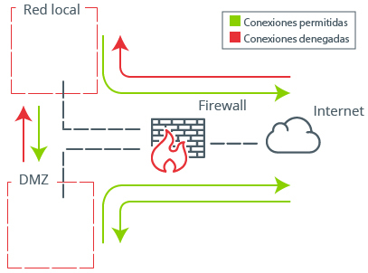
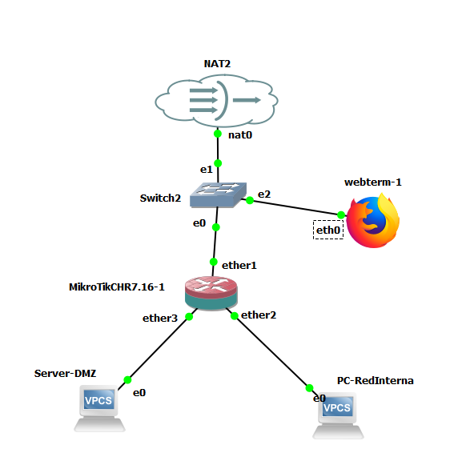
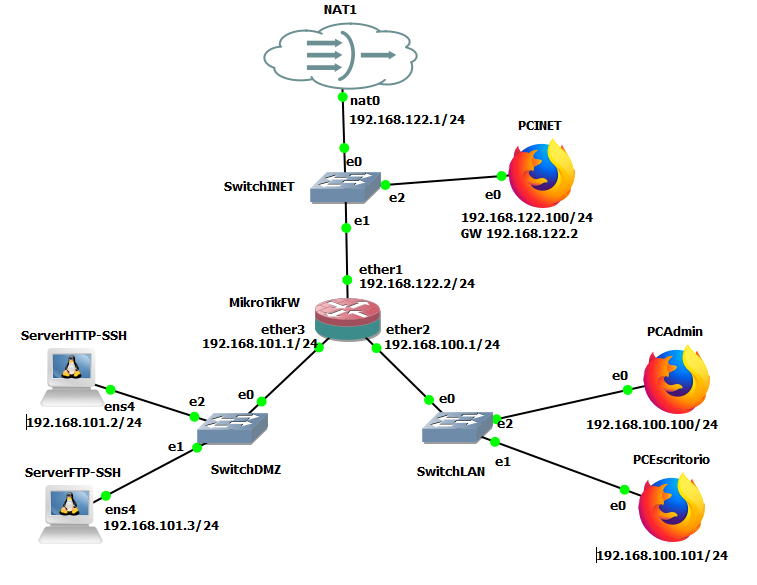

# Práctica 7.2: Despliegue de una DMZ con un Cortafuegos de Tres Interfaces

!!! note "Datos de la Práctica"
    * **Módulo:** Seguridad y Alta Disponibilidad (SAD - 0378)
    * **Unidad Didáctica:** UD7 - Seguridad perimetral: cortafuegos y DMZ
    * **Entorno de trabajo:** Emulador de red **GNS3** con las siguientes máquinas y appliances:
        1. **Router MikroTik RouterOS** (Cloud Hosted Router - CHR) configurado como cortafuegos perimetral con tres interfaces de red (*Three-Legged Firewall*).
        2. **Servidor Linux Debian** en la zona DMZ (con servicios Web HTTP y FTP).
        3. **Estación de administración y cliente interno** en la red LAN corporativa (Appliance Webterm o Firefox, y VPCS).
        4. **Cliente / Auditor externo en la WAN** (acceso desde la máquina anfitriona o nodo VPCS externo).

---

## 1. Objetivos

* Diseñar e implementar en GNS3 una arquitectura de **Zona Desmilitarizada (DMZ)** basada en un único cortafuegos con tres patas o interfaces (*Three-Legged Firewall*).
* Comprender la matriz de relaciones de confianza entre las tres zonas de red: **WAN (Internet / No Confiable)**, **DMZ (Semiconfiable / Servicios Públicos)** y **LAN (Confiable / Red Corporativa)**.
* Configurar las reglas de **Destination NAT (DNAT)** para redirigir peticiones públicas entrantes hacia los servidores correspondientes de la DMZ (servicios HTTP y FTP).
* Diseñar la política de filtrado en la cadena `forward` para garantizar el aislamiento estricto: permitir que los clientes externos accedan a los servicios de la DMZ pero bloquear cualquier intento de acceso desde la DMZ o el exterior hacia la red LAN interna.
* Aplicar el principio de **inspección con estado (*Stateful Packet Inspection - SPI*)** para optimizar el rendimiento y autorizar las respuestas legítimas entre zonas.
* Analizar la simplificación del juego de reglas comparando políticas por defecto permisivas (*Blacklisting*) frente a restrictivas (*Whitelisting* o *Default Deny*).

---

## 2. Escenario y Fundamentos Técnicos

### La Arquitectura DMZ de Tres Interfaces (*Three-Legged Firewall*)

Cuando una organización necesita publicar servidores para que sean accesibles desde Internet (páginas web, servidores de correo, pasarelas de pago, etc.), ubicarlos dentro de la red corporativa supone una grave brecha de seguridad. Si uno de estos servidores es comprometido mediante una vulnerabilidad en su software web, el atacante obtendría acceso directo a la red interna y a todos los puestos y datos de la empresa.

Para neutralizar este vector de ataque se implementa una **Zona Desmilitarizada (DMZ)**: una red intermedia aislada tanto de Internet como de la red interna. En esta práctica utilizaremos una topología de **un único router con tres interfaces físicas**:


```text
                                [ INTERNET / WAN ]
                                  (Red Externa)
                                        │
                                        │ (ether1)
                          ┌─────────────▼─────────────┐
                          │      ROUTER MIKROTIK      │
                          │   Cortafuegos Perimetral  │
                          └──────┬─────────────┬──────┘
                                 │             │
                (ether2 - LAN)   │             │   (ether3 - DMZ)
       ┌─────────────────────────┘             └─────────────────────────┐
       ▼                                                                 ▼
[ RED CORPORATIVA / LAN ]                                     [ ZONA DMZ / SERVICIOS ]
• Clientes de usuario (PC1)                                   • Servidor Web HTTP (Debian)
• Estación Administrador (Webterm)                            • Servidor FTP / Archivos
```



### Matriz de Políticas de Seguridad entre Zonas

El cortafuegos debe gobernar los flujos de tráfico aplicando rigurosamente la matriz de directivas recomendada por organismos de ciberseguridad como el INCIBE:




1. **Internet → DMZ:** **PERMITIR (Condicional).** Se autorizan exclusivamente las peticiones dirigidas a los puertos de los servicios públicos publicados (ej. TCP 80 para HTTP, TCP 21 para FTP). El resto de puertos y protocolos quedan denegados.
2. **Internet → LAN:** **DENEGAR.** Ningún host externo puede iniciar conexiones hacia la red corporativa interna bajo ninguna circunstancia.
3. **LAN → DMZ:** **PERMITIR.** Los usuarios y administradores internos pueden acceder a los servidores de la DMZ para su consulta, actualización o mantenimiento.
4. **LAN → Internet:** **PERMITIR.** Los puestos internos pueden navegar y consumir servicios de Internet a través del enmascaramiento de direcciones (*Source NAT / Masquerade*).
5. **DMZ → LAN:** **¡DENEGAR ESTRICTAMENTE! (Regla de oro de la DMZ).** Si un atacante consigue comprometer el servidor web de la DMZ, el cortafuegos debe impedirle de forma tajante enviar tráfico o iniciar conexiones hacia la red interna.
6. **DMZ → Internet:** **DENEGAR por defecto.** Los servidores de la DMZ no deben iniciar conexiones hacia el exterior de forma arbitraria, salvo excepciones estrictamente acotadas (como resolver DNS o conectarse a repositorios de actualización específicos).

---

## 3. Direccionamiento y Topología en GNS3

El laboratorio se implementará en GNS3 según el siguiente esquema de red:





### Tabla de Direccionamiento IP del Laboratorio

| Nodo / Dispositivo | Interfaz | Dirección IP / Máscara | Puerta de Enlace | Rol y Función |
| :--- | :--- | :--- | :--- | :--- |
| **MikroTik RouterOS** | `ether1` (WAN) | DHCP / `192.168.122.X` | Proveedor (virbr0) | Conexión perimetral externa hacia Internet. |
| **MikroTik RouterOS** | `ether2` (LAN) | `192.168.100.1/24` | -- | Puerta de enlace por defecto de la LAN. |
| **MikroTik RouterOS** | `ether3` (DMZ) | `192.168.101.1/24` | -- | Puerta de enlace por defecto de la DMZ. |
| **PC-RedInterna (VPCS)** | `eth0` | `192.168.100.2/24` | `192.168.100.1` | Puesto ofimático de la red interna corporativa. |
| **Webterm / Firefox (Admin)** | `eth0` | `192.168.100.3/24` | `192.168.100.1` | Puesto del administrador de red para WebFig. |
| **Server-DMZ (Debian)** | `eth0` | `192.168.101.2/24` | `192.168.101.1` | Servidor público (Apache/Nginx en p.80, FTP en p.21). |
| **Cliente Externo (Host / VPCS)**| `eth0` | IP de la subred WAN | Según red WAN | Simula el usuario o auditor externo en Internet. |

---

## 4. Desarrollo Paso a Paso de la Práctica

---

### Fase 1: Despliegue de la Topología y Conectividad Base

1. **Creación del Proyecto:** Inicia GNS3 y crea un nuevo proyecto llamado `SAD_P7_2_DMZ_Un_Router`.
2. **Arrastre de Nodos:**
    * 1 Router **MikroTik CHR**.
    * 3 Switches Ethernet básicos de GNS3 (uno para WAN, uno para LAN y uno para DMZ).
    * 1 Nube NAT conectada al switch WAN.
    * 1 Nodo **Server-DMZ** (Appliance Debian) conectado al switch DMZ.
    * 1 Nodo **Webterm** (o Firefox) y 1 nodo **PC-RedInterna** (VPCS) conectados al switch LAN.
    * *(Opcional)* 1 nodo VPCS conectado al switch WAN para pruebas rápidas de auditoría externa.

3. **Configuración de Interfaces y Enrutamiento en MikroTik:**
    * Inicia el router MikroTik y entra en su consola.
    * Configura las direcciones IP estáticas en cada una de las interfaces físicas:

    ```routeros
    # Interfaz WAN como cliente DHCP:
    /ip dhcp-client add interface=ether1 disabled=no

    # Interfaz LAN:
    /ip address add address=192.168.100.1/24 interface=ether2 comment="Puerta de enlace LAN"

    # Interfaz DMZ:
    /ip address add address=192.168.101.1/24 interface=ether3 comment="Puerta de enlace DMZ"

    # Habilitar Source NAT (Masquerade) para salida a Internet por la WAN:
    /ip firewall nat add chain=srcnat out-interface=ether1 action=masquerade comment="NAT Internet"
    ```

    !!! warning "Aviso importante sobre Quickset en RouterOS"
        Si el router MikroTik tiene más de dos interfaces de red activas, **no utilices el asistente inicial *Quickset***. Quickset está optimizado para enrutadores residenciales básicos (1 WAN + 1 LAN) y puede reescribir de forma errónea interfaces, bridges o reglas de NAT preexistentes. Realiza siempre la configuración de forma directa mediante la consola CLI o a través de **WebFig**.

4. **Configuración de los Equipos Finales:**
    * **PC-RedInterna (VPCS):**
        ```text
        PC-RedInterna> ip 192.168.100.2 255.255.255.0 192.168.100.1
        PC-RedInterna> save
        ```
    * **Server-DMZ (Debian):**
        * Configura `/etc/network/interfaces`:
            ```text
            auto eth0
            iface eth0 inet static
                address 192.168.101.2
                netmask 255.255.255.0
                gateway 192.168.101.1
            ```
        * Reinicia la red con `systemctl restart networking` o `ip addr add 192.168.101.2/24 dev eth0`.
        * Asegúrate de que el servidor tenga levantado el servicio web (ej. `systemctl start apache2` o `nginx`) y opcionalmente FTP (`vsftpd` / `proftpd`).
    * **Webterm (Estación Administrador LAN):**
        * Si utilizas el appliance Webterm, su interfaz de red se define en `/etc/network/interfaces`:
            ```text
            auto eth0
            iface eth0 inet static
                address 192.168.100.3
                netmask 255.255.255.0
                gateway 192.168.100.1
            ```
        * Levanta la interfaz con `/etc/init.d/networking restart`.

5. **Verificación de Enrutamiento Inicial (Sin Cortafuegos):**
    * Antes de programar el cortafuegos, comprueba que el enrutamiento funciona:
        * Desde `PC-RedInterna`, haz ping a `192.168.101.2` (DMZ) y a la WAN (`192.168.122.1` o `8.8.8.8`).
        * Desde `Server-DMZ`, haz ping a `192.168.100.2` (LAN).
    * En este punto inicial todos los equipos se comunican libremente entre sí porque RouterOS tiene habilitado el reenrutamiento y aún no existen reglas de filtrado perimetral.

---

### Fase 2: Publicación de los Servicios de la DMZ con DNAT (*Port Forwarding*)

Para que los usuarios de Internet puedan acceder al servidor web o FTP de la DMZ, debemos redirigir el tráfico que llegue a la IP pública de `ether1` hacia la IP privada `192.168.101.2`:

1. Accede a **WebFig** desde el navegador de la máquina anfitriona o desde el Webterm (`http://192.168.100.1`).
2. Ve a **IP → Firewall → NAT** y añade las siguientes reglas pulsando **Add New**:

    * **Regla DNAT para el Servicio Web (HTTP):**
        * **Chain:** `dstnat`
        * **In. Interface:** `ether1`
        * **Protocol:** `6 (tcp)`
        * **Dst. Port:** `80`
        * **Action:** `dst-nat`
        * **To Addresses:** `192.168.101.2`
        * **To Ports:** `80`
        * **Comment:** *DNAT Web HTTP hacia Server DMZ*

    * **Regla DNAT para el Servicio FTP:**
        * **Chain:** `dstnat`
        * **In. Interface:** `ether1`
        * **Protocol:** `6 (tcp)`
        * **Dst. Port:** `21`
        * **Action:** `dst-nat`
        * **To Addresses:** `192.168.101.2`
        * **To Ports:** `21`
        * **Comment:** *DNAT FTP hacia Server DMZ*

---

### Fase 3: Configuración del Cortafuegos y Reglas de Filtrado

!!! tip "Vídeo de Referencia del Procedimiento"
    Puedes seguir la demostración detallada paso a paso de la configuración en RouterOS en el siguiente vídeo:
    
    * [Vídeo: MikroTik - DMZ con un solo router (Román Carceller)](https://youtu.be/1MJNdidUCEc){:target="_blank"}

!!! warning "Correcciones e Instrucciones Cruciales sobre la Configuración"
    Al seguir el vídeo de Román Carceller, ten muy presentes las siguientes apreciaciones y correcciones docentes:

    1. **Reglas omitidas en el vídeo (minuto 18:00):** A la configuración mostrada le faltan dos reglas imprescindibles:
        * **Aceptar explícitamente en la cadena `forward` el tráfico HTTP (puerto 80) y FTP (puerto 21)** dirigido a la DMZ que llegue por `ether1`. Si no se autorizan en el cortafuegos, las peticiones redirigidas por DNAT serán bloqueadas por la directiva denegatoria.
        * **Política por defecto restrictiva (*drop*)** para todo el tráfico `input` y `forward` no autorizado que provenga de `ether1`.
    2. **Posición de las directivas restrictivas:** Recuerda que las reglas denegatorias por defecto (*Drop all*) deben situarse **al final de la lista (*bottom*)** de `Filter Rules`.
    3. Observa atentamente la siguiente captura de pantalla con la tabla definitiva de reglas y sus respectivos comentarios explicativos:


#### Creación de las Reglas en `Filter Rules`

Configura en **IP → Firewall → Filter Rules** el conjunto de reglas atendiendo a su orden estricto de arriba abajo:

1. **Regla 1 (SPI Global - Retorno en FORWARD):**
    * `Chain`: `forward`
    * `Connection State`: `established, related`
    * `Action`: `accept`
    * `Comment`: *Aceptar paquetes forward de conexiones establecidas y relacionadas*

2. **Regla 2 (SPI Router - Retorno en INPUT):**
    * `Chain`: `input`
    * `Connection State`: `established, related`
    * `Action`: `accept`
    * `Comment`: *Aceptar paquetes input de conexiones establecidas y relacionadas*

3. **Regla 3 (Aislamiento de la LAN frente a la DMZ):**
    * `Chain`: `forward`
    * `In. Interface`: `ether3` (DMZ)
    * `Out. Interface`: `ether2` (LAN)
    * `Action`: `drop`
    * `Comment`: *¡CRÍTICA! Denegar cualquier tráfico iniciado desde la DMZ hacia la LAN interna*

4. **Regla 4 (Publicación de Servicios DMZ - HTTP y FTP):**
    * `Chain`: `forward`
    * `In. Interface`: `ether1` (WAN)
    * `Out. Interface`: `ether3` (DMZ)
    * `Protocol`: `6 (tcp)`
    * `Dst. Port`: `80,21`
    * `Action`: `accept`
    * `Comment`: *Permitir tráfico web y ftp desde Internet hacia la DMZ*

5. **Regla 5 (Salida de la LAN hacia Internet y DMZ):**
    * `Chain`: `forward`
    * `In. Interface`: `ether2` (LAN)
    * `Action`: `accept`
    * `Comment`: *Permitir que los equipos de la LAN accedan a Internet y a la DMZ*

6. **Regla 6 (Gestión del Router desde la LAN):**
    * `Chain`: `input`
    * `In. Interface`: `ether2` (LAN)
    * `Action`: `accept`
    * `Comment`: *Permitir administración del router únicamente desde la red local LAN*

7. **Regla 7 (Cierre del plano de datos - FORWARD DROP):**
    * `Chain`: `forward`
    * `Action`: `drop`
    * `Comment`: *Política por defecto forward: descartar cualquier otro tráfico no autorizado*

8. **Regla 8 (Cierre del plano de control - INPUT DROP):**
    * `Chain`: `input`
    * `Action`: `drop`
    * `Comment`: *Política por defecto input: descartar cualquier petición hacia el propio router*

---

### Fase 4: Optimización del Cortafuegos (Lista Blanca vs Lista Negra)

Una vez conseguido el funcionamiento de la DMZ, analiza cómo se puede optimizar el número y la complejidad de las directivas en función de la filosofía de seguridad adoptada:

```text
┌──────────────────────────────────────┐     ┌──────────────────────────────────────┐
│  POLÍTICA PERMISIVA (Lista Negra)    │     │  POLÍTICA RESTRICTIVA (Lista Blanca) │
├──────────────────────────────────────┤     ├──────────────────────────────────────┤
│ • Por defecto: ACEPTAR todo el flujo │     │ • Por defecto: DENEGAR todo (DROP)   │
│ • Requiere listar cada amenaza/bloqueo│    │ • Sólo se aceptan servicios explícitos│
│ • Peligro de olvidos catastróficos   │     │ • Máxima seguridad por diseño        │
└──────────────────────────────────────┘     └──────────────────────────────────────┘
```

* **Escenario A (Política por defecto permisiva):** Si no colocas la regla `drop` al final de la cadena `forward`, el router aceptará por defecto todo paquete no contemplado. Para blindar la red en este modelo necesitarías añadir múltiples reglas explícitas de descarte (`drop WAN -> LAN`, `drop DMZ -> WAN`, `drop invalid`, etc.), lo que incrementa notablemente la lista de reglas y el riesgo de brechas de seguridad por omisión.
* **Escenario B (Política por defecto restrictiva / Default Drop):** Al colocar la regla `drop` al final de la cadena, cualquier combinación que no haya sido aceptada previamente queda automáticamente bloqueada. Esto permite reducir el juego de reglas a la mínima expresión indispensable (*Zero Trust / Whitelisting*).

---

## 5. Batería de Pruebas y Auditoría de Seguridad

Completa la siguiente matriz de verificación técnica en tu entorno de GNS3, anotando el resultado observado y justificando qué regla del cortafuegos actúa en cada caso:

| Prueba nº | Origen → Destino | Protocolo / Puerto | Comando / Acción ejecutada | Resultado esperado | ¿Superada? (Sí/No) | Regla de Filter Rules aplicada |
| :---: | :--- | :--- | :--- | :--- | :---: | :--- |
| **T1** | LAN → Internet | ICMP / HTTP | `ping 8.8.8.8` desde `PC-RedInterna` | Conexión exitosa | | |
| **T2** | LAN → DMZ | HTTP (TCP 80) | `curl http://192.168.101.2` desde Webterm | Muestra página web | | |
| **T3** | WAN / Host → DMZ | HTTP (TCP 80) | `curl http://<IP_ETHER1_MIKROTIK>` | Muestra página web (DNAT) | | |
| **T4** | WAN / Host → DMZ | SSH (TCP 22) | `ssh debian@<IP_ETHER1_MIKROTIK>` | Conexión rechazada / timeout | | |
| **T5** | WAN / Host → LAN | ICMP (Ping) | `ping 192.168.100.2` desde red externa | Bloqueado sin respuesta | | |
| **T6** | DMZ → LAN | ICMP (Ping) | `ping 192.168.100.2` desde `Server-DMZ` | **¡BLOQUEADO!** (0% éxito) | | |
| **T7** | DMZ → LAN | SSH / HTTP | Intentar conexión desde DMZ a LAN | **¡BLOQUEADO!** | | |
| **T8** | WAN / DMZ → Router | HTTP (WebFig) | Abrir navegador hacia IP del router | **¡BLOQUEADO!** | | |
| **T9** | LAN → Router | HTTP (WebFig) | Acceso a `http://192.168.100.1` | Acceso permitido a WebFig | | |

---

## 6. Cuestiones y Análisis Técnico

Responde con rigor técnico a las siguientes cuestiones en tu memoria de prácticas:

1. **Aislamiento Perimetral y Salto de Red (*Pivoting*):**
    * Supón que un ciberdelincuente descubre un fallo de inyección de comandos o RCE en una aplicación PHP alojada en `Server-DMZ` y consigue una shell remota. Explica de forma detallada cómo las directivas configuradas en RouterOS evitan que el atacante pueda pivotar hacia las bases de datos o puestos de trabajo de la red corporativa (`192.168.100.0/24`).
2. **El Papel de la Inspección con Estado (*Connection Tracking*):**
    * Si la regla 3 bloquea tajantemente todo el tráfico entrante por `ether3` (DMZ) con destino a `ether2` (LAN), ¿por qué cuando un usuario de la LAN realiza una petición HTTP a `http://192.168.101.2` el servidor web sí es capaz de devolverle los datos de la página web? Identifica qué regla permite dicho retorno y por qué no entra en conflicto con la regla 3.
3. **Análisis de Políticas por Defecto:**
    * Argumenta las razones de ingeniería y seguridad por las cuales la industria descarta el uso de políticas permisivas (*Default Accept*) en cortafuegos perimetrales frente al modelo restrictivo (*Default Deny*).
4. **Vulnerabilidades Arquitectónicas de la DMZ con un Único Router:**
    * A pesar de que las directivas de software de RouterOS aíslan las redes lógicas, ¿qué riesgos inherentes de seguridad y de disponibilidad presenta una DMZ basada en un único dispositivo de encaminamiento frente a un esquema con doble cortafuegos (*Back-to-Back*)? Menciona al menos dos factores críticos.

---

## 7. Entregables

Presenta un documento en formato **PDF** con la siguiente estructura:

1. **Portada y Metadatos:** Nombre completo del alumno, fecha y datos del módulo SAD.
2. **Esquema de Red:** Captura de pantalla de la topología completa en funcionamiento en tu emulador GNS3, mostrando las etiquetas de interfaces y direccionamiento.
3. **Configuración del Cortafuegos en RouterOS:**
    * Captura de pantalla íntegra de la ventana **IP → Firewall → Filter Rules** en WebFig, donde se aprecie con total claridad el listado de reglas ordenadas, sus cadenas (`forward` / `input`), interfaces, acciones y comentarios.
    * Captura de la ventana **IP → Firewall → NAT** con las reglas de enmascaramiento (`masquerade`) y redirección de puertos (`dstnat`).
4. **Evidencias de la Batería de Pruebas:**
    * Captura del acceso web HTTP exitoso desde el exterior a la IP de la WAN del MikroTik.
    * Captura de la terminal de `Server-DMZ` ejecutando `ping 192.168.100.2` evidenciando el bloqueo total del tráfico DMZ → LAN.
    * Tabla de comprobaciones del apartado 5 debidamente completada con los resultados obtenidos en el laboratorio.
5. **Cuestiones Técnicas:** Respuestas completas y argumentadas a las cuatro cuestiones del apartado 6.
