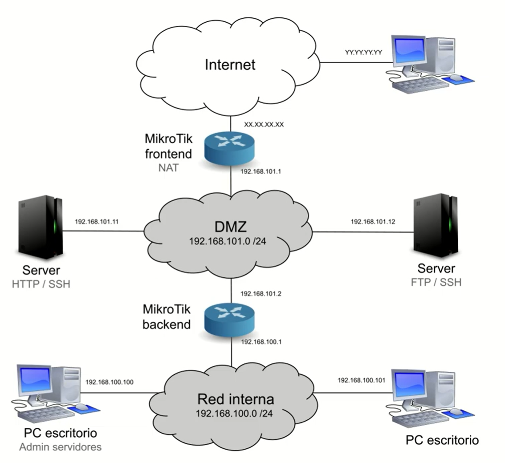
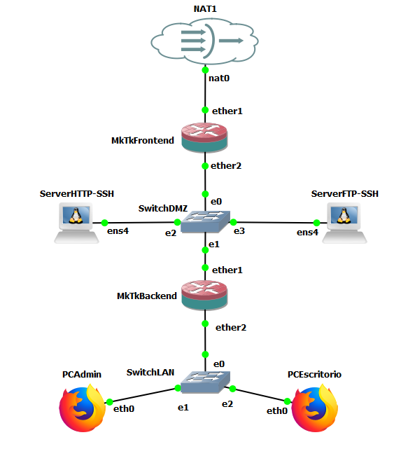
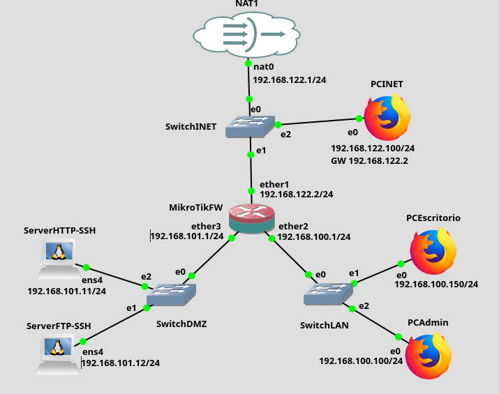

# Práctica 7.3: Arquitectura Avanzada de DMZ con Doble Cortafuegos en Cascada

!!! note "Datos de la Práctica"
    * **Módulo:** Seguridad y Alta Disponibilidad (SAD - 0378)
    * **Unidad Didáctica:** UD7 - Seguridad perimetral: cortafuegos y DMZ
    * **Entorno de trabajo:** Emulador de red **GNS3** con las siguientes máquinas y appliances:
        1. **Router MikroTik CHR 1 (Cortafuegos Frontend):** Gestiona el perímetro externo entre la WAN (Internet) y la DMZ.
        2. **Router MikroTik CHR 2 (Cortafuegos Backend):** Gestiona el perímetro interno entre la DMZ y la red interna (LAN corporativa).
        3. **Servidores en DMZ:** Nodos Debian para Servidor Web HTTP (`192.168.101.11`) y Servidor FTP (`192.168.101.12`).
        4. **Puestos de usuario y administración en LAN:** Appliance Webterm/Firefox (`PCAdmin` - `192.168.100.100`) y nodo cliente (`PCEscritorio` - `192.168.100.150`).
        5. **Cliente externo en WAN:** Estación o máquina host (`PCINET` - `192.168.122.X`).
    * **Archivo de escenario descargable:** Puedes apoyarte en el proyecto preconfigurado [mktk2routers.gns3project](recursos/mktk2routers.gns3project).

---

## 1. Objetivos

* Diseñar e implementar en GNS3 una arquitectura perimetral de **doble cortafuegos en cascada (*Dual-Homed / Back-to-Back Firewalls*)** para aislar de forma estricta los servicios públicos y la red interna corporativa.
* Aplicar el principio de **Defensa en Profundidad (*Defense in Depth*)**, comprendiendo cómo la división de responsabilidades entre un cortafuegos perimetral externo (*Frontend*) y uno interno (*Backend*) eleva exponencialmente la resiliencia de la infraestructura.
* Configurar **enrutamiento estático bidireccional** entre múltiples saltos para permitir la visibilidad entre la LAN, la DMZ y la salida a Internet.
* Implementar directivas de **redirección de puertos (DNAT)** en el cortafuegos Frontend para publicar servicios web y FTP hacia Internet.
* Segmentar el plano de gestión aplicando control granular de acceso por dirección IP y puerto: restringir la administración SSH de servidores exclusivamente al puesto del administrador (`PCAdmin`), impidiendo el acceso a estaciones de escritorio ordinarias.
* Modificar el puerto del plano de control del cortafuegos (WebFig en TCP 8080) y blindar la cadena `input` frente a accesos procedentes de zonas no de confianza.
* Ejecutar una batería completa de pruebas de auditoría y elaborar la memoria técnica con las evidencias de validación.

---

## 2. Fundamentos Técnicos: DMZ con Doble Cortafuegos (*Back-to-Back*)

En infraestructuras corporativas críticas, la arquitectura de DMZ con un solo router (*Three-Legged Firewall*) presenta un punto único de fallo (*Single Point of Failure*): si el cortafuegos sufre una vulnerabilidad de software en su propio kernel o una mala configuración humana, tanto la DMZ como la LAN interna pueden quedar expuestas simultáneamente.

Para maximizar la seguridad perimetral se adopta el esquema de **doble cortafuegos en serie o en cascada**:



### División de Roles entre Cortafuegos

1. **Cortafuegos Perimetral Externo (*Frontend Firewall*):**
    * Separa la red no confiable (Internet / WAN) de la zona desmilitarizada (DMZ).
    * Su misión principal es actuar como primer escudo defensivo: filtrar escaneos masivos, bloquear denegaciones de servicio y publicar de forma estricta únicamente los puertos de los servicios públicos (HTTP, FTP, DNS) mediante reglas de Destination NAT (DNAT).
    * Desconoce la topología interna en detalle; únicamente posee una ruta estática hacia la red LAN apuntando como siguiente salto al cortafuegos Backend.

2. **Cortafuegos Interno (*Backend Firewall*):**
    * Separa la zona desmilitarizada (DMZ) de la red corporativa privada (LAN).
    * Constituye la última línea de defensa encargada de custodiar la «joya de la corona»: los puestos de trabajo, bases de datos y controladores de dominio de la organización.
    * Aplica una política de aislamiento tajante: **bloquea cualquier intento de conexión originado desde la DMZ hacia la LAN**. Si un atacante compromete totalmente un servidor web en la DMZ, el cortafuegos Backend le impide pivotar (*lateral movement*) hacia los equipos de los empleados.
    * Permite que los puestos internos naveguen hacia Internet y consuman los servicios de la DMZ, aplicando a su vez privilegios mínimos para las tareas de administración (sólo `PCAdmin` puede acceder por SSH a los servidores).

```text
  [ INTERNET / WAN ] (192.168.122.0/24)
          │
          │ ether1 (DHCP / 192.168.122.2)
  ┌───────▼───────────────────────────┐
  │     ROUTER FRONTEND (FW1)         │ ◄── Cortafuegos Perimetral Externo
  └───────┬───────────────────────────┘
          │ ether2 (192.168.101.1/24)
          │
          ├─────────────────────────────────────────┐
          │                                         │
  ┌───────▼────────────────┐               ┌────────▼───────────────┐
  │  Server Web HTTP       │               │  Server FTP            │
  │  (192.168.101.11/24)   │               │  (192.168.101.12/24)   │
  └────────────────────────┘               └────────────────────────┘
          │                                 [ ZONA DMZ ] (192.168.101.0/24)
          │
          │ ether1 (192.168.101.2/24)
  ┌───────▼───────────────────────────┐
  │     ROUTER BACKEND (FW2)          │ ◄── Cortafuegos Interno
  └───────┬───────────────────────────┘
          │ ether2 (192.168.100.1/24)
          │
          ├─────────────────────────────────────────┐
          │                                         │
  ┌───────▼────────────────┐               ┌────────▼───────────────┐
  │  PCAdmin (Gestión)     │               │  PCEscritorio (Usuario)│
  │  (192.168.100.100/24)  │               │  (192.168.100.150/24)  │
  └────────────────────────┘               └────────────────────────┘
                                            [ RED CORPORATIVA LAN ] (192.168.100.0/24)
```

!!! tip "Principio de Heterogeneidad de Fabricantes"
    En auditorías y directivas de seguridad bancaria, militar y gubernamental (ENS), se recomienda expresamente que el cortafuegos Frontend y el cortafuegos Backend sean de **fabricantes distintos** (por ejemplo, un Fortinet / pfSense en el perímetro exterior y un Cisco ASA / Palo Alto o MikroTik en el interior, o viceversa). De esta manera, si se publica una vulnerabilidad crítica de día cero (0-day) que afecta al sistema operativo del cortafuegos exterior, dicha vulnerabilidad no existirá en el cortafuegos interior, evitando que el adversario vulnere ambas capas con un único exploit.

---

## 3. Topología y Direccionamiento en GNS3

El laboratorio modela el entorno corporativo con la siguiente topología en GNS3:





### Tabla de Direccionamiento IP del Laboratorio

| Nodo / Dispositivo | Interfaz | Dirección IP | Máscara | Puerta de Enlace (GW) | Rol en el Laboratorio |
| :--- | :--- | :--- | :--- | :--- | :--- |
| **Router Frontend (FW1)** | `ether1` (WAN) | Dinámica DHCP / `192.168.122.2` | `/24` | virbr0 (`192.168.122.1`) | Conexión externa a Internet. |
| **Router Frontend (FW1)** | `ether2` (DMZ) | `192.168.101.1` | `/24` | -- | Enlace DMZ hacia servidores y FW2. |
| **Router Backend (FW2)** | `ether1` (DMZ) | `192.168.101.2` | `/24` | `192.168.101.1` | Enlace DMZ hacia FW1. |
| **Router Backend (FW2)** | `ether2` (LAN) | `192.168.100.1` | `/24` | -- | Puerta de enlace de la red LAN. |
| **Server Web HTTP** | `eth0` | `192.168.101.11` | `/24` | `192.168.101.1` | Servidor Apache (puertos TCP 80 y 22). |
| **Server FTP** | `eth0` | `192.168.101.12` | `/24` | `192.168.101.1` | Servidor FTP vsftpd (puertos TCP 21 y 22). |
| **PCAdmin** | `eth0` | `192.168.100.100` | `/24` | `192.168.100.1` | Equipo autorizado de administración de red. |
| **PCEscritorio** | `eth0` | `192.168.100.150` | `/24` | `192.168.100.1` | Puesto ofimático estándar de usuario. |
| **PCINET (Host / WAN)** | `eth0` | `192.168.122.100` | `/24` | `192.168.122.1` | Simula un cliente o auditor en Internet. |

---

## 4. Desarrollo Paso a Paso de la Práctica

---

### Fase 1: Despliegue del Escenario y Enrutamiento Base

1. **Apertura del Escenario en GNS3:**
    * Inicia GNS3 y abre el proyecto base descargado: [mktk2routers.gns3project](recursos/mktk2routers.gns3project).
    * También puedes crear el escenario manualmente arrastrando dos MikroTik CHR, tres switches (WAN, DMZ, LAN), dos servidores Debian y dos clientes gráficos (Webterm o Firefox).

!!! tip "Vídeo de Referencia: Preparación del Escenario"
    Puedes revisar el montaje del escenario y el cableado de las interfaces en el siguiente vídeo:
    
    * [Vídeo: MikroTik - DMZ con dos routers - Preparación del escenario (Román Carceller)](https://youtu.be/W1brUTTIemA){:target="_blank"}

2. **Configuración de Interfaces en Router Frontend (FW1):**
    * Conéctate a la consola de FW1 y asigna los direccionamientos:

    ```routeros
    # Asignar cliente DHCP en ether1 para recibir IP y gateway de Internet:
    /ip dhcp-client add interface=ether1 disabled=no

    # Asignar IP fija a ether2 en la DMZ:
    /ip address add address=192.168.101.1/24 interface=ether2 comment="IP DMZ Frontend"

    # Enmascaramiento NAT para el tráfico que sale a Internet por ether1:
    /ip firewall nat add chain=srcnat out-interface=ether1 action=masquerade comment="NAT Internet WAN"
    ```

3. **Configuración de Interfaces y Enrutamiento en Router Backend (FW2):**
    * Conéctate a la consola de FW2 y configura sus interfaces y su ruta por defecto:

    ```routeros
    # Asignar IP en ether1 (interfaz hacia la DMZ):
    /ip address add address=192.168.101.2/24 interface=ether1 comment="IP DMZ Backend"

    # Asignar IP en ether2 (puerta de enlace de la red LAN):
    /ip address add address=192.168.100.1/24 interface=ether2 comment="Puerta de enlace LAN"

    # Ruta por defecto hacia Internet: el siguiente salto es ether2 de FW1
    /ip route add dst-address=0.0.0.0/0 gateway=192.168.101.1 comment="Ruta por defecto hacia Internet via FW1"

    # Enmascaramiento NAT para el tráfico que sale de la LAN hacia la DMZ/Internet:
    /ip firewall nat add chain=srcnat out-interface=ether1 action=masquerade comment="NAT LAN hacia DMZ/WAN"
    ```

4. **Ruta Estática de Retorno en Router Frontend (FW1):**
    * Para que FW1 sepa cómo reenviar tráfico hacia la red LAN interna (`192.168.100.0/24`), debemos indicarle que el siguiente salto es la interfaz DMZ de FW2:

    ```routeros
    # En la consola de FW1 (Frontend):
    /ip route add dst-address=192.168.100.0/24 gateway=192.168.101.2 comment="Ruta hacia LAN interna via FW2"
    ```

5. **Verificación de Conectividad Base (Ping Bidireccional):**
    * Antes de encender los cortafuegos, comprueba que:
        * Desde `PCAdmin` (`192.168.100.100`) puedes hacer ping a `192.168.101.11` (Server Web), a `192.168.101.1` (FW1) y a Internet (`8.8.8.8` o `192.168.122.1`).
        * Desde `Server Web` (`192.168.101.11`) puedes hacer ping a Internet y a los routers.
    * Con el enrutamiento verificado, podemos proceder a blindar ambos dispositivos.

---

### Fase 2: Configuración del Cortafuegos Perimetral Frontend (FW1)

!!! tip "Vídeo de Referencia: Configuración de los Routers"
    Sigue las directivas de filtrado y NAT explicadas en el siguiente vídeo:
    
    * [Vídeo: MikroTik - DMZ con dos routers (Román Carceller)](https://youtu.be/CE_jU_-GPQo){:target="_blank"}

#### 1. Publicación de Servicios Públicos en FW1 (Destination NAT)

Desde WebFig o CLI en FW1, redirige las peticiones entrantes de Internet hacia los servidores de la DMZ:

```routeros
# Redirección del servicio Web HTTP (TCP 80):
/ip firewall nat add chain=dstnat in-interface=ether1 protocol=tcp dst-port=80 action=dst-nat to-addresses=192.168.101.11 to-ports=80 comment="DNAT Web HTTP hacia 192.168.101.11"

# Redirección del servicio FTP (TCP 21):
/ip firewall nat add chain=dstnat in-interface=ether1 protocol=tcp dst-port=21 action=dst-nat to-addresses=192.168.101.12 to-ports=21 comment="DNAT FTP hacia 192.168.101.12"
```

#### 2. Reglas de Filtrado en FW1 (`Filter Rules`)

Aplica una política restrictiva (*Whitelisting*) en la cadena `forward` y securiza la cadena `input`:

```routeros
# 1. SPI: Aceptar paquetes de conexiones ya establecidas y relacionadas
/ip firewall filter add chain=forward connection-state=established,related action=accept comment="Aceptar retorno SPI forward"
/ip firewall filter add chain=input connection-state=established,related action=accept comment="Aceptar retorno SPI input"

# 2. Permitir peticiones hacia los servidores publicados en DMZ tras el DNAT
/ip firewall filter add chain=forward in-interface=ether1 out-interface=ether2 dst-address=192.168.101.11 protocol=tcp dst-port=80 action=accept comment="Permitir HTTP hacia Server Web DMZ"
/ip firewall filter add chain=forward in-interface=ether1 out-interface=ether2 dst-address=192.168.101.12 protocol=tcp dst-port=21 action=accept comment="Permitir FTP hacia Server FTP DMZ"

# 3. Permitir salida a Internet desde la DMZ y desde la LAN (tráfico saliente por ether1)
/ip firewall filter add chain=forward out-interface=ether1 action=accept comment="Permitir salida hacia Internet WAN"

# 4. Denegación por defecto en FORWARD (descartar cualquier intento de entrada directo)
/ip firewall filter add chain=forward action=drop comment="FORWARD DROP: Descartar resto de trafico"

# 5. Gestión del router FW1: permitir acceso SSH y WebFig solo desde host de gestion autorizado
/ip firewall filter add chain=input src-address=192.168.122.1 protocol=tcp dst-port=80,8080,22 action=accept comment="Permitir gestion FW1 desde Host WAN"
/ip firewall filter add chain=input in-interface=ether2 src-address=192.168.100.100 protocol=tcp dst-port=80,8080,22 action=accept comment="Permitir gestion FW1 desde PCAdmin"
/ip firewall filter add chain=input action=drop comment="INPUT DROP: Bloquear resto de accesos al router"
```

---

### Fase 3: Configuración del Cortafuegos Interno Backend (FW2)

El cortafuegos Backend debe custodiar de forma implacable la red LAN interna frente a cualquier tráfico procedente de la DMZ o del exterior.

#### Reglas de Filtrado en FW2 (`Filter Rules`)

Accede a FW2 (desde `PCAdmin` en `http://192.168.100.1`) y configura las siguientes reglas:

```routeros
# 1. SPI: Aceptar conexiones establecidas y relacionadas
/ip firewall filter add chain=forward connection-state=established,related action=accept comment="SPI forward establecido/relacionado"
/ip firewall filter add chain=input connection-state=established,related action=accept comment="SPI input establecido/relacionado"

# 2. Permitir que la LAN interna acceda a los servidores de la DMZ (HTTP y FTP para todos)
/ip firewall filter add chain=forward in-interface=ether2 out-interface=ether1 dst-address=192.168.101.11 protocol=tcp dst-port=80 action=accept comment="Permitir LAN -> Server HTTP DMZ"
/ip firewall filter add chain=forward in-interface=ether2 out-interface=ether1 dst-address=192.168.101.12 protocol=tcp dst-port=21 action=accept comment="Permitir LAN -> Server FTP DMZ"

# 3. REGLA DE GESTIÓN EXCLUSIVA SSH: Solo PCAdmin (192.168.100.100) puede administrar los servidores DMZ
/ip firewall filter add chain=forward in-interface=ether2 out-interface=ether1 src-address=192.168.100.100 dst-address=192.168.101.11,192.168.101.12 protocol=tcp dst-port=22 action=accept comment="SSH DMZ solo permitido para PCAdmin"

# 4. Permitir salida a Internet general para los puestos de la LAN (navegación web, DNS)
/ip firewall filter add chain=forward in-interface=ether2 out-interface=ether1 action=accept comment="Permitir salida LAN hacia Internet"

# 5. REGLA DE ORO DEL BACKEND: Bloquear tajantemente cualquier tráfico iniciado desde la DMZ hacia la LAN
/ip firewall filter add chain=forward in-interface=ether1 out-interface=ether2 action=drop comment="REGLA DE ORO: Bloquear DMZ hacia LAN"

# 6. FORWARD DROP por defecto
/ip firewall filter add chain=forward action=drop comment="FORWARD DROP: Descartar resto"

# 7. Gestión del Router FW2 (INPUT): Solo PCAdmin puede administrar FW2
/ip firewall filter add chain=input in-interface=ether2 src-address=192.168.100.100 action=accept comment="Gestion FW2 exclusiva desde PCAdmin"
/ip firewall filter add chain=input action=drop comment="INPUT DROP: Bloquear todo acceso no autorizado a FW2"
```

---

### Fase 4: Reto Evaluativo de Consolidación ("Configuración de un FW")

Para homologar la configuración con el estándar de evaluación del módulo, ajustaremos el puerto del servicio WebFig del router y aplicaremos las directivas específicas de la actividad evaluativa:

1. **Cambio de puerto del servicio WebFig:**
    * Por defecto, WebFig escucha en el puerto TCP 80. Para evitar conflictos con servidores web y dificultar escaneos automáticos, en RouterOS es buena práctica cambiar el puerto a `8080`:
    * En WebFig: **IP → Services → www** → cambiar `Port: 8080`.
    * O por consola:
        ```routeros
        /ip service set www port=8080
        ```
    * A partir de este momento, el acceso a la interfaz gráfica se realizará mediante `http://<IP_ROUTER>:8080`.

2. **Matriz de requerimientos finales del reto:**
    * **Desde INET (Internet):**
        * Acceso a `http://192.168.122.2:80` redirige a Apache en `192.168.101.11` (OK).
        * Acceso a `ftp://192.168.122.2:21` redirige a vsftpd en `192.168.101.12` (OK).
        * Sin acceso a la LAN ni a ningún otro puerto de la DMZ (ej. SSH 22).
    * **Desde la DMZ:**
        * Los servidores pueden acceder a Internet para actualizaciones/DNS (OK).
        * Los servidores **no pueden** acceder a la LAN bajo ningún concepto.
    * **Desde la LAN:**
        * Todos los equipos navegan por Internet y consultan HTTP y FTP en la DMZ.
        * **Sólo `PCAdmin` (`192.168.100.100`)** puede conectar por SSH al puerto 22 de los servidores de la DMZ. `PCEscritorio` (`192.168.100.150`) recibe conexión denegada.
    * **Administración de los Routers:**
        * Sólo `PCAdmin` y el host de gestión `192.168.122.1` pueden entrar a WebFig (puerto 8080) y SSH (puerto 22).

---

## 5. Batería Sistemática de Pruebas y Auditoría

Ejecuta el protocolo sistemático de pruebas desde cada uno de los nodos para auditar el cumplimiento del diseño de seguridad:

### 1. Pruebas desde `PCAdmin` (`192.168.100.100`)

| Prueba | Comando / URL | Resultado Esperado | ¿Superada? | Justificación Técnica |
| :--- | :--- | :--- | :---: | :--- |
| **P1.1** | `http://192.168.100.1:8080` | **Acceso OK a WebFig FW2** | | Permitido en INPUT FW2 por IP de origen. |
| **P1.2** | `http://192.168.101.11` | **Página de Apache OK** | | Permitido en FORWARD FW2 hacia DMZ HTTP. |
| **P1.3** | `ftp://192.168.101.12` | **Acceso FTP OK** | | Permitido en FORWARD FW2 hacia DMZ FTP. |
| **P1.4** | `ssh admin@192.168.100.1` | **Acceso SSH OK a FW2** | | Autorizado en INPUT FW2. |
| **P1.5** | `ssh debian@192.168.101.11` | **Acceso SSH OK a Server Web** | | Autorizado en FORWARD FW2 para PCAdmin. |
| **P1.6** | `ssh debian@192.168.101.12` | **Acceso SSH OK a Server FTP** | | Autorizado en FORWARD FW2 para PCAdmin. |
| **P1.7** | `ping -c 3 8.8.8.8` (o `192.168.122.100`) | **Respuesta ICMP OK** | | Tráfico saliente a Internet permitido con NAT. |

### 2. Pruebas desde `PCEscritorio` (`192.168.100.150`)

| Prueba | Comando / URL | Resultado Esperado | ¿Superada? | Justificación Técnica |
| :--- | :--- | :--- | :---: | :--- |
| **P2.1** | `http://192.168.100.1:8080` | **SIN ACCESO / Bloqueado** | | INPUT FW2 descarta peticiones que no sean de PCAdmin. |
| **P2.2** | `http://192.168.101.11` | **Página de Apache OK** | | Tráfico web autorizado para toda la LAN. |
| **P2.3** | `ftp://192.168.101.12` | **Acceso FTP OK** | | Tráfico FTP autorizado para toda la LAN. |
| **P2.4** | `ssh admin@192.168.100.1` | **SIN ACCESO / Bloqueado** | | INPUT FW2 descarta intentos de administración. |
| **P2.5** | `ssh debian@192.168.101.11` | **SIN ACCESO / Bloqueado** | | Regla SSH DMZ restringe origen a 192.168.100.100. |
| **P2.6** | `ssh debian@192.168.101.12` | **SIN ACCESO / Bloqueado** | | Regla SSH DMZ restringe origen a 192.168.100.100. |
| **P2.7** | `ping -c 3 8.8.8.8` (o `192.168.122.100`) | **Respuesta ICMP OK** | | Salida a Internet autorizada. |

### 3. Pruebas desde `PCINET` (Host / Red Externa `192.168.122.X`)

| Prueba | Comando / URL | Resultado Esperado | ¿Superada? | Justificación Técnica |
| :--- | :--- | :--- | :---: | :--- |
| **P3.1** | `http://192.168.122.2:8080` | **SIN ACCESO / Bloqueado** | | Bloqueado en INPUT FW1. |
| **P3.2** | `http://192.168.122.2` (puerto 80) | **Página de Apache OK** | | DNAT en FW1 hacia 192.168.101.11:80. |
| **P3.3** | `ftp://192.168.122.2` (puerto 21) | **Acceso FTP OK** | | DNAT en FW1 hacia 192.168.101.12:21. |
| **P3.4** | `ssh admin@192.168.122.2` | **SIN ACCESO / Bloqueado** | | Bloqueado en INPUT FW1 (salvo si coincide con IP host autorizada). |
| **P3.5** | `ssh debian@192.168.101.11` | **SIN ACCESO / Bloqueado** | | No hay DNAT para SSH en FW1 y forward bloqueado. |
| **P3.6** | `ping 192.168.100.100` | **SIN ACCESO / Bloqueado** | | FORWARD DROP en FW1 descarta paquetes hacia LAN. |

### 4. Pruebas desde los Servidores DMZ (`192.168.101.11` y `101.12`)

| Prueba | Comando / Acción | Resultado Esperado | ¿Superada? | Justificación Técnica |
| :--- | :--- | :--- | :---: | :--- |
| **P4.1** | `ping -c 3 192.168.100.100` | **¡BLOQUEADO! (0% éxito)** | | Bloqueado por regla de oro en FORWARD FW2. |
| **P4.2** | `ping -c 3 192.168.100.150` | **¡BLOQUEADO! (0% éxito)** | | Bloqueado por regla de oro en FORWARD FW2. |
| **P4.3** | `ssh admin@192.168.101.2` (o FW1) | **SIN ACCESO / Bloqueado** | | Bloqueado en INPUT del cortafuegos. |
| **P4.4** | `ping -c 3 192.168.122.100` | **Respuesta ICMP OK** | | Salida autorizada hacia Internet a través de FW1. |

---

## 6. Cuestiones Técnicas y Análisis de Seguridad

Responde con criterio profesional a las siguientes preguntas:

1. **Defensa en Profundidad frente a Compromiso Total de la DMZ:**
    * Imagina que un atacante logra comprometer con privilegios de `root` el servidor Apache (`192.168.101.11`). Analiza qué dispositivos y directivas de red evitan que dicho atacante pueda acceder o escanear los equipos de la LAN corporativa (`192.168.100.0/24`). ¿Qué tendría que conseguir vulnerar el atacante a continuación para poner un pie en la LAN?
2. **Coexistencia entre Enrutamiento y Filtrado:**
    * En el router Frontend (FW1) existe una ruta estática explícita hacia la LAN interna (`192.168.100.0/24 via 192.168.101.2`). Si dicha ruta existe en la tabla de enrutamiento, ¿por qué un paquete ICMP procedente de Internet dirigido a `192.168.100.100` no llega a su destino? ¿Qué componente del router se procesa antes y detiene el paquete?
3. **Control Granular por Identidad y Dirección IP:**
    * En la cadena `forward` de FW2 hemos establecido que sólo `PCAdmin` (`192.168.100.100`) pueda conectar por SSH a los servidores de la DMZ, mientras que `PCEscritorio` (`192.168.100.150`) lo tiene denegado. ¿Qué técnicas de mitigación adicionales implementarías en un entorno real para evitar que un usuario malicioso en `PCEscritorio` se cambie manualmente su dirección IP a `192.168.100.100` para burlar el cortafuegos (*IP Spoofing*)?
4. **Resiliencia ante Vulnerabilidades del Proveedor:**
    * Explica por qué la utilización de sistemas operativos distintos para el cortafuegos exterior e interior (por ejemplo, OPNsense/pfSense en el Frontend y RouterOS en el Backend) constituye un estándar de oro en arquitecturas perimetrales de alta seguridad.

---

## 7. Entregables

Presenta los siguientes elementos para la evaluación de la práctica:

1. **Archivos de Respaldo de Configuración:**
    * Exportación del archivo de respaldo de RouterOS sin cifrar del Cortafuegos Frontend: `fw_frontend.backup` (o script de exportación `fw_frontend.rsc`).
    * Exportación del archivo de respaldo de RouterOS del Cortafuegos Backend: `fw_backend.backup` (o script de exportación `fw_backend.rsc`).
2. **Memoria Técnica en PDF:**
    * **Portada:** Título de la práctica, datos del alumno y fecha.
    * **Captura del Escenario en GNS3:** Topología en ejecución con todas las máquinas encendidas e interfaces etiquetadas.
    * **Evidencias de Configuración:**
        * Capturas de la ventana **IP → Firewall → Filter Rules** y **NAT** de FW1 (Frontend).
        * Capturas de la ventana **IP → Firewall → Filter Rules** y **NAT** de FW2 (Backend).
        * Captura del cambio de puerto de WebFig a `8080`.
    * **Resultados de las Pruebas:** Tablas de comprobación del apartado 5 debidamente cumplimentadas con las observaciones empíricas.
    * **Cuestiones Técnicas:** Respuestas detalladas y argumentadas a las cuatro cuestiones del apartado 6.
