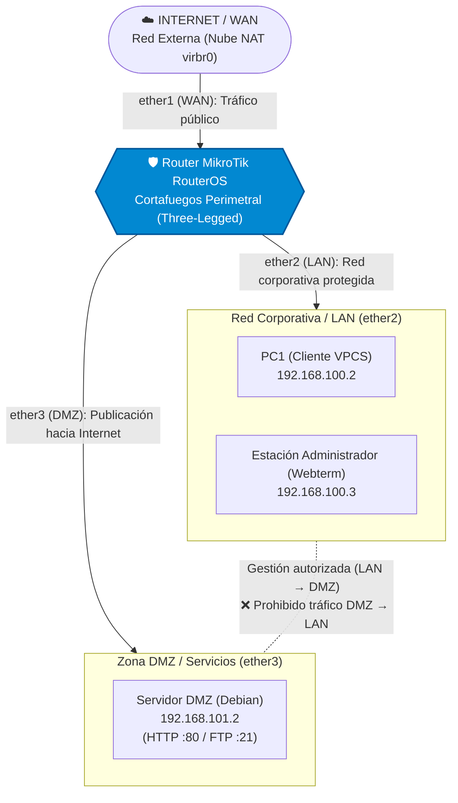
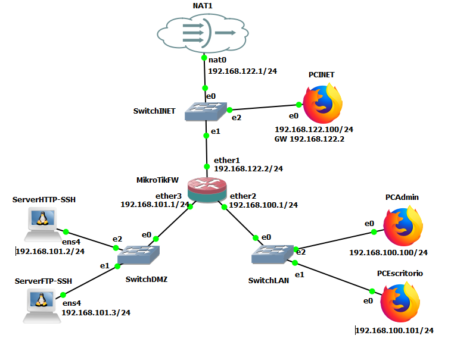

# Práctica 7.3: MikroTik - DMZ con un solo router

!!! note "Datos de la Práctica"
    * **Módulo:** Seguridad y Alta Disponibilidad (SAD - 0378)
    * **Unidad Didáctica:** UD7 - Seguridad perimetral: cortafuegos y DMZ
    * **Entorno de trabajo:** Emulador de red **GNS3** con las siguientes máquinas y appliances:
        1. **Router MikroTik RouterOS** (Cloud Hosted Router - CHR) configurado como cortafuegos perimetral con tres interfaces de red (*Three-Legged Firewall*).
        2. **Servidor Linux Debian** en la zona DMZ (`Server-DMZ` - con servicios Web HTTP en puerto 80 y FTP en puerto 21).
        3. **Estación de administración y cliente interno** en la red LAN corporativa (`Webterm` y `PC1` VPCS).
        4. **Cliente / Auditor externo en la WAN** (acceso desde la máquina anfitriona o nodo VPCS externo).
    * **Archivo de escenario descargable:** Puedes acelerar el montaje descargando el proyecto preconfigurado con clientes y servidores en [Escenario DMZ con 1 router (SharePoint)](https://gvaedu-my.sharepoint.com/:u:/g/personal/j_munozjimeno_edu_gva_es/IQAwARG3TsRTT7dcNdKZeYeQAVY3LT14VSAuHdJp9KDmzkM?e=t4cdEt){target="_blank"}.

---

## 1. Objetivos

* Diseñar e implementar en GNS3 una arquitectura de **Zona Desmilitarizada (DMZ) completa y segura** basada en un único cortafuegos de tres interfaces (*Three-Legged Firewall*).
* Configurar reglas de **Destination NAT (DNAT / Port Forwarding)** para publicar hacia Internet los servicios web (HTTP) y de transferencia de ficheros (FTP) alojados en la DMZ.
* Diseñar la política de filtrado en la cadena `forward` para garantizar el aislamiento estricto: permitir que los clientes externos accedan a los servicios de la DMZ pero bloquear cualquier intento de acceso desde la DMZ o el exterior hacia la red LAN interna (*Regla de oro de la DMZ*).
* Securizar la cadena `input` del propio router MikroTik, permitiendo su administración web (**WebFig**) o por terminal exclusivamente desde equipos autorizados de la LAN.
* Aplicar el principio de **inspección con estado (*Stateful Packet Inspection - SPI*)** para optimizar el rendimiento y autorizar las respuestas legítimas entre zonas.
* Establecer directivas denegatorias por defecto (*Default Drop*) en las cadenas de control y de datos, aplicando el modelo de **seguridad por defecto (*Zero Trust / Whitelisting*)**.
* Auditar el funcionamiento perimetral mediante una batería exhaustiva de pruebas y escaneos de puertos.

---

## 2. Escenario y Fundamentos Técnicos

### Arquitectura de la DMZ con un Router

Cuando una organización requiere que sus servicios públicos sean accesibles desde Internet manteniendo la máxima seguridad en su red interna, debe desplegar una zona desmilitarizada:




### Topología en GNS3

El laboratorio se implementa en GNS3 siguiendo la siguiente distribución de nodos e interfaces:



---

## 3. Vídeo Formativo y Avisos Cruciales de Configuración

!!! note "Vídeo de Referencia del Procedimiento"
    

    *Sigue las instrucciones del vídeo [MikroTik - DMZ con un solo router (Román Carceller)](https://youtu.be/1MJNdidUCEc){target="_blank"} para configurar el enrutamiento, la redirección de puertos y el cortafuegos perimetral.*

!!! warning "Avisos y Correcciones Docentes Imprescindibles"
    Al replicar la configuración del vídeo, ten muy en cuenta las siguientes indicaciones y correcciones:

    1. **Reglas omitidas en el vídeo (minuto 18:00):** A la configuración mostrada le faltan dos reglas imprescindibles:
        * **Aceptar explícitamente en la cadena `forward` el tráfico HTTP (puerto 80) y FTP (puerto 21)** dirigido a la DMZ que llegue por `ether1`. Si no se autorizan en el cortafuegos, las peticiones redirigidas por DNAT serán bloqueadas por la directiva denegatoria.
        * **Política por defecto restrictiva (*drop*)** para todo el tráfico `input` y `forward` no autorizado que provenga de `ether1`.
    2. **Posición de las directivas restrictivas:** Recuerda que las reglas denegatorias por defecto (*Drop all*) deben situarse **al final de la lista (*bottom*)** de `Filter Rules`.
    3. **Uso de Quickset:** Si el router MikroTik tiene más de dos interfaces activas, **no te fíes de la configuración mediante *Quickset***; utiliza siempre **WebFig** o la consola CLI.
    4. Observa atentamente la siguiente captura de pantalla con la tabla definitiva de reglas y sus respectivos comentarios explicativos:


---

## 4. Tabla de Direccionamiento IP del Laboratorio

| Nodo / Dispositivo | Interfaz | Dirección IP / Máscara | Puerta de Enlace | Rol y Función |
| :--- | :--- | :--- | :--- | :--- |
| **MikroTik RouterOS** | `ether1` (WAN) | DHCP / `192.168.122.X` | Proveedor (virbr0) | Conexión perimetral externa hacia Internet. |
| **MikroTik RouterOS** | `ether2` (LAN) | `192.168.100.1/24` | -- | Puerta de enlace por defecto de la LAN. |
| **MikroTik RouterOS** | `ether3` (DMZ) | `192.168.101.1/24` | -- | Puerta de enlace por defecto de la DMZ. |
| **PC1 (VPCS)** | `eth0` | `192.168.100.2/24` | `192.168.100.1` | Puesto ofimático de la red interna corporativa. |
| **Webterm (Admin)** | `eth0` | `192.168.100.3/24` | `192.168.100.1` | Puesto del administrador de red para WebFig. |
| **Server-DMZ (Debian)** | `eth0` | `192.168.101.2/24` | `192.168.101.1` | Servidor público (Apache HTTP en p.80, FTP en p.21). |
| **Cliente Externo (Host / VPCS)**| `eth0` | IP de la subred WAN | Según red WAN | Simula el usuario o auditor externo en Internet. |

---

## 5. Desarrollo Paso a Paso de la Práctica

---

### Fase 1: Despliegue de la Topología y Conectividad Base

1. **Creación del Proyecto:** Inicia GNS3 y abre el proyecto base o crea uno nuevo llamado `SAD_P7_3_DMZ_Un_Router`.
2. **Configuración de Interfaces y Enrutamiento en MikroTik:**
    Inicia la consola del MikroTik y configura las IPs y el NAT saliente:

    ```routeros
    # Interfaz WAN como cliente DHCP:
    /ip dhcp-client add interface=ether1 disabled=no

    # Interfaz LAN:
    /ip address add address=192.168.100.1/24 interface=ether2 comment="Puerta de enlace LAN"

    # Interfaz DMZ:
    /ip address add address=192.168.101.1/24 interface=ether3 comment="Puerta de enlace DMZ"

    # Habilitar Source NAT (Masquerade) para salida a Internet por ether1:
    /ip firewall nat add chain=srcnat out-interface=ether1 action=masquerade comment="NAT Internet"
    ```

3. **Configuración de los Equipos Finales:**
    * **PC1 (VPCS):**
        ```text
        PC1> ip 192.168.100.2 255.255.255.0 192.168.100.1
        PC1> save
        ```
    * **Server-DMZ (Debian):** Configura `/etc/network/interfaces` con IP estática `192.168.101.2/24` y pasarela `192.168.101.1`. Asegúrate de que los servicios Apache2 (`systemctl start apache2`) y FTP estén activos.
    * **Webterm (Admin LAN):** Configura `/etc/network/interfaces` con IP `192.168.100.3/24` y pasarela `192.168.100.1`.

4. **Verificación de Conectividad Base:**
    Comprueba con pings que todos los equipos alcanzan a su respectiva pasarela en el router y pueden navegar hacia la pasarela WAN.

---

### Fase 2: Publicación de los Servicios de la DMZ con DNAT (*Port Forwarding*)

Para que los usuarios de Internet puedan acceder al servidor web o FTP de la DMZ utilizando la IP pública de `ether1`, creamos las reglas de redirección de puertos:

1. Accede a **WebFig** desde Webterm o desde la máquina anfitriona (`http://192.168.100.1`).
2. Ve a **IP → Firewall → NAT** y pulsa **Add New**:

    * **Regla DNAT para Web (HTTP - Puerto 80):**
        * **Chain:** `dstnat`
        * **In. Interface:** `ether1`
        * **Protocol:** `6 (tcp)`
        * **Dst. Port:** `80`
        * **Action:** `dst-nat`
        * **To Addresses:** `192.168.101.2`
        * **To Ports:** `80`
        * **Comment:** *DNAT Web HTTP hacia Server DMZ*

    * **Regla DNAT para FTP (Puerto 21):**
        * **Chain:** `dstnat`
        * **In. Interface:** `ether1`
        * **Protocol:** `6 (tcp)`
        * **Dst. Port:** `21`
        * **Action:** `dst-nat`
        * **To Addresses:** `192.168.101.2`
        * **To Ports:** `21`
        * **Comment:** *DNAT FTP hacia Server DMZ*

---

### Fase 3: Configuración del Cortafuegos en `Filter Rules`

Configura en **IP → Firewall → Filter Rules** el conjunto de 8 reglas en el orden estricto de arriba abajo:

1. **Regla 1 (SPI Global - Retorno en FORWARD):**
    * `Chain`: `forward`
    * `Connection State`: `established, related`
    * `Action`: `accept`
    * `Comment`: *Aceptar paquetes forward de conexiones establecidas y relacionadas*

2. **Regla 2 (SPI Router - Retorno en INPUT):**
    * `Chain`: `input`
    * `Connection State`: `established, related`
    * `Action`: `accept`
    * `Comment`: *Aceptar paquetes input de conexiones establecidas y relacionadas*

3. **Regla 3 (Aislamiento de la LAN frente a la DMZ - ¡Regla de Oro!):**
    * `Chain`: `forward`
    * `In. Interface`: `ether3` (DMZ)
    * `Out. Interface`: `ether2` (LAN)
    * `Action`: `drop`
    * `Comment`: *¡CRÍTICA! Denegar cualquier tráfico iniciado desde la DMZ hacia la LAN interna*

4. **Regla 4 (Publicación de Servicios DMZ - HTTP y FTP):**
    * `Chain`: `forward`
    * `In. Interface`: `ether1` (WAN)
    * `Out. Interface`: `ether3` (DMZ)
    * `Protocol`: `6 (tcp)`
    * `Dst. Port`: `80,21`
    * `Action`: `accept`
    * `Comment`: *Permitir tráfico web y ftp desde Internet hacia la DMZ*

5. **Regla 5 (Salida de la LAN hacia Internet y DMZ):**
    * `Chain`: `forward`
    * `In. Interface`: `ether2` (LAN)
    * `Action`: `accept`
    * `Comment`: *Permitir que los equipos de la LAN accedan a Internet y a la DMZ*

6. **Regla 6 (Gestión del Router desde la LAN):**
    * `Chain`: `input`
    * `In. Interface`: `ether2` (LAN)
    * `Action`: `accept`
    * `Comment`: *Permitir administración del router únicamente desde la red local LAN*

7. **Regla 7 (Cierre del plano de datos - FORWARD DROP):**
    * `Chain`: `forward`
    * `Action`: `drop`
    * `Comment`: *Política por defecto forward: descartar cualquier otro tráfico no autorizado*

8. **Regla 8 (Cierre del plano de control - INPUT DROP):**
    * `Chain`: `input`
    * `Action`: `drop`
    * `Comment`: *Política por defecto input: descartar cualquier petición hacia el propio router*

---

## 6. Batería de Pruebas y Auditoría de Seguridad

Completa la siguiente matriz de verificación técnica en tu entorno de GNS3:

| Prueba nº | Origen → Destino | Protocolo / Puerto | Comando / Acción ejecutada | Resultado esperado | ¿Superada? (Sí/No) | Regla de Filter Rules aplicada |
| :---: | :--- | :--- | :--- | :--- | :--- | :--- |
| **T1** | LAN → Internet | ICMP / HTTP | `ping 8.8.8.8` desde `PC1` | Conexión exitosa | | |
| **T2** | LAN → DMZ | HTTP (TCP 80) | `curl http://192.168.101.2` desde Webterm | Muestra página web | | |
| **T3** | WAN / Host → DMZ | HTTP (TCP 80) | `curl http://<IP_ETHER1_MIKROTIK>` | Muestra página web (DNAT) | | |
| **T4** | WAN / Host → DMZ | SSH (TCP 22) | `ssh debian@<IP_ETHER1_MIKROTIK>` | Conexión rechazada / timeout | | |
| **T5** | WAN / Host → LAN | ICMP (Ping) | `ping 192.168.100.2` desde red externa | Bloqueado sin respuesta | | |
| **T6** | DMZ → LAN | ICMP (Ping) | `ping 192.168.100.2` desde `Server-DMZ` | **¡BLOQUEADO!** (0% éxito) | | |
| **T7** | DMZ → LAN | SSH / HTTP | Intentar conexión desde DMZ a LAN | **¡BLOQUEADO!** | | |
| **T8** | WAN / DMZ → Router | HTTP (WebFig) | Abrir navegador hacia IP del router | **¡BLOQUEADO!** | | |
| **T9** | LAN → Router | HTTP (WebFig) | Acceso a `http://192.168.100.1` | Acceso permitido a WebFig | | |

---

## 7. Cuestiones y Análisis Técnico

Responde con rigor técnico a las siguientes cuestiones en tu memoria de prácticas:

1. **Aislamiento Perimetral y Salto de Red (*Pivoting*):**
    * Supón que un atacante descubre una vulnerabilidad en una aplicación web de `Server-DMZ` y consigue una shell remota. Explica de forma detallada cómo las directivas configuradas en RouterOS evitan que el atacante pueda pivotar hacia las bases de datos o puestos de trabajo de la red corporativa (`192.168.100.0/24`).
2. **El Papel de la Inspección con Estado (*Connection Tracking*):**
    * Si la regla 3 bloquea tajantemente todo el tráfico entrante por `ether3` (DMZ) con destino a `ether2` (LAN), ¿por qué cuando un usuario de la LAN realiza una petición HTTP a `http://192.168.101.2` el servidor web sí es capaz de devolverle los datos de la página web? Identifica qué regla permite dicho retorno y por qué no entra en conflicto con la regla 3.
3. **Análisis de Políticas por Defecto:**
    * Argumenta las razones por las cuales se descarta el uso de políticas permisivas (*Default Accept*) en cortafuegos corporativos frente al modelo restrictivo (*Default Deny*).
4. **Vulnerabilidades Arquitectónicas de la DMZ con un Único Router:**
    * A pesar de que las directivas de RouterOS aíslan las redes lógicas, ¿qué riesgos inherentes de seguridad y disponibilidad presenta una DMZ basada en un único router físico frente a un esquema con doble cortafuegos en cascada (*Dual Firewall / Back-to-Back*)?

---

## 8. Entregables

Presenta un documento en formato **PDF** con la siguiente estructura:

1. **Portada y Metadatos:** Nombre completo del alumno, fecha y módulo SAD.
2. **Esquema de Red:** Captura de pantalla de la topología en funcionamiento en GNS3.
3. **Configuración del Cortafuegos en RouterOS:**
    * Captura de pantalla íntegra de la ventana **IP → Firewall → Filter Rules** en WebFig con las 8 reglas ordenadas y comentadas.
    * Captura de la ventana **IP → Firewall → NAT** con las reglas de enmascaramiento (`masquerade`) y redirección de puertos (`dstnat`).
4. **Evidencias de la Batería de Pruebas:**
    * Captura del acceso web HTTP exitoso desde el exterior a la IP de la WAN del MikroTik.
    * Captura de la terminal de `Server-DMZ` ejecutando `ping 192.168.100.2` evidenciando el bloqueo total del tráfico DMZ → LAN.
    * Tabla de comprobaciones del apartado 6 completada con los resultados obtenidos.
5. **Cuestiones Técnicas:** Respuestas completas y argumentadas a las cuatro cuestiones del apartado 7.
