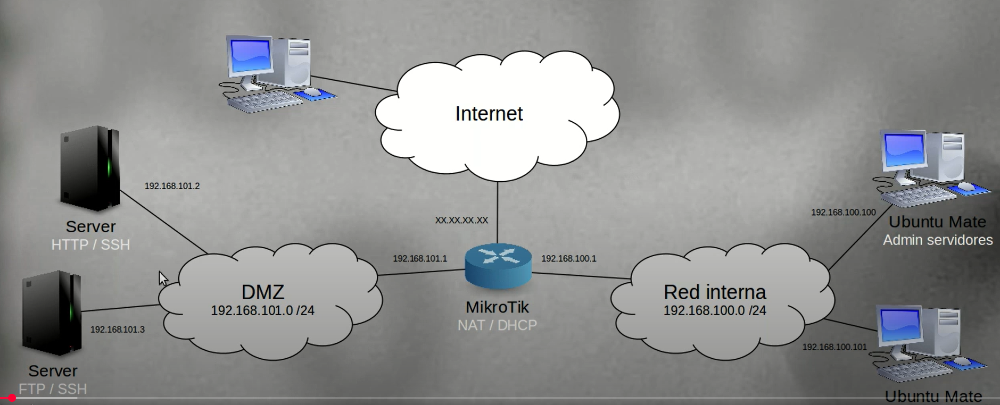
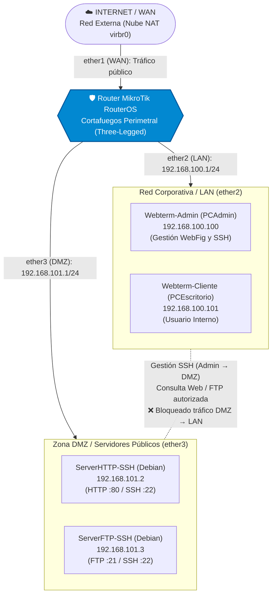

# Práctica 7.3: MikroTik - DMZ con un solo router

!!! note "Datos de la Práctica"
    * **Módulo:** Seguridad y Alta Disponibilidad (SAD - 0378)
    * **Unidad Didáctica:** UD7 - Seguridad perimetral: cortafuegos y DMZ
    * **Entorno de trabajo:** Emulador de red **GNS3** con las siguientes máquinas y appliances:
        1. **Router MikroTik RouterOS** (Cloud Hosted Router - CHR) configurado como cortafuegos perimetral con tres interfaces de red (*Three-Legged Firewall*). Toda su parametrización se realizará a través de su entorno gráfico **WebFig**.
        2. **Servidores Linux Debian en la zona DMZ:**
            * `ServerHTTP-SSH` (IP `192.168.101.2/24`): Servidor Web Apache2 (HTTP puerto 80) y administración remota SSH (puerto 22).
            * `ServerFTP-SSH` (IP `192.168.101.3/24`): Servidor FTP vsftpd (puerto 21) y administración remota SSH (puerto 22).
        3. **Estaciones de prueba y administración en LAN:** Dos appliances **Webterm** gráficos:
            * `Webterm-Admin` (`PCAdmin` con IP fija `192.168.100.100/24`): Estación autorizada del administrador de red para gestionar el router mediante WebFig y los servidores vía SSH.
            * `Webterm-Cliente` (`PCEscritorio` con IP fija `192.168.100.101/24`): Estación de trabajo estándar de usuario interno.
        4. **Cliente / Auditor externo en la WAN:** Nodo **Webterm** (`PCINET` con IP `192.168.122.100/24`) o el propio navegador web de la máquina anfitriona conectada a la nube NAT (`virbr0`).


---

## 1. Objetivos

* Diseñar e implementar en GNS3 una arquitectura de **Zona Desmilitarizada (DMZ) completa y segura** basada en un único cortafuegos de tres interfaces (*Three-Legged Firewall*).
* Realizar toda la configuración del router perimetral exclusivamente a través de su entorno gráfico web (**WebFig**), prescindiendo por completo de la consola de comandos CLI.
* Configurar directivas de **Destination NAT (DNAT / Port Forwarding)** para publicar hacia Internet los servicios públicos alojados en servidores independientes de la DMZ:
    * Redirección del tráfico web (TCP 80) hacia el servidor `ServerHTTP-SSH` (`192.168.101.2`).
    * Redirección del tráfico de ficheros (TCP 21) hacia el servidor `ServerFTP-SSH` (`192.168.101.3`).
* Diseñar la política de filtrado en la cadena `forward` para garantizar el aislamiento estricto: permitir que los clientes externos e internos accedan a los servicios públicos de la DMZ pero bloquear cualquier intento de acceso iniciado desde la DMZ hacia la red LAN interna (*Regla de oro de la DMZ*).
* Establecer un control de acceso granular en la LAN: permitir que la estación de administración (`Webterm-Admin`) acceda por SSH (puerto 22) a los servidores de la DMZ, denegando dicho acceso a los usuarios convencionales (`Webterm-Cliente`).
* Securizar la cadena `input` del router MikroTik, restringiendo el acceso administrativo a **WebFig** únicamente a la red corporativa o a la IP del administrador.
* Aplicar el principio de **inspección con estado (*Stateful Packet Inspection - SPI*)** para optimizar el rendimiento y autorizar el tráfico de retorno de conexiones legítimas.
* Auditar el funcionamiento perimetral mediante una batería exhaustiva de pruebas técnicas desde las distintas zonas de red.

---

## 2. Escenario y Fundamentos Técnicos

### Arquitectura de la DMZ con un Router

Cuando una organización requiere que sus servicios públicos sean accesibles desde Internet garantizando al mismo tiempo que una intrusión en dichos servidores no comprometa los datos ni los equipos internos, despliega una arquitectura DMZ con cortafuegos de tres patas:





### Topología en GNS3

El laboratorio se implementa en GNS3 con dos servidores Debian independientes en la DMZ, estaciones Webterm para la administración y pruebas en la LAN, y un cliente Webterm externo en la WAN:


---

## 3. Vídeo Formativo y Avisos Cruciales de Configuración

Si prefieres seguir la práctica en vídeo aquí tienes una descriipción completa de la misma

!!! note "Vídeo de Referencia del Procedimiento"
    

    *Sigue las instrucciones del vídeo [MikroTik - DMZ con un solo router (Román Carceller)](https://youtu.be/1MJNdidUCEc){target="_blank"} para comprender los fundamentos de la redirección de puertos y el aislamiento entre interfaces.*

!!! warning "Avisos y Correcciones Docentes Imprescindibles"
    Al replicar la configuración del vídeo en tu laboratorio, ten muy presentes las siguientes indicaciones:

    1. **Dos servidores independientes en DMZ:** A diferencia de una configuración simplificada con un único host, aquí disponemos de **dos servidores Debian**:
        * `ServerHTTP-SSH` (`192.168.101.2`): aloja el servicio Web Apache en el puerto 80.
        * `ServerFTP-SSH` (`192.168.101.3`): aloja el servicio FTP en el puerto 21.
    2. **Reglas omitidas en el vídeo (minuto 18:00):** A la configuración mostrada en el vídeo le faltan directivas indispensables:
        * **Aceptar en la cadena `forward` el tráfico HTTP (puerto 80) y FTP (puerto 21)** dirigido a las IPs de la DMZ que llegue por `ether1`. Si no se autorizan en `Filter Rules`, los paquetes redirigidos por DNAT serán descartados por la directiva denegatoria.
        * **Política por defecto restrictiva (*reject / drop*)** para todo el tráfico `input` y `forward` no autorizado que provenga de `ether1`.
    3. **Uso exclusivo de WebFig:** En routers con tres o más interfaces activas, **no utilices el asistente *Quickset***; realiza toda la configuración directamente en **WebFig**.
    4. **Tabla de referencia de reglas en WebFig:** La siguiente captura ilustra el conjunto ordenado de reglas con sus respectivos comentarios aclaratorios:


---

## 4. Tabla de Direccionamiento IP del Laboratorio

| Nodo / Dispositivo | Tipo de Nodo | Interfaz | Dirección IP / Máscara | Puerta de Enlace | Rol y Función en el Escenario |
| :--- | :--- | :--- | :--- | :--- | :--- |
| **MikroTik RouterOS** | Router CHR | `ether1` (WAN) | `192.168.122.2/24` (o DHCP) | `192.168.122.1` | Conexión perimetral externa hacia Internet (virbr0). |
| **MikroTik RouterOS** | Router CHR | `ether2` (LAN) | `192.168.100.1/24` | -- | Puerta de enlace predeterminada de la red LAN. |
| **MikroTik RouterOS** | Router CHR | `ether3` (DMZ) | `192.168.101.1/24` | -- | Puerta de enlace predeterminada de la zona DMZ. |
| **ServerHTTP-SSH** | Servidor Debian | `eth0` / `ens4` | `192.168.101.2/24` | `192.168.101.1` | Servidor Web Apache (HTTP :80) y administración SSH (:22). |
| **ServerFTP-SSH** | Servidor Debian | `eth0` / `ens4` | `192.168.101.3/24` | `192.168.101.1` | Servidor FTP vsftpd (FTP :21) y administración SSH (:22). |
| **Webterm-Admin** (`PCAdmin`) | Appliance Webterm | `eth0` | `192.168.100.100/24` | `192.168.100.1` | Puesto del administrador de red (WebFig y gestión SSH). |
| **Webterm-Cliente** (`PCEscritorio`) | Appliance Webterm | `eth0` | `192.168.100.101/24` | `192.168.100.1` | Puesto cliente de usuario de la red corporativa. |
| **Webterm-Externo** (`PCINET`) | Appliance Webterm | `eth0` | `192.168.122.100/24` | `192.168.122.2` | Simulación de auditor / usuario externo en Internet. |

---

## 5. Desarrollo Paso a Paso de la Práctica

---

### Fase 1: Despliegue de la Topología y Conectividad Base mediante WebFig

* **Archivo de escenario descargable:** Puedes acelerar el montaje descargando el proyecto preconfigurado con clientes y servidores en [Escenario DMZ con 1 router (SharePoint)](https://gvaedu-my.sharepoint.com/:u:/r/personal/j_munozjimeno_edu_gva_es/Documents/Documentos/Docencia/CompartidoAlumnado/P7_3DMZ1router.gns3project?d=w64ad8b0ab70e4c09a679f1c17bcc8edf&csf=1&web=1&e=mvOklY){target="_blank"}.

Si  no puedes descargarlo o prefieres desarrollar el escenario puedes seguir estos pasos

1. Monta la topología conectando:
    * `ether1` de MikroTik al switch WAN (`SwitchINET`), conectado a la Nube NAT (`virbr0`) y a `PCINET`.
    * `ether2` al switch LAN (`SwitchLAN`), donde se conectan `PCAdmin` (`Webterm-Admin`) y `PCEscritorio` (`Webterm-Cliente`).
    * `ether3` al switch DMZ (`SwitchDMZ`), donde se conectan `ServerHTTP-SSH` y `ServerFTP-SSH`.

2. **Configuración de Red en los Equipos Finales:**

    === "ServerHTTP-SSH (Debian Web)"
        Edita `/etc/network/interfaces` en `ServerHTTP-SSH`:
        ```text
        auto eth0
        iface eth0 inet static
            address 192.168.101.2
            netmask 255.255.255.0
            gateway 192.168.101.1
        ```
        *(Nota: Si la tarjeta de red en Debian figura como `ens4`, sustituye `eth0` por `ens4`).*  
        Aplica los cambios con `systemctl restart networking` y comprueba el servicio web:
        ```bash
        systemctl status apache2
        ```

    === "ServerFTP-SSH (Debian FTP)"
        Edita `/etc/network/interfaces` en `ServerFTP-SSH`:
        ```text
        auto eth0
        iface eth0 inet static
            address 192.168.101.3
            netmask 255.255.255.0
            gateway 192.168.101.1
        ```
        Aplica los cambios con `systemctl restart networking` y comprueba el servicio FTP:
        ```bash
        systemctl status vsftpd
        ```

    === "Webterm-Admin (PCAdmin)"
        Edita `/etc/network/interfaces` en `PCAdmin`:
        ```text
        auto eth0
        iface eth0 inet static
            address 192.168.100.100
            netmask 255.255.255.0
            gateway 192.168.100.1
        ```
        Aplica con `/etc/init.d/networking restart`.

    === "Webterm-Cliente (PCEscritorio)"
        Edita `/etc/network/interfaces` en `PCEscritorio`:
        ```text
        auto eth0
        iface eth0 inet static
            address 192.168.100.101
            netmask 255.255.255.0
            gateway 192.168.100.1
        ```
        Aplica con `/etc/init.d/networking restart`.

    === "Webterm-Externo (PCINET)"
        Edita `/etc/network/interfaces` en `PCINET`:
        ```text
        auto eth0
        iface eth0 inet static
            address 192.168.122.100
            netmask 255.255.255.0
            gateway 192.168.122.2
        ```
        Aplica con `/etc/init.d/networking restart`.


3. **Configuración de Interfaces y NAT en MikroTik mediante WebFig:**
    Abre el navegador de la máquina anfitriona hacia la IP de `ether1`:

    * **Paso 1: Asignación de Direcciones IP:**
        Ve a **IP → Addresses** y pulsa **Add New** para cada interfaz:
        * **LAN (`ether2`):**
            * `Address:` `192.168.100.1/24`
            * `Interface:` `ether2`
            * `Comment:` *Puerta de enlace LAN*
            * Pulsa **OK**.
        * **DMZ (`ether3`):**
            * `Address:` `192.168.101.1/24`
            * `Interface:` `ether3`
            * `Comment:` *Puerta de enlace DMZ*
            * Pulsa **OK**.
        * **WAN (`ether1`):**
            * Configura la IP estática: `Address:` `192.168.122.2/24`, `Interface:` `ether1`, `Comment:` *Enlace WAN*.
            * Solo después de haberla configurado y accedido a la configuración del router en el navegador del host a través de la IP `192.168.122.2` borra la IP que estaba concedida por DHCP.

    * **Paso 2: Enmascaramiento para salida a Internet (Source NAT):**
        Ve a **IP → Firewall → NAT** y pulsa **Add New**:
        * **Chain:** `srcnat`
        * **Out. Interface:** `ether1`
        * **Action:** `masquerade`
        * **Comment:** *NAT Masquerade hacia Internet*
        * Pulsa **OK**.

4. **Comprobación de Conectividad Inicial:**
    Antes de configurar el cortafuegos, comprueba que el enrutamiento base funciona realizando pruebas de ping desde las terminales de `PCINET`, `PCAdmin`, `PCEscritorio`, `ServerHTTP-SSH` y `ServerFTP-SSH` hacia sus respectivas puertas de enlace predeterminadas y hacia alguna dirección de internet (www.cisco.com, www.uji.es, etc)

---

### Fase 2: Publicación de los Servicios de la DMZ con DNAT (*Port Forwarding*)

Para que los usuarios de Internet accedan a los servidores web y FTP empleando la IP pública de `ether1`, configuramos en WebFig las reglas de Destination NAT:

OJO. SI HACEMOS ESTO PERDEMOS GESTIÓN DEL WEBFIG. ANTES HAY QUE PASAR LA GESTIÓN AL 8080

1. En WebFig, accede a **IP → Firewall → NAT** y pulsa **Add New**:

    * **Regla DNAT Web HTTP hacia `ServerHTTP-SSH` (Puerto 80):**
        * **Chain:** `dstnat`
        * **In. Interface:** `ether1`
        * **Protocol:** `tcp`
        * **Dst. Port:** `80`
        * **Action:** `dst-nat`
        * **To Addresses:** `192.168.101.2`
        * **To Ports:** `80`
        * **Comment:** *DNAT Web HTTP hacia ServerHTTP-SSH*
        * Pulsa **OK**.

    * **Regla DNAT FTP hacia `ServerFTP-SSH` (Puerto 21):**
        * Pulsa nuevamente **Add New**:
        * **Chain:** `dstnat`
        * **In. Interface:** `ether1`
        * **Protocol:** `6 (tcp)`
        * **Dst. Port:** `21`
        * **Action:** `dst-nat`
        * **To Addresses:** `192.168.101.3`
        * **To Ports:** `21`
        * **Comment:** *DNAT FTP hacia ServerFTP-SSH*
        * Pulsa **OK**.

---

### Fase 3: Configuración del Cortafuegos en `Filter Rules` (WebFig)

Accede en WebFig a **IP → Firewall → Filter Rules** y añade pulsando **Add New** la tabla completa de reglas de seguridad, respetando rigurosamente su orden relativo:

1. **Regla 0 (SPI Global - Conexiones Establecidas y Relacionadas):**
    * **Chain:** `forward`
    * **Connection State:** marca `established` y `related`
    * **Action:** `accept`
    * **Comment:** *;;; Permitir establecidas y relacionadas*
    * Pulsa **OK**.

2. **Regla 1 (Publicación de Servicios DMZ desde Internet):**
    * **Chain:** `forward`
    * **In. Interface:** `ether1`
    * **Out. Interface:** `ether3`
    * **Protocol:** `6 (tcp)`
    * **Dst. Port:** `80,21`
    * **Action:** `accept`
    * **Comment:** *;;; Permitir el tráfico de paso desde Internet a los servidores WEB y FTP de la DMZ*
    * Pulsa **OK**.

3. **Regla 2 (Bloqueo de Tráfico de Paso no Autorizado desde Internet):**
    * **Chain:** `forward`
    * **In. Interface:** `ether1`
    * **Action:** `reject` *(o `drop`)*
    * **Comment:** *;;; Rechazo todo el tráfico de paso que venga de Internet*
    * Pulsa **OK**.

4. **Regla 3 (Protección de la Entrada al Router desde Internet):**
    * **Chain:** `input`
    * **In. Interface:** `ether1`
    * *(Opcional)* En **Src. Address** marca la casilla `!` (*not*) e introduce la IP autorizada de administración remota.
    * **Action:** `reject` *(o `drop`)*
    * **Comment:** *;;; Rechazo todo el tráfico de entrada que venga de internet que no sea de mi equipo*
    * Pulsa **OK**.

5. **Regla 4 (Aislamiento de la LAN frente a la DMZ - ¡Regla de Oro de la DMZ!):**
    * **Chain:** `forward`
    * **In. Interface:** `ether3`
    * **Out. Interface:** `ether2`
    * **Action:** `reject` *(o `drop`)*
    * **Comment:** *;;; Rechazo el tráfico de paso de DMZ a red interna*
    * Pulsa **OK**.

6. **Regla 5 (Acceso LAN al Servidor Web DMZ):**
    * **Chain:** `forward`
    * **In. Interface:** `ether2`
    * **Dst. Address:** `192.168.101.2`
    * **Protocol:** `6 (tcp)`
    * **Dst. Port:** `80`
    * **Action:** `accept`
    * **Comment:** *;;; Permito el tráfico WEB desde la red interna al servidor WEB de la DMZ*
    * Pulsa **OK**.

7. **Regla 6 (Acceso LAN al Servidor FTP DMZ):**
    * **Chain:** `forward`
    * **In. Interface:** `ether2`
    * **Dst. Address:** `192.168.101.3`
    * **Protocol:** `6 (tcp)`
    * **Dst. Port:** `21`
    * **Action:** `accept`
    * **Comment:** *;;; Permito el tráfico FTP desde la red interna al servidor FTP de la DMZ*
    * Pulsa **OK**.

8. **Regla 7 (Gestión SSH Exclusiva para el Administrador):**
    * **Chain:** `forward`
    * **In. Interface:** `ether2`
    * **Src. Address:** `192.168.100.100` *(IP de `Webterm-Admin`)*
    * **Protocol:** `6 (tcp)`
    * **Dst. Port:** `22`
    * **Action:** `accept`
    * **Comment:** *;;; Permitir el tráfico de paso SSH desde el equipo del administrador a cualquier equipo de la DMZ*
    * Pulsa **OK**.

9. **Regla 8 (Bloqueo de Tráfico Restante de LAN hacia DMZ):**
    * **Chain:** `forward`
    * **In. Interface:** `ether2`
    * **Out. Interface:** `ether3`
    * **Action:** `reject` *(o `drop`)*
    * **Comment:** *;;; Rechazo el tráfico de paso de red interna a DMZ*
    * Pulsa **OK**.

> **Verificación Visual:** Comprueba que en WebFig tu lista de directivas coincide con la captura de referencia mostrada en la Sección 3, verificando que los comentarios coinciden y los contadores de paquetes (*Packets / Bytes*) comienzan a registrar actividad a medida que ejecutes las pruebas.

---

## 6. Batería de Pruebas y Auditoría de Seguridad

Ejecuta la siguiente batería de comprobaciones técnicas desde las diferentes estaciones de la maqueta y completa la matriz de resultados:

| Prueba nº | Origen → Destino | Protocolo / Puerto | Comando / Acción ejecutada | Resultado esperado | ¿Superada? (Sí/No) | Regla aplicada en WebFig |
| :---: | :--- | :--- | :--- | :--- | :--- | :--- |
| **T1** | LAN → Internet | ICMP | `ping -c 3 8.8.8.8` desde `Webterm-Cliente` | Salida exitosa a Internet vía NAT | | NAT Masquerade |
| **T2** | LAN → DMZ (Web) | HTTP (TCP 80) | `curl http://192.168.101.2` desde `Webterm-Cliente` | Muestra la página web de `ServerHTTP-SSH` | | Regla 5 |
| **T3** | LAN → DMZ (FTP) | FTP (TCP 21) | `nc -zv 192.168.101.3 21` desde `Webterm-Cliente` | Conexión establecida con `ServerFTP-SSH` | | Regla 6 |
| **T4** | LAN (Admin) → DMZ | SSH (TCP 22) | `ssh debian@192.168.101.2` desde `Webterm-Admin` | Conexión SSH autorizada | | Regla 7 |
| **T5** | LAN (Admin) → DMZ | SSH (TCP 22) | `ssh debian@192.168.101.3` desde `Webterm-Admin` | Conexión SSH autorizada | | Regla 7 |
| **T6** | LAN (Cliente) → DMZ | SSH (TCP 22) | `ssh debian@192.168.101.2` desde `Webterm-Cliente` | **¡RECHAZADO / BLOQUEADO!** | | Regla 8 |
| **T7** | WAN / Host → DMZ | HTTP (TCP 80) | Navegar a `http://192.168.122.2` desde `PCINET` | Web de `ServerHTTP-SSH` visible vía DNAT | | Regla 1 (DNAT) |
| **T8** | WAN / Host → DMZ | FTP (TCP 21) | Conexión a `192.168.122.2:21` desde `PCINET` | Servicio FTP de `ServerFTP-SSH` visible vía DNAT | | Regla 1 (DNAT) |
| **T9** | WAN / Host → DMZ | SSH (TCP 22) | `ssh debian@192.168.122.2` desde `PCINET` | **¡BLOQUEADO!** (No publicado hacia WAN) | | Regla 2 |
| **T10** | WAN / Host → LAN | ICMP (Ping) | `ping -c 3 192.168.100.100` desde red WAN | **¡BLOQUEADO!** (Sin respuesta) | | Regla 2 |
| **T11** | DMZ → LAN | ICMP (Ping) | `ping -c 3 192.168.100.100` desde `ServerHTTP-SSH` | **¡BLOQUEADO!** (0% éxito, Regla de Oro) | | Regla 4 |
| **T12** | DMZ → LAN | ICMP (Ping) | `ping -c 3 192.168.100.100` desde `ServerFTP-SSH` | **¡BLOQUEADO!** (0% éxito, Regla de Oro) | | Regla 4 |
| **T13** | DMZ → LAN | SSH / HTTP | Intentar `curl http://192.168.100.100` desde DMZ | **¡BLOQUEADO!** (Aislamiento total) | | Regla 4 |
| **T14** | LAN (Admin) → Router | HTTP (WebFig) | Abrir `http://192.168.100.1` desde `Webterm-Admin` | Acceso concedido a WebFig | | Conexión local LAN |
| **T15** | WAN / DMZ → Router | HTTP (WebFig) | Abrir navegador hacia `192.168.122.2` o `192.168.101.1` | **¡BLOQUEADO!** | | Regla 3 |

---

## 7. Cuestiones y Análisis Técnico

Responde con precisión técnica a las siguientes cuestiones en tu memoria de prácticas:

1. **Aislamiento Perimetral y Contención de Intrusiones (*Pivoting*):**
    * Supón que un atacante remoto detecta una vulnerabilidad en la aplicación web alojada en `ServerHTTP-SSH` (`192.168.101.2`) y logra ejecutar comandos con una *reverse shell*. Explica detalladamente cómo las reglas de RouterOS le impiden:
        * Pivotar e iniciar ataques contra los equipos y datos de la red corporativa (`192.168.100.0/24`).
        * Descargar ficheros confidenciales atacando internamente a `ServerFTP-SSH` (`192.168.101.3`).
2. **Inspección de Estados (*SPI / Connection Tracking*):**
    * La Regla 4 rechaza de forma tajante cualquier paquete originado en la DMZ (`ether3`) hacia la red interna (`ether2`). Siendo así, ¿por qué cuando un usuario de la LAN solicita una página a `http://192.168.101.2` el servidor web sí puede devolver los paquetes de respuesta? ¿Qué regla lo permite y por qué se evalúa antes que la Regla 4?
3. **Control Granular del Tráfico de Gestión SSH:**
    * Analiza la configuración de la Regla 7 frente a la Regla 8. ¿Por qué es fundamental que la Regla 7 filtre por la dirección IP de origen (`Src. Address: 192.168.100.100`) además de la interfaz y el puerto TCP 22? ¿Qué ocurriría si esta regla no especificara la dirección de origen?
4. **Directivas `reject` frente a `drop` y Evaluación de Riesgos:**
    * ¿Qué diferencias técnicas y de seguridad existen entre aplicar una acción `reject` (como en el ejemplo del laboratorio) frente a una acción `drop` en las reglas de bloqueo hacia Internet?
    * ¿Qué riesgos de seguridad y de punto único de fallo (*Single Point of Failure - SPOF*) presenta este diseño de DMZ con un único router físico frente a un modelo de doble cortafuegos en cascada (*Back-to-Back*)?

---

## 8. Entregables

Presenta un documento en formato **PDF** con la siguiente estructura y contenido:

1. **Portada y Metadatos:** Nombre completo del alumno, fecha y módulo formativo (SAD).
2. **Esquema de Red en GNS3:** Captura de pantalla de la topología completa en ejecución con los nombres de nodo y enlaces visibles.
3. **Configuración en RouterOS (WebFig):**
    * Captura de pantalla de **IP → Firewall → NAT** con las reglas `masquerade` y las dos reglas `dstnat` (Web y FTP) desplegadas.
    * Captura de pantalla íntegra de **IP → Firewall → Filter Rules** con las directivas ordenadas y sus comentarios visibles.
4. **Evidencias de la Batería de Pruebas:**
    * Captura del navegador web en `PCINET` accediendo exitosamente a la web pública de `ServerHTTP-SSH` a través de la IP WAN del MikroTik.
    * Captura de la conexión FTP desde `PCINET` accediendo al servicio de `ServerFTP-SSH`.
    * Captura de las terminales de `ServerHTTP-SSH` y `ServerFTP-SSH` ejecutando `ping 192.168.100.100` demostrando el bloqueo total (0% de paquetes recibidos).
    * Captura del acceso SSH concedido desde `Webterm-Admin` y bloqueado desde `Webterm-Cliente`.
    * Tabla de comprobaciones del apartado 6 completada con los resultados verificados.
5. **Cuestiones Técnicas:** Respuestas detalladas y razonadas a las cuestiones del apartado 7.
