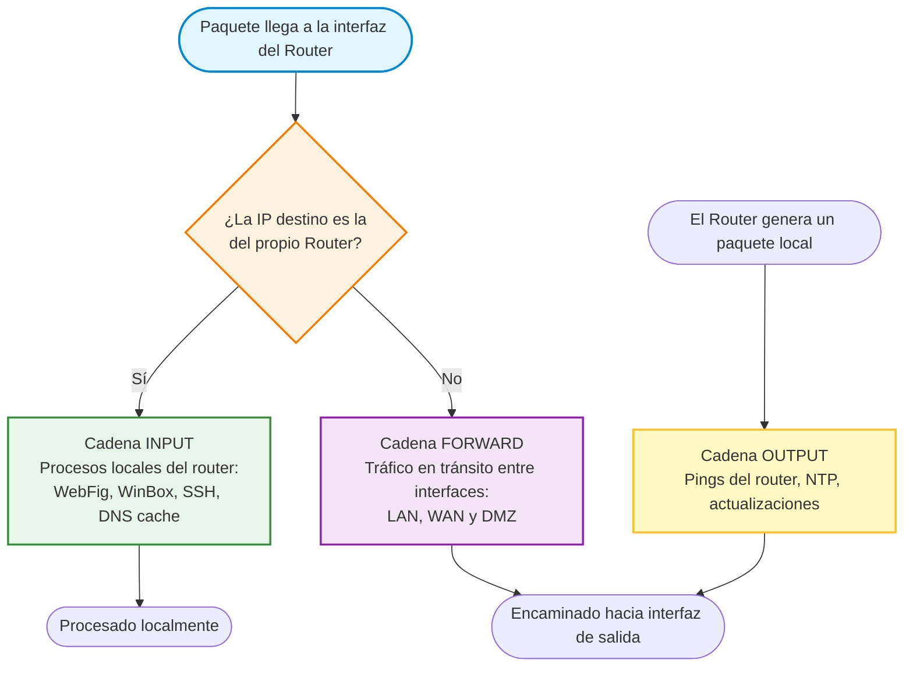
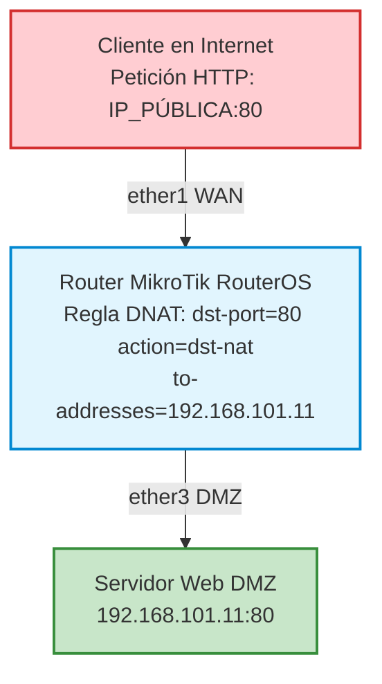
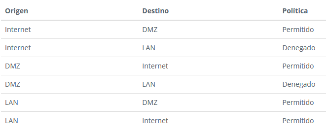
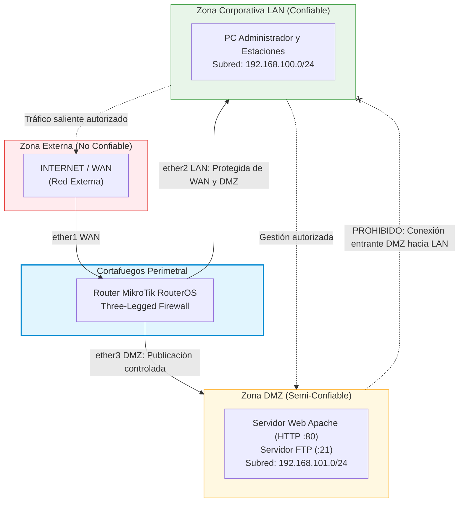
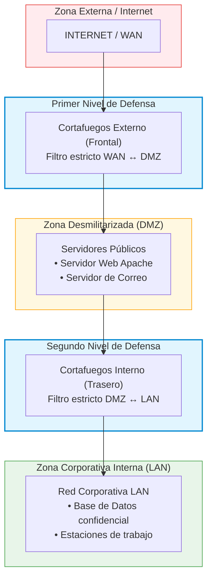

# UD7. Seguridad perimetral: cortafuegos y DMZ

## 1. Fundamentos de la Seguridad Perimetral y Defensa en Profundidad

En el ámbito de la administración de sistemas informáticos en red, la seguridad de una organización no puede descansar únicamente en la protección individual de los servidores o equipos de usuario. Resulta imprescindible blindar los límites por los que fluye la información hacia el exterior y regular de forma granular el tráfico que accede a las infraestructuras corporativas.

---

### 1.1. Concepto y Retos del Perímetro de Red

Se define el **perímetro de red** como la frontera física y lógica que separa las redes internas bajo el control de la organización (redes de confianza) de las redes externas públicas no confiables (principalmente Internet) o de redes pertenecientes a colaboradores y proveedores.

La **seguridad perimetral** abarca el conjunto de métodos, dispositivos y tecnologías concebidos para supervisar, filtrar, canalizar y registrar todo el tráfico que entra o sale de la organización a través de dicha frontera.

En los entornos corporativos contemporáneos, la implantación de la seguridad perimetral se enfrenta a desafíos crecientes:

* **Disolución de la frontera física:** La generalización del teletrabajo, el acceso móvil y las políticas BYOD (*Bring Your Own Device*) hacen que los puestos de trabajo se conecten desde cualquier ubicación geográfica.
* **Migración a la nube (IaaS/PaaS/SaaS):** Los servicios y bases de datos se distribuyen entre centros de datos locales y nubes públicas (AWS, Azure, Google Cloud), exigiendo una segmentación perimetral híbrida.
* **Amenazas internas:** Un alto porcentaje de los incidentes de ciberseguridad se originan en el interior del perímetro (empleados negligentes, credenciales comprometidas o dispositivos infectados por malware tras conectarse a una Wi-Fi externa).

---

### 1.2. El Principio de Defensa en Profundidad

La seguridad informática no debe depender de un único punto de control. Si una barrera es vulnerada, deben existir capas defensivas subsiguientes que detengan o retrasen al atacante. Este enfoque se conoce como **Defensa en Profundidad (*Defense in Depth*)**:

```text
 ═══════════════════════════════════════════════════════════════════════════════
  CAPA 1: Seguridad Perimetral (Cortafuegos, IDS/IPS, UTM, DMZ)
 ───────────────────────────────────────────────────────────────────────────────
  CAPA 2: Seguridad de Red Interna (VLANs, Control de Acceso 802.1X, WPA3-Ent)
 ───────────────────────────────────────────────────────────────────────────────
  CAPA 3: Seguridad de Host (Hardening SO, Cortafuegos Personal, EDR/Antivirus)
 ───────────────────────────────────────────────────────────────────────────────
  CAPA 4: Seguridad de la Aplicación y Datos (Cifrado, ACLs, Copias de Seguridad)
 ═══════════════════════════════════════════════════════════════════════════════
```

El cortafuegos perimetral constituye la **primera línea de defensa**, impidiendo que el escaneo masivo y los vectores de ataque indiscriminados alcancen los sistemas internos de la organización.

---

### 1.3. Niveles de Confianza y Zonas de Seguridad

Para administrar eficazmente el tráfico de red, los límites perimetrales se dividen en **zonas de seguridad** homogéneas en función de su nivel de confianza:

```text
               ┌───────────────────────────────────────────────┐
               │              RED EXTERNA (WAN)                │
               │             Nivel Confianza: NULO             │
               │                   (Internet)                  │
               └───────────────────────┬───────────────────────┘
                                       │
                                       ▼
                         ┌───────────────────────────┐
                         │   CORTAFUEGOS PERIMETRAL  │
                         └─────────────┬─────────────┘
                                       │
                 ┌─────────────────────┴─────────────────────┐
                 │                                           │
                 ▼                                           ▼
   ┌───────────────────────────┐               ┌───────────────────────────┐
   │    ZONA DESMILITARIZADA   │               │     RED INTERNA (LAN)     │
   │           (DMZ)           │               │   Nivel Confianza: ALTO   │
   │   Nivel Confianza: MEDIO  │               │                           │
   │  (Web, Correo, DNS, FTP)  │               │   (Estaciones, BBDD,      │
   └───────────────────────────┘               │    Controlador Dominio)   │
                                               └───────────────────────────┘
```

1. **Red Externa (WAN / Internet):** Zona no confiable donde residen los clientes públicos, pero también los atacantes, *botnets* y sistemas automatizados de escaneo.
2. **Red Interna (LAN corporativa):** Zona de máxima confianza donde residen los equipos de trabajo de los empleados, estaciones de administración, servidores de bases de datos internas y controladores de dominio.
3. **Zona Desmilitarizada (DMZ):** Subred intermedia de confianza media diseñada para alojar servidores que prestan servicios hacia el exterior (Web, FTP, correo), manteniéndolos aislados de la LAN.
4. **Extranet:** Red perimetral restringida habilitada para que socios comerciales, sucursales o teletrabajadores accedan a aplicaciones específicas mediante túneles seguros (VPN).

---

### 1.4. Políticas de Seguridad por Defecto: Restrictiva vs. Permisiva

A la hora de configurar cualquier dispositivo de filtrado perimetral, el administrador debe adoptar una postura de diseño global:

| Enfoque | Directiva por Defecto | Funcionamiento y Filosofía | Valoración de Seguridad |
| :--- | :--- | :--- | :--- |
| **Política Restrictiva**<br>*(Default Deny / Lista Blanca)* | **DENEGAR TODO**<br>(Drop / Reject por defecto) | Se bloquea cualquier comunicación por defecto. El administrador debe habilitar **explícitamente** cada puerto, protocolo e IP de origen y destino imprescindibles para el negocio. | **Máxima seguridad (Recomendada).** Garantiza el cumplimiento del principio de mínimo privilegio. |
| **Política Permisiva**<br>*(Default Allow / Lista Negra)* | **PERMITIR TODO**<br>(Accept por defecto) | Se permite todo el tráfico por defecto y se crean reglas puntuales para bloquear únicamente amenazas conocidas o puertos peligrosos. | **Muy vulnerable.** Inviable en entornos corporativos, ya que cualquier servicio nuevo u olvido del administrador queda expuesto. |

!!! tip "Recursos de Apoyo: Fundamentos de Seguridad Perimetral"
    Para asimilar los conceptos de segmentación y defensa en profundidad, puedes consultar los siguientes recursos audiovisuales y guías de referencia:

    * [Vídeo: Intypedia - Lección 5: Seguridad Perimetral (Alejandro Ramos Fraile)](https://www.youtube.com/watch?v=sxg1nq17xj4){:target="_blank"}:
        * *Escena 1 (01:17):* Fundamentos de la seguridad perimetral e introducción a los cortafuegos.
        * *Escena 2 (05:13):* Sistemas de detección de intrusiones (IDS) y Honeypots.
        * *Escena 3 (09:42):* Tráfico en la Red: Antivirus perimetral, antispam y VPNs.
        * *Escena 4 (11:26):* Gestión Unificada de Amenazas (UTM) y conclusiones.

---

## 2. Arquitectura, Tipología y Funcionamiento de los Cortafuegos

Un **cortafuegos (*firewall*)** es un dispositivo hardware o software capaz de examinar y procesar los paquetes de datos que entran, salen o atraviesan una red, determinando su destino según una serie de reglas de seguridad preestablecidas.

---

### 2.1. Alcance: Qué Controla un Cortafuegos y Qué Amenazas NO Evita

Es un error común asumir que un cortafuegos proporciona protección total. Un cortafuegos es una herramienta de control de flujos de red, con capacidades y límites bien definidos:

```text
 ┌──────────────────────────────────────────────┐  ┌──────────────────────────────────────────────┐
 │          QUÉ CONTROLA EL CORTAFUEGOS         │  │          QUÉ NO EVITA EL CORTAFUEGOS         │
 ├──────────────────────────────────────────────┤  ├──────────────────────────────────────────────┤
 │ ✔ Accesos a equipos y servicios específicos  │  │ ✘ Ataques físicos directos a los servidores  │
 │ ✔ Conexiones salientes no autorizadas        │  │ ✘ Uso remoto de credenciales legítimas       │
 │ ✔ Filtrado de flujos según origen y destino  │  │ ✘ Ataques web en puertos abiertos (SQLi, XSS)│
 │ ✔ Tráfico no deseado entre distintas zonas   │  │ ✘ Infección por malware recibido por correo  │
 │ ✔ Ataques de escaneo y sondeo de puertos     │  │ ✘ Amenazas internas originadas en la LAN     │
 └──────────────────────────────────────────────┘  └──────────────────────────────────────────────┘
```

El cortafuegos reduce drásticamente la **superficie de ataque expuesta**, pero debe complementarse con autenticación robusta, sistemas IDS/IPS, WAF (*Web Application Firewall*), antimalware y copias de seguridad.

---

### 2.2. Clasificación de los Cortafuegos

#### Según su Posición en la Red

1. **Cortafuegos de Equipo o Personal (*Host-based Firewall*):**
    * Se ejecuta directamente sobre el sistema operativo de una estación o servidor (por ejemplo, `iptables`/`nftables` y `ufw` en Linux, o Windows Defender Firewall).
    * Solo protege al equipo donde está instalado, filtrando el tráfico entrante y saliente generado por sus propios procesos.
2. **Cortafuegos de Red o Perimetral (*Network Firewall*):**
    * Dispositivo autónomo (router o *appliance* dedicado) situado en la frontera entre dos o más redes.
    * Su función principal es **filtrar el tráfico que pasa a través de él** (tráfico *forward*) sin que el propio router sea el origen ni el destino de la comunicación.

#### Según su Implementación

1. **Cortafuegos Software / Lógico:**
    * Programas que se ejecutan sobre sistemas operativos de propósito general (ej. distribuciones Linux o BSD como pfSense u OPNsense, o soluciones integradas como `iptables`).
    * Destacan por su coste reducido y gran flexibilidad de personalización.
2. **Cortafuegos Hardware / Físico:**
    * Dispositivos diseñados específicamente con procesadores optimizados (ASIC / FPGA) para el procesamiento y conmutación de paquetes a alta velocidad.
    * Suelen comercializarse como equipos de **Gestión Unificada de Amenazas (UTM - *Unified Threat Management*)** o cortafuegos de nueva generación (**NGFW - *Next Generation Firewall***) de fabricantes como MikroTik, Fortinet, Cisco o Palo Alto Networks.

---

### 2.3. Clasificación por Generaciones y Nivel del Modelo OSI

La capacidad de filtrado de un cortafuegos depende de la profundidad con la que examina los paquetes en las capas del modelo OSI:

```text
 [ Capa 7: Aplicación ] ──> 3ª GENERACIÓN: Cortafuegos de Aplicación / WAF / NGFW (DPI)
 [ Capa 4: Transporte ] ──> 2ª GENERACIÓN: Filtrado con Estado (Stateful Inspection / SPI)
 [ Capa 3: Red        ] ──> 1ª GENERACIÓN: Filtrado de Paquetes sin Estado (Stateless)
```

#### 1ª Generación: Filtrado de Paquetes sin Estado (*Stateless Packet Filtering*)

* Trabaja en las capas de **Red (IP)** y **Transporte (TCP/UDP)**.
* Analiza cada paquete de forma aislada, sin recordar los paquetes anteriores:
    * Dirección IP de origen y destino.
    * Puerto de transporte de origen y destino.
    * Protocolo (TCP, UDP, ICMP).
* **Limitación:** Es incapaz de distinguir si un paquete entrante corresponde a la respuesta legítima de una petición iniciada desde la LAN o si se trata de un ataque de inyección exterior no solicitado.

#### 2ª Generación: Inspección de Paquetes con Estado (*Stateful Packet Filtering - SPI*)

* Mantiene una **tabla interna de conexiones activas** (*Connection Tracking Table*).
* Cuando un equipo interno inicia una sesión TCP hacia el exterior, el cortafuegos registra los parámetros del flujo (IPs, puertos, números de secuencia) y clasifica los paquetes en cuatro estados fundamentales:
    * **`NEW`:** El paquete solicita abrir una nueva conexión (ej. bandera TCP `SYN`).
    * **`ESTABLISHED`:** El paquete pertenece a una conexión ya validada y bidireccional.
    * **`RELATED`:** El paquete abre una conexión complementaria asociada a una ya establecida (imprescindible para protocolos complejos como FTP pasivo o señalización SIP/VoIP).
    * **`INVALID`:** El paquete no se asocia con ninguna conexión conocida o presenta banderas corruptas (debe ser descartado de inmediato).
* **Ventaja:** Permite aplicar la regla dorada perimetral: **permitir la salida de tráfico nuevo desde la LAN y aceptar únicamente paquetes `ESTABLISHED` y `RELATED` procedentes de Internet**, bloqueando de raíz cualquier intento de apertura de sesión desde el exterior.

#### 3ª Generación: Cortafuegos a Nivel de Aplicación y NGFW

* Trabajan en la **Capa de Aplicación (Capa 7)**.
* Reensamblan el flujo de datos completo para realizar **inspección profunda de paquetes (DPI - *Deep Packet Inspection*)**:
    * Verificación de la sintaxis HTTP/HTTPS, filtrado de URLs y bloqueo de palabras clave.
    * Cortafuegos de Aplicaciones Web (**WAF**): Prevención contra inyecciones SQL, Cross-Site Scripting (XSS) y ataques al Top 10 de OWASP.
    * Detección de aplicaciones encubiertas (identifican tráfico BitTorrent o Tor aunque viaje a través del puerto TCP 443).

---

### 2.4. Cadenas de Procesamiento y Acciones de Filtrado

En los sistemas basados en Linux y en el sistema operativo **RouterOS de MikroTik**, el motor de filtrado organiza las reglas en **cadenas (*chains*)** según el recorrido que siguen los paquetes:



1. **Cadena `INPUT`:** Procesa los paquetes dirigidos a las direcciones IP del propio cortafuegos (por ejemplo, cuando un administrador se conecta a la interfaz WebFig del router o mediante SSH).
2. **Cadena `FORWARD`:** Procesa los paquetes que entran por una interfaz y salen por otra diferente atravesando el equipo (tráfico de los usuarios de la LAN hacia Internet, o tráfico externo hacia la DMZ).
3. **Cadena `OUTPUT`:** Procesa los paquetes emitidos directamente por el sistema operativo del cortafuegos hacia la red (peticiones NTP, resoluciones DNS del router o mensajes de alerta).

#### Decisiones y Acciones de Filtrado

Cuando un paquete coincide con las condiciones de una regla (o con la política por defecto), el cortafuegos ejecuta una de las siguientes acciones:

| Acción | Comportamiento | Impacto en la Red | Caso de Uso Recomendado |
| :--- | :--- | :--- | :--- |
| **`ACCEPT`** | El paquete es autorizado y continúa su curso hacia la siguiente etapa de encaminamiento. | Ninguno. | Tráfico corporativo legítimo autorizado. |
| **`DROP`** | El paquete es **descartado silenciosamente** sin enviar ninguna notificación al remitente. | El emisor agota su tiempo de espera (*timeout*), ignorando si la IP existe o si hay un cortafuegos activo. | **Recomendado para la interfaz WAN (Internet).** Oculta información sobre la arquitectura perimetral y ralentiza los escaneos de atacantes. |
| **`REJECT`** | El paquete es descartado, pero el cortafuegos **responde activamente al emisor** mediante un mensaje de error ICMP (*Port Unreachable*) o un paquete TCP `RST`. | La conexión se cierra al instante sin pausas ni esperas de timeout. | **Recomendado para la red interna (LAN).** Facilita el diagnóstico de red y evita que las aplicaciones de los usuarios queden bloqueadas esperando respuesta. |

---

## 3. Traducción de Direcciones de Red (NAT) y Publicación de Servicios

En las redes IPv4, los equipos de la red corporativa utilizan bloques de direccionamiento privado definidos por la norma **RFC 1918** (`10.0.0.0/8`, `172.16.0.0/12`, `192.168.0.0/16`), los cuales no son enrutables directamente a través de Internet.

Para comunicar la infraestructura local con el exterior se emplea la **Traducción de Direcciones de Red (NAT - *Network Address Translation*)**.

---

### 3.1. SNAT y Masquerade (Salida a Internet)

* **Source NAT (SNAT):** Modifica la dirección IP de origen de los paquetes emitidos desde la LAN antes de enviarlos a Internet, sustituyéndola por la dirección IP pública del router.
* **Enmascaramiento (*Masquerade*):** Variante de SNAT utilizada cuando la IP pública de la WAN se asigna dinámicamente mediante DHCP o PPPoE. El router actualiza dinámicamente la traducción si la IP externa cambia.
* **Mantenimiento de sesión:** El cortafuegos asigna un puerto efímero externo único a cada flujo, permitiendo que cientos de equipos compartan una única dirección IP pública para navegar (**PAT - *Port Address Translation***).

---

### 3.2. DNAT / Redireccionamiento de Puertos (*Port Forwarding*)

Cuando la empresa dispone de un servidor web, FTP o correo electrónico alojado en su red interna o DMZ, los usuarios de Internet no pueden alcanzarlo utilizando su IP privada (`192.168.101.11`).

Se implementa entonces **Destination NAT (DNAT)**:



1. El router perimetral recibe una petición dirigida a su propia interfaz externa (`dst-address=IP_WAN`) en un puerto específico (ej. TCP 80).
2. El motor de NAT altera la cabecera del paquete, reemplazando la IP de destino por la IP privada interna del servidor (`to-addresses=192.168.101.11`).
3. El paquete atraviesa a continuación la cadena `FORWARD` del cortafuegos, donde una regla de filtrado debe permitir explícitamente el paso hacia dicha IP y puerto.

---

### 3.3. Práctica de Laboratorio

El diseño y puesta en marcha del filtrado con estado, la protección de acceso al router y la publicación de servicios se aborda en la práctica inicial del bloque:

!!! note "Práctica de Laboratorio"
    **[Práctica 7.1: Configuración de Cortafuegos de Red y Filtrado con Estado en MikroTik RouterOS](P7_1_cortafuegos_mikrotik_basico.md)**
    
    *En esta práctica aprenderás a securizar un router MikroTik RouterOS desde cero, configurando reglas stateful en la cadena forward, protegiendo los servicios administrativos en la cadena input mediante listas de control de acceso y publicando servicios internos mediante redireccionamiento de puertos (DNAT).*

---

## 4. Zonas Desmilitarizadas (DMZ): Arquitectura y Políticas de Aislamiento

### 4.1. Concepto y Objetivos de la DMZ

Si un servidor web con acceso público se sitúa directamente dentro de la red local de la empresa, cualquier vulnerabilidad en el software de la aplicación (un fallo en WordPress, una inyección SQL o una ejecución remota de código) permitiría a un atacante tomar el control del servidor y utilizarlo como pivote (*pivot*) para comprometer de inmediato el resto de estaciones y bases de datos corporativas de la LAN.

Para mitigar este riesgo surge la **Zona Desmilitarizada (DMZ - *Demilitarized Zone*)**: una subred intermedia aislada física y lógicamente de la LAN, destinada exclusivamente a albergar servidores accesibles desde redes públicas.

---

### 4.2. Matriz de Políticas de Tráfico entre Zonas

El principio rector de la DMZ es la **contención perimetral**: los servidores de la DMZ pueden recibir conexiones desde Internet y desde la LAN, pero **bajo ningún concepto pueden iniciar conexiones hacia la red local**.


<small>*Ilustración: Flujos de tráfico autorizados y denegados entre zonas.*</small>

| Origen | Destino | Acción | Justificación Técnica y Operativa |
| :--- | :--- | :--- | :--- |
| **Internet (WAN)** | **DMZ** | **Permitido condicional** | Solo a los puertos y protocolos estrictamente publicados (ej. HTTP 80, HTTPS 443). |
| **Internet (WAN)** | **LAN** | **Denegado absoluto** | Ningún dispositivo externo puede alcanzar los puestos o servidores internos. |
| **LAN** | **Internet (WAN)** | **Permitido** | Navegación y servicios salientes de los empleados mediante SNAT/Masquerade. |
| **LAN** | **DMZ** | **Permitido** | Permite a los usuarios consultar los servicios y al personal de IT administrar los servidores (SSH, RDP, Web). |
| **DMZ** | **LAN** | **DENEGADO ESTRICTO** | **Regla de oro de la DMZ:** Si un atacante compromete el servidor web, el cortafuegos le impide escanear o saltar a la red local. |
| **DMZ** | **Internet (WAN)** | **Restringido** | Generalmente denegado por defecto, permitiendo únicamente salidas puntuales (actualizaciones de paquetes `apt`, peticiones DNS a servidores específicos). |

---

### 4.3. Topologías de Despliegue de DMZ

#### Topología 1: DMZ con un Cortafuegos de Tres Interfaces (*Three-Legged Firewall*)

Utiliza un único dispositivo de encaminamiento dotado de al menos tres interfaces de red físicas: una para la WAN, otra para la LAN corporativa y una tercera para la DMZ.



* **Ventajas:** Menor coste de equipamiento y configuración centralizada en un único equipo.
* **Inconvenientes:** Si el router se ve comprometido a nivel de sistema operativo o firmware, el atacante obtiene control simultáneo sobre todas las zonas.

!!! note "Práctica de Laboratorio"
    **[Práctica 7.2: Despliegue de una DMZ con un Cortafuegos de Tres Interfaces](P7_2_dmz_un_router.md)**
    
    *En esta práctica implementarás en GNS3 un escenario de cortafuegos de tres interfaces sobre MikroTik RouterOS, aplicando la matriz completa de reglas de filtrado entre WAN, LAN y DMZ y validando las restricciones mediante pruebas de penetración controladas.*

---

#### Topología 2: DMZ con Dos Cortafuegos en Cascada (*Dual Firewall / Back-to-Back*)

Representa el estándar de alta seguridad para infraestructuras críticas. La DMZ queda emparedada físicamente entre dos cortafuegos diferenciados:



* **Cortafuegos Frontal (*Frontend*):** Conectado directamente a Internet. Filtra el tráfico hacia la DMZ y bloquea cualquier paquete anómalo.
* **Cortafuegos Interno (*Backend*):** Separa la DMZ de la red interna. Controla rigurosamente el acceso de gestión desde la LAN hacia la DMZ y bloquea con contundencia cualquier flujo iniciado en la DMZ.
* **Defensa de Doble Fabricante:** La mejor práctica recomienda emplear dispositivos de distintos fabricantes o sistemas operativos para el *front* y el *back*. Si un exploit de día cero compromete el cortafuegos externo, el cortafuegos interno resistirá el ataque al no compartir la misma vulnerabilidad.

!!! note "Práctica de Laboratorio"
    **[Práctica 7.3: Arquitectura Avanzada de DMZ con Doble Cortafuegos en Cascada](P7_3_dmz_dos_routers.md)**
    
    *En esta práctica desplegarás un escenario perimetral avanzado en GNS3 con dos routers MikroTik en cascada, configurando la segmentación en doble barrera y analizando las ventajas de la defensa en profundidad perimetral.*

---

### 4.4. Recursos Oficiales y Lecturas Recomendadas

Para ampliar la visión sobre diseño seguro de perímetros y normativas aplicables:

* [INCIBE: Qué es una DMZ y cómo te puede ayudar a proteger tu empresa](https://www.incibe.es/protege-tu-empresa/blog/dmz-y-te-puede-ayudar-proteger-tu-empresa){:target="_blank"}.
* [Vídeo URJCx: Seguridad perimetral - Firewalls y DMZ](https://youtu.be/OsaOKS7Q-cE){:target="_blank"}.
* [ComputerHoy: ¿Qué es Firewall y en qué consiste?](https://computerhoy.com/reportajes/tecnologia/que-es-firewall-541885){:target="_blank"}.

---

## 5. Resumen de la Unidad y Buenas Prácticas

1. **Denegación por Defecto como Regla de Oro:** Todo cortafuegos corporativo debe estructurarse bajo una política restrictiva (*Default Deny*), autorizando únicamente el tráfico necesario.
2. **Inspección con Estado:** Descartar en la interfaz WAN cualquier paquete en estado `NEW` no asociado a un servicio publicado mediante DNAT, aceptando únicamente retornos `ESTABLISHED,RELATED`.
3. **Aislamiento Innegociable de la DMZ:** Ningún servidor ubicado en la DMZ debe disponer de permiso para iniciar comunicaciones hacia la red LAN interna.
4. **Protección de la Gestión Administrativa:** Limitar el acceso a los puertos de administración del cortafuegos (SSH, HTTPS/WebFig, WinBox) a IPs nominales de confianza ubicadas en la LAN de administración, deshabilitando el acceso web desde interfaces públicas.
5. **Auditoría Sistemática:** Registrar en ficheros de eventos (*logs*) todos los paquetes descartados por la regla final de contención para alimentar sistemas de correlación SIEM y prevenir intrusiones.
