# Práctica 8.1: VPN Sitio a Sitio (Site-to-Site) con IPsec en MikroTik RouterOS

!!! note "Datos de la Práctica"
    * **Módulo:** Seguridad y Alta Disponibilidad (SAD - 0378)
    * **Unidad Didáctica:** UD8 - Seguridad perimetral: Acceso remoto y Redes Privadas Virtuales (VPN)
    * **Entorno de trabajo:** Emulador de red **GNS3** con las siguientes máquinas y appliances:
        1. **Router MikroTik CHR 1 (Sede 1):** Conecta la red interna `192.168.1.0/24` a Internet.
        2. **Router MikroTik CHR 2 (Sede 2):** Conecta la red interna `192.168.2.0/24` a Internet.
        3. **Clientes VPCS:** Nodo `PC1` en Sede 1 (`192.168.1.10`) y nodo `PC2` en Sede 2 (`192.168.2.10`).
        4. **Nube / Switch WAN (Internet):** Conecta las interfaces públicas de ambos routers en la subred WAN compartida.
    * **Archivos descargables del laboratorio:**
        * Proyecto guiado inicial: [VPNconIPsec_escenario.gns3project](recursos/VPNconIPsec_escenario.gns3project)
        * Proyecto del reto de evaluación: [VPNconIPsec_tarea.gns3project](recursos/VPNconIPsec_tarea.gns3project)

---

## 1. Objetivos

* Diseñar e implementar en GNS3 un túnel de **Red Privada Virtual Sitio a Sitio (*Site-to-Site VPN*)** utilizando el estándar **IPsec en Modo Túnel** con encapsulación **ESP** entre dos routers MikroTik RouterOS.
* Comprender la secuencia de configuración del protocolo **IKE** en versiones modernas de RouterOS:
    1. **Peers:** Definición de los interlocutores remotos y parámetros de la Fase 1 (IKE SA).
    2. **Identities:** Mecanismo de autenticación mutua mediante clave precompartida (*Pre-Shared Key - PSK*).
    3. **Policies:** Definición de los selectores de tráfico de la Fase 2 (IPsec SA) y activación del modo túnel.
* Identificar y solucionar la interferencia entre la traducción de direcciones (**Source NAT / Masquerade**) y el cifrado IPsec mediante directivas de **exclusión o bypass de NAT (*NAT Bypass / Accept*)**.
* Auditar el túnel analizando las asociaciones de seguridad activas (*Installed SAs*) y verificando el incremento de los contadores de paquetes y bytes cifrados.
* Capturar y examinar el tráfico en tránsito sobre el enlace WAN con **Wireshark**, comprobando la total ilegibilidad de las comunicaciones internas y la presencia de datagramas **ESP (Protocolo IP 50)**.
* Exportar las copias de seguridad de la configuración (`.backup`) para su entrega y validación docente.

---

## 2. Escenario y Fundamentos Técnicos

En este laboratorio simularemos la interconexión segura de dos sedes corporativas de una empresa (Sede 1 y Sede 2) separadas geográficamente y conectadas a través de una red pública no confiable (Internet):


### El Flujo de Cifrado y Desencapsulado

Cuando un equipo de la Sede 1 (`PC1`) envía un paquete de datos hacia un servidor de la Sede 2 (`PC2`):

1. `PC1` envía un paquete IP estándar con origen `192.168.1.10` y destino `192.168.2.10` a su puerta de enlace (`MikroTik 1`).
2. `MikroTik 1` evalúa sus políticas IPsec (*Policies*). Al comprobar que el tráfico coincide con el selector (`192.168.1.0/24 → 192.168.2.0/24`), **no envía el paquete directamente a Internet** ni le aplica enmascaramiento NAT ordinario.
3. El router cifra el paquete completo mediante el protocolo **ESP (AES-128 / SHA-256)**, le añade la cabecera de seguridad y le antepone una **nueva cabecera IP pública** con origen en su propia IP WAN y destino en la IP WAN de `MikroTik 2`.
4. El paquete viaja por Internet como un datagrama seguro. Cualquier nodo intermedio solo puede ver las direcciones públicas de los routers y el protocolo ESP (50); el contenido interno es completamente invisible e inmune a manipulaciones.
5. Al recibirlo, `MikroTik 2` descifra el paquete, verifica su código de autenticación HMAC y entrega el paquete original en la red local de la Sede 2 para que llegue a `PC2`.

---

## 3. Topología y Direccionamiento en GNS3

El laboratorio modela el entorno de trabajo según el siguiente esquema de red en GNS3:

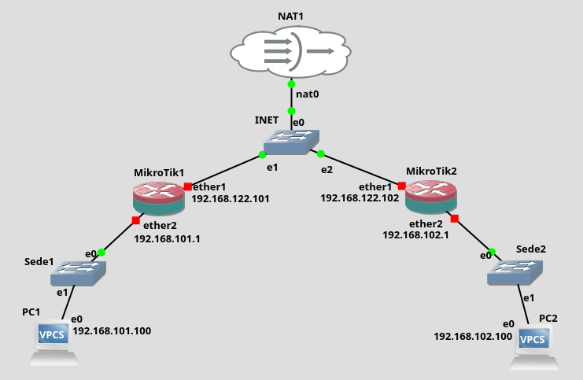

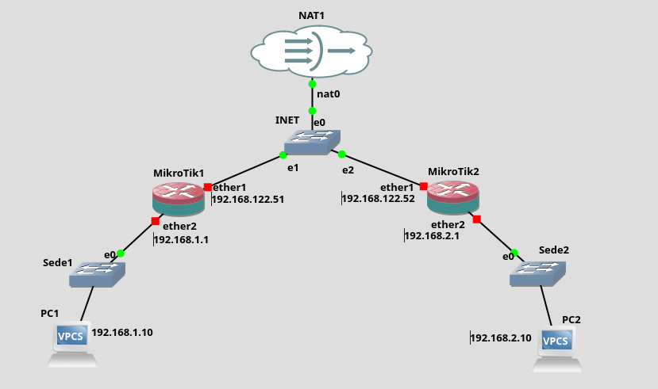

### Tabla de Direccionamiento IP del Laboratorio

| Nodo / Dispositivo | Interfaz | Dirección IP | Máscara | Puerta de Enlace (GW) | Rol en la Topología |
| :--- | :--- | :--- | :--- | :--- | :--- |
| **MikroTik 1 (Sede 1)** | `ether1` (WAN) | DHCP / `192.168.122.10` | `/24` | virbr0 (`192.168.122.1`) | Conexión externa a Internet WAN. |
| **MikroTik 1 (Sede 1)** | `ether2` (LAN) | `192.168.1.1` | `/24` | -- | Puerta de enlace por defecto de la Sede 1. |
| **PC1 (VPCS Sede 1)** | `eth0` | `192.168.1.10` | `/24` | `192.168.1.1` | Estación cliente de la Sede 1. |
| **MikroTik 2 (Sede 2)** | `ether1` (WAN) | DHCP / `192.168.122.20` | `/24` | virbr0 (`192.168.122.1`) | Conexión externa a Internet WAN. |
| **MikroTik 2 (Sede 2)** | `ether2` (LAN) | `192.168.2.1` | `/24` | -- | Puerta de enlace por defecto de la Sede 2. |
| **PC2 (VPCS Sede 2)** | `eth0` | `192.168.2.10` | `/24` | `192.168.2.1` | Estación cliente de la Sede 2. |

!!! note "Credenciales por defecto del Laboratorio"
    * **Usuario de RouterOS:** `admin`
    * **Contraseña de RouterOS:** `admin` (en ambos routers).
    * **Secreto compartido del túnel (*Pre-Shared Key / Secret*):** `admin`

---

## 4. Desarrollo Paso a Paso de la Práctica

---

### Fase 1: Despliegue del Escenario y Verificación de Conectividad Base

1. **Apertura del Proyecto:**
    * Inicia GNS3 y abre el proyecto preconfigurado [VPNconIPsec_escenario.gns3project](recursos/VPNconIPsec_escenario.gns3project).
    * Inicia todos los dispositivos del laboratorio.

2. **Verificación de la Conexión WAN:**
    * Accede a la consola de `MikroTik 1` y comprueba su IP en la interfaz `ether1`:
        ```routeros
        /ip address print
        ```
    * Haz ping desde `MikroTik 1` a la IP de `ether1` de `MikroTik 2` y a la puerta de enlace de Internet (`192.168.122.1`). Debe responder con éxito.

    !!! warning "Aviso importante sobre la ruta por defecto en RouterOS"
        Si en algún momento eliminas la IP pública asignada por DHCP a `ether1` o desactivas el cliente DHCP (`/ip dhcp-client`), RouterOS **eliminará automáticamente la ruta por defecto hacia Internet**. En tal caso, el router quedará incomunicado en la WAN. Si te ocurre, añade manualmente la ruta por defecto en consola:
        ```routeros
        /ip route add dst-address=0.0.0.0/0 gateway=192.168.122.1 comment="Ruta por defecto WAN"
        ```

3. **Verificación del Aislamiento Inicial:**
    * Abre la consola de **PC1** e intenta hacer ping a **PC2**:
        ```text
        PC1> ping 192.168.2.10
        ```
    * Comprobarás que el ping **falla por completo** (tiempo de espera agotado). Aunque ambos routers tienen salida a Internet, la red pública no enruta direcciones privadas `192.168.X.X` y aún no hemos construido el túnel IPsec.

---

### Fase 2: Configuración del Túnel IPsec en MikroTik 1 (Sede 1)

!!! tip "Vídeo de Apoyo: Configuración de VPN con IPsec en MikroTik"
    Puedes seguir la explicación en vídeo del profesor Román Carceller en el siguiente enlace:
    
    * [Vídeo: MikroTik - VPN con IPsec (Román Carceller)](https://youtu.be/71E1JbzN63I){:target="_blank"}

!!! important "Diferencias de interfaz en versiones modernas de RouterOS (WebFig)"
    En versiones antiguas de RouterOS los parámetros de Peer e Identity estaban unificados. A partir del **minuto 3:14 del vídeo**, debes seguir los pasos en el orden exacto que se detalla a continuación para configurar correctamente las pestañas **Peers**, **Identities** y **Policies**.

Accede a WebFig de `MikroTik 1` introduciendo en tu navegador la dirección IP de su interfaz WAN (o gestionándolo desde un cliente web en la LAN).

#### Paso 1: Creación del Peer (Fase 1 - IKE SA)

1. En el menú lateral de WebFig, navega a **IP → IPsec**.
2. Selecciona la pestaña **Peers** y pulsa **Add New**:

    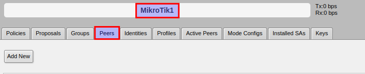

3. Configura los siguientes parámetros:
    * **Name:** `peer_sede2`
    * **Address:** Introduce la **dirección IP pública / WAN de MikroTik 2** (por ejemplo, `192.168.122.20` o la IP que tenga asignada en `ether1`).
    * **Profile:** `default`
    * **Exchange Mode:** `ike2` o `main (ikev1)`
    * Deja el resto de opciones por defecto y pulsa **OK**.

    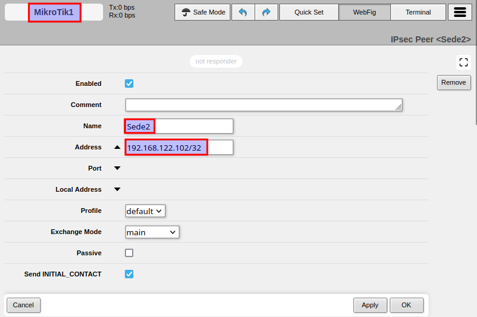

#### Paso 2: Creación de la Identity (Autenticación mutua con PSK)

1. Dentro de **IP → IPsec**, haz clic en la pestaña **Identities** y pulsa **Add New**:

    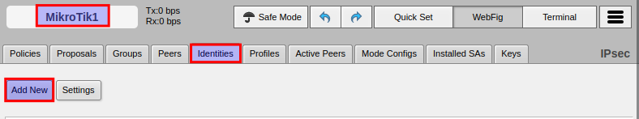

2. Completa los campos:
    * **Peer:** Selecciona el peer recién creado: `peer_sede2`.
    * **Auth. Method:** `pre shared key`.
    * **Secret:** Introduce la clave compartida acordada: `admin`.
    * Pulsa **OK**.

    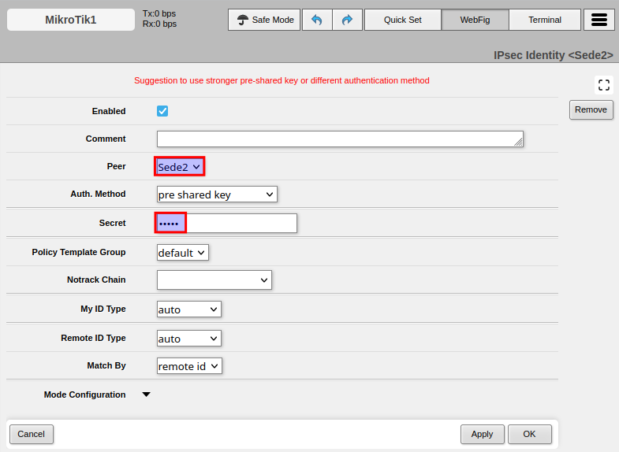

#### Paso 3: Creación de la Policy (Fase 2 - Selectores de Tráfico y Modo Túnel)

1. Ve a la pestaña **Policies** dentro de **IP → IPsec** y pulsa **Add New**:

    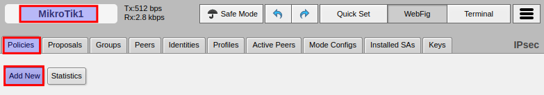

2. Configura los parámetros que definirán qué tráfico debe entrar al túnel:
    * **Peer:** Selecciona `peer_sede2`.
    * **Tunnel:** Marca la casilla **Tunnel** (activa el **Modo Túnel** de IPsec).
    * **Src. Address:** Introduce la subred local de la Sede 1: `192.168.1.0/24`.
    * **Dst. Address:** Introduce la subred remota de la Sede 2: `192.168.2.0/24`.
    * **Action:** `encrypt`.
    * **Proposal:** `default`.
    * Pulsa **OK**.

    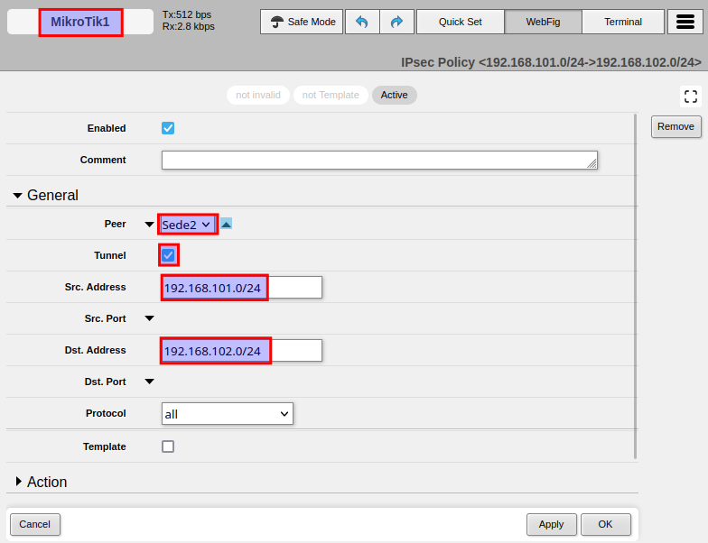

#### Paso 4: Directiva de Exclusión de NAT (*NAT Bypass*)

!!! caution "¡El error más común en despliegues IPsec!"
    Por defecto, MikroTik aplica una regla de enmascaramiento (*masquerade*) en `IP → Firewall → NAT` para todo el tráfico saliente por `ether1`. Si un paquete con origen `192.168.1.10` sale hacia `192.168.2.10`, el cortafuegos cambiará su IP de origen por la IP pública de `ether1` **antes** de que la política IPsec pueda capturarlo, provocando que el túnel falle.

Debemos indicarle al cortafuegos que **no aplique NAT** al tráfico que viaje entre ambas sedes privadas:

1. Ve a **IP → Firewall → NAT** y pulsa **Add New**:

    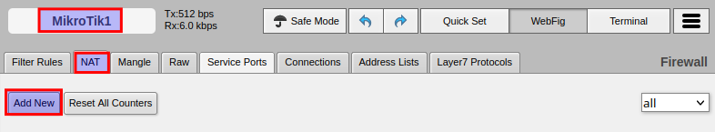

2. Define los selectores del tráfico inter-sedes:
    * **Chain:** `srcnat`
    * **Src. Address:** `192.168.1.0/24` (Subred local Sede 1)
    * **Dst. Address:** `192.168.2.0/24` (Subred remota Sede 2)
    * **Action:** `accept` *(indica que el paquete se acepta tal cual, sin alterar su cabecera ni enmascararlo)*.
    * **Comment:** *Bypass NAT para tunel IPsec hacia Sede 2*.
    * Pulsa **OK**.

    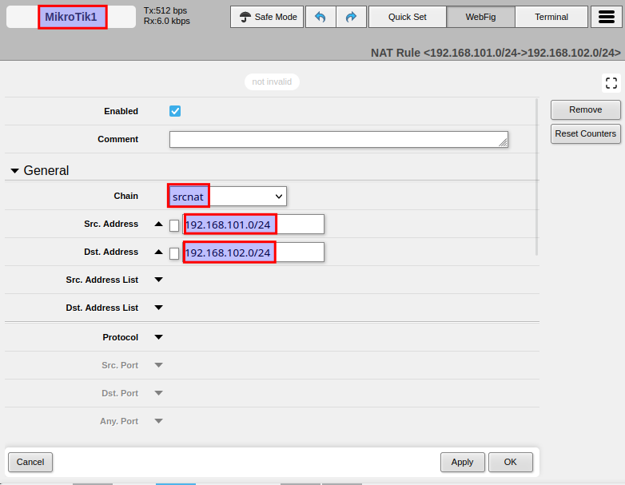

3. **¡Orden de evaluación indispensable!:**
    * Arrastra la nueva regla con el ratón y sitúala **en la primera posición de la lista (posición 0)**, por encima de la regla general de `masquerade`:

    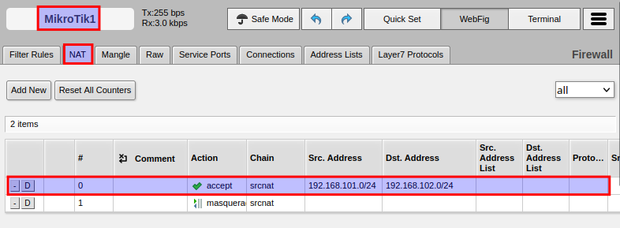

---

### Fase 3: Configuración Simétrica en MikroTik 2 (Sede 2)

Para que el túnel sea operativo, debemos replicar de forma simétrica e invertida la misma configuración en el router de la Sede 2 (`MikroTik 2`):

1. **Peer en MikroTik 2:**
    * **IP → IPsec → Peers → Add New**
    * **Name:** `peer_sede1`
    * **Address:** Introduce la **IP WAN de MikroTik 1** (ej. `192.168.122.10`).
    * **Profile:** `default`
2. **Identity en MikroTik 2:**
    * **IP → IPsec → Identities → Add New**
    * **Peer:** `peer_sede1`
    * **Auth. Method:** `pre shared key`
    * **Secret:** `admin` *(debe ser estrictamente idéntico al configurado en MikroTik 1)*.
3. **Policy en MikroTik 2:**
    * **IP → IPsec → Policies → Add New**
    * **Peer:** `peer_sede1`
    * **Tunnel:** Marcado (`yes`).
    * **Src. Address:** `192.168.2.0/24` (Subred local Sede 2).
    * **Dst. Address:** `192.168.1.0/24` (Subred remota Sede 1).
    * **Action:** `encrypt`
4. **Bypass de NAT en MikroTik 2:**
    * **IP → Firewall → NAT → Add New**
    * **Chain:** `srcnat` | **Src. Address:** `192.168.2.0/24` | **Dst. Address:** `192.168.1.0/24` | **Action:** `accept`
    * **Comentario:** *Bypass NAT para tunel IPsec hacia Sede 1*.
    * **Ubica la regla en la primera posición (posición 0)**, por encima del masquerade.

---

### Fase 4: Auditoría, Verificación y Captura con Wireshark

1. **Comprobación de Conectividad Extremo a Extremo:**
    * Abre la consola de **PC1** y lanza un ping hacia **PC2**:
        ```text
        PC1> ping 192.168.2.10
        ```
    * El primer paquete puede sufrir un ligero retardo mientras se completa la negociación IKE. A continuación, los paquetes deben responder con **100% de éxito**.
    * Realiza la prueba inversa desde **PC2** hacia **PC1** (`ping 192.168.1.10`).

2. **Auditoría de Asociaciones de Seguridad (SAs) en RouterOS:**
    * En WebFig de cualquiera de los routers, accede a **IP → IPsec**:
        * Pestaña **Active Peers:** Comprueba que el estado del peer remoto se encuentra en `established`.
        * Pestaña **Installed SAs:** Observa que aparecen dos SAs activas (una de entrada y otra de salida) con su respectivo **SPI**, el algoritmo criptográfico utilizado (`aes-cbc` o `aes-gcm`) y los contadores de paquetes y bytes incrementándose en tiempo real conforme se envían datos.

3. **Demostración de Seguridad con Wireshark:**
    * En GNS3, haz clic derecho sobre el enlace Ethernet que conecta `MikroTik 1` con el switch WAN de Internet y selecciona **Start Capture**.
    * Se abrirá **Wireshark** monitorizando el tráfico que viaja por la red pública.
    * Vuelve a la consola de **PC1** y ejecuta un ping continuo hacia **PC2**:
        ```text
        PC1> ping 192.168.2.10 -c 10
        ```
    * **¡Comprobación crítica en Wireshark!:**
        * Filtra en Wireshark por `icmp`. Observarás que **no se captura absolutamente ningún paquete ICMP**.
        * Filtra por `esp` o borra el filtro: observarás una ráfaga de paquetes cuyo protocolo es **ESP (Protocol 50)** entre las IPs públicas `192.168.122.10` y `192.168.122.20`.
        * Selecciona cualquiera de estos paquetes y expande su árbol en la ventana central: los datos viajan totalmente cifrados (*Encapsulating Security Payload*), demostrando que un espía en Internet es incapaz de interceptar el contenido o identificar los equipos internos que se comunican.

4. **Generación de Respaldos de Configuración:**
    * En `MikroTik 1`: Ve a **Files → Backup**, nombra el archivo como `MikroTik1.backup` y pulsa **Backup**. Descarga el archivo a tu máquina anfitriona.
    * En `MikroTik 2`: Repite la operación y descarga `MikroTik2.backup`.

---

## 5. Cuestiones y Análisis Técnico

Responde de forma justificada en tu memoria técnica a las siguientes cuestiones:

1. **La Interferencia del NAT con las Políticas IPsec:**
    * Explica detalladamente por qué es indispensable situar la regla `chain=srcnat src=192.168.1.0/24 dst=192.168.2.0/24 action=accept` antes de la regla general de `masquerade`. ¿Qué le sucedería al paquete en la interfaz WAN si dicha regla no existiera o estuviera colocada por debajo?
2. **Modo Túnel vs Modo Transporte:**
    * Al configurar la política marcamos la casilla `Tunnel=yes`. ¿Qué diferencia estructural existe entre las cabeceras de red generadas en este modo y las que se habrían generado si hubiéramos operado en Modo Transporte? ¿Habría sido viable el Modo Transporte en este escenario?
3. **Visibilidad en Tránsito y Análisis de Tráfico:**
    * A partir de la captura obtenida con Wireshark en la WAN, detalla qué información puede deducir un atacante que intercepte la comunicación en Internet y qué información le queda completamente vedada gracias a la encapsulación ESP.
4. **Mecanismos de Autenticación y Escalabilidad:**
    * En esta práctica hemos utilizado una contraseña precompartida (*Pre-Shared Key* `admin`). Si tuvieras que diseñar la red de una multinacional con 100 delegaciones remotas, ¿qué problemas de gestión y seguridad plantearía mantener claves PSK y qué alternativa basada en PKI implementarías?

---

## 6. Entregables

Presenta un único documento en formato **PDF** junto con los archivos de configuración:

1. **Archivos de Configuración de RouterOS:**
    * `MikroTik1.backup` (Copia de seguridad del router de la Sede 1).
    * `MikroTik2.backup` (Copia de seguridad del router de la Sede 2).
2. **Memoria Técnica en PDF conteniendo:**
    * **Datos del alumno:** Nombre y apellidos, módulo SAD y fecha.
    * **Topología GNS3:** Captura de pantalla de la red en ejecución con las etiquetas de direccionamiento visibles.
    * **Evidencias de Configuración:**
        * Captura de pantalla en WebFig de **IP → IPsec → Peers**, **Identities** y **Policies** de ambos routers.
        * Captura de pantalla de la tabla **IP → Firewall → NAT** mostrando la regla de bypass en primera posición.
        * Captura de la pestaña **Installed SAs** evidenciando las asociaciones de seguridad establecidas y el tráfico cursado.
    * **Evidencia de Conectividad y Cifrado:**
        * Captura de la terminal de `PC1` realizando ping exitoso a `PC2` (`192.168.2.10`).
        * Captura de pantalla de **Wireshark** en la WAN demostrando la presencia de tráfico **ESP (protocolo 50)** y la ausencia de texto claro o tramas ICMP.
    * **Cuestiones Técnicas:** Respuestas completas y argumentadas a las cuatro cuestiones del apartado 5.

