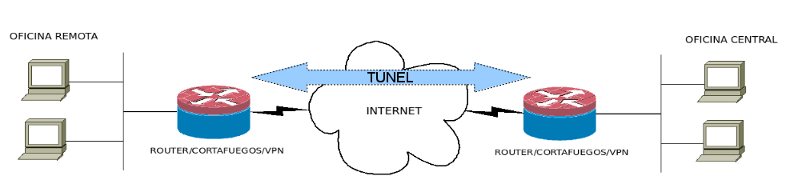
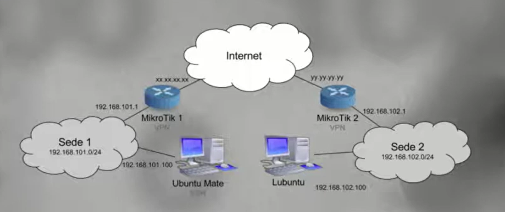
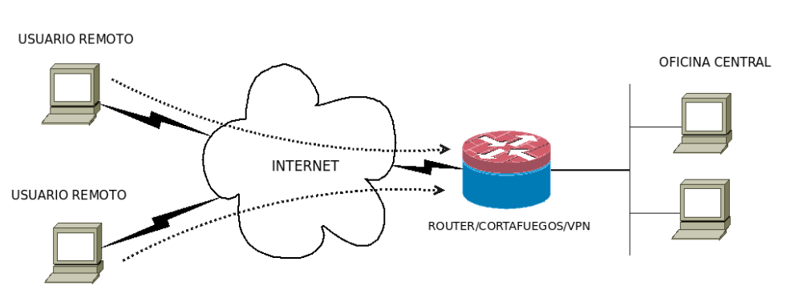
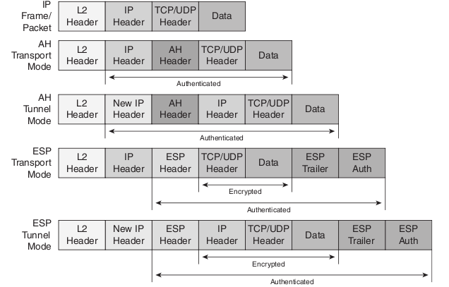
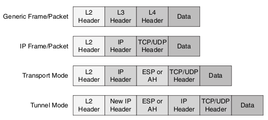
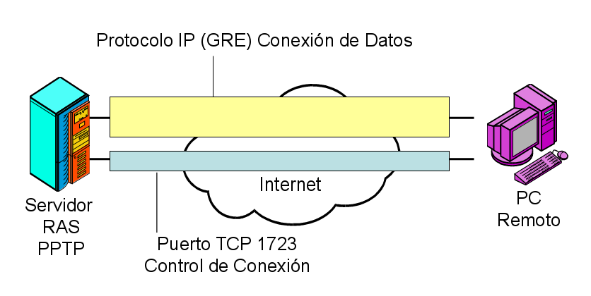
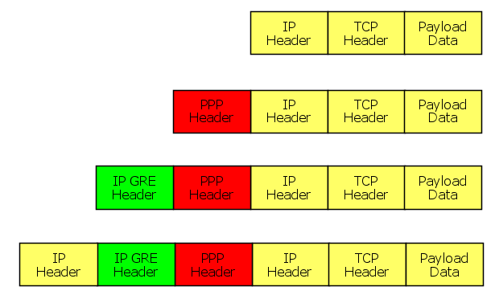
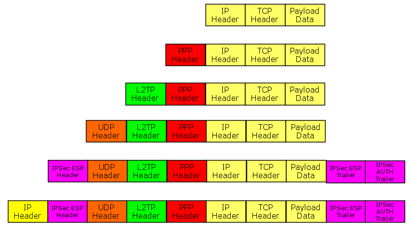

# UD8. Seguridad perimetral: Acceso remoto y Redes Privadas Virtuales (VPN)

!!! note "Datos de la Unidad Didáctica"
    * **Módulo:** Seguridad y Alta Disponibilidad (SAD - 0378)
    * **Ciclo Formativo:** Administración de Sistemas Informáticos en Red (ASIR) - 2º Curso
    * **Duración estimada:** 8 horas
    * **Resultados de aprendizaje:** Diseñar, configurar y evaluar redes privadas virtuales (VPN) seguras para interconectar sedes remotas y puestos de teletrabajo a través de redes públicas, aplicando protocolos criptográficos estándar en capas de red y transporte.

---

## 1. Introducción y Fundamentos de las Redes Privadas Virtuales

En los primeros años de las telecomunicaciones corporativas, cuando una organización necesitaba comunicar su sede central con una sucursal remota, la única alternativa para garantizar la privacidad consistía en contratar **líneas punto a punto dedicadas** a las compañías operadoras (como líneas punto a punto X.25, Frame Relay o circuitos ATM). Aunque este enfoque proporcionaba un aislamiento físico total frente a terceros, conllevaba costes económicos extremadamente elevados, una nula flexibilidad geográfica y plazos de despliegue de semanas o meses.

Con la expansión universal de Internet surgió el concepto de **Red Privada Virtual (*Virtual Private Network - VPN*)**: una tecnología de red que permite crear una extensión virtual de una red local privada sobre una infraestructura pública y no confiable (habitualmente Internet), garantizando los mismos niveles de seguridad, autenticidad y privacidad que si los equipos estuvieran directamente interconectados por un cable físico privado.

```text
                      [ INFRAESTRUCTURA PÚBLICA (INTERNET) ]
                               (Medio No Seguro)
                                      │
  ┌─────────────────┐                 ▼                 ┌─────────────────┐
  │ SEDE CENTRAL    │ ═════════════════════════════════ │ SUCURSAL REMOTA │
  │ Red 192.168.1.0 │    [ TÚNEL CIFRADO Y AUTÉNTICO ]   │ Red 192.168.2.0 │
  └─────────────────┘                                   └─────────────────┘
```

!!! tip "Recursos de Introducción a las VPN"
    Para asentar los conceptos esenciales y comprender cómo las VPN salvaguardan la privacidad frente a interceptaciones en redes públicas, consulta los siguientes materiales de apoyo:
    
    * [Vídeo: Qué es una VPN y cómo funciona a favor de la privacidad de tu información](https://www.youtube.com/watch?v=IzxC6UPilqQ){:target="_blank"}
    * [Artículo: ¿Qué es una conexión VPN, para qué sirve y qué ventajas tiene? (Xataka)](https://www.xataka.com/seguridad/que-es-una-conexion-vpn-para-que-sirve-y-que-ventajas-tiene){:target="_blank"}

---

### Los Pilares de Seguridad de una VPN

Para que un canal virtual sobre una red pública pueda considerarse seguro, la tecnología de VPN debe garantizar de forma simultánea cuatro propiedades criptográficas esenciales:

1. **Confidencialidad (*Privacy / Encryption*):**
    * La información transmitida viaja totalmente cifrada mediante algoritmos criptográficos robustos (como AES-128, AES-256 o ChaCha20).
    * Si un atacante intercepta el tráfico en un router intermedio de Internet mediante técnicas de *sniffing* (escucha pasiva), únicamente observará una secuencia de datos aleatorios indescifrables.
2. **Integridad de los Datos (*Data Integrity*):**
    * Garantiza que ningún paquete haya sido modificado, alterado o corrompido durante su trayecto por la red.
    * Se implementa mediante códigos de autenticación de mensajes basados en funciones hash (*HMAC - Hash-based Message Authentication Code*), como SHA-256 o SHA-512. Si un solo bit es alterado, el receptor descarta el paquete de inmediato.
3. **Autenticación de Extremos (*Authentication*):**
    * Cada extremo del túnel debe certificar su identidad de forma fehaciente antes de intercambiar tráfico corporativo.
    * Puede basarse en **claves precompartidas (*Pre-Shared Keys - PSK*)** acordadas previamente o, en entornos corporativos de mayor envergadura, en **certificados digitales X.509** emitidos por una Autoridad de Certificación (CA) de confianza mediante Infraestructura de Clave Pública (PKI).
4. **Protección contra Reenvío / Antirrepetición (*Anti-Replay Protection*):**
    * Impide que un atacante capture paquetes legítimos cifrados (por ejemplo, una orden de transferencia bancaria o una autenticación exitosa) y los reenvíe posteriormente a la red para reproducir la acción.
    * El protocolo asigna a cada paquete un número de secuencia estrictamente creciente y una ventana deslizante temporal de verificación.

---

### El Concepto de Tunelización (*Tunneling*)

El mecanismo estructural básico de cualquier VPN es la **tunelización (*tunneling*)**. Consiste en encapsular un paquete de red original (completo, con sus datos y su cabecera con direcciones IP privadas) dentro de un **nuevo paquete de transporte** provisto de una cabecera IP pública enrutable por Internet:

```text
Paquete Original (Red Privada):
┌───────────────────────────┬────────────────────────────────────────┐
│ IP Origen: 192.168.1.10   │ DATOS (Payload original, TCP/UDP...)   │
│ IP Destino: 192.168.2.20  │                                        │
└───────────────────────────┴────────────────────────────────────────┘
                              │
                    Cifrado y Encapsulación
                              │
                              ▼
Paquete Tunelizado que viaja por Internet:
┌───────────────────────────┬───────────────────────────────┬────────┐
│ Nueva Cabecera IP Pública │ Cabecera de Seguridad (ESP)   │ Carga  │
│ IP Org: 80.25.14.2 (WAN1) │ Cifrada:                      │ Cifrada│
│ IP Dst: 212.80.3.5 (WAN2) │ [Paquete original encapsulado]│ + HMAC │
└───────────────────────────┴───────────────────────────────┴────────┘
```

Al llegar al destino (el router o pasarela VPN del otro extremo), el paquete es desencapsulado, descifrado y verificado, entregándose en la subred privada de destino con total transparencia para las aplicaciones de usuario.

---

## 2. Tipos y Arquitecturas de VPN

En función del escenario operativo y de los dispositivos involucrados, las redes privadas virtuales se clasifican en dos grandes arquitecturas principales, además de diversas modalidades complementarias:

### A. VPN Sitio a Sitio (*Site-to-Site / LAN-to-LAN / Router-to-Router*)

Se utiliza para interconectar de forma permanente redes locales enteras ubicadas en diferentes sedes geográficas (por ejemplo, la sede central en Valencia con una delegación en Castellón o Madrid):





* **Dispositivos de terminación:** Los puntos extremos del túnel son los routers perimetrales o cortafuegos de cada sede (*VPN Gateways*).
* **Transparencia para los usuarios:** Los ordenadores, impresoras y servidores de cada oficina no necesitan ningún software cliente adicional instalado ni configuración especial. Para ellos, la red de la otra sede es accesible exactamente igual que si estuvieran en el mismo edificio.
* **Protocolo dominante:** En este modelo el estándar indiscutible de la industria es **IPsec en Modo Túnel**.

---

### B. VPN de Acceso Remoto (*Remote Access / Client-to-Site / Road Warrior*)

Está diseñada para permitir que usuarios individuales (teletrabajadores, comerciales en movilidad o personal de soporte técnico) se conecten de forma segura a los recursos y servidores de la red corporativa desde cualquier conexión a Internet no confiable (su domicilio, un hotel o una red Wi-Fi pública):



* **Dispositivos de terminación:** En un extremo se sitúa el **concentrador o pasarela VPN corporativa** (*VPN Gateway*) y en el otro extremo el **dispositivo del usuario** (ordenador portátil, smartphone o tablet).
* **Requisito de software:** Requiere que el usuario cuente con una aplicación cliente VPN instalada o utilice el cliente VPN nativo integrado en su sistema operativo (Windows, Linux, macOS, Android, iOS).
* **Asignación de direccionamiento:** Al autenticarse con éxito, el servidor VPN asigna dinámicamente al cliente remoto una dirección IP perteneciente a un rango interno reservado (*VPN Pool*), permitiéndole acceder a impresoras, servidores de archivos e intranets corporativas.
* **Tecnologías comunes:** OpenVPN, WireGuard, L2TP/IPsec, SSTP y soluciones SSL VPN web.

---

### C. Estrategias de Enrutamiento: Split Tunneling vs Full Tunnel

Al desplegar una VPN de acceso remoto, los administradores de sistemas deben decidir cómo se gobernará el tráfico del usuario hacia Internet mediante una de las siguientes dos políticas:

```text
┌───────────────────────────────────────┐   ┌───────────────────────────────────────┐
│     TÚNEL COMPLETO (Full Tunnel)      │   │     TÚNEL DIVIDIDO (Split Tunnel)     │
├───────────────────────────────────────┤   ├───────────────────────────────────────┤
│ • TODO el tráfico del cliente sale a  │   │ • SÓLO el tráfico a IPs corporativas  │
│   través del túnel hacia la empresa.  │   │   va por el túnel cifrado.            │
│ • La navegación a Internet se filtra  │   │ • La navegación a Internet sale por la│
│   en el cortafuegos corporativo.      │   │   conexión local directa del usuario. │
│ • Máxima seguridad; mayor consumo de  │   │ • Menor consumo de ancho de banda;    │
│   ancho de banda en la sede central.  │   │   riesgo de fuga si el cliente cae.   │
└───────────────────────────────────────┘   └───────────────────────────────────────┘
```

* **Full Tunnel (Túnel Completo):** Toda la comunicación del equipo remoto (incluyendo YouTube, búsquedas en Google y correo personal) viaja cifrada hasta el cortafuegos de la empresa y sale a Internet desde allí. Garantiza la máxima seguridad y cumplimiento normativo, pero satura la conexión de la empresa si los usuarios consumen mucho tráfico multimedia.
* **Split Tunneling (Túnel Dividido):** Únicamente los paquetes dirigidos a la subred corporativa (ej. `192.168.1.0/24`) entran por el túnel; el resto del tráfico a Internet sale directamente por el router doméstico del usuario. Es más eficiente, pero introduce riesgos si el equipo del usuario es infectado por malware mientras navega en Internet de forma paralela.

---

### D. Casos de Uso Especiales: VPN over LAN y Navegación Privada

* **VPN over LAN:** Consiste en establecer un túnel cifrado dentro de la propia red de área local. Es una técnica habitual para aislar el plano de gestión de infraestructura de red de la red de usuarios ordinaria o para dotar de una capa de cifrado suplementaria a conexiones sobre redes Wi-Fi abiertas.
* **VPN para Navegación Anónima y Evasión Geográfica:** Servicios comerciales de VPN (como NordVPN, ProtonVPN, etc.) orientados a usuarios particulares que encaminan todo el tráfico web a través de un servidor intermedio para ocultar la dirección IP real frente a los sitios web visitados o eludir censuras y restricciones geográficas de contenido.

---

## 3. El Estándar IPsec (Internet Protocol Security)

**IPsec** es el conjunto de protocolos de seguridad más robusto y maduro de la industria para proteger comunicaciones en la **Capa 3 (Capa de Red)** del modelo OSI. Definido por el IETF en múltiples RFCs (destacando el RFC 4301), IPsec opera de forma transparente para los protocolos de capas superiores (TCP, UDP, ICMP) y para las aplicaciones de usuario.

```text
             ARQUITECTURA DE PROTOCOLOS IPsec
  ┌─────────────────────────────────────────────────────┐
  │         IKE (Internet Key Exchange - UDP 500)       │ ◄── Gestión y Negociación de Claves
  ├──────────────────────────┬──────────────────────────┤
  │    AH (Protocolo 51)     │    ESP (Protocolo 50)    │ ◄── Protocolos de Transporte Seguro
  │  Autenticación/Integridad│   Cifrado + Autenticación│
  ├──────────────────────────┴──────────────────────────┤
  │             Capa IP (Protocolo IPv4 / IPv6)         │
  └─────────────────────────────────────────────────────┘
```

### A. Protocolos Base: AH vs ESP

IPsec implementa dos mecanismos principales para encapsular el tráfico de datos:



#### 1. Authentication Header (AH - Protocolo IP 51)
* **Servicios que presta:** Proporciona integridad estricta, autenticación del emisor y protección antirrepetición.
* **Limitación crítica:** **¡NO PROPORCIONA CONFIDENCIALIDAD!** Los datos viajan en texto claro legible por cualquier sniffer.
* **Incompatibilidad con NAT:** Como AH calcula su hash de integridad incluyendo los campos de la cabecera IP externa (como las IPs de origen y destino), si el paquete atraviesa un router que realiza NAT/PAT (reescribiendo la IP), el hash calculado en el receptor no coincidirá y el paquete será descartado. Por esta razón, AH se encuentra en desuso práctico en Internet.

#### 2. Encapsulating Security Payload (ESP - Protocolo IP 50)
* **Servicios que presta:** Proporciona **confidencialidad total (cifrado)**, además de integridad, autenticación de origen y protección antirrepetición.
* **Funcionamiento:** Cifra el paquete y le añade una cabecera ESP al inicio y una cola ESP (*ESP Trailer / Auth*) al final con el código HMAC de autenticación.
* **Estándar actual:** ESP es el protocolo que se utiliza prácticamente en el 100% de las VPNs IPsec del mundo real.

---

### B. Modos de Operación: Modo Transporte vs Modo Túnel

IPsec puede configurarse en dos modos de funcionamiento diferenciados en función del punto de inicio y fin del cifrado:



| Característica | Modo Transporte (*Transport Mode*) | Modo Túnel (*Tunnel Mode*) |
| :--- | :--- | :--- |
| **¿Qué se cifra?** | Únicamente la carga útil (Capa 4 - TCP/UDP y datos). | El paquete IP original completo (cabecera original + datos). |
| **Cabecera IP** | Conserva la cabecera IP original del emisor y receptor. | Genera una **nueva cabecera IP pública** externa. |
| **Escenario de uso típico** | Comunicaciones **Host a Host** (ej. dos servidores que se comunican entre sí en una misma red). | Comunicaciones **Gateway a Gateway** (VPN Sitio a Sitio entre dos routers). |
| **Ocultación de topología** | Expone las IPs internas de las máquinas participantes. | Oculta por completo el direccionamiento privado de las LANs corporativas. |
| **Incompatibilidad NAT** | Problemas frecuentes si no se combina con L2TP o NAT-T. | Totalmente compatible mediante NAT-T (encapsulación UDP 4500). |

---

### C. Gestión de Claves: El Protocolo IKE (Internet Key Exchange)

Para que dos routers puedan cifrar y descifrar paquetes mediante IPsec, primero deben negociar de forma segura qué algoritmos utilizarán, acordar las claves secretas y autenticarse mutuamente. Este proceso se gestiona automáticamente mediante el protocolo **IKE** (habitualmente en sus versiones IKEv1 o la moderna **IKEv2**), que opera sobre el puerto **UDP 500**.

El establecimiento de una sesión IPsec mediante IKE se divide en dos fases consecutivas:

```text
[ ROUTER 1 ]                                            [ ROUTER 2 ]
     │                                                       │
     │ ────────── FASE 1: IKE SA (Canal de Control) ───────── │
     │  • Negociación de cifrado (AES), hash (SHA) y DH      │
     │  • Autenticación mutua con PSK o Certificado X.509    │
     │  • Se crea el túnel IKE seguro (ISAKMP)               │
     │                                                       │
     │ ────────── FASE 2: IPSEC SA (Túnel de Datos) ───────── │
     │  • Negociación de parámetros para tráfico real (ESP)  │
     │  • Definición de selectores de tráfico (Red1 ↔ Red2)  │
     │  • Se crean las SAs unidireccionales de IPsec         │
     │                                                       │
     │ ══════════ FLUJO DE DATOS CIFRADOS (ESP) ════════════ │
     │ [PAQUETE CIFRADO CON CLAVES DE LA FASE 2]             │
     ▼                                                       ▼
```

#### Fase 1 (IKE SA / ISAKMP)
1. Los routers acuerdan los parámetros para proteger su propia comunicación de gestión:
    * **Algoritmo de cifrado simétrico:** ej. AES-CBC-128 o AES-GCM-256.
    * **Función hash de integridad:** ej. SHA-256 o SHA-512.
    * **Grupo Diffie-Hellman (DH Group):** ej. Group 14 (2048-bit MODP) o Group 19 (256-bit ECP) para derivar un secreto compartido a través de un canal público no seguro sin transmitir la clave por la red.
2. Autenticación de las identidades:
    * **Pre-Shared Key (PSK):** Una contraseña secreta idéntica configurada en ambos routers.
    * **Certificados digitales:** Intercambio de certificados firmados por una CA.
3. Al finalizar, queda establecida la **IKE SA** (Asociación de Seguridad de Fase 1).

#### Fase 2 (IPsec SA / Quick Mode)
1. Utilizando el canal seguro de la Fase 1, los routers negocian los parámetros que protegerán el tráfico de los usuarios finales:
    * **Protocolo de encapsulación:** ESP.
    * **Algoritmos de cifrado y hash para ESP:** ej. AES-256 y SHA-256.
    * **Selectores de tráfico (*Traffic Selectors / Policies*):** Especifican con precisión qué subredes locales y remotas quedan autorizadas para entrar al túnel (por ejemplo: tráfico originado en `192.168.1.0/24` con destino a `192.168.2.0/24`).
2. Se generan dos **IPsec SAs unidireccionales** (una para enviar y otra para recibir) identificadas por un número denominado **SPI (*Security Parameter Index*)**.

#### NAT Traversal (NAT-T)
Dado que muchos routers de acceso a Internet efectúan traducción de direcciones NAT (modificando cabeceras y puertos), el protocolo ESP (que no tiene puertos TCP o UDP al ser un protocolo de capa 3) suele quedar bloqueado en routers residenciales. Para solucionar esto se diseñó **NAT-T (RFC 3948)**:
* Detecta automáticamente si existe un dispositivo NAT entre ambos routers durante la Fase 1.
* Si detecta NAT, encapsula todos los paquetes ESP dentro de datagramas estándar **UDP por el puerto 4500**, permitiendo que el túnel IPsec atraviese cualquier router NAT sin interrupciones.

---

## 4. Tecnologías y Protocolos de VPN Alternativos

Aunque IPsec es el rey indiscutible de las conexiones sitio a sitio, existen múltiples protocolos concebidos para cubrir otros casos de uso, especialmente en acceso remoto:

### A. Protocolos Heredados: PPTP

Desarrollado a finales de los años 90 por un consorcio liderado por Microsoft, **PPTP (*Point-to-Point Tunneling Protocol*)** fue durante años el protocolo VPN más popular debido a su sencillez y a estar integrado de forma nativa en todas las versiones de Windows:





* **Estructura técnica:** Emplea una conexión de control TCP por el puerto **1723** y el protocolo de encapsulación **GRE (Generic Routing Encapsulation - protocolo IP 47)** para el túnel de datos PPP.
* **Cifrado y Autenticación:** Utiliza MPPE (*Microsoft Point-to-Point Encryption*) con claves de 40 o 128 bits y autenticación mediante MS-CHAPv2.
* **Dictamen de seguridad:** **¡TOTALMENTE INSEGURO Y OBSOLETO!** En el año 2012 se demostró que el mecanismo de autenticación MS-CHAPv2 puede romperse en menos de 24 horas mediante ataques de diccionario y colisiones forzadas. Está formalmente desaconsejado por todos los estándares de ciberseguridad.

---

### B. L2TP e IPsec (L2TP/IPsec)

Para superar las deficiencias de PPTP, Cisco y Microsoft combinaron el protocolo L2F y PPTP para crear **L2TP (*Layer 2 Tunneling Protocol*, RFC 2661)**. 



* **Problema de L2TP en solitario:** L2TP encapsula tramas PPP dentro de paquetes UDP por el puerto **1701**, pero **no proporciona cifrado ni confidencialidad por sí mismo**.
* **Solución combinada L2TP/IPsec:** L2TP se encapsula dentro de un túnel seguro IPsec en Modo Transporte:
    1. **IPsec** negocia las claves y cifra la carga útil con ESP.
    2. **L2TP** gestiona la asignación de IPs, la autenticación de usuarios con login y contraseña (*PPP Secrets*) y la interfaz de red virtual.
* **Ventajas:** Excelente compatibilidad nativa en clientes Windows, Android, iOS y macOS sin necesidad de instalar software de terceros.

---

### C. VPNs Basadas en SSL/TLS: OpenVPN

**OpenVPN** es una solución de código abierto multiplataforma de referencia mundial en VPNs de acceso remoto y sitio a sitio:

* **Principio de funcionamiento:** En lugar de operar a nivel de kernel como IPsec, OpenVPN opera en espacio de usuario empleando la biblioteca **OpenSSL** para cifrado, autenticación e intercambio de claves.
* **Flexibilidad de transporte:** Puede configurarse para escuchar en cualquier puerto y protocolo (UDP para máximo rendimiento de tráfico en tiempo real; o **TCP en el puerto 443** para mimetizarse por completo con el tráfico web HTTPS, evadiendo cortafuegos perimetrales muy restrictivos que bloquean los puertos de IPsec).
* **Controladores virtuales:**
    * **TUN (modo enrutado / Capa 3):** Encapsula paquetes IP. Es más rápido, eficiente y el más utilizado para acceso remoto y teletrabajo.
    * **TAP (modo puente / Capa 2):** Encapsula tramas Ethernet completas. Permite transmitir tráfico no-IP, difusión (*broadcast* como NetBIOS) o crear puentes de red transparentes.
* **Autenticación:** Soporta certificados digitales mediante PKI (ficheros `.crt` y `.key` gestionados habitualmente con herramientas como Easy-RSA), doble factor de autenticación (2FA/MFA) y credenciales de usuario.

---

### D. La Nueva Generación: WireGuard

Lanzado en 2020 e integrado directamente en el núcleo (*kernel*) de Linux a partir de la versión 5.6, **WireGuard** representa el mayor salto evolutivo en protocolos VPN de las últimas dos décadas:

* **Sencillez radical de código:** Mientras que implementaciones de IPsec (como StrongSwan) o OpenVPN superan las 100.000 y 400.000 líneas de código respectivamente, WireGuard cuenta con apenas **4.000 líneas**. Esto reduce drásticamente la superficie de ataque y permite una auditoría de seguridad formal exhaustiva.
* **Criptografía moderna y fija (*Opinionated Cryptography*):** No permite negociar algoritmos obsoletos (evita ataques de *downgrade*). Utiliza exclusivamente algoritmos de vanguardia: **ChaCha20** para cifrado simétrico, **Poly1305** para autenticación, **Curve25519** para intercambio de claves Diffie-Hellman y **BLAKE2s** para hashing.
* **Enrutamiento por clave criptográfica (*Cryptokey Routing*):** Asocia cada clave pública a una lista de direcciones IP autorizadas. Cada paquete se cifra y firma vinculándolo a la clave del interlocutor de forma similar a como opera SSH.
* **Rendimiento:** Ofrece velocidades de transferencia netamente superiores a OpenVPN e IPsec y una latencia mínima, lo que lo hace idóneo para entornos de alto rendimiento y dispositivos móviles (conexión y reconexión prácticamente instantánea al cambiar de Wi-Fi a datos móviles).

---

### E. Nuevos Paradigmas: Redes Mesh y Zero Trust Network Access (ZTNA)

En las arquitecturas de red modernas basadas en la nube y el teletrabajo global, el modelo clásico de VPN corporativa (*conectar un dispositivo a la red y otorgarle acceso implícito a toda la subred*) está siendo sustituido o complementado por nuevos enfoques:

```text
┌───────────────────────────────────────┐   ┌───────────────────────────────────────┐
│       VPN CORPORATIVA CLÁSICA         │   │   ZERO TRUST NETWORK ACCESS (ZTNA)    │
├───────────────────────────────────────┤   ├───────────────────────────────────────┤
│ • Conexión Perimetral: "Castillo y    │   │ • Filosofía: "Nunca confíes, verifica │
│   Foso" (Castle-and-Moat).            │   │   siempre" (Never trust, always verify│
│ • Acceso implícito a toda la LAN.     │   │ • Acceso mínimo a aplicaciones exactas│
│ • Si el portátil se infecta, infecta  │   │ • Validación continua de identidad,   │
│   toda la subred de la empresa.       │   │   salud del equipo y contexto.        │
└───────────────────────────────────────┘   └───────────────────────────────────────┘
```

* **VPNs Mesh P2P (Tailscale, ZeroTier):** Construyen redes virtuales malladas superpuestas (*Overlay Networks*) basadas en WireGuard, donde cada dispositivo se conecta directamente con los demás mediante túneles punto a punto autenticados centralmente, sin necesidad de concentrar todo el tráfico en un router central ni abrir puertos en cortafuegos (técnicas de *NAT Traversal / STUN / DERP*).
* **ZTNA (Acceso a la Red de Confianza Cero):** Elimina el acceso a nivel de red (IP/subred). El usuario no entra en la red local de la empresa, sino que un agente o proxy autentica cada petición de forma individual, permitiendo únicamente el acceso a una aplicación específica autorizada (por ejemplo, al ERP o al repositorio Git) y bloqueando todo lo demás.

---

## 5. Consideraciones de Rendimiento y Seguridad en el Despliegue

Al diseñar e implementar una solución de VPN en un entorno corporativo, los administradores deben tener en cuenta factores críticos que impactan en la estabilidad de la red:

### 1. MTU, MSS y Fragmentación de Paquetes
* En redes Ethernet la Unidad Máxima de Transferencia (**MTU**) estándar es de **1500 bytes**.
* Cuando un paquete IP de 1500 bytes se encapsula en una VPN, la adición de cabeceras de seguridad (cabecera IP externa de 20 bytes, cabecera ESP de 8 bytes, vector de inicialización de 16 bytes, relleno y código HMAC de 16-32 bytes) eleva el tamaño total del paquete por encima de 1500 bytes.
* Si el paquete excede la MTU del proveedor de Internet, el router intermedio deberá fragmentarlo (lo que degrada el rendimiento de la CPU) o lo descartará si tiene activo el bit *Don't Fragment (DF)*.
* **Solución técnica:** Ajustar el **MSS (*Maximum Segment Size*)** en las reglas de cortafuegos del router (*TCP MSS Clamping*) a valores típicos como **1360 - 1400 bytes** para forzar a los clientes a generar paquetes más pequeños que no requieran fragmentación tras añadir las cabeceras VPN.

### 2. Sobrecarga de CPU y Aceleración por Hardware (AES-NI)
* El cifrado y descifrado constante de cientos de megabits por segundo puede saturar el procesador de un router o cortafuegos.
* Es fundamental comprobar que el procesador del cortafuegos disponga de soporte para **aceleración criptográfica por hardware (instrucciones AES-NI)**. En RouterOS o Linux, activar la aceleración por hardware permite procesar tráfico IPsec a velocidad de cable (*wirespeed*) sin penalizar el rendimiento del sistema.

### 3. Exclusión de NAT para el Tráfico VPN (*NAT Bypass*)
* En routers que realizan enmascaramiento hacia Internet (*Masquerade / Source NAT*), el router intenta traducir todas las IPs privadas salientes por la IP pública de la WAN.
* Si no se define una regla explícita de **exclusión o bypass de NAT** para el tráfico inter-sedes (tráfico entre `192.168.1.0/24` y `192.168.2.0/24`), el router enmascarará el paquete antes de que la política IPsec lo capture, provocando que el túnel falle. En RouterOS esto se solventa añadiendo una regla `accept` en la cadena `srcnat` con alta prioridad.

---

## 6. Cuestionario de Autoevaluación

Comprueba tu asimilación de los contenidos de la unidad respondiendo a las siguientes cuestiones:

??? question "1. ¿Cuál es la principal diferencia entre una VPN Sitio a Sitio y una VPN de Acceso Remoto?"
    **Respuesta:** En una VPN Sitio a Sitio se interconectan redes completas a través de sus routers perimetrales de forma permanente y transparente para los usuarios (sin software cliente). En una VPN de Acceso Remoto (*Road Warrior*), un usuario individual se conecta a la red corporativa desde su propio equipo mediante un software cliente VPN.

??? question "2. En el marco IPsec, ¿qué diferencia fundamental existe entre el protocolo AH y el protocolo ESP?"
    **Respuesta:** AH (Authentication Header - protocolo 51) sólo proporciona integridad y autenticación, pero **no cifra los datos** (no proporciona confidencialidad) y es incompatible con NAT. ESP (Encapsulating Security Payload - protocolo 50) proporciona cifrado (confidencialidad), integridad, autenticación y es el estándar utilizado en producción.

??? question "3. ¿Por qué el Modo Transporte de IPsec no es adecuado para una VPN entre dos sedes remotas conectadas por Internet?"
    **Respuesta:** Porque el Modo Transporte sólo cifra la carga útil pero mantiene visible la cabecera IP original. En una conexión entre sedes a través de Internet se requiere el **Modo Túnel**, el cual encapsula el paquete privado original y le añade una nueva cabecera con direcciones IP públicas enrutables por Internet.

??? question "4. ¿Qué función cumple el protocolo IKE en una conexión IPsec?"
    **Respuesta:** IKE (UDP 500) es el protocolo de control encargado de autenticar a los extremos (mediante claves precompartidas o certificados), acordar los algoritmos criptográficos mediante Diffie-Hellman y negociar periódicamente las claves de cifrado (Asociaciones de Seguridad - SAs).

??? question "5. ¿Para qué se utiliza el mecanismo NAT-Traversal (NAT-T) en IPsec y qué puerto utiliza?"
    **Respuesta:** Detecta la presencia de dispositivos NAT en el trayecto y encapsula los paquetes ESP en datagramas **UDP en el puerto 4500**, permitiendo que el tráfico IPsec atraviese routers con NAT sin ser descartado.

??? question "6. ¿Por qué el protocolo PPTP está formalmente desaconsejado en la actualidad?"
    **Respuesta:** Porque su mecanismo de autenticación (MS-CHAPv2) y cifrado (MPPE) adolecen de graves vulnerabilidades criptográficas conocidas que permiten que un atacante pasivo obtenga la clave y descifre todo el tráfico en cuestión de horas.

??? question "7. ¿Qué ventaja operativa clave aporta OpenVPN al configurarse sobre el puerto TCP 443?"
    **Respuesta:** Permite que el tráfico VPN se camufle como tráfico web seguro HTTPS, permitiendo atravesar cortafuegos y proxies perimetrales de hoteles o empresas que bloquean todos los puertos excepto la navegación web estándar.

??? question "8. ¿Qué características diferencian a WireGuard frente a implementaciones clásicas como OpenVPN o IPsec?"
    **Respuesta:** WireGuard tiene un código extremadamente compacto (~4.000 líneas), funciona integrado en el kernel de Linux con un rendimiento y velocidad de conexión sobresalientes, y utiliza exclusivamente algoritmos criptográficos modernos de última generación (ChaCha20, Curve25519) sin posibilidad de negociación insegura.

??? question "9. En una VPN de acceso remoto, ¿qué diferencia existe entre la directiva Full Tunnel y Split Tunneling?"
    **Respuesta:** En *Full Tunnel*, todo el tráfico del cliente (corporativo e Internet) viaja por el túnel cifrado hacia el cortafuegos de la empresa. En *Split Tunneling*, sólo viaja por la VPN el tráfico destinado a la red corporativa, mientras que la navegación general a Internet sale directamente por la conexión local del usuario.

??? question "10. ¿Por qué es necesario configurar una regla de bypass de NAT en un router perimetral que establece una VPN IPsec?"
    **Respuesta:** Porque si el router aplica la regla general de enmascaramiento (*masquerade*) al tráfico dirigido a la otra sede, cambiará la IP privada de origen por la pública del router, impidiendo que la política IPsec reconozca y capture el tráfico inter-redes.

---

## 7. Práctica de la Unidad

Aplica los conocimientos teóricos adquiridos en el laboratorio práctico oficial de la unidad:

* **[Práctica 8.1: VPN Sitio a Sitio con IPsec en MikroTik RouterOS](P8_1_vpn_ipsec_site_to_site.md)**: Despliegue completo en GNS3 de un túnel IPsec entre dos sedes remotas, configuración de Peers, Identities, Policies, regla de bypass de NAT y validación de tráfico cifrado.

