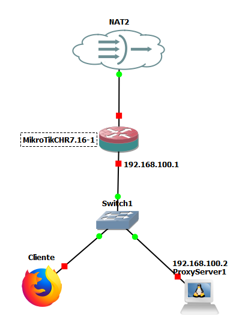
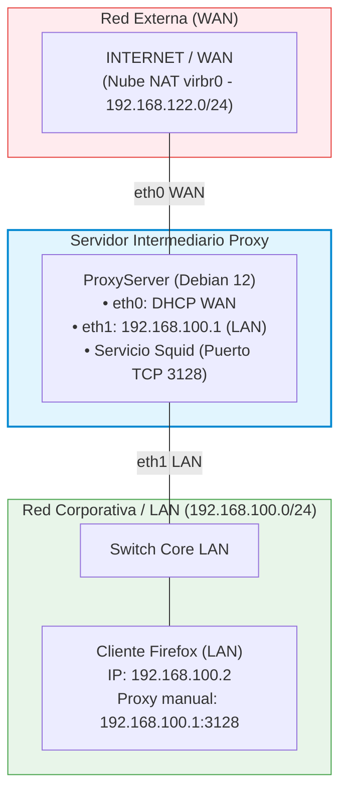

# Práctica 9.1: Servidor Proxy-Caché, Control de Acceso y Filtrado Web con Squid en Linux

!!! note "Datos de la Práctica"
    * **Módulo:** Seguridad y Alta Disponibilidad (SAD - 0378)
    * **Unidad Didáctica:** UD9 - Protección perimetral mediante Servidores Proxy
    * **Entorno de trabajo:** Emulador de red **GNS3** con las siguientes máquinas y appliances:
        1. **Servidor Proxy Linux Debian (`ProxyServer`):** Máquina con dos interfaces de red (`eth0` conectada a la nube NAT de Internet y `eth1` conectada a la red interna corporativa).
        2. **Cliente gráfico (`Cliente-LAN`):** Appliance Firefox (o Webterm / Debian con entorno gráfico) conectado a la red interna para auditar la navegación a través del proxy.
        3. **Switch Ethernet básico** y **Nube NAT (Internet)** de GNS3.

---

## 1. Objetivos

* Desplegar y poner en funcionamiento un servidor proxy directo **Squid** sobre **Debian GNU/Linux** en un entorno de red emulado en GNS3.
* Configurar la arquitectura de **proxy-caché** en disco y memoria RAM, inicializando la estructura jerárquica de almacenamiento con `squid -z`.
* Implementar el subsistema de **autenticación básica HTTP (`basic_ncsa_auth`)** utilizando contraseñas cifradas en `/etc/squid/passwd` con la herramienta `htpasswd`.
* Dominar la sintaxis y el orden de evaluación secuencial de las **Listas de Control de Acceso (ACLs)** y directivas `http_access`.
* Resolver el **reto de filtrado corporativo de la unidad**:
    1. Permitir acceso autenticado exclusivamente a determinados subdominios de Google (`drive.google.com` y `calendar.google.com`).
    2. Bloquear cualquier otro subdominio de Google (`maps.google.com`, `mail.google.com`, etc.).
    3. Permitir el resto de Internet de forma autenticada y denegar todo tráfico no autenticado.
* Auditar el funcionamiento del proxy en tiempo real a través del archivo de registro `/var/log/squid/access.log`, analizando los estados de caché (`TCP_HIT`, `TCP_MISS`) y códigos de denegación (`TCP_DENIED`).
* Gestionar la transferencia de los archivos de configuración (`squid.conf` y `passwd`) mediante `scp` para su evaluación docente.

---

## 2. Escenario y Topología en GNS3

El laboratorio modela la salida a Internet de una red corporativa a través de un servidor proxy intermediario según el siguiente esquema:





### Tabla de Direccionamiento IP del Laboratorio

| Nodo / Dispositivo | Interfaz | Dirección IP | Máscara | Puerta de Enlace (GW) | Rol en la Práctica |
| :--- | :--- | :--- | :--- | :--- | :--- |
| **ProxyServer (Debian)** | `eth0` (WAN) | Dinámica DHCP | `/24` | virbr0 (`192.168.122.1`) | Conexión externa a Internet para descargar recursos. |
| **ProxyServer (Debian)** | `eth1` (LAN) | `192.168.100.1` | `/24` | -- | IP de escucha del servicio proxy (puerto TCP 3128). |
| **Cliente-LAN (Firefox)** | `eth0` | `192.168.100.2` | `/24` | `192.168.100.1` | Equipo cliente que navega configurando el proxy. |

---

## 3. Desarrollo Paso a Paso de la Práctica

---

### Fase 1: Despliegue de la Red y Conectividad Base

1. **Montaje en GNS3:**
    * Inicia GNS3 y crea el proyecto `SAD_P9_1_Proxy_Squid`.
    * Añade un nodo **Debian** (`ProxyServer`), un switch Ethernet, un nodo **Firefox** (o Webterm) y una **Nube NAT**.
    * Conecta la interfaz `eth0` del Debian a la Nube NAT y su interfaz `eth1` al switch interno.
    * Conecta el nodo Firefox al switch interno.

2. **Configuración de Interfaces en ProxyServer (Debian):**
    * Inicia la máquina Debian y abre su consola.
    * Configura `/etc/network/interfaces`:
        ```text
        auto lo
        iface lo inet loopback

        # Interfaz WAN hacia Internet
        auto eth0
        iface eth0 inet dhcp

        # Interfaz LAN interna hacia los clientes
        auto eth1
        iface eth1 inet static
            address 192.168.100.1
            netmask 255.255.255.0
        ```
    * Reinicia el subsistema de red:
        ```bash
        sudo systemctl restart networking
        ```
    * Comprueba que tienes conectividad externa haciendo ping a Internet (`ping 8.8.8.8` o `ping debian.org`).

3. **Configuración de Red en el Cliente Firefox:**
    * En el nodo Firefox, asigna la IP estática `192.168.100.2/24` con gateway `192.168.100.1`.
    * Comprueba que alcanzas al servidor proxy ejecutando:
        ```bash
        ping 192.168.100.1
        ```

---

### Fase 2: Instalación y Configuración del Proxy Caché (Squid)

!!! tip "Vídeo de Apoyo: Proxy Caché con Squid"
    Puedes seguir la explicación en vídeo en el siguiente recurso del curso:
    
    * [Vídeo: Ubuntu Server - Proxy caché con Squid (Román Carceller)](https://youtu.be/L1J0Oy6y2m8){:target="_blank"}

1. **Instalación de Paquetes en ProxyServer:**
    * En Debian el paquete actual se denomina `squid` (en distribuciones antiguas se llamaba `squid3`, pero su configuración es prácticamente idéntica):
        ```bash
        sudo apt update
        sudo apt install -y squid apache2-utils
        ```

2. **Resguardo de la Configuración Original:**
    * Antes de realizar modificaciones, crea una copia de seguridad del archivo maestro:
        ```bash
        sudo cp /etc/squid/squid.conf /etc/squid/squid.conf.original
        ```

3. **Configuración de los Parámetros de Caché:**
    * Abre el archivo `/etc/squid/squid.conf` con tu editor preferido (`nano /etc/squid/squid.conf`).
    * Localiza o añade las siguientes directivas fundamentales de almacenamiento y puerto:

    ```squid
    # Puerto de escucha del proxy (por defecto TCP 3128)
    http_port 3128

    # Memoria RAM dedicada a objetos en caché reciente
    cache_mem 64 MB

    # Tamaño máximo de un objeto individual almacenable en caché
    maximum_object_size 4096 KB

    # Estructura del directorio de caché en disco:
    # Formato: cache_dir <tipo> <ruta> <tamaño_MB> <L1_directorios> <L2_directorios>
    cache_dir ufs /var/spool/squid 100 16 256
    ```

4. **Inicialización de los Directorios de la Caché:**

    !!! important "Aviso Docente Crítico (Minutos 10:45 y 12:35 del vídeo)"
        Antes de arrancar Squid con la directiva `cache_dir` activada, es **obligatorio detener el servicio e inicializar la estructura jerárquica de subdirectorios** en el disco duro. Ejecuta la siguiente secuencia exacta:
        ```bash
        # 1. Detener el servicio:
        sudo systemctl stop squid.service

        # 2. Crear los subdirectorios de la caché:
        sudo squid -z

        # 3. Arrancar nuevamente el servicio:
        sudo systemctl start squid.service
        ```
    * Comprueba que el servicio está activo y sin errores:
        ```bash
        sudo systemctl status squid.service
        ```

5. **Configuración del Navegador en el Cliente Firefox:**
    * En la máquina Firefox, abre el navegador y ve a:
        * **Ajustes (Settings) → General → Ajustes de red (Network Settings) → Configuración (Settings...)**
    * Selecciona **Configuración manual del proxy (*Manual proxy configuration*)**:
        * **Proxy HTTP:** `192.168.100.1` | **Puerto:** `3128`
        * Marca la casilla: **Usar este proxy también para HTTPS (*Also use this proxy for HTTPS*)**.
    * Guarda los cambios pulsando **Aceptar**.

6. **Auditoría de la Caché:**
    * En el servidor Debian, abre una segunda terminal para monitorizar las peticiones en vivo:
        ```bash
        sudo tail -f /var/log/squid/access.log
        ```
    * En el navegador Firefox, visita una página web HTTP estática.
    * La primera vez que cargues la página, observarás en el log el código `TCP_MISS` (el proxy descarga el objeto de Internet).
    * Si recargas la página (F5), observarás el código `TCP_HIT` o `TCP_REFRESH_UNMODIFIED` (el proxy entrega el objeto directamente desde su caché local sin consumir ancho de banda de la WAN).

---

### Fase 3: Implementación de Autenticación Básica

!!! tip "Vídeo de Apoyo: Proxy con Autenticación Básica"
    Puedes revisar el procedimiento de autenticación en el siguiente vídeo:
    
    * [Vídeo: Ubuntu Server - Proxy con autenticación básica (Román Carceller)](https://youtu.be/tkuhGqDqrAg){:target="_blank"}

Para evitar el uso no autorizado del proxy, configuraremos el módulo de autenticación básica mediante contraseñas:

1. **Configuración del Módulo Auxiliar NCSA en `squid.conf`:**
    * Edita `/etc/squid/squid.conf` y añade las siguientes directivas de autenticación en la sección de parámetros de autenticación (habitualmente al principio de las directivas de control):

    ```squid
    # Módulo de autenticación básica NCSA:
    auth_param basic program /usr/lib/squid/basic_ncsa_auth /etc/squid/passwd
    auth_param basic children 5
    auth_param basic realm Servidor Proxy Corporativo IES El Caminas - Introduce tus credenciales
    auth_param basic credentialsttl 2 hours
    auth_param basic casesensitive on

    # Definición de la ACL de usuarios que han completado la autenticación:
    acl usuarios_autenticados proxy_auth REQUIRED
    ```

2. **Generación del Fichero de Contraseñas `/etc/squid/passwd`:**
    * Utiliza la herramienta `htpasswd` para crear el fichero y los dos usuarios requeridos para la práctica:
    * **Usuario del Profesor:**
        ```bash
        # El parámetro -c crea el fichero desde cero:
        sudo htpasswd -c /etc/squid/passwd profe
        # Introduce como contraseña: ieselcaminas
        ```
    * **Usuario del Alumno (introduce tu nombre):**
        ```bash
        # Sin el parámetro -c para no sobreescribir el fichero anterior:
        sudo htpasswd /etc/squid/passwd tunombre
        # Introduce tu contraseña deseada (ej. tuapellido)
        ```

3. **Asignación de Permisos de Seguridad:**
    * Por seguridad, restringe los permisos para que sólo el usuario del sistema `proxy` pueda leer el archivo:
        ```bash
        sudo chown proxy:proxy /etc/squid/passwd
        sudo chmod 640 /etc/squid/passwd
        ```

---

### Fase 4: Reto Evaluativo Oficial de Filtrado de Contenidos

Configuraremos las listas de control de acceso (ACLs) para cumplir con total exactitud las directivas solicitadas en la actividad oficial de evaluación de la unidad:

#### Requerimientos del Reto
1. El proxy debe operar como **proxy-caché**.
2. Debe requerir **autenticación básica obligatoria** con los usuarios `profe` y tu usuario de alumno.
3. **Filtrado selectivo de Google:**
    * Debe permitir el acceso autenticado a `drive.google.com` y a `calendar.google.com`.
    * Debe **bloquear cualquier otro subdominio de `google.com`** (por ejemplo: `maps.google.com`, `mail.google.com`, `www.google.com`, etc.).
4. **Acceso al resto de Internet:**
    * Debe permitir el acceso a cualquier otra URL siempre que el usuario esté debidamente autenticado.
    * Debe impedir el acceso a cualquier URL si el usuario no se ha autenticado.
5. **Restricción de diseño:** Toda la configuración debe realizarse exclusivamente dentro de `/etc/squid/squid.conf` y `/etc/squid/passwd` (sin emplear ficheros externos auxiliares).

#### Configuración de ACLs y Reglas de Acceso en `squid.conf`

Edita `/etc/squid/squid.conf`. Justo después de las directivas de autenticación y de las ACLs estándar del sistema (`Safe_ports`, `SSL_ports`), añade el siguiente bloque:

```squid
# ==============================================================================
# DEFINICIÓN DE LISTAS DE CONTROL DE ACCESO (ACLs)
# ==============================================================================

# 1. Subdominios de Google expresamente permitidos:
acl google_permitidos dstdomain drive.google.com calendar.google.com

# 2. Bloque general para el dominio google.com y todos sus subdominios:
# (El punto inicial indica .google.com y cualquier subdominio como maps.google.com)
acl google_general dstdomain .google.com

# ==============================================================================
# REGLAS DE ACCESO HTTP (http_access) - ¡EL ORDEN ES CRÍTICO!
# ==============================================================================

# Regla A: Permitir acceso a Drive y Calendar SÓLO a usuarios autenticados
http_access allow google_permitidos usuarios_autenticados

# Regla B: Denegar cualquier otro intento de acceso a dominios/subdominios de Google
http_access deny google_general

# Regla C: Permitir el resto de Internet a cualquier usuario que esté autenticado
http_access allow usuarios_autenticados

# Regla D: Denegar el acceso a cualquier otra petición no contemplada (Política por defecto)
http_access deny all
```

!!! important "Análisis del Orden Secuencial de las Reglas"
    ¿Por qué este orden exacto resuelve el reto?
    
    1. Si un usuario autenticado solicita `drive.google.com`, coincide con la **Regla A** (`google_permitidos` AND `usuarios_autenticados`) → **Se le permite el paso de inmediato**.
    2. Si solicita `maps.google.com`, no coincide con la Regla A, pero coincide con la **Regla B** (`google_general`) → **Se le deniega el acceso (403 Forbidden)**.
    3. Si solicita `debian.org` o `wikipedia.org`, no coincide con la Regla A ni con la B. Pasa a la **Regla C** → Si está autenticado, **se le permite navegar**.
    4. Si un usuario no se ha autenticado o cancela el cuadro de diálogo de contraseña, no cumple `usuarios_autenticados` y cae en la **Regla D** → **Denegado**.

4. **Recarga de la Configuración:**
    * Aplica los cambios sin interrumpir el servicio:
        ```bash
        sudo systemctl reload squid.service
        ```
    * Si el comando no muestra errores, la sintaxis es correcta. Si hay fallos, revisa `/var/log/squid/cache.log`.

---

## 4. Protocolo de Pruebas y Auditoría

Desde el navegador Firefox del nodo cliente (`Cliente-LAN`), ejecuta la siguiente batería sistemática de pruebas y anota los resultados observados:

| Prueba nº | URL Solicitada | Usuario y Contraseña | Comportamiento Esperado | ¿Superada? | Código observado en `access.log` |
| :---: | :--- | :--- | :--- | :---: | :--- |
| **T1** | `http://drive.google.com` | `profe` / `ieselcaminas` | Solicita credenciales y **permite el acceso** | | `TCP_MISS` o `TCP_TUNNEL/200` |
| **T2** | `http://calendar.google.com` | `tunombre` / `tuapellido` | Solicita credenciales y **permite el acceso** | | `TCP_MISS` o `TCP_TUNNEL/200` |
| **T3** | `http://maps.google.com` | Cualquier usuario | **Acceso Denegado** (Squid Error: 403 Forbidden) | | `TCP_DENIED/403` |
| **T4** | `http://www.google.com` | Cualquier usuario | **Acceso Denegado** (Squid Error: 403 Forbidden) | | `TCP_DENIED/403` |
| **T5** | `http://debian.org` (o `example.com`) | `profe` o tu usuario | Solicita credenciales y **permite el acceso** | | `TCP_MISS/200` o `TCP_HIT/200` |
| **T6** | Cualquier URL | Pulsar **Cancelar** en el login | **Acceso Denegado** (407 Proxy Auth Required) | | `TCP_DENIED/407` |

---

## 5. Instrucciones para la Transferencia de Archivos (`scp`)

Para facilitar la entrega y corrección de la práctica, los archivos de configuración deben transferirse desde la máquina virtual Debian hacia tu máquina host:

### De la máquina virtual Debian a tu máquina Host:
Abre una terminal en el servidor Debian y ejecuta:

```bash
# Copiar squid.conf al directorio de tu usuario en el host:
sudo scp /etc/squid/squid.conf usuario@192.168.122.1:/home/usuario/squid.conf

# Copiar el archivo de contraseñas passwd al host:
sudo scp /etc/squid/passwd usuario@192.168.122.1:/home/usuario/passwd
```
*(Sustituye `usuario` por tu nombre de usuario real en la máquina anfitriona y `192.168.122.1` por la IP de la interfaz puente/NAT de tu host).*

### Procedimiento inverso (cargar la configuración en el servidor):
```bash
sudo scp usuario@192.168.122.1:/home/usuario/squid.conf /etc/squid/squid.conf
sudo scp usuario@192.168.122.1:/home/usuario/passwd /etc/squid/passwd
sudo chown proxy:proxy /etc/squid/passwd
sudo chmod 640 /etc/squid/passwd
sudo systemctl reload squid.service
```

---

## 6. Cuestiones Técnicas y Análisis

Responde de forma justificada en tu memoria técnica a las siguientes preguntas:

1. **Alteración del Orden en Reglas de Filtrado:**
    * ¿Qué sucedería exactamente si en `squid.conf` intercambiamos de lugar la Regla A y la Regla B, situando `http_access deny google_general` antes de `http_access allow google_permitidos usuarios_autenticados`? Justifica si los usuarios podrían acceder a Google Drive o Calendar.
2. **Permisos del Fichero de Contraseñas:**
    * ¿Por qué el fichero `/etc/squid/passwd` debe tener como propietario a `proxy:proxy` y permisos `640`? ¿Qué riesgo de seguridad se derivaría de asignarle permisos universales `777` o `666` en un servidor multiusuario?
3. **Auditoría e Interpretación de Registros:**
    * A partir de tu archivo `/var/log/squid/access.log`, copia una línea correspondiente a un acceso exitoso y otra correspondiente a un acceso bloqueado. Desglosa e identifica cada uno de los campos que la componen (marca temporal, dirección IP, código de resultado, tamaño, método HTTP, URL y usuario autenticado).
4. **El Reto de HTTPS y el Método CONNECT:**
    * En el navegador Firefox has configurado el proxy tanto para HTTP como para HTTPS. Explica por qué Squid ha sido capaz de bloquear `maps.google.com` y autorizar `drive.google.com` bajo HTTPS a pesar de que el tráfico viaja cifrado. ¿Qué cabecera de la negociación TLS (*SNI*) ha utilizado Squid para tomar esta decisión?

---

## 7. Entregables

Presenta los siguientes elementos para la evaluación de la práctica:

1. **Ficheros de Configuración Originales:**
    * Archivo `/etc/squid/squid.conf` completo y comentado.
    * Archivo `/etc/squid/passwd` con los usuarios `profe` y tu usuario de alumno.
2. **Memoria Técnica en formato PDF conteniendo:**
    * **Cabecera:** Nombre y apellidos del alumno, fecha y datos del módulo SAD.
    * **Topología GNS3:** Captura de pantalla de la red en ejecución con los dos nodos (`ProxyServer` y `Cliente-LAN`) encendidos.
    * **Evidencias de la Batería de Pruebas:**
        * Captura del navegador Firefox accediendo con éxito a `drive.google.com` con el usuario autenticado.
        * Captura del navegador Firefox mostrando la pantalla de error de Squid (403 Forbidden) al intentar acceder a `maps.google.com`.
        * Captura de la terminal de Debian con `tail -n 20 /var/log/squid/access.log` donde se aprecien los estados `TCP_MISS/200` y `TCP_DENIED/403` con el nombre de usuario registrado.
    * **Tabla de Pruebas:** Cumplimentación de la tabla del apartado 4 con los resultados obtenidos en el laboratorio.
    * **Cuestiones Técnicas:** Respuestas completas y argumentadas a las cuatro cuestiones del apartado 6.
