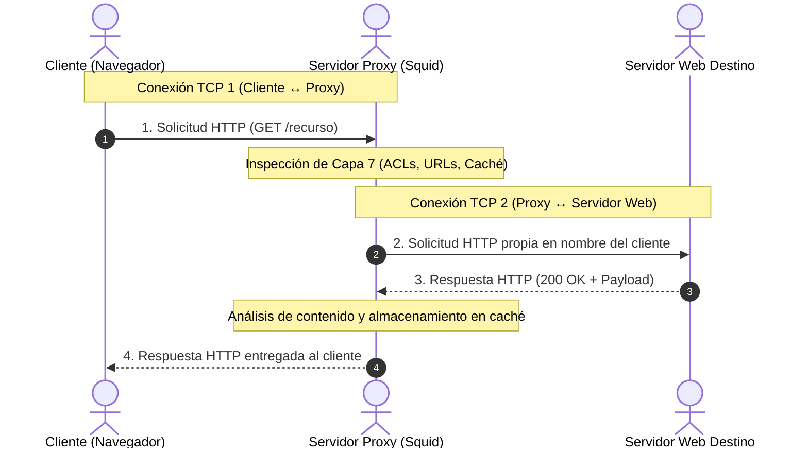
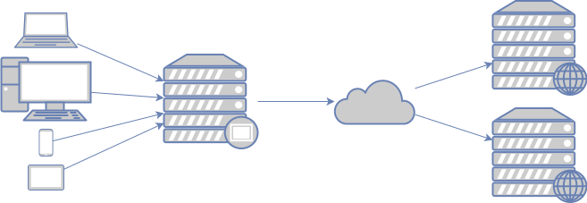
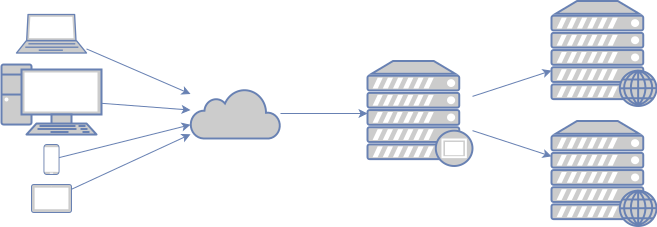
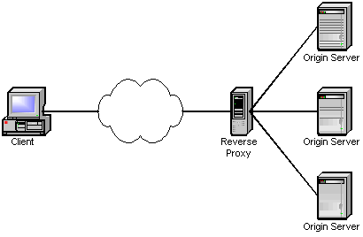
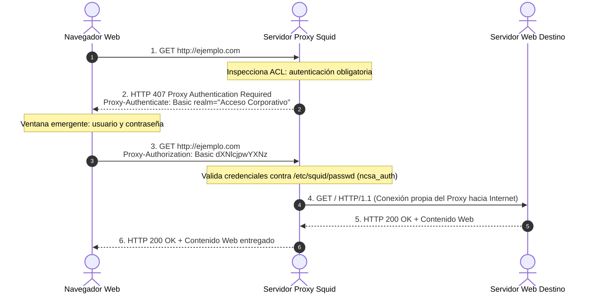

# UD9. Protección perimetral mediante Servidores Proxy

!!! note "Datos de la Unidad Didáctica"
    * **Módulo:** Seguridad y Alta Disponibilidad (SAD - 0378)
    * **Ciclo Formativo:** Administración de Sistemas Informáticos en Red (ASIR) - 2º Curso
    * **Duración estimada:** 8 horas
    * **Resultados de aprendizaje:** Diseñar, configurar y evaluar servicios proxy para la securización del perímetro de red, optimizando el rendimiento mediante mecanismos de caché y aplicando directivas granulares de autenticación, filtrado de contenidos e intermediación tanto en sentido directo como inverso.

---

## 1. Introducción y Concepto de Servidor Proxy

En la arquitectura clásica de redes, un cortafuegos (*firewall*) opera filtrando paquetes en las capas de red y transporte (Capas 3 y 4 del modelo OSI) evaluando direcciones IP, puertos y estados de conexión. Sin embargo, un cortafuegos tradicional es incapaz de comprender la semántica de las aplicaciones web ni de examinar el contenido de las peticiones que viajan en el interior de los paquetes.

Un **Servidor Proxy** (del inglés *proxy*, que significa «representante» o «intermediario») es un dispositivo o servicio de software que se interpone entre un cliente que solicita un recurso y el servidor que lo proporciona, operando en la **Capa de Aplicación (Capa 7 OSI)**:



### El Principio de Ruptura de Conexión

A diferencia de un router o un conmutador, que simplemente reenvían paquetes de un segmento a otro, **el servidor proxy rompe la conexión extremo a extremo**:

1. El cliente no establece una conexión de transporte TCP directa con el servidor de destino final; se conecta única y exclusivamente con el servidor proxy (**Conexión 1**).
2. El proxy recibe la petición de capa 7 (por ejemplo, una petición `GET /index.html HTTP/1.1`), la analiza, verifica que cumple las políticas de seguridad de la organización y, si está autorizada, abre una conexión completamente independiente con el servidor de Internet (**Conexión 2**) en nombre del cliente.
3. El servidor de Internet recibe la petición creyendo que el solicitante es el propio proxy; desconoce la dirección IP real y la existencia del cliente interno.
4. El proxy recibe la respuesta del servidor web, la procesa (evaluando si la almacena en su memoria caché) y se la entrega al cliente a través de la primera conexión.

!!! tip "Recursos de Introducción al Funcionamiento del Proxy"
    Para visualizar de forma dinámica cómo interactúa un proxy en la red y las ventajas que aporta a la seguridad corporativa, consulta estos recursos recomendados:
    
    * [Vídeo: ¿QUÉ ES un PROXY? ¿Cómo Funciona? | Todo lo que Necesitas Saber (8:53)](https://youtu.be/LMC0ZOUm4kc){:target="_blank"}
    * [Artículo: Qué es un servidor proxy (OpenWebinars)](https://openwebinars.net/blog/que-es-un-servidor-proxy/){:target="_blank"}

---

### Beneficios Principales de un Servidor Proxy

* **Anonimato y Ocultación de Topología:** Oculta las direcciones IP privadas y la estructura de la red interna corporativa frente al exterior.
* **Control de Acceso y Filtrado Perimetral:** Permite definir qué usuarios pueden navegar, en qué horarios y hacia qué sitios web o dominios específicos.
* **Ahorro de Ancho de Banda y Aceleración:** Almacena copias de los recursos más solicitados en su memoria caché local (*Web Caching*), respondiendo de forma instantánea a peticiones repetidas sin sobrecargar la línea de acceso a Internet.
* **Registro y Auditoría Exhaustiva (*Logging*):** Registra cada solicitud HTTP con indicación de fecha, hora, dirección IP de origen, usuario autenticado, URL completa solicitada, código de estado HTTP y bytes transferidos, facilitando la detección de anomalías e incidentes de seguridad.

---

## 2. Clasificación Funcional: Proxy Directo vs Proxy Inverso

Dependiendo de a quién proteja y en qué sentido del flujo de tráfico se sitúe el intermediario, los proxies se dividen en dos categorías fundamentales:

```text
┌──────────────────────────────────────────────┐  ┌──────────────────────────────────────────────┐
│        PROXY DIRECTO (Forward Proxy)         │  │         PROXY INVERSO (Reverse Proxy)        │
├──────────────────────────────────────────────┤  ├──────────────────────────────────────────────┤
│ • Se sitúa delante de los CLIENTES.          │  │ • Se sitúa delante de los SERVIDORES.        │
│ • Los clientes son CONOCIDOS (red interna).  │  │ • Los clientes son DESCONOCIDOS (Internet).   │
│ • Los destinos son DESCONOCIDOS (Internet).  │  │ • Los destinos son CONOCIDOS (servidores web)│
│ • Protege, filtra y audita la red local.     │  │ • Protege, balancea y acelera los servidores.│
└──────────────────────────────────────────────┘  └──────────────────────────────────────────────┘
```

---

### A. Proxy Directo (*Forward Proxy*)

El **Proxy Directo** se encuentra situado dentro de la red corporativa, frente a los clientes locales, actuando como puerta de enlace obligatoria para acceder a los recursos de Internet:



* **Objetivo de diseño:** Proteger a los usuarios de la red local y aplicar las directivas de seguridad de la organización.
* **Aislamiento:** Ningún servidor de Internet puede iniciar comunicaciones hacia los clientes de la LAN, ni conoce sus IPs privadas.
* **Aplicaciones habituales:** Entornos educativos y empresariales donde se requiere restringir el acceso a redes sociales, portales de juego o sitios potencialmente maliciosos, además de optimizar la velocidad de navegación mediante almacenamiento en caché.
* **Software de referencia:** **Squid**, Privoxy.

---

### B. Proxy Inverso (*Reverse Proxy*)

El **Proxy Inverso** se ubica en el perímetro de la organización (habitualmente en una DMZ), situado directamente delante de uno o varios servidores web de origen (*backend*):





* **Objetivo de diseño:** Proteger, acelerar y optimizar los servidores web de la organización frente a las peticiones procedentes de Internet.
* **Aislamiento:** Los clientes externos nunca interactúan directamente con los servidores de aplicaciones internos; todas las peticiones públicas llegan a la IP pública del proxy inverso.

#### Beneficios Clave del Proxy Inverso

1. **Protección y Ocultación del Backend:** Los servidores web reales (que pueden albergar bases de datos, código fuente y aplicaciones sensibles) no son expuestos directamente a Internet. Un atacante no puede escanear sus puertos ni conocer su sistema operativo o versión de software.
2. **Terminación SSL/TLS (*TLS Termination Proxy*):** El proxy inverso asume la carga computacional de descifrar y cifrar las sesiones HTTPS de los clientes de Internet, comunicándose con los servidores backend en HTTP plano (o HTTPS ligero en una red segura). Esto libera a los servidores de aplicaciones de una sobrecarga significativa de CPU y centraliza la gestión de los certificados digitales (Let's Encrypt / certificados corporativos) en un único punto.
3. **Cortafuegos de Aplicaciones Web (WAF):** El proxy inverso puede equiparse con módulos WAF (como ModSecurity en Nginx/Apache o Coraza) para inspeccionar la carga útil de las peticiones HTTP/HTTPS, bloqueando ataques comunes como inyección SQL (SQLi), Cross-Site Scripting (XSS), inclusión remota de archivos (RFI) y mitigando ataques de denegación de servicio (DDoS).
4. **Equilibrio de Carga (*Load Balancing*):** Si la infraestructura dispone de múltiples servidores web idénticos, el proxy inverso reparte las peticiones entre ellos según algoritmos como *Round Robin*, *Least Connections* (menor número de conexiones activas) o *IP Hash* (persistencia de sesión), permitiendo el escalado horizontal transparente.
5. **Caché y Compresión Web:** Almacena respuestas estáticas (imágenes, hojas de estilo CSS, scripts JavaScript) en su memoria RAM de alta velocidad y aplica algoritmos de compresión como Gzip o Brotli al vuelo, reduciendo drásticamente los tiempos de carga y el consumo de ancho de banda.
6. **Software de referencia:** **Nginx**, **HAProxy**, Apache HTTP Server (`mod_proxy`), **Varnish** Cache, Traefik y servicios CDN globales (Cloudflare, Akamai).

---

### C. Modos de Implementación de un Proxy Directo: Explícito vs Transparente

Al desplegar un proxy directo en una red local existen dos filosofías de integración con los equipos cliente:

#### 1. Proxy Explícito (*Configured Proxy*)
* **Mecanismo:** El navegador o sistema operativo del cliente está explícitamente configurado para enviar todo el tráfico al proxy indicando su dirección IP y puerto (por defecto TCP 3128 en Squid, o puertos como 8080).
* **Despliegue:** Puede configurarse manualmente, mediante políticas de grupo (GPO de Active Directory), archivos de configuración automática de proxy (**PAC - Proxy Auto-Config**) o el protocolo de autodescubrimiento **WPAD (*Web Proxy Auto-Discovery Protocol*)** a través de DHCP y DNS.
* **Seguridad perimetral:** Para evitar que un usuario avanzado se salte el proxy borrando su configuración en el navegador, el cortafuegos perimetral del router debe bloquear de forma estricta cualquier salida directa de los clientes hacia los puertos TCP 80 y 443 de Internet.

#### 2. Proxy Transparente (*Intercepting Proxy*)
* **Mecanismo:** El cliente **no tiene ningún proxy configurado** en su navegador; cree que está conectando directamente a Internet. Sin embargo, cuando sus paquetes atraviesan el router o pasarela por defecto, una regla de cortafuegos (usualmente mediante `iptables` o directivas DNAT) intercepta silenciosamente el tráfico dirigido a los puertos 80 y lo redirige hacia el puerto local donde escucha el servidor proxy:
    ```bash
    # Redirección en el router perimetral (iptables):
    iptables -t nat -A PREROUTING -i eth1 -p tcp --dport 80 -j REDIRECT --to-port 3128
    ```
* **Ventajas:** Despliegue inmediato en redes masivas (hoteles, campus universitarios, redes corporativas heterogéneas) sin necesidad de tocar la configuración de los dispositivos de los usuarios.
* **Limitaciones técnicas con HTTPS:** Debido a la naturaleza del cifrado SSL/TLS, interceptar de forma transparente el puerto 443 provoca advertencias graves de seguridad en los navegadores (rompe la cadena de confianza del certificado), requiriendo soluciones complejas de inspección de certificados (*SSL Bump*).

---

## 3. Funcionalidades Clave de un Proxy Web

---

### A. Caché Web: Optimización y Frescura

El servicio de **caché web** almacena copias de respuestas HTTP previamente solicitadas para satisfacer solicitudes idénticas posteriores de forma instantánea:

```mermaid
graph TD
    Client([Cliente solicita recurso Web]) --> Proxy{¿Está en la Caché<br>del Servidor Proxy?}
    
    Proxy -- Sí (TCP_HIT) --> Fresh{¿El objeto sigue<br>siendo fresco?}
    Fresh -- Sí --> ServeFast[Entrega inmediata desde disco o RAM<br>• Latencia casi nula<br>• Cero consumo de WAN]
    Fresh -- No (TCP_REFRESH) --> Revalidate[Petición condicional al origen<br>If-Modified-Since]
    
    Revalidate --> Modified{¿El servidor responde<br>304 Not Modified?}
    Modified -- Sí --> UpdateTimer[Actualiza tiempo de frescura y entrega caché]
    Modified -- No --> FetchNew[Descarga nuevo recurso y actualiza caché]

2. Petición posterior del Cliente 2:
[ Cliente 2 ] ── GET /logo.png ──> [ Proxy ] (HIT: ¡está en caché!)
[ Cliente 2 ] <── 200 OK (logo) ── [ Proxy ] (Respuesta inmediata; 0 tráfico a Internet)
```

#### Estados de Registro en la Caché (`access.log`)
Al analizar los registros del servidor proxy (como el archivo `/var/log/squid/access.log`), se identifican los siguientes códigos fundamentales:

* `TCP_HIT`: El recurso solicitado se encontraba almacenado en la caché del proxy y se entregó directamente al cliente sin consultar al servidor de Internet. Ahorro de tiempo y ancho de banda del 100%.
* `TCP_MISS`: El recurso no estaba en la caché (primera vez que se solicita o fue purgado). El proxy tuvo que conectarse al servidor remoto para descargarlo.
* `TCP_REFRESH_UNMODIFIED`: El recurso estaba en la caché pero su tiempo de validez había expirado. El proxy realizó una petición condicional al servidor de origen mediante la cabecera `If-Modified-Since` o `If-None-Match` (ETag); el servidor respondió con un código `304 Not Modified` indicando que el contenido no ha cambiado, por lo que el proxy sirvió la versión que ya tenía almacenada.
* `TCP_DENIED`: La petición fue rechazada por las directivas de control de acceso (ACLs) del proxy (código HTTP `403 Forbidden` o `407 Proxy Authentication Required`).

#### Cabeceras HTTP de Control de Caché
El comportamiento de la caché se rige por las directivas que los servidores y clientes envían en sus cabeceras HTTP:
* `Cache-Control: public`: Indica que cualquier proxy intermedio puede almacenar el recurso.
* `Cache-Control: private`: El recurso contiene información personal de un usuario y sólo puede almacenarlo su propio navegador, **nunca un proxy compartido**.
* `Cache-Control: no-cache` / `no-store`: Prohíbe almacenar el recurso en la caché.
* `Cache-Control: max-age=segundos`: Tiempo máximo de validez del recurso antes de considerarse obsoleto (*stale*).
* `ETag`: Identificador único (hash) de la versión del archivo para validación condicional rápida.

---

### B. Autenticación de Usuarios

Para aplicar políticas diferenciadas y auditar qué personas navegan por la red corporativa, el proxy puede exigir que el usuario se autentique antes de concederle salida hacia Internet:

1. El cliente envía una petición HTTP ordinaria.
2. El proxy intercepta la petición y responde con un código de error **HTTP 407 Proxy Authentication Required** junto con la cabecera `Proxy-Authenticate: Basic realm="..."`.
3. El navegador del usuario muestra una ventana emergente solicitando usuario y contraseña.
4. El navegador reenvía la petición original incluyendo la cabecera `Proxy-Authorization: Basic <credenciales_en_base64>`.
5. El proxy valida las credenciales contra su base de datos local (fichero `/etc/squid/passwd` generado con la utilidad `htpasswd`) o contra un servidor de directorio corporativo centralizado (**LDAP / Active Directory**).



---

### C. Listas de Control de Acceso (ACLs) y Filtrado de Contenidos

El mecanismo central para gobernar el comportamiento de Squid son las **Listas de Control de Acceso (*Access Control Lists - ACLs*)**:

```squid
# 1. Definición de la lista:
acl <nombre_lista> <tipo_acl> <argumentos...>

# 2. Aplicación de la directiva de permiso o denegación:
http_access allow <nombre_lista>
http_access deny <nombre_lista>
```

#### Tipos Principales de ACL en Squid
* `src`: Dirección IP o subred de origen del cliente (ej. `acl red_alumnos src 192.168.100.0/24`).
* `dstdomain`: Nombre de dominio o subdominio de destino. El punto inicial indica coincidencia con el dominio y todos sus subdominios (ej. `acl google_drive dstdomain drive.google.com`).
* `url_regex`: Búsqueda de patrones mediante expresiones regulares en la URL completa (ej. `acl descargas_prohibidas url_regex -i \.(exe|iso|torrent)$`).
* `proxy_auth`: Requiere que el usuario esté autenticado en el sistema (ej. `acl usuarios_validos proxy_auth REQUIRED`).
* `time`: Filtrado basado en días de la semana y franjas horarias (ej. `acl horario_lectivo time M T W H F 08:00-14:00`).
* `port`: Puertos de destino autorizados (ej. `acl Safe_ports port 80 443`).

#### Regla de Oro en la Evaluación de ACLs
Las reglas `http_access` se evalúan de forma estrictamente **secuencial, de arriba hacia abajo**. En el momento en que una petición cumple todas las condiciones de una línea, el proxy toma la decisión de inmediato (`allow` o `deny`) y **detiene la evaluación**. Si ninguna regla coincide, se aplica la directiva por defecto final (habitualmente `http_access deny all`).

---

### D. El Desafío del Tráfico HTTPS en los Proxies Web

Hoy en día, más del 95% del tráfico web mundial viaja cifrado mediante **HTTPS (TLS/SSL)**. Esto supone un cambio de paradigma para los proxies web:

#### 1. Túnel Ciego mediante HTTP CONNECT (Comportamiento Estándar)
Cuando un navegador necesita acceder a un sitio HTTPS (puerto 443) a través de un proxy explícito:
* El navegador envía al proxy la petición: `CONNECT www.banco.com:443 HTTP/1.1`.
* El proxy lee el nombre del dominio solicitado a través de la extensión **SNI (*Server Name Indication*)** de la negociación TLS.
* Si el dominio está autorizado por las ACLs, el proxy responde con `HTTP/1.1 200 Connection established` y a partir de ese momento se limita a reenviar bytes cifrados de forma ciega entre el cliente y el servidor.
* **Limitación:** El proxy **no puede ver la ruta exacta** (`/login`, `/transferencia`), ni el contenido HTML, ni aplicar filtrado por palabras clave ni almacenar el contenido en caché.

#### 2. Inspección Profunda SSL (*SSL Bumping / MitM Corporativo*)
Para que una empresa pueda inspeccionar antivirus, prevenir fugas de datos (DLP) y filtrar contenidos en conexiones HTTPS, el proxy debe realizar una interceptación activa (*Man-in-the-Middle* controlado):
* El proxy intercepta el handshake TLS con el servidor web remoto y crea una sesión TLS independiente hacia Internet.
* A continuación, el proxy genera dinámicamente un **certificado falso al vuelo** para `www.sitio.com` y se lo presenta al navegador del cliente.
* Para que el navegador no muestre una alarma roja de certificado no seguro, los administradores deben instalar previamente el **certificado de la Autoridad de Certificación (CA) del proxy** en el almacén de certificados de confianza de todos los equipos corporativos.
* **Consideraciones éticas y legales:** Aunque es común en el ámbito militar y financiero, la inspección SSL puede vulnerar la privacidad de los trabajadores si se descifra tráfico bancario o de salud. En Squid se configuran excepciones explícitas (*SSL Bump splice*) para omitir la inspección en dominios financieros o gubernamentales.

---

## 4. Ecosistema de Software Proxy en Linux

En entornos corporativos y centros de datos conviven diferentes herramientas especializadas según la función requerida:

| Software | Tipo Principal | Fortalezas Técnicas | Casos de Uso Típicos |
| :--- | :--- | :--- | :--- |
| **Squid** | Proxy Directo y Caché | Madurez insuperable, motor de ACLs extremadamente flexible, autenticación diversa (NCSA, LDAP, Kerberos), soporte de proxy transparente. | Control de navegación en empresas, colegios, universidades y optimización de ancho de banda. |
| **Nginx** | Proxy Inverso | Rendimiento asíncrono no bloqueante (*event-driven*), bajísimo consumo de RAM, terminación TLS veloz, compresión Gzip/Brotli. | Publicación de aplicaciones web, frontend de arquitecturas de microservicios, balanceo HTTP. |
| **HAProxy** | Proxy Inverso y Balanceador | Rendimiento extremo en Capas 4 (TCP) y 7 (HTTP), monitorización avanzada de la salud de los backends (*health checks*), alta disponibilidad. | Balanceo de carga de tráfico crítico en centros de datos y pasarelas de pago. |
| **Varnish** | Acelerador Web Caché | Almacenamiento ultrarrápido en memoria RAM, lenguaje de configuración VCL (*Varnish Configuration Language*). | Aceleración de periódicos digitales, comercios electrónicos masivos y portales de contenidos. |
| **Privoxy** | Proxy Directo Ligero | Filtrado avanzado de cabeceras HTTP, bloqueo de publicidad, rastreadores y protección de la privacidad personal. | Integración con navegadores individuales o enrutamiento a través de la red Tor. |
| **E2Guardian** | Filtro de Contenido | Análisis semántico y heurístico de contenido web, bloqueo por categorías de texto y control parental avanzado. | Filtrado de contenidos en entornos educativos combinado habitualmente como backend de Squid. |

---

## 5. Cuestionario de Autoevaluación

Comprueba tu asimilación de los contenidos teóricos respondiendo a las siguientes cuestiones:

??? question "1. ¿En qué nivel del modelo OSI opera un servidor proxy y en qué se diferencia su funcionamiento del de un router tradicional?"
    **Respuesta:** Opera en la **Capa de Aplicación (Capa 7 OSI)**. A diferencia de un router (que enruta paquetes en Capa 3 manteniendo la conexión de transporte entre emisor y receptor), el proxy **rompe la conexión de extremo a extremo**: mantiene una conexión TCP independiente con el cliente y otra con el servidor final, actuando como intermediario y evaluando la semántica del protocolo de aplicación (HTTP/HTTPS).

??? question "2. Explica la diferencia funcional esencial entre un Proxy Directo (*Forward Proxy*) y un Proxy Inverso (*Reverse Proxy*)."
    **Respuesta:** Un Proxy Directo se sitúa frente a los clientes de una red local interna para protegerlos, filtrar su navegación hacia Internet y ahorrar ancho de banda. Un Proxy Inverso se sitúa frente a los servidores de origen de una organización para protegerlos de ataques externos procedentes de Internet, realizar terminación SSL/TLS, balancear la carga entre varios backends y acelerar la entrega de contenidos.

??? question "3. En los registros de un proxy-caché, ¿qué significan los códigos TCP_HIT y TCP_MISS?"
    **Respuesta:** `TCP_HIT` indica que el objeto web solicitado ya se encontraba almacenado en la memoria caché del proxy y fue entregado al cliente de inmediato sin consultar a Internet. `TCP_MISS` indica que el objeto no estaba en la caché, por lo que el proxy tuvo que descargarlo del servidor remoto de Internet.

??? question "4. ¿Qué código de estado HTTP emite un servidor proxy cuando exige que el usuario se autentique antes de navegar?"
    **Respuesta:** El código de error **HTTP 407 Proxy Authentication Required**, acompañado de la cabecera `Proxy-Authenticate` que indica el mecanismo de desafío (por ejemplo, `Basic`).

??? question "5. ¿Qué ventaja y qué limitación presenta un Proxy Transparente frente a uno Explícito?"
    **Respuesta:** La ventaja es que no requiere configuración manual en los navegadores ni en los dispositivos de los usuarios (el router redirige el tráfico silenciosamente). La limitación principal es que en conexiones HTTPS el proxy no puede interceptar el tráfico de forma nativa sin generar alertas críticas de seguridad de certificados en los clientes.

??? question "6. ¿Qué función cumple el comando 'squid -z' en una instalación de Squid?"
    **Respuesta:** Se encarga de inicializar y crear la estructura jerárquica de subdirectorios en el disco duro definidos en la directiva `cache_dir` para almacenar los archivos de la caché antes de arrancar el servicio por primera vez.

??? question "7. Al evaluar las directivas http_access en squid.conf, ¿por qué es crítico el orden en el que se escriben las reglas?"
    **Respuesta:** Porque Squid evalúa las reglas de forma secuencial, de arriba hacia abajo. En cuanto una petición coincide con una directiva, la acción (`allow` o `deny`) se aplica de inmediato y la evaluación se detiene. Si se coloca una regla permisiva demasiado arriba, las restricciones posteriores quedarán anuladas.

??? question "8. ¿Cómo maneja un proxy web estándar el tráfico HTTPS mediante el método HTTP CONNECT?"
    **Respuesta:** El navegador solicita al proxy abrir un túnel hacia el puerto 443 del dominio de destino (`CONNECT www.dominio.com:443`). El proxy lee el nombre del dominio en la cabecera SNI, valida si está autorizado por sus ACLs y, de estarlo, abre un túnel TCP ciego por el que fluyen los bytes cifrados sin descifrar el contenido ni ver las rutas internas.

??? question "9. ¿Qué ventajas aporta la 'Terminación SSL/TLS' en un proxy inverso como Nginx?"
    **Respuesta:** Libera a los servidores backend de la intensa carga computacional de descifrar y cifrar las claves criptográficas, centraliza la renovación y gestión de los certificados digitales en un único punto y permite al proxy inverso inspeccionar el tráfico en claro para aplicar reglas de WAF o balanceo avanzado.

??? question "10. ¿Por qué se desaconseja utilizar la directiva 'Cache-Control: private' en recursos que se desean almacenar en un proxy corporativo?"
    **Respuesta:** Porque la directiva `private` indica explícitamente que la respuesta contiene datos personales exclusivos para un usuario concreto y prohíbe que cualquier caché compartida o proxy intermedio almacene una copia, restringiendo su almacenamiento únicamente a la caché del navegador local del usuario.

---

## 6. Práctica de la Unidad

Aplica los conceptos teóricos aprendidos desplegando y configurando un servidor proxy corporativo completo:

* **[Práctica 9.1: Servidor Proxy-Caché, Control de Acceso y Filtrado Web con Squid en Linux](P9_1_proxy_squid_filtrado.md)**: Instalación de Squid en Debian sobre GNS3, configuración de almacenamiento en disco, autenticación básica de usuarios con `htpasswd`, filtrado selectivo de subdominios de Google mediante ACLs y verificación desde cliente gráfico Firefox.
